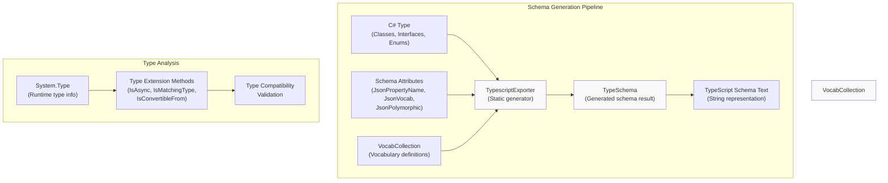
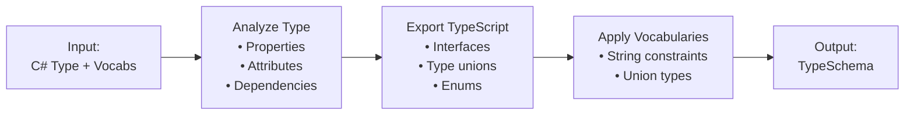
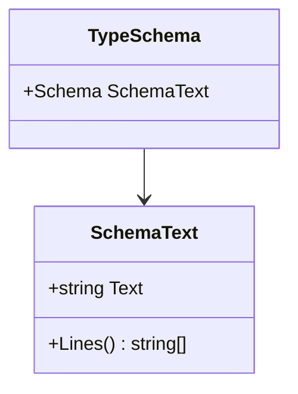
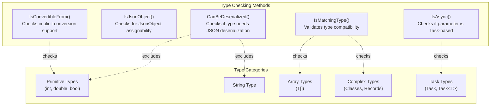
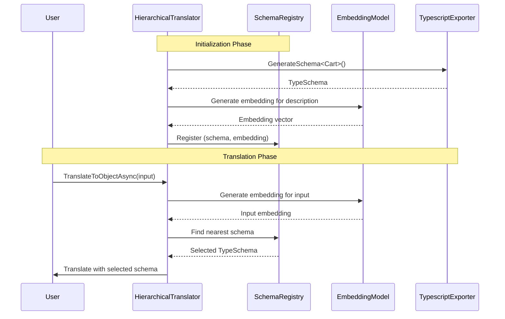

<!-- source: DeepWiki mcp.deepwiki.com · repo microsoft/typechat.net · page 10.3 Schema Types · fetched 2026-10-26 -->

# Schema Types

<details>
<summary>Relevant source files</summary>

The following files were used as context for generating this wiki page:

- [examples/SchemaHierarchy/Program.cs](examples/SchemaHierarchy/Program.cs)
- [src/typechat.program/Extensions.cs](src/typechat.program/Extensions.cs)
- [tests/TypeChat.UnitTests/TestSchema.cs](tests/TypeChat.UnitTests/TestSchema.cs)

</details>


## Purpose and Scope

This page provides comprehensive API reference documentation for TypeChat's schema generation and type analysis infrastructure. These types enable the conversion of C# types into TypeScript schemas that language models can understand, validate generated JSON responses, and analyze type compatibility for program execution.

For conceptual understanding of how schema generation works, see [Schema Generation](#3.2). For guidance on defining schemas with attributes and vocabularies, see [Schema Definition](#4). For understanding type mapping rules, see [Type Mapping](#4.1).

## Overview

The schema type system in TypeChat consists of three primary components:

1. **Schema Generation** - Converting C# types to TypeScript schemas
2. **Vocabulary Management** - Constraining and validating string values
3. **Type Analysis** - Runtime type checking and compatibility verification



Sources: [tests/TypeChat.UnitTests/TestSchema.cs:1-100]()

## TypescriptExporter

The `TypescriptExporter` class is the core schema generation engine that converts C# types into TypeScript schema definitions. This static class provides methods for generating both data type schemas and API interface schemas.

### Key Methods

| Method | Purpose | Returns |
|--------|---------|---------|
| `GenerateSchema(Type type)` | Generates TypeScript schema for a data type | `TypeSchema` |
| `GenerateSchema(Type type, VocabCollection vocabs)` | Generates schema with vocabulary constraints | `TypeSchema` |
| `GenerateAPI(Type apiInterface)` | Generates TypeScript API interface from C# interface | `TypeSchema` |

### Schema Generation Workflow



### Data Type Schema Generation

Generates TypeScript interface definitions from C# classes and records:

```typescript
// Generated from C# type:
// public record SentimentResponse(string sentiment);

export interface SentimentResponse {
    sentiment: string;
}
```

Example usage from test suite:

**Basic Schema Generation:**
```csharp
TypeSchema schema = TypescriptExporter.GenerateSchema(typeof(SentimentResponse));
// schema.Schema.Text contains the TypeScript interface definition
```

**Schema with Vocabularies:**
```csharp
TypeSchema schema = TypescriptExporter.GenerateSchema(
    typeof(Order), 
    TestVocabs.All()
);
// Vocabulary constraints are applied to string properties
```

Sources: [tests/TypeChat.UnitTests/TestSchema.cs:8-21]()

### API Interface Generation

Converts C# interfaces with method definitions into TypeScript API interfaces:

**Math API Example:**
```csharp
// C# Interface
public interface IMathAPI {
    double add(double x, double y);
}

// Generated TypeScript
var schema = TypescriptExporter.GenerateAPI(typeof(IMathAPI));
// Output:
// interface IMathAPI {
//     add(x: number, y: number): number;
// }
```

Sources: [tests/TypeChat.UnitTests/TestSchema.cs:40-48]()

**String API Example:**
```csharp
var schema = TypescriptExporter.GenerateAPI(typeof(IStringAPI));
// Generates interface with string manipulation methods
// string concat(args: any[]): string;
// string lowercase(s: string): string;
```

Sources: [tests/TypeChat.UnitTests/TestSchema.cs:50-59]()

**Object API with Dependencies:**
```csharp
var schema = TypescriptExporter.GenerateAPI(typeof(IPersonApi));
// Generates IPersonApi interface plus all dependent types:
// - interface Person
// - interface Name
// - interface Location
```

Sources: [tests/TypeChat.UnitTests/TestSchema.cs:61-72]()

### Async API Handling

The exporter automatically strips `Task` and `Task<T>` return types from async methods:

```csharp
// C# Interface
public interface IAsyncService {
    Task DoWork();
    Task<Name> GetNameOf();
}

// Generated TypeScript (Task is removed)
var schema = TypescriptExporter.GenerateAPI(typeof(IAsyncService));
// interface IAsyncService {
//     DoWork(): void;
//     GetNameOf(): Name;
// }
```

Sources: [tests/TypeChat.UnitTests/TestSchema.cs:74-85]()

### Generic Type Handling

Generic types are converted to concrete TypeScript interfaces with mangled names:

```csharp
var schema = TypescriptExporter.GenerateSchema(typeof(Parent<Name, Location>));
// Generates:
// interface Parent_Name_Location {
//     children1: Child_Name[];
//     children2: Child_Location[];
// }
```

The generic type parameters are embedded in the interface name using underscore separation.

Sources: [tests/TypeChat.UnitTests/TestSchema.cs:87-97]()

### Nullable Type Support

Optional properties are marked with `?` in TypeScript:

```csharp
var schema = TypescriptExporter.GenerateSchema(typeof(NullableTestObj));
// Generates:
// interface NullableTestObj {
//     optionalText?: string;
//     OptionalAmt?: number;
// }
```

Vocabularies can also be optional:
```csharp
VocabCollection vocabs = new VocabCollection { TestVocabs.Milks() };
schema = TypescriptExporter.GenerateSchema(typeof(WrapperNullableObj), vocabs);
// milk?: "whole" | "skim" | "oat" | ...
```

Sources: [tests/TypeChat.UnitTests/TestSchema.cs:23-38]()

## TypeSchema

The `TypeSchema` class represents the result of schema generation. It contains the generated TypeScript schema text and metadata about the type.

### Structure



### Properties

| Property | Type | Description |
|----------|------|-------------|
| `Schema` | Schema representation | Contains the generated TypeScript text |
| `Schema.Text` | `string` | The complete TypeScript schema as a string |

### Usage Pattern

```csharp
TypeSchema schema = TypescriptExporter.GenerateSchema(typeof(Order));

// Access the generated TypeScript text
string typescriptCode = schema.Schema.Text;

// Parse into lines for validation
var lines = schema.Schema.Text.Lines();
```

### Schema Text Analysis

The schema text can be analyzed to verify generated content:

```csharp
var lines = schema.Schema.Text.Lines();
Assert.True(lines.ContainsSubstring("coffee", "CoffeeOrder[]"));
Assert.True(lines.ContainsSubstring("desserts", "DessertOrder[]"));
```

Sources: [tests/TypeChat.UnitTests/TestSchema.cs:8-21]()

## VocabCollection

The `VocabCollection` class manages vocabulary definitions that constrain string properties to specific allowed values. Vocabularies improve translation accuracy by limiting the language model to predefined options.

### Purpose

Vocabularies serve two key purposes:
1. **Constraint Specification** - Define allowed string values for properties
2. **Schema Enhancement** - Generate TypeScript union types for constrained strings

### Usage Pattern

```csharp
// Create a collection with specific vocabularies
VocabCollection vocabs = new VocabCollection { 
    TestVocabs.Milks(),
    TestVocabs.CoffeeSizes(),
    TestVocabs.CoffeeTypes()
};

// Pass to schema generator
TypeSchema schema = TypescriptExporter.GenerateSchema(
    typeof(CoffeeOrder), 
    vocabs
);
```

### Vocabulary Application

When vocabularies are applied, string properties are converted to TypeScript union types:

```typescript
// Without vocabulary:
interface CoffeeOrder {
    size: string;
}

// With vocabulary:
interface CoffeeOrder {
    size: "small" | "medium" | "large" | "extra large";
}
```

### Test Vocabularies

The test suite defines several vocabulary collections:

```csharp
VocabCollection vocabs = new VocabCollection { TestVocabs.Milks() };
// Provides milk type options for coffee orders

TestVocabs.All()
// Returns a comprehensive collection for complex schemas
```

Sources: [tests/TypeChat.UnitTests/TestSchema.cs:32-38]()

## Type Analysis Extensions

The schema system includes internal extension methods for runtime type analysis and compatibility checking. These are used primarily by the program execution system.

### Type Compatibility Matrix



Sources: [src/typechat.program/Extensions.cs:1-51]()

### Extension Method Reference

#### IsAsync

Determines if a parameter type is asynchronous (Task-based):

```csharp
internal static bool IsAsync(this ParameterInfo returnType)
{
    return (typeof(Task)).IsAssignableFrom(returnType.ParameterType);
}
```

**Usage:** Identifies async methods when generating API schemas or compiling programs.

Sources: [src/typechat.program/Extensions.cs:7-10]()

#### IsJsonObject

Checks if a type can be treated as a `JsonObject`:

```csharp
internal static bool IsJsonObject(this Type type)
{
    return type.IsAssignableFrom(typeof(JsonObject));
}
```

**Usage:** Determines if dynamic JSON handling is needed.

Sources: [src/typechat.program/Extensions.cs:12-15]()

#### IsConvertibleFrom

Determines if a parameter can accept a value of a given type through implicit conversion:

```csharp
internal static bool IsConvertibleFrom(this ParameterInfo param, Type fromType)
{
    return (param.ParameterType == fromType ||
           param.ParameterType.IsPrimitive && fromType.IsPrimitive);
}
```

**Usage:** Validates argument compatibility in program execution, allowing implicit casts between primitive types.

Sources: [src/typechat.program/Extensions.cs:20-24]()

#### CanBeDeserialized

Determines if a parameter requires JSON deserialization (excludes primitives and strings):

```csharp
internal static bool CanBeDeserialized(this ParameterInfo param)
{
    return (!param.ParameterType.IsPrimitive &&
            !param.ParameterType.IsString());
}
```

**Usage:** Identifies parameters that need to be deserialized from JSON objects during program execution.

Sources: [src/typechat.program/Extensions.cs:26-30]()

#### IsMatchingType

Performs deep type compatibility checking, including array element types:

```csharp
internal static bool IsMatchingType(this ParameterInfo param, Type otherType)
{
    Type expectedType = param.ParameterType;
    if (expectedType.IsArray)
    {
        if (!otherType.IsArray)
        {
            return false;
        }
        return (expectedType.GetElementType() == otherType.GetElementType());
    }
    return (expectedType.IsAssignableFrom(otherType));
}
```

**Usage:** Validates that array element types match exactly, while allowing inheritance for reference types.

Sources: [src/typechat.program/Extensions.cs:32-44]()

### Serialization Helper

The `Stringify<T>` extension method provides JSON serialization with program-specific options:

```csharp
internal static string Stringify<T>(this T value)
{
    return JsonSerializer.Serialize<T>(value, JsonProgramConvertor.Options);
}
```

**Usage:** Serializes program values with consistent formatting options.

Sources: [src/typechat.program/Extensions.cs:46-49]()

## Schema Registration and Hierarchies

The `HierarchicalJsonTranslator` uses schema types to enable dynamic schema selection based on semantic similarity. This is part of the multi-schema routing system.

### Schema Registration Pattern

```csharp
var translator = new HierarchicalJsonTranslator(model, embeddingModel);

// Register schemas with natural language descriptions
await translator.AddSchemaAsync<Cart>(
    "Order Coffee Drinks (Italian names included) and Baked Goods"
);

await translator.AddSchemaAsync<CalendarActions>(
    "Actions related to calendars, appointments, meetings, schedules"
);

await translator.AddSchemaAsync<Order>(
    "Order pizza, beer and salads"
);
```

### Schema Selection Workflow



Sources: [examples/SchemaHierarchy/Program.cs:17-66]()

### Registration Example

From the SchemaHierarchy example application:

```csharp
public class SchemaHierarchyApp : ConsoleApp
{
    private readonly HierarchicalJsonTranslator _translator;

    protected override async Task InitApp()
    {
        await _translator.AddSchemaAsync<Cart>(
            "Order Coffee Drinks (Italian names included) and Baked Goods"
        );
        
        await _translator.AddSchemaAsync<SentimentResponse>(
            "Statements with sentiments, emotions, feelings, impressions"
        );
        
        await _translator.AddSchemaAsync<HealthDataResponse>(
            "Health information: enter your medications, conditions"
        );
    }
}
```

This registration pattern associates each schema (generated by `TypescriptExporter`) with a semantic description for routing.

Sources: [examples/SchemaHierarchy/Program.cs:38-48]()

## Testing and Validation

The test infrastructure validates schema generation across multiple dimensions:

### Test Coverage Matrix

| Test Category | Validation Focus | Test Method |
|--------------|------------------|-------------|
| Basic Types | Property mapping | `ExportBasic()` |
| Nullable Types | Optional property handling | `ExportNullable()` |
| API Interfaces | Method signature conversion | `ExportMathAPI()`, `ExportStringAPI()` |
| Object APIs | Dependency analysis | `ExportObjectAPI()` |
| Async Methods | Task type removal | `ExportAsyncApi()` |
| Generic Types | Type parameter handling | `ExportGenerics()` |

### Validation Pattern

Tests use a common pattern of generating schemas and verifying content:

```csharp
[Fact]
public void ExportBasic()
{
    TypeSchema schema = TypescriptExporter.GenerateSchema(typeof(SentimentResponse));
    
    // Validate schema structure
    ValidateBasic(typeof(SentimentResponse), schema);
    
    // Verify specific content
    Assert.True(schema.Schema.Text.Contains("sentiment"));
}
```

### Line-Based Verification

The test suite uses line parsing for detailed schema validation:

```csharp
var lines = schema.Schema.Text.Lines();
Assert.True(lines.ContainsSubstring("optionalText?", "string"));
Assert.True(lines.ContainsSubstring("OptionalAmt?", "number"));
Assert.True(lines.ContainsSubstring("interface", "IMathAPI"));
```

This approach verifies:
- Property names and types
- Optional property markers (`?`)
- Interface declarations
- Method signatures
- Array type annotations

Sources: [tests/TypeChat.UnitTests/TestSchema.cs:1-100]()

## Related Types

For information about other API reference topics:
- **Core translation types** - See [Core Types](#10.1) for `JsonTranslator`, `LanguageModel`, and `Prompt`
- **Program execution types** - See [Program Types](#10.2) for `ProgramTranslator`, `ProgramCompiler`, and `ProgramInterpreter`
- **Integration types** - See [Integration Types](#10.4) for Semantic Kernel and Extensions.AI adapters
- **Utility types** - See [Utility Types](#10.5) for `Config`, `ConsoleApp`, and `VectorTextIndex`

For conceptual information:
- **Schema design patterns** - See [Schema Definition](#4)
- **Type mapping rules** - See [Type Mapping](#4.1)
- **Vocabulary usage** - See [Vocabularies](#4.2)

---

