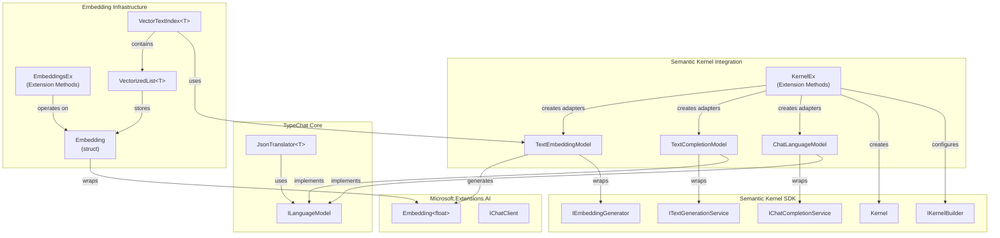
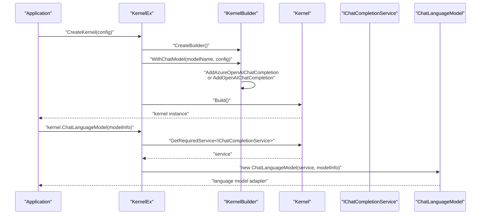
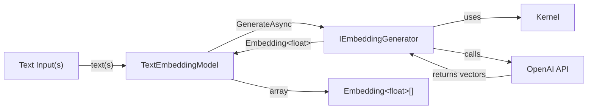
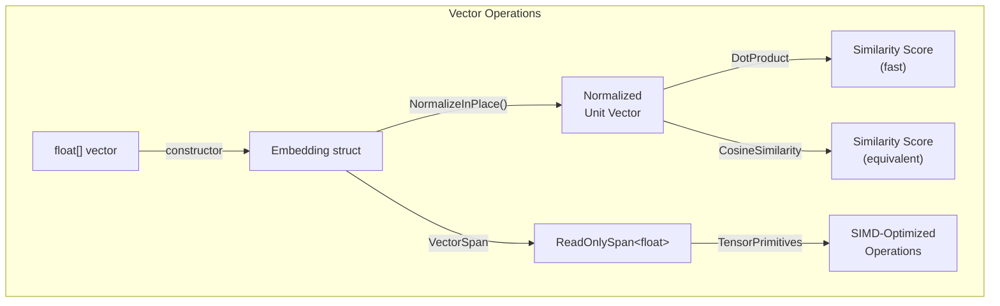
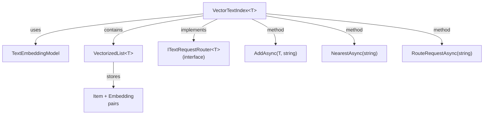
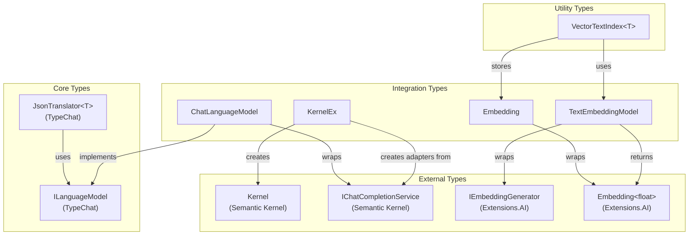

<!-- source: DeepWiki mcp.deepwiki.com · repo microsoft/typechat.net · page 10.4 Integration Types · fetched 2026-10-26 -->

# Integration Types

<details>
<summary>Relevant source files</summary>

The following files were used as context for generating this wiki page:

- [examples/typechat.examplesLib/ConsoleApp.cs](examples/typechat.examplesLib/ConsoleApp.cs)
- [examples/typechat.examplesLib/VectorTextIndex.cs](examples/typechat.examplesLib/VectorTextIndex.cs)
- [src/typechat.program/TypeChat.Program.csproj](src/typechat.program/TypeChat.Program.csproj)
- [src/typechat.schema/TypeChat.Schema.csproj](src/typechat.schema/TypeChat.Schema.csproj)
- [src/typechat.sk/Embeddings/Embedding.cs](src/typechat.sk/Embeddings/Embedding.cs)
- [src/typechat.sk/Embeddings/EmbeddingsEx.cs](src/typechat.sk/Embeddings/EmbeddingsEx.cs)
- [src/typechat.sk/KernelEx.cs](src/typechat.sk/KernelEx.cs)
- [src/typechat.sk/TextEmbeddingModel.cs](src/typechat.sk/TextEmbeddingModel.cs)
- [src/typechat.sk/TypeChat.SemanticKernel.csproj](src/typechat.sk/TypeChat.SemanticKernel.csproj)
- [src/typechat/TypeChat.csproj](src/typechat/TypeChat.csproj)
- [tests/TypeChat.IntegrationTests/TestVectorized_EndToEnd.cs](tests/TypeChat.IntegrationTests/TestVectorized_EndToEnd.cs)

</details>


This page documents the types in the TypeChat.NET integration layer that enable interoperability with Semantic Kernel and Microsoft.Extensions.AI, as well as the embedding and vectorization infrastructure. These types provide adapters, extension methods, and utilities for integrating TypeChat with external AI frameworks and implementing semantic search capabilities.

For core translation types, see [Core Types](#10.1). For schema-related types, see [Schema Types](#10.3). For utility types including configuration, see [Utility Types](#10.5). For practical usage of these integration types, see [Semantic Kernel Integration](#6.1) and [Embeddings and Vectorization](#7.3).

## Overview

The integration types are primarily located in two assemblies:

| Assembly | Purpose |
|----------|---------|
| `Microsoft.TypeChat.SemanticKernel` | Semantic Kernel integration, model adapters, and embedding infrastructure |
| `Microsoft.TypeChat.ExamplesLib` | Vector indexing and semantic search utilities |

**Sources:** [src/typechat.sk/TypeChat.SemanticKernel.csproj:1-42](), [examples/typechat.examplesLib/VectorTextIndex.cs:1-156]()

## Architecture

### Integration Layer Architecture



**Sources:** [src/typechat.sk/KernelEx.cs:1-141](), [src/typechat.sk/TextEmbeddingModel.cs:1-80](), [src/typechat.sk/Embeddings/Embedding.cs:1-160](), [examples/typechat.examplesLib/VectorTextIndex.cs:1-156]()

## KernelEx Extension Methods

The `KernelEx` class provides extension methods for configuring and creating Semantic Kernel instances with TypeChat-compatible language models and embedding generators.

### Kernel Creation

```
public static Kernel CreateKernel(this OpenAIConfig config)
```

Creates a Semantic Kernel with chat completion capabilities based on OpenAI configuration.

**Key Methods:**

| Method | Purpose |
|--------|---------|
| `CreateKernel(OpenAIConfig)` | Creates a configured kernel from OpenAI settings |
| `WithChatModel(IKernelBuilder, string, OpenAIConfig)` | Adds a chat completion service to the kernel builder |
| `WithChatModels(IKernelBuilder, OpenAIConfig, string[])` | Adds multiple chat models to the kernel builder |
| `WithEmbeddingModel(IKernelBuilder, string, OpenAIConfig)` | Adds an embedding generation service to the kernel builder |

**Configuration Options:**

The methods support both Azure OpenAI and OpenAI configurations:
- Azure OpenAI with token credentials (TokenCredential)
- Azure OpenAI with API keys
- OpenAI with API keys and optional organization

**Sources:** [src/typechat.sk/KernelEx.cs:8-108]()

### Model Adapter Creation

```
public static ChatLanguageModel ChatLanguageModel(this Kernel kernel, ModelInfo model)
public static TextCompletionModel TextCompletionModel(this Kernel kernel, ModelInfo model)
```

These extension methods create TypeChat-compatible language model adapters from Semantic Kernel services.

**Sources:** [src/typechat.sk/KernelEx.cs:115-133]()

### Extension Method Usage Pattern



**Sources:** [src/typechat.sk/KernelEx.cs:16-133]()

## Language Model Adapters

While the adapter classes are not included in the provided files, they are referenced in the KernelEx extension methods and serve as bridges between Semantic Kernel services and TypeChat's `ILanguageModel` interface.

### ChatLanguageModel

Adapts `IChatCompletionService` from Semantic Kernel to TypeChat's `ILanguageModel` interface. This adapter enables using Semantic Kernel's chat completion services for TypeChat translation.

**Creation:**
```csharp
ChatLanguageModel model = kernel.ChatLanguageModel(modelInfo);
```

**Sources:** [src/typechat.sk/KernelEx.cs:115-120]()

### TextCompletionModel

Adapts `ITextGenerationService` from Semantic Kernel to TypeChat's `ILanguageModel` interface. This adapter enables using Semantic Kernel's text generation services for TypeChat translation.

**Creation:**
```csharp
TextCompletionModel model = kernel.TextCompletionModel(modelInfo);
```

**Sources:** [src/typechat.sk/KernelEx.cs:128-133]()

## TextEmbeddingModel

The `TextEmbeddingModel` class wraps Semantic Kernel's embedding generation services to provide text embedding capabilities for TypeChat applications.

### Class Structure

| Property/Method | Type | Purpose |
|----------------|------|---------|
| `ModelInfo` | `ModelInfo` | Information about the embedding model |
| `GenerateEmbeddingAsync(string, CancellationToken)` | `Task<Embedding<float>>` | Generates an embedding for a single text |
| `GenerateEmbeddingsAsync(IList<string>, CancellationToken)` | `Task<Embedding<float>[]>` | Generates embeddings for multiple texts in batch |

### Constructors

**From OpenAI Configuration:**
```csharp
public TextEmbeddingModel(OpenAIConfig config, ModelInfo? modelInfo = null)
```
Creates a model by configuring a kernel with an embedding generator from the OpenAI configuration.

**From Existing Service:**
```csharp
public TextEmbeddingModel(IEmbeddingGenerator<string, Embedding<float>> service, ModelInfo? modelInfo)
```
Creates a model wrapping an existing embedding generation service.

**Sources:** [src/typechat.sk/TextEmbeddingModel.cs:8-80]()

### Embedding Generation Pipeline



**Sources:** [src/typechat.sk/TextEmbeddingModel.cs:57-78]()

### Batch Processing

The `GenerateEmbeddingsAsync` method supports batch processing of multiple texts, which is more efficient than generating embeddings individually when the underlying model supports batching.

**Sources:** [src/typechat.sk/TextEmbeddingModel.cs:68-78]()

## Embedding Structure

The `Embedding` struct is a mutable wrapper around embedding vectors that provides vector operations and distance calculations.

### Properties and Methods

| Member | Type | Purpose |
|--------|------|---------|
| `Vector` | `float[]` | The raw embedding vector |
| `VectorSpan` | `ReadOnlySpan<float>` | Span view of the vector for efficient operations |
| `Size` | `int` | Dimension of the embedding vector |
| `IsEmpty` | `bool` | Whether the embedding is empty |
| `NormalizeInPlace()` | `void` | Normalizes the vector to unit length in-place |
| `CosineSimilarity(Embedding)` | `double` | Computes cosine similarity with another embedding |
| `DotProduct(Embedding)` | `double` | Computes dot product with another embedding |
| `Similarity(Embedding, EmbeddingDistance)` | `double` | Computes similarity using specified distance measure |

### Constructors

```csharp
public Embedding()                              // Empty embedding
public Embedding(float[] vector)                // From array
public Embedding(ReadOnlyMemory<float> vector)  // From memory
public Embedding(Embedding<float> vector)       // From Extensions.AI embedding
```

**Sources:** [src/typechat.sk/Embeddings/Embedding.cs:11-159]()

### Distance Measures

The struct supports two distance measures via the `Similarity` method:

| Distance Type | Description | Use Case |
|--------------|-------------|----------|
| `EmbeddingDistance.Dot` | Dot product | Fast comparison when vectors are normalized |
| `EmbeddingDistance.Cosine` | Cosine similarity | General-purpose similarity regardless of normalization |

**Normalization Optimization:**

When embeddings are normalized to unit length using `NormalizeInPlace()`, dot product becomes equivalent to cosine similarity but with better performance.

**Sources:** [src/typechat.sk/Embeddings/Embedding.cs:80-122]()

### Vector Operations



**Sources:** [src/typechat.sk/Embeddings/Embedding.cs:70-127]()

## EmbeddingsEx Extension Methods

The `EmbeddingsEx` static class provides extension methods for working with embeddings, particularly for finding nearest neighbors in collections.

### Extension Methods

| Method | Purpose |
|--------|---------|
| `GenerateEmbeddingAsync(IEmbeddingGenerator, string, Kernel, CancellationToken)` | Generates a single embedding |
| `IndexOfNearest(IList<Embedding>, Embedding, EmbeddingDistance)` | Finds the index of the nearest neighbor |
| `Nearest(IList<Embedding>, Embedding, TopNCollection<int>, EmbeddingDistance)` | Finds top-N nearest neighbors |
| `Nearest(IList<Embedding>, Embedding, int, EmbeddingDistance)` | Creates and populates a top-N collection |

### Nearest Neighbor Search

The nearest neighbor methods compare an embedding against a list of candidate embeddings and return the closest matches.

**Return Type:**
```csharp
ScoredValue<int>  // Single match with index and score
TopNCollection<int>  // Top-N matches with indexes and scores
```

**Sources:** [src/typechat.sk/Embeddings/EmbeddingsEx.cs:8-95]()

## VectorTextIndex<T>

The `VectorTextIndex<T>` class is an in-memory vector index that automatically vectorizes items and enables semantic search and routing.

### Class Overview



**Sources:** [examples/typechat.examplesLib/VectorTextIndex.cs:7-156]()

### Key Methods

| Method | Return Type | Purpose |
|--------|------------|---------|
| `AddAsync(T, string, CancellationToken)` | `Task` | Adds an item with its text representation |
| `AddAsync(T[], string[], CancellationToken)` | `Task` | Batch adds items with text representations |
| `NearestAsync(string, CancellationToken)` | `Task<T>` | Finds the nearest item to given text |
| `NearestAsync(string, int, CancellationToken)` | `Task<List<T>>` | Finds top-N nearest items |
| `RouteRequestAsync(string, CancellationToken)` | `Task<T>` | Routes a request to the nearest item |

### Usage Pattern

```mermaid
sequenceDiagram
    participant App as "Application"
    participant Index as "VectorTextIndex&lt;T&gt;"
    participant Model as "TextEmbeddingModel"
    participant List as "VectorizedList&lt;T&gt;"
    
    Note over App,List: Initialization
    App->>Index: "new VectorTextIndex(model)"
    
    Note over App,List: Adding Items
    App->>Index: "AddAsync(item, 'description')"
    Index->>Model: "GenerateEmbeddingAsync('description')"
    Model-->>Index: "Embedding&lt;float&gt;"
    Index->>Index: "new Embedding(embedding_float)"
    Index->>Index: "NormalizeInPlace()"
    Index->>List: "Add(item, embedding)"
    
    Note over App,List: Searching
    App->>Index: "NearestAsync('query text')"
    Index->>Model: "GenerateEmbeddingAsync('query text')"
    Model-->>Index: "Embedding&lt;float&gt;"
    Index->>Index: "new Embedding + NormalizeInPlace()"
    Index->>List: "Nearest(embedding, EmbeddingDistance.Dot)"
    List-->>Index: "item"
    Index-->>App: "item"
```

**Sources:** [examples/typechat.examplesLib/VectorTextIndex.cs:24-155]()

### Batch Processing

The `AddAsync(T[], string[], CancellationToken)` overload enables efficient batch addition of items:

1. Generates embeddings for all texts in a single batch operation
2. Normalizes all embeddings
3. Adds all item-embedding pairs to the index

This is significantly more efficient than adding items individually when the embedding model supports batch processing.

**Sources:** [examples/typechat.examplesLib/VectorTextIndex.cs:84-104]()

### Request Routing

The `VectorTextIndex<T>` implements `ITextRequestRouter<T>`, making it usable for routing natural language requests to the semantically nearest item:

```csharp
public Task<T> RouteRequestAsync(string request, CancellationToken cancelToken = default)
{
    return NearestAsync(request, cancelToken);
}
```

This enables semantic routing scenarios where requests are automatically directed to the most relevant handler, schema, or action based on embedding similarity.

**Sources:** [examples/typechat.examplesLib/VectorTextIndex.cs:55-58]()

## Integration Type Dependencies

### Package Dependencies

The integration types depend on the following external packages:

| Package | Version | Purpose |
|---------|---------|---------|
| `Microsoft.SemanticKernel` | 1.67.1 | Core Semantic Kernel functionality |
| `Azure.Identity` | 1.17.0 | Azure authentication for Azure OpenAI |
| `System.Numerics.Tensors` | 10.0.0 | SIMD-optimized vector operations |
| `Microsoft.Extensions.Configuration.Binder` | 10.0.0 | Configuration binding |

**Sources:** [src/typechat.sk/TypeChat.SemanticKernel.csproj:13-30]()

### Type Relationships



**Sources:** [src/typechat.sk/KernelEx.cs:1-141](), [src/typechat.sk/TextEmbeddingModel.cs:1-80](), [src/typechat.sk/Embeddings/Embedding.cs:1-160](), [examples/typechat.examplesLib/VectorTextIndex.cs:1-156]()

## Usage Examples

### Creating a Kernel and Language Model

```csharp
// From OpenAI configuration
OpenAIConfig config = Config.LoadOpenAI();
Kernel kernel = config.CreateKernel();
ChatLanguageModel model = kernel.ChatLanguageModel(config.Model);

// Use with JsonTranslator
var translator = new JsonTranslator<MySchema>(model);
```

### Creating an Embedding Model and Index

```csharp
// Create embedding model
TextEmbeddingModel embeddingModel = new TextEmbeddingModel(config);

// Create vector index
VectorTextIndex<string> index = new VectorTextIndex<string>(embeddingModel);

// Add items
await index.AddAsync("CoffeeShop", "Order coffee, tea, and bakery items");
await index.AddAsync("BookStore", "Browse and purchase books");

// Find nearest match
string route = await index.RouteRequestAsync("I want to buy a latte");
// Returns: "CoffeeShop"
```

### Working with Embeddings

```csharp
// Generate embeddings
TextEmbeddingModel model = new TextEmbeddingModel(config);
var embedding1 = new Embedding(await model.GenerateEmbeddingAsync("Hello world"));
var embedding2 = new Embedding(await model.GenerateEmbeddingAsync("Greetings planet"));

// Normalize for efficient comparison
embedding1.NormalizeInPlace();
embedding2.NormalizeInPlace();

// Compute similarity
double similarity = embedding1.DotProduct(embedding2);
```

**Sources:** [tests/TypeChat.IntegrationTests/TestVectorized_EndToEnd.cs:16-146]()

---

