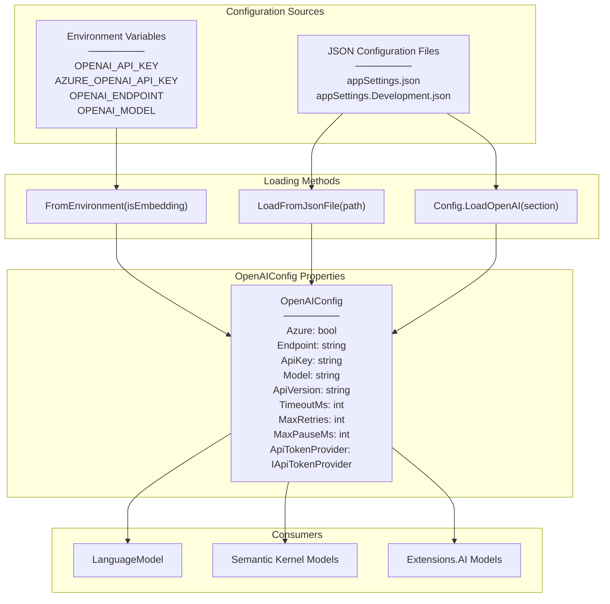
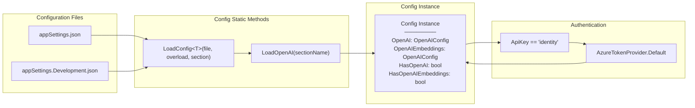
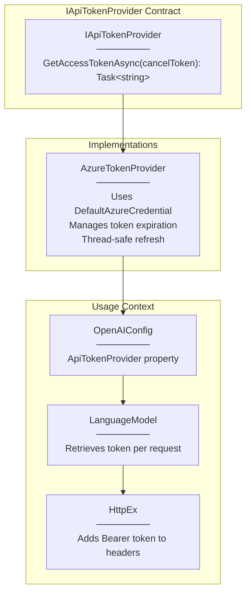
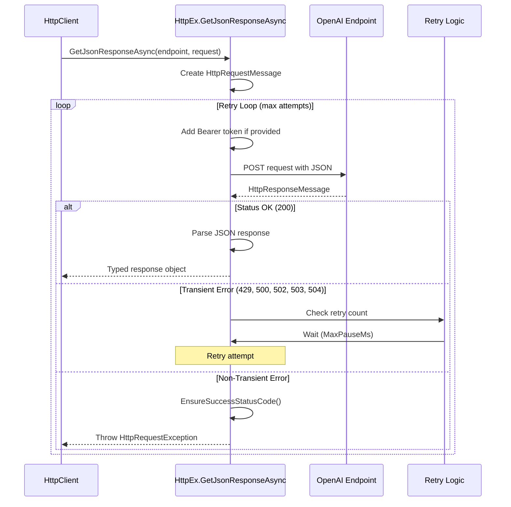
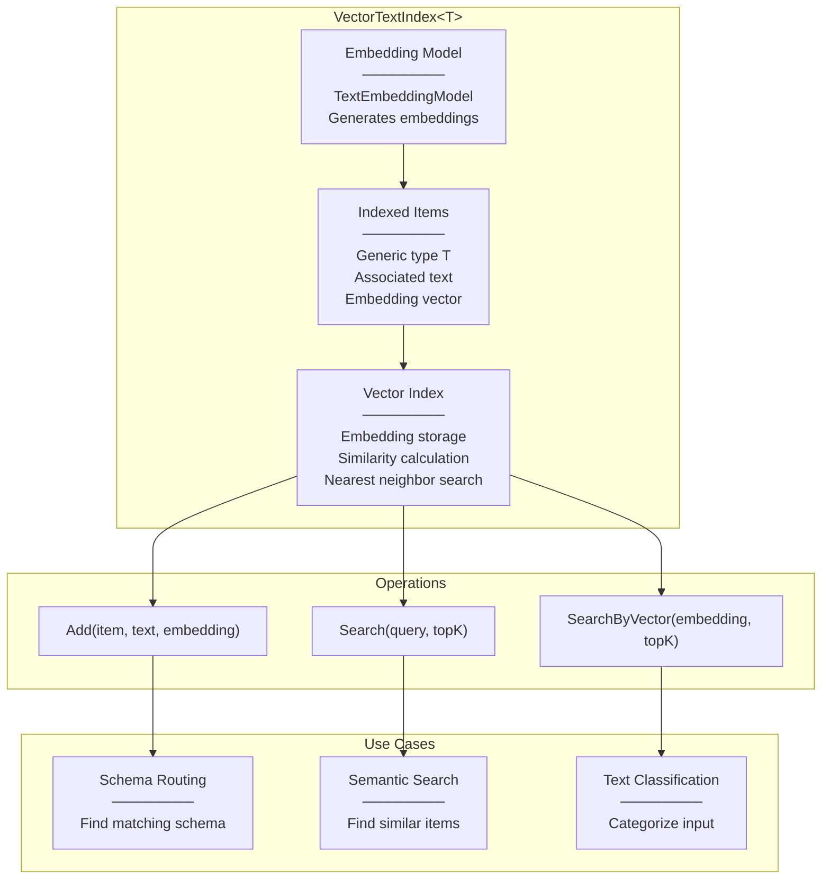
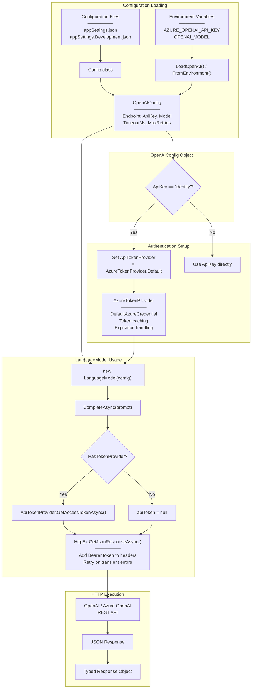
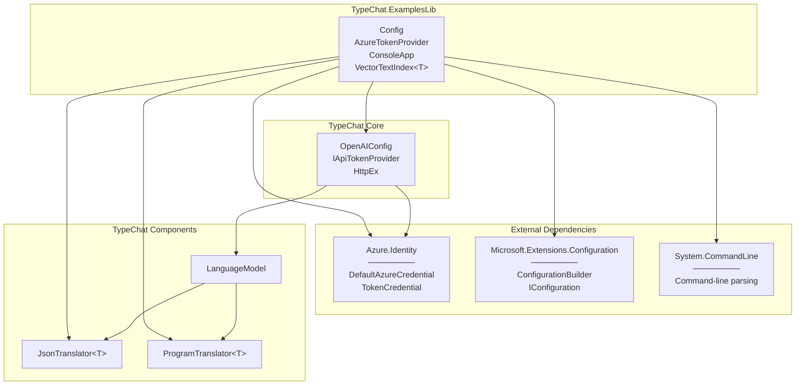

<!-- source: DeepWiki mcp.deepwiki.com · repo microsoft/typechat.net · page 10.5 Utility Types · fetched 2026-10-26 -->

# Utility Types

<details>
<summary>Relevant source files</summary>

The following files were used as context for generating this wiki page:

- [examples/typechat.examplesLib/Auth.cs](examples/typechat.examplesLib/Auth.cs)
- [examples/typechat.examplesLib/Config.cs](examples/typechat.examplesLib/Config.cs)
- [examples/typechat.examplesLib/TypeChat.ExamplesLib.csproj](examples/typechat.examplesLib/TypeChat.ExamplesLib.csproj)
- [src/typechat.meai/TypeChat.Extensions.AI.csproj](src/typechat.meai/TypeChat.Extensions.AI.csproj)
- [src/typechat/HttpEx.cs](src/typechat/HttpEx.cs)
- [src/typechat/LanguageModel.cs](src/typechat/LanguageModel.cs)
- [src/typechat/OpenAIConfig.cs](src/typechat/OpenAIConfig.cs)

</details>


## Purpose and Scope

This page documents utility and helper types in TypeChat.NET that provide supporting functionality for configuration management, authentication, HTTP operations, and example application infrastructure. These types are not part of the core translation pipeline but are essential for practical application development and testing.

For core translation types, see [Core Types](#10.1). For schema-related utilities, see [Schema Types](#10.3).

---

## Overview

TypeChat.NET includes several utility types organized across different assemblies:

| Assembly | Utility Types | Purpose |
|----------|---------------|---------|
| `Microsoft.TypeChat` | `OpenAIConfig`, `IApiTokenProvider`, `HttpEx` | Core configuration and HTTP utilities |
| `Microsoft.TypeChat.Examples` | `Config`, `AzureTokenProvider`, `ConsoleApp`, `VectorTextIndex<T>` | Example application infrastructure |
| `Microsoft.TypeChat.SemanticKernel` | `KernelEx` | Semantic Kernel extension methods |
| `Microsoft.TypeChat.Extensions.AI` | Extension methods | Microsoft.Extensions.AI adapters |

These utilities handle concerns that are common across TypeChat applications but orthogonal to the translation logic itself.

Sources: [examples/typechat.examplesLib/TypeChat.ExamplesLib.csproj](), [src/typechat.meai/TypeChat.Extensions.AI.csproj]()

---

## Configuration Management

### OpenAIConfig



**OpenAIConfig Class**

The `OpenAIConfig` class stores configuration for connecting to OpenAI or Azure OpenAI services. It supports both environment variable-based and file-based configuration loading.

**Key Properties:**

- `Azure` - Boolean indicating whether to use Azure OpenAI (true) or OpenAI (false)
- `Endpoint` - API endpoint URL
- `ApiKey` - API key for authentication, or "identity" to use Azure token provider
- `Model` - Name of the language or embedding model
- `ApiVersion` - API version (default: "2023-05-15")
- `TimeoutMs` - HTTP timeout in milliseconds (default: 15000)
- `MaxRetries` - Maximum number of retry attempts (default: 3)
- `MaxPauseMs` - Pause duration between retries (default: 1000)
- `ApiTokenProvider` - Optional token provider for Azure authentication

**Loading from Environment:**

[src/typechat/OpenAIConfig.cs:130-155]()

```csharp
// Load configuration from environment variables
var config = OpenAIConfig.FromEnvironment(isEmbedding: false);
```

The method checks for Azure OpenAI variables first (`AZURE_OPENAI_API_KEY`, `AZURE_OPENAI_ENDPOINT`), then falls back to OpenAI variables (`OPENAI_API_KEY`, `OPENAI_ENDPOINT`, `OPENAI_ORGANIZATION`).

**Loading from JSON:**

[src/typechat/OpenAIConfig.cs:162-170]()

```csharp
// Load from JSON file
var config = OpenAIConfig.LoadFromJsonFile("config.json");
```

**Validation:**

The `Validate()` method ensures required properties are set before use. It is automatically called by `FromEnvironment()` and should be called manually when loading from other sources.

Sources: [src/typechat/OpenAIConfig.cs:1-172]()

### Config Helper Class



**Config Class**

The `Config` class simplifies loading configuration from JSON files for example applications. It handles both file-based and environment-based configuration with automatic fallback.

**Static Methods:**

- `LoadConfig<T>(configFile, configOverloadFile, sectionName)` - Generic configuration loading
- `LoadOpenAI(sectionName)` - Specialized method for loading OpenAI configuration

[examples/typechat.examplesLib/Config.cs:21-52]()

**Instance Usage:**

```csharp
var config = new Config();
var languageModel = new LanguageModel(config.OpenAI);
var embeddingModel = new TextEmbeddingModel(config.OpenAIEmbeddings);
```

The constructor automatically loads configuration from `appSettings.json` and `appSettings.Development.json` if they exist, or falls back to environment variables.

**Configuration File Structure:**

```json
{
  "OpenAI": {
    "Azure": true,
    "Endpoint": "https://YOUR_RESOURCE.openai.azure.com",
    "ApiKey": "your-key-or-identity",
    "Model": "gpt-4",
    "ApiVersion": "2023-05-15"
  },
  "OpenAI_Embedding": {
    "Azure": true,
    "Endpoint": "https://YOUR_RESOURCE.openai.azure.com",
    "ApiKey": "identity",
    "Model": "text-embedding-ada-002"
  }
}
```

**Identity-Based Authentication:**

When `ApiKey` is set to `"identity"`, the `Config` class automatically assigns `AzureTokenProvider.Default` to the `ApiTokenProvider` property:

[examples/typechat.examplesLib/Config.cs:47-50]()

Sources: [examples/typechat.examplesLib/Config.cs:1-106]()

---

## Authentication

### IApiTokenProvider Interface



**IApiTokenProvider**

The `IApiTokenProvider` interface defines a contract for obtaining API access tokens. This abstraction allows TypeChat to support different authentication mechanisms.

```csharp
public interface IApiTokenProvider
{
    Task<string> GetAccessTokenAsync(CancellationToken cancelToken);
}
```

**Usage in LanguageModel:**

[src/typechat/LanguageModel.cs:52]()

The `LanguageModel` class retrieves a token before each API request when a token provider is configured:

```csharp
string apiToken = _config.HasTokenProvider 
    ? await _config.ApiTokenProvider.GetAccessTokenAsync(cancelToken) 
    : null;
```

Sources: [src/typechat/LanguageModel.cs:47-55]()

### AzureTokenProvider

**AzureTokenProvider Class**

The `AzureTokenProvider` class implements `IApiTokenProvider` using Azure Identity's `DefaultAzureCredential`. It handles token caching, expiration checking, and thread-safe token refresh.

**Key Features:**

- **Automatic Credential Discovery** - Uses `DefaultAzureCredential` which tries multiple authentication methods
- **Token Caching** - Caches tokens until they near expiration
- **Expiration Buffer** - Refreshes tokens 5 minutes before actual expiration (configurable)
- **Thread Safety** - Uses `SemaphoreSlim` for concurrent refresh protection

[examples/typechat.examplesLib/Auth.cs:14-106]()

**Constructor:**

```csharp
// Using predefined scope
var provider = new AzureTokenProvider(AzureTokenScopes.CogServices);

// Using custom scopes
var provider = new AzureTokenProvider(
    new[] { "https://cognitiveservices.azure.com/.default" },
    expirationBufferMs: 300000
);
```

**Singleton Instance:**

A default instance is available for Cognitive Services:

```csharp
var provider = AzureTokenProvider.Default;
```

**Token Refresh Logic:**

[examples/typechat.examplesLib/Auth.cs:49-76]()

The provider checks if the current token is expired (with buffer) and refreshes if necessary. The refresh operation is protected by a semaphore to prevent concurrent refresh attempts.

**Supported Azure Scopes:**

| Enum Value | Scope URI |
|------------|-----------|
| `AzureTokenScopes.CogServices` | `https://cognitiveservices.azure.com/.default` |

Sources: [examples/typechat.examplesLib/Auth.cs:1-106]()

---

## HTTP Utilities

### HttpEx Extension Methods



**HttpEx Class**

The `HttpEx` class provides internal extension methods for HTTP operations used by `LanguageModel` and other components. These methods are not part of the public API.

**GetJsonResponseAsync Method:**

[src/typechat/HttpEx.cs:11-51]()

This method handles JSON request/response with automatic retry logic:

```csharp
internal static async Task<Response> GetJsonResponseAsync<Request, Response>(
    this HttpClient client,
    string endpoint,
    Request request,
    int maxRetries,
    int retryPauseMs,
    string? apiToken = null)
```

**Features:**

- **JSON Serialization** - Automatic request/response JSON conversion
- **Bearer Token Support** - Optional API token header injection
- **Retry Logic** - Automatic retry on transient errors
- **Configurable Backoff** - Pause between retries (from `OpenAIConfig.MaxPauseMs`)

**Transient Error Detection:**

[src/typechat/HttpEx.cs:53-69]()

The `IsTransientError` extension method identifies HTTP status codes that warrant retry:

| Status Code | Value | Description |
|-------------|-------|-------------|
| Too Many Requests | 429 | Rate limit exceeded |
| Internal Server Error | 500 | Server error |
| Bad Gateway | 502 | Gateway error |
| Service Unavailable | 503 | Service temporarily unavailable |
| Gateway Timeout | 504 | Gateway timeout |

**Usage in LanguageModel:**

[src/typechat/LanguageModel.cs:53]()

```csharp
var response = await _client.GetJsonResponseAsync<Request, Response>(
    _endPoint, 
    request, 
    _config.MaxRetries, 
    _config.MaxPauseMs, 
    apiToken
).ConfigureAwait(false);
```

Sources: [src/typechat/HttpEx.cs:1-71](), [src/typechat/LanguageModel.cs:47-55]()

---

## Example Infrastructure

### ConsoleApp Base Class

The `ConsoleApp` class (part of `TypeChat.ExamplesLib`) provides a base class for building console-based TypeChat examples. While the implementation is not included in the provided files, it is referenced throughout the example projects.

**Typical Usage Pattern:**

```csharp
public class MyExample : ConsoleApp
{
    protected override async Task RunAsync()
    {
        // Example implementation
        var config = new Config();
        var model = new LanguageModel(config.OpenAI);
        var translator = new JsonTranslator<MyType>(model);
        
        await RunInputLoopAsync(async input => {
            var result = await translator.TranslateAsync(input);
            // Process result
        });
    }
}
```

**Key Responsibilities:**

- Command-line argument parsing
- Input loop management
- Configuration loading
- Error handling and display
- Sample data file loading

Sources: [examples/typechat.examplesLib/TypeChat.ExamplesLib.csproj]()

### VectorTextIndex<T>

The `VectorTextIndex<T>` class provides semantic search capabilities using text embeddings. While the implementation is not included in the provided files, it is extensively referenced in the architecture diagrams.

**Conceptual Structure:**



**Typical Usage:**

```csharp
// Create index with embedding model
var embeddingModel = new TextEmbeddingModel(config.OpenAIEmbeddings);
var index = new VectorTextIndex<Schema>(embeddingModel);

// Add items to index
await index.AddAsync(schema1, "description of schema 1");
await index.AddAsync(schema2, "description of schema 2");

// Search for similar items
var results = await index.SearchAsync("user query", topK: 3);
```

**Key Operations:**

- **AddAsync** - Add items with text and computed embeddings
- **SearchAsync** - Find nearest neighbors by text query
- **SearchByVectorAsync** - Find nearest neighbors by embedding vector
- **CosineSimilarity** - Calculate similarity between embeddings

**Applications:**

1. **Schema Hierarchy Example** - Routes requests to appropriate schema based on semantic similarity
2. **Multi-Schema Routing** - Selects correct translator for incoming requests
3. **Semantic Search** - Finds relevant items in a collection

Sources: Architecture diagrams, [examples/typechat.examplesLib/TypeChat.ExamplesLib.csproj]()

---

## Configuration Flow

### Complete Configuration and Authentication Flow



This diagram shows the complete flow from configuration loading through authentication setup to actual API requests.

Sources: [examples/typechat.examplesLib/Config.cs](), [src/typechat/OpenAIConfig.cs](), [examples/typechat.examplesLib/Auth.cs](), [src/typechat/LanguageModel.cs](), [src/typechat/HttpEx.cs]()

---

## Usage Patterns

### Basic Configuration Setup

**File-Based Configuration (Recommended for Examples):**

```csharp
using Microsoft.TypeChat;

// Load from appSettings.json
var config = new Config();

// Create language model
var languageModel = new LanguageModel(config.OpenAI);

// Create embedding model if needed
if (config.HasOpenAIEmbeddings)
{
    var embeddingModel = new TextEmbeddingModel(config.OpenAIEmbeddings);
}
```

**Environment-Based Configuration:**

```csharp
// Load from environment variables
var openAIConfig = OpenAIConfig.FromEnvironment();
var languageModel = new LanguageModel(openAIConfig);

// For embeddings
var embeddingConfig = OpenAIConfig.FromEnvironment(isEmbedding: true);
var embeddingModel = new TextEmbeddingModel(embeddingConfig);
```

**Custom JSON Configuration:**

```csharp
// Load custom configuration
var customConfig = Config.LoadConfig<MyConfig>(
    "myconfig.json",
    "myconfig.Development.json",
    "MySection"
);
```

### Azure Identity Authentication

**Setup for Azure OpenAI with Identity:**

```json
{
  "OpenAI": {
    "Azure": true,
    "Endpoint": "https://myresource.openai.azure.com",
    "ApiKey": "identity",
    "Model": "gpt-4"
  }
}
```

**Using Custom Token Provider:**

```csharp
var config = new OpenAIConfig
{
    Azure = true,
    Endpoint = "https://myresource.openai.azure.com",
    Model = "gpt-4",
    ApiTokenProvider = new AzureTokenProvider(AzureTokenScopes.CogServices)
};

var model = new LanguageModel(config);
```

### Error Handling

**Configuration Validation:**

```csharp
try
{
    var config = OpenAIConfig.FromEnvironment();
    config.Validate("environment");
}
catch (ArgumentException ex)
{
    // Handle missing or invalid configuration
    Console.WriteLine($"Configuration error: {ex.Message}");
}
```

**HTTP Retry Configuration:**

```csharp
var config = new OpenAIConfig
{
    // ... other settings
    MaxRetries = 5,           // Retry up to 5 times
    MaxPauseMs = 2000,        // Wait 2 seconds between retries
    TimeoutMs = 30000         // 30 second timeout per request
};
```

Sources: [examples/typechat.examplesLib/Config.cs](), [src/typechat/OpenAIConfig.cs](), [examples/typechat.examplesLib/Auth.cs]()

---

## Assembly and Dependency Structure



**Package Dependencies:**

| Assembly | Key Dependencies |
|----------|------------------|
| `Microsoft.TypeChat` | None (self-contained HTTP and config types) |
| `Microsoft.TypeChat.Examples` | `Azure.Identity` 1.17.0<br/>`Microsoft.Extensions.Configuration.Binder` 10.0.0<br/>`Microsoft.Extensions.Configuration.Json` 10.0.0<br/>`System.CommandLine` 2.0.0 |
| `Microsoft.TypeChat.Extensions.AI` | `Azure.Identity` 1.17.0<br/>`Microsoft.Extensions.AI` 9.10.2<br/>`Microsoft.Extensions.Configuration.Binder` 10.0.0 |

Sources: [examples/typechat.examplesLib/TypeChat.ExamplesLib.csproj](), [src/typechat.meai/TypeChat.Extensions.AI.csproj]()

---

## Summary

The utility types in TypeChat.NET provide essential infrastructure for:

1. **Configuration Management** - `Config` and `OpenAIConfig` simplify loading settings from files or environment variables
2. **Authentication** - `IApiTokenProvider` and `AzureTokenProvider` enable Azure Identity-based authentication
3. **HTTP Operations** - `HttpEx` handles API communication with retry logic
4. **Example Infrastructure** - `ConsoleApp` and `VectorTextIndex<T>` support example applications and semantic search

These utilities are designed to reduce boilerplate code and provide consistent patterns across TypeChat applications. The configuration system supports both development (file-based) and production (environment-based) scenarios, while the authentication system provides seamless integration with Azure services.

Sources: [examples/typechat.examplesLib/Config.cs](), [src/typechat/OpenAIConfig.cs](), [examples/typechat.examplesLib/Auth.cs](), [src/typechat/HttpEx.cs]()

---

