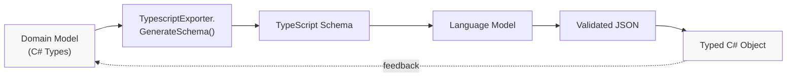
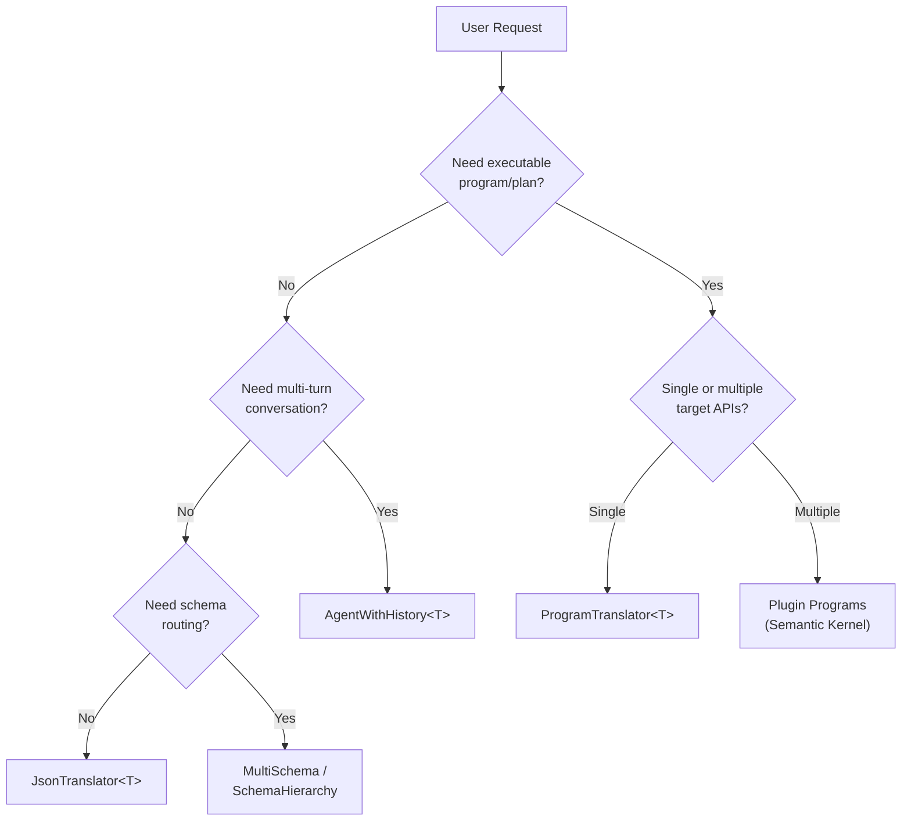
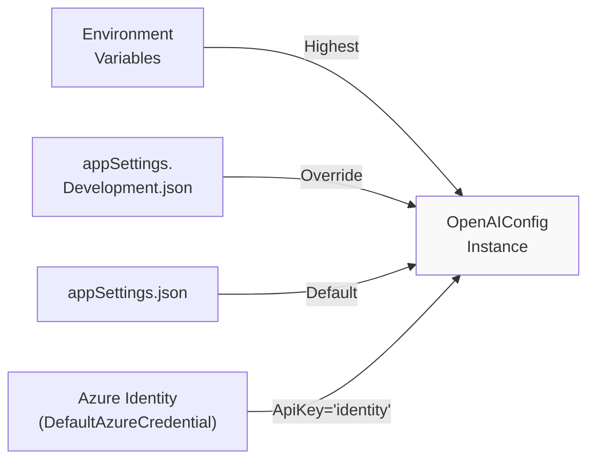
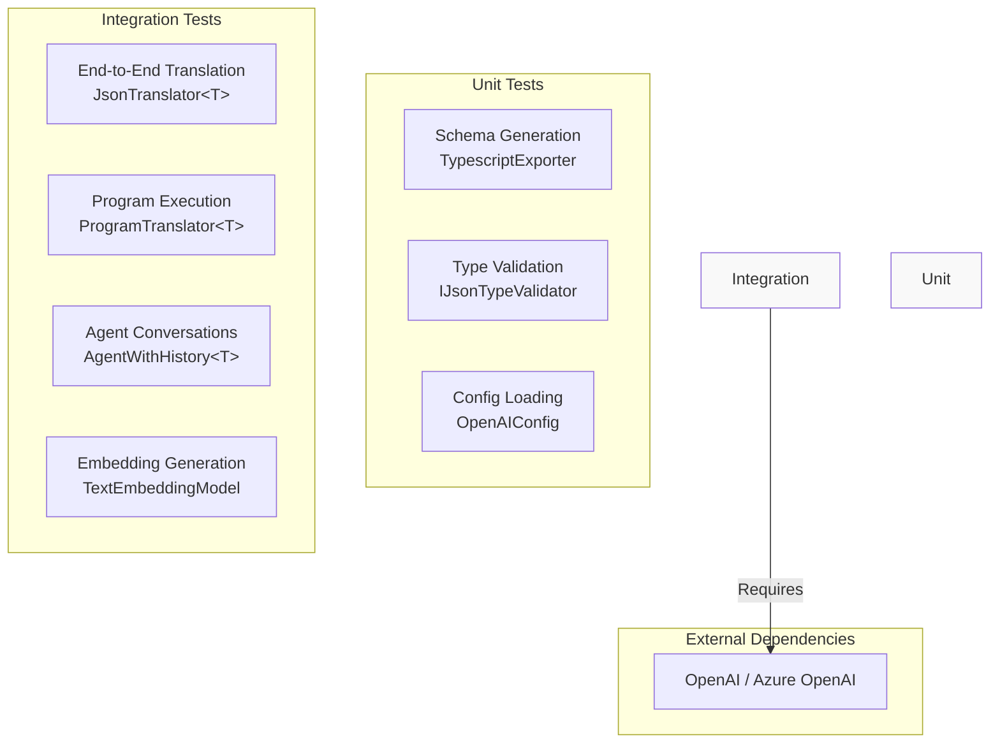
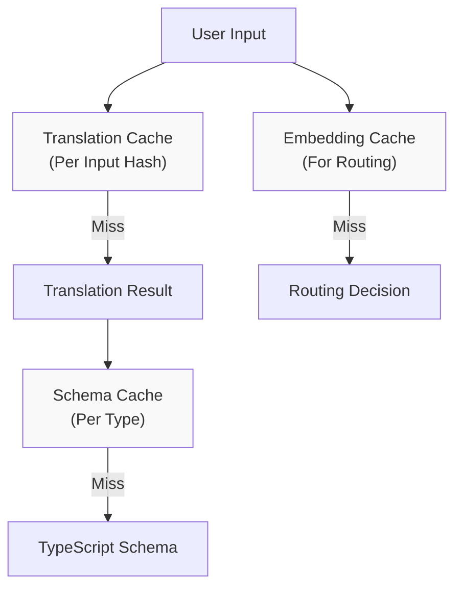

<!-- source: DeepWiki mcp.deepwiki.com · repo microsoft/typechat.net · page 11 Best Practices · fetched 2026-10-26 -->

# Best Practices

<details>
<summary>Relevant source files</summary>

The following files were used as context for generating this wiki page:

- [README.md](README.md)
- [examples/CoffeeShop/CoffeeShopSchema.cs](examples/CoffeeShop/CoffeeShopSchema.cs)
- [examples/CoffeeShop/Program.cs](examples/CoffeeShop/Program.cs)
- [examples/CoffeeShop/input.txt](examples/CoffeeShop/input.txt)
- [examples/Sentiment/Program.cs](examples/Sentiment/Program.cs)
- [examples/appSettings.json](examples/appSettings.json)
- [src/typechat.schema/TypescriptExporter.cs](src/typechat.schema/TypescriptExporter.cs)

</details>


This document provides high-level guidance and recommendations for building effective applications with TypeChat.NET. It covers general principles, component selection, configuration strategies, and common patterns that lead to successful implementations.

For detailed guidance on specific topics, see:
- [Schema Design](#11.1) - Best practices for defining types and schemas
- [Error Handling](#11.2) - Strategies for validation failures and repair loops
- [Performance Optimization](#11.3) - Token usage, caching, and execution optimization

## Purpose and Scope

This page addresses cross-cutting best practices that apply across all TypeChat.NET components, including when to use each component, how to structure your application, and general patterns for reliable operation. It focuses on architectural decisions and integration patterns rather than implementation details.

## General Principles

### Type First, Prompt Second

TypeChat.NET's core strength is strong typing. Design your C# types first to represent the domain model clearly, then let the `TypescriptExporter` generate the schema automatically. This approach:

- Ensures type safety throughout your application
- Provides compile-time validation of your domain model
- Enables IDE support and refactoring
- Makes schema changes traceable through version control



**Sources:** [src/typechat.schema/TypescriptExporter.cs:28-47](), [README.md:28-45]()

### Start Simple, Iterate Toward Complexity

Begin with `JsonTranslator<T>` for simple scenarios before moving to `ProgramTranslator<T>` or `AgentWithHistory<T>`. The component selection should match your use case complexity:



**Sources:** [README.md:19-27](), [README.md:122-147]()

## Component Selection Guide

### When to Use JsonTranslator&lt;T&gt;

Use `JsonTranslator<T>` when you need to convert natural language into structured data without execution logic:

- **Sentiment analysis** - Classify text sentiment with reasoning
- **Order processing** - Parse customer orders into structured carts
- **Data extraction** - Extract structured information from unstructured text
- **Classification** - Categorize inputs into predefined types

Example use cases: [examples/Sentiment/Program.cs:6-41](), [examples/CoffeeShop/Program.cs:10-76]()

### When to Use ProgramTranslator&lt;T&gt;

Use `ProgramTranslator<T>` when you need to generate and execute programs against a specific API:

- **Calculation engines** - Translate "add 2 and 3" into mathematical operations
- **Calendar operations** - Generate calendar action sequences
- **API orchestration** - Create multi-step API call sequences
- **Plugin invocation** - Route to Semantic Kernel plugins dynamically

Example use cases: [README.md:48-67](), [README.md:139-142]()

### When to Use AgentWithHistory&lt;T&gt;

Use `AgentWithHistory<T>` for conversational scenarios requiring context:

- **Data collection agents** - Gather information across multiple turns
- **Guided workflows** - Lead users through multi-step processes
- **Contextual clarification** - Ask follow-up questions when needed
- **Progressive refinement** - Build up complex requests incrementally

Example use cases: [README.md:144-146]()

**Sources:** [README.md:122-146]()

## Configuration Management

### Use Environment-Specific Settings

Structure configuration to support local development and production deployment without code changes:

```
examples/
├── appSettings.json                    # Default/template settings
└── appSettings.Development.json        # Local overrides (gitignored)
```

The `OpenAIConfig` class supports multiple configuration sources with precedence:



**Sources:** [README.md:148-191](), [examples/appSettings.json:1-22]()

### Configuration Priority Pattern

Load configuration in this order for maximum flexibility:

1. **Environment variables** - For production/CI deployment (`OpenAIConfig.FromEnvironment()`)
2. **Development overrides** - For local development (`Config.LoadOpenAI()`)
3. **Default values** - As fallback in base `appSettings.json`

```csharp
// Recommended pattern from examples
OpenAIConfig config = Config.LoadOpenAI();
var model = new LanguageModel(config);
```

**Sources:** [README.md:193-207](), [examples/Sentiment/Program.cs:12-16]()

### Use Azure Identity for Production

For production deployments, use Azure Managed Identity instead of API keys:

- Set `ApiKey` to `"identity"` in configuration
- System uses `DefaultAzureCredential` for token acquisition
- Enables rotation and centralized access management
- Eliminates secrets in configuration files

**Sources:** [README.md:150-158]()

## Model Selection and Configuration

### Choose Appropriate Models for Task Complexity

Different scenarios have different model requirements:

| Use Case | Recommended Model | Reasoning |
|----------|------------------|-----------|
| Simple classification | gpt-35-turbo | Cost-effective, fast responses |
| Complex schemas (CoffeeShop, Restaurant) | gpt-4 | Better understanding of nested structures |
| Program generation | gpt-4 | More reliable code generation |
| Embeddings / semantic search | ada-002 | Optimized for vector representations |
| High-volume production | gpt-35-turbo | Balance cost and quality |

**Sources:** [README.md:80-85](), [README.md:121]()

### Configure Retry and Timeout Settings

Set appropriate retry and timeout values based on your deployment scenario:

```json
{
  "OpenAI": {
    "MaxRetries": 2,
    "TimeoutMs": 30000
  }
}
```

- **Development**: Higher timeouts (30-60s) to accommodate debugging
- **Production**: Balanced timeouts (15-30s) with retry logic
- **High-volume**: Lower timeouts (10-15s) with circuit breakers

**Sources:** [examples/appSettings.json:9-13]()

## Translation Workflow Best Practices

### Set Appropriate MaxRepairAttempts

The `JsonTranslator<T>.MaxRepairAttempts` property controls validation retry behavior:

```mermaid
sequenceDiagram
    participant App as "Application"
    participant JT as "JsonTranslator&lt;T&gt;"
    participant LM as "LanguageModel"
    participant Val as "IJsonTypeValidator"
    
    App->>JT: "TranslateAsync(input)"
    JT->>LM: "CompleteAsync(prompt + schema)"
    LM-->>JT: "JSON response"
    JT->>Val: "Validate(json)"
    
    alt "Valid JSON"
        Val-->>JT: "Success"
        JT-->>App: "Typed object"
    else "Invalid JSON (attempt < MaxRepairAttempts)"
        Val-->>JT: "Validation errors"
        JT->>LM: "CompleteAsync(repair prompt + errors)"
        Note over JT,LM: "Retry loop"
    else "Max attempts exceeded"
        JT-->>App: "TypeChatException"
    end
```

**Recommended values:**

- **Simple schemas**: `MaxRepairAttempts = 1-2` - Fast failure for basic types
- **Complex schemas**: `MaxRepairAttempts = 3-4` - Allow more repair cycles
- **Production systems**: `MaxRepairAttempts = 2-3` - Balance reliability and cost

**Sources:** [examples/CoffeeShop/Program.cs:16-19]()

### Monitor Translation Events

Subscribe to translator events for observability and debugging:

```csharp
// During development - see all interactions
translator.ValidatorEvent += OnValidation;
translator.Repaired += OnRepaired;
translator.Completed += OnCompleted;

// In production - log failures only
translator.Failed += LogTranslationFailure;
```

Event subscription helps with:
- Understanding model behavior during development
- Tracking repair frequency and success rates
- Identifying schema improvement opportunities
- Production monitoring and alerting

**Sources:** [examples/CoffeeShop/Program.cs:20-21]()

## Schema Patterns

### Use Vocabularies to Constrain String Values

Apply `[JsonVocab]` attributes to string properties that should accept only specific values:

```csharp
[JsonVocab("espresso | lungo | ristretto | macchiato")]
public string Name { get; set; }
```

Benefits:
- Reduces model hallucination
- Provides clear constraints to the LLM
- Enables runtime validation against known values
- Improves translation accuracy

See [Schema Design](#11.1) for comprehensive vocabulary patterns.

**Sources:** [examples/CoffeeShop/CoffeeShopSchema.cs:50-52](), [README.md:36-44]()

### Implement Unknown Item Patterns

For schemas with partial understanding requirements, include an `UnknownItem` type:

```csharp
[JsonPolymorphic]
[JsonDerivedType(typeof(UnknownItem), typeDiscriminator: nameof(UnknownItem))]
[JsonDerivedType(typeof(KnownItem), typeDiscriminator: nameof(KnownItem))]
public abstract class Item { }

[Comment("Use this type for items that match nothing else")]
public class UnknownItem : Item
{
    [Comment("The text that wasn't understood")]
    public string Text { get; set; }
}
```

This pattern allows graceful degradation when the model doesn't understand parts of the input.

**Sources:** [examples/CoffeeShop/CoffeeShopSchema.cs:24-40](), [examples/CoffeeShop/CoffeeShopSchema.cs:136-153]()

### Property Naming Considerations

Property names significantly impact model behavior:

- **Be specific**: `ProductName` is better than `Name` for product identification
- **Be consistent**: Use the same terminology throughout your schema
- **Be descriptive**: `CoffeeTemperature` is clearer than `Temp`
- **Avoid ambiguity**: Don't use terms that could mean multiple things

```csharp
// The model is VERY sensitive to property names
// E.g. changing 'productName' to 'name' can lead to the model 
// being less stringent about what it places in that field.
```

**Sources:** [examples/CoffeeShop/CoffeeShopSchema.cs:8-16]()

## Testing Strategies

### Use Batch Input Files

Structure test inputs in text files for repeatable testing:

```
examples/CoffeeShop/
├── Program.cs
└── input.txt          # Test cases with expected behaviors
```

Run in batch mode: `dotnet run -- input.txt`

Benefits:
- Regression testing across schema changes
- Documenting expected behaviors
- Sharing test cases with stakeholders
- Automated testing in CI/CD

**Sources:** [README.md:119](), [examples/CoffeeShop/input.txt:1-72]()

### Test Across Complexity Levels

Include test cases that cover:

1. **Happy path** - Clear, unambiguous requests
2. **Edge cases** - Boundary conditions and unusual patterns
3. **Ambiguous inputs** - Cases requiring clarification
4. **Failure cases** - Inputs that should produce `UnknownItem` or errors
5. **Multi-entity** - Multiple items in a single request

Example test categories from CoffeeShop:

```
# Basic orders
i'd like a latte that's it

# Complex nested options  
decaf soy vanilla syrup caramel latte with sugar and foam

# Should produce UnknownItem
roses are red
two lawnmowers, a grande latte and a tall tree
```

**Sources:** [examples/CoffeeShop/input.txt:1-72]()

### Integration vs Unit Testing



**Unit tests** should validate:
- Schema generation correctness
- Type mapping and export logic
- Configuration parsing
- Validation rules (without LLM)

**Integration tests** should validate:
- Complete translation workflows
- Model interaction and repair loops
- Program compilation and execution
- Agent conversation flows

**Sources:** [README.md:115-118]()

## Common Pitfalls and Anti-Patterns

### Anti-Pattern: Ignoring Validation Errors

❌ **Don't ignore validation results:**
```csharp
try {
    var result = await translator.TranslateAsync(input);
    // Proceed without checking for UnknownItem
} catch { }
```

✅ **Do check for partial understanding:**
```csharp
var cart = await translator.TranslateAsync(input);
if (HasUnknownItems(cart)) {
    // Handle partial understanding
    PromptUserForClarification();
}
```

**Sources:** [examples/CoffeeShop/Program.cs:34-55]()

### Anti-Pattern: Over-Complex Schemas

❌ **Don't create deeply nested hierarchies without reason:**
- Makes debugging difficult
- Increases token usage
- Reduces model accuracy
- Complicates deserialization

✅ **Do flatten where possible and use focused schemas:**
- Keep nesting to 3-4 levels maximum
- Split complex domains into multiple translators
- Use schema routing for multi-domain applications

### Anti-Pattern: Hardcoding API Keys

❌ **Don't hardcode credentials:**
```csharp
var config = new OpenAIConfig {
    ApiKey = "sk-..." // DON'T DO THIS
};
```

✅ **Do use configuration management:**
```csharp
// Development
var config = Config.LoadOpenAI();

// Production with Azure Identity
var config = new OpenAIConfig {
    ApiKey = "identity",
    Azure = true,
    Endpoint = "https://resource.openai.azure.com"
};
```

**Sources:** [README.md:148-191]()

### Anti-Pattern: No Timeout Configuration

❌ **Don't use default timeouts in production:**

The default timeout may be too long or too short for your scenario, leading to poor user experience or premature failures.

✅ **Do configure appropriate timeouts:**
```json
{
  "OpenAI": {
    "TimeoutMs": 15000,
    "MaxRetries": 2
  }
}
```

**Sources:** [examples/appSettings.json:9-13]()

## Observability and Monitoring

### Key Metrics to Track

Monitor these metrics in production:

| Metric | Purpose | Threshold |
|--------|---------|-----------|
| Translation success rate | Overall reliability | > 95% |
| Repair attempt frequency | Schema quality indicator | < 20% requiring repair |
| Average response time | Performance baseline | < 3 seconds for JsonTranslator |
| Token consumption | Cost management | Monitor trends |
| Validation failure types | Schema improvement signals | Categorize and track |

### Logging Strategy

```csharp
// Production logging pattern
translator.Failed += (sender, e) => {
    logger.LogError(e.Exception, 
        "Translation failed after {Attempts} attempts. Input length: {Length}",
        e.RepairAttempts, e.Input.Length);
};

translator.Repaired += (sender, e) => {
    logger.LogWarning(
        "Translation required {Attempts} repair attempts",
        e.RepairAttempts);
};
```

Log at appropriate levels:
- **Error**: Translation failures after max attempts
- **Warning**: Repair cycles, UnknownItem usage
- **Info**: Successful translations in high-verbosity scenarios
- **Debug**: Full prompts and responses (development only)

## Performance Considerations

### Token Usage Optimization

Token consumption is the primary cost driver. Optimize by:

1. **Minimizing schema size**
   - Export only required types
   - Use `TypescriptExporter.TypesToIgnore` for unnecessary types
   
2. **Efficient vocabularies**
   - Use named vocabularies instead of inline for repeated values
   - Keep vocabulary lists focused and relevant

3. **Prompt optimization**
   - Customize `IJsonTranslatorPrompts` for your domain
   - Remove unnecessary instructions

See [Performance Optimization](#11.3) for detailed guidance.

**Sources:** [src/typechat.schema/TypescriptExporter.cs:134-136]()

### Caching Strategies

Consider caching at multiple levels:



- **Schema caching**: TypeScript schemas rarely change, cache per type
- **Translation caching**: Cache results for identical inputs (with TTL)
- **Embedding caching**: Cache embeddings for routing decisions

## Security Considerations

### Input Validation

Always validate user input before translation:

```csharp
// Length limits
if (input.Length > MaxInputLength) {
    throw new ArgumentException("Input too long");
}

// Content filtering
if (ContainsProhibitedContent(input)) {
    throw new SecurityException("Invalid content");
}

// Rate limiting per user/session
if (!rateLimiter.AllowRequest(userId)) {
    throw new RateLimitException();
}
```

### Output Validation

Validate translated results before execution:

```csharp
var program = await translator.TranslateAsync(input);

// Validate program structure
if (program.Steps.Length > MaxSteps) {
    throw new SecurityException("Program too complex");
}

// Validate API calls
foreach (var step in program.Steps) {
    if (!IsAllowedFunction(step.FunctionName)) {
        throw new SecurityException($"Function {step.FunctionName} not allowed");
    }
}
```

### Sensitive Data Handling

- Never include sensitive data in schema comments
- Sanitize logs to remove PII
- Use Azure Private Link for OpenAI in regulated environments
- Implement data retention policies for translation history

## Migration and Versioning

### Schema Evolution

When evolving schemas in production:

1. **Add optional properties first** - Maintain backward compatibility
2. **Version your schemas** - Use separate types for breaking changes
3. **Test with existing data** - Validate against production samples
4. **Gradual rollout** - Use feature flags for new schema versions

```csharp
// Version 1
public class OrderV1 { ... }

// Version 2 with breaking changes
public class OrderV2 { ... }

// Router to handle both
var translator = useLegacySchema 
    ? new JsonTranslator<OrderV1>(model)
    : new JsonTranslator<OrderV2>(model);
```

### Semantic Kernel Migration

When upgrading Semantic Kernel versions:

```csharp
// Pre-1.0 (deprecated)
// Used sk_0.22.230905.3-preview branch

// 1.0+ (current)
using Microsoft.TypeChat.SemanticKernel;
var kernel = KernelEx.CreateKernel()
    .WithChatModels(config)
    .Build();
```

**Sources:** [README.md:69-75]()

## Summary

Effective TypeChat.NET applications follow these principles:

1. **Type-first design** - Define strong C# types, let schema generation handle the rest
2. **Appropriate component selection** - Match component complexity to use case requirements
3. **Robust configuration** - Support multiple environments without code changes
4. **Comprehensive testing** - Cover happy paths, edge cases, and failures
5. **Observability** - Monitor success rates, repair frequency, and performance
6. **Security awareness** - Validate inputs and outputs, protect sensitive data
7. **Iterative refinement** - Start simple, add complexity as needed

For implementation details, see:
- [Schema Design](#11.1) - Detailed type and vocabulary patterns
- [Error Handling](#11.2) - Validation, repair, and exception strategies
- [Performance Optimization](#11.3) - Token usage, caching, and execution optimization

**Sources:** [README.md:1-243](), [examples/CoffeeShop/Program.cs:1-77](), [examples/Sentiment/Program.cs:1-42]()

---

