<!-- source: DeepWiki mcp.deepwiki.com · repo microsoft/typechat.net · page 11.1 Schema Design · fetched 2026-10-26 -->

# Schema Design

<details>
<summary>Relevant source files</summary>

The following files were used as context for generating this wiki page:

- [examples/CoffeeShop/CoffeeShopSchema.cs](examples/CoffeeShop/CoffeeShopSchema.cs)
- [examples/CoffeeShop/Program.cs](examples/CoffeeShop/Program.cs)
- [examples/CoffeeShop/input.txt](examples/CoffeeShop/input.txt)
- [examples/SchemaHierarchy/Program.cs](examples/SchemaHierarchy/Program.cs)
- [src/typechat.schema/TypescriptExporter.cs](src/typechat.schema/TypescriptExporter.cs)
- [tests/TypeChat.UnitTests/TestSchema.cs](tests/TypeChat.UnitTests/TestSchema.cs)

</details>


## Purpose and Scope

This page provides best practices and design patterns for creating schemas that work effectively with language models in TypeChat.NET. A well-designed schema significantly impacts translation accuracy, robustness, and maintainability.

For technical details on how schemas are generated from C# types, see [Schema Generation](#3.2). For specific implementation guidance on vocabularies, polymorphism, and type mapping, see [Schema Definition](#4).

---

## Core Design Principles

Effective schema design for language models differs from traditional API design. Language models interpret schemas as instructions, not just type definitions. The following principles guide successful schema design:

### Principle 1: Property Names Are Semantic Signals

Property names strongly influence how language models classify and populate data. Descriptive, specific names improve accuracy.

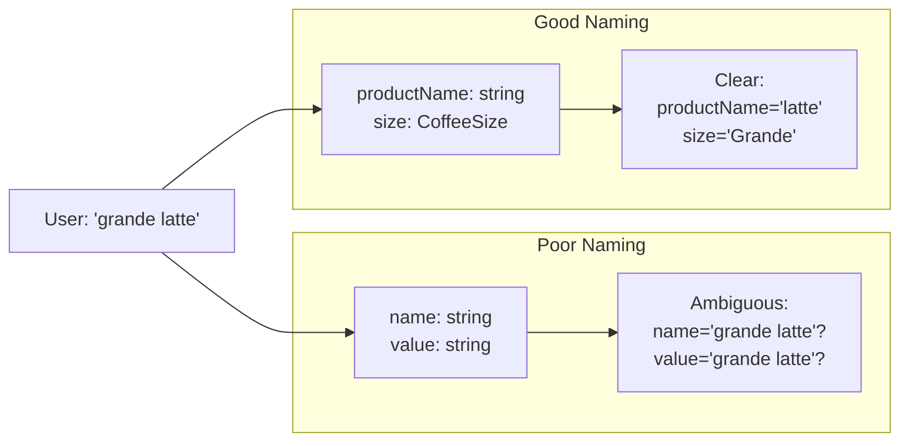

**Example from CoffeeShop schema:**

The property is named `productName` rather than just `name` to make the semantic intent clear [examples/CoffeeShop/CoffeeShopSchema.cs:51-52](), [examples/CoffeeShop/CoffeeShopSchema.cs:68-69](), [examples/CoffeeShop/CoffeeShopSchema.cs:85-86]().

**Warning from source code:**
> "The model can be VERY sensitive to property names. E.g. changing 'productName' to 'name' can lead to the model being less stringent about what it places in that field." [examples/CoffeeShop/CoffeeShopSchema.cs:15]()

**Sources:** [examples/CoffeeShop/CoffeeShopSchema.cs:1-290]()

---

### Principle 2: Constrain with Vocabularies

Vocabularies (`JsonVocab`) dramatically improve accuracy by constraining string values to known sets. Use vocabularies for any domain-specific terminology.

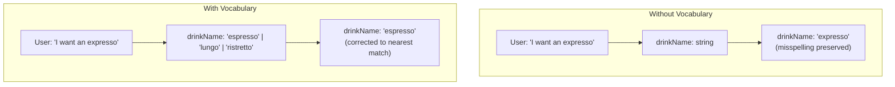

**CoffeeShop vocabularies by category:**

| Property Type | Vocabulary Constant | Purpose |
|--------------|---------------------|---------|
| `EspressoDrinks.Name` | `CoffeeShopVocabs.EspressoDrinks` | Constrain to espresso drink types [examples/CoffeeShop/CoffeeShopSchema.cs:50-52]() |
| `Milks.Name` | `CoffeeShopVocabs.Milks` | Constrain to milk options [examples/CoffeeShop/CoffeeShopSchema.cs:164-166]() |
| `Syrups.Name` | `CoffeeShopVocabs.Syrups` | Constrain to syrup flavors [examples/CoffeeShop/CoffeeShopSchema.cs:188-190]() |
| `OptionQuantity.Amount` | `CoffeeShopVocabs.OptionQuantity` | Constrain to quantity descriptors [examples/CoffeeShop/CoffeeShopSchema.cs:240-242]() |

**Sources:** [examples/CoffeeShop/CoffeeShopSchema.cs:50-52](), [examples/CoffeeShop/CoffeeShopSchema.cs:258-289]()

---

### Principle 3: Use Comments to Guide Translation

The `[Comment]` attribute provides explicit instructions to the language model. Use comments to clarify intent, specify defaults, or explain edge cases.

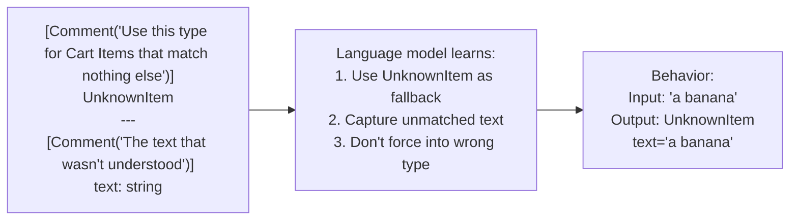

**Strategic comment placement in CoffeeShop:**

- **Fallback guidance:** `"Use this type for Cart Items that match nothing else"` [examples/CoffeeShop/CoffeeShopSchema.cs:34]()
- **Uncertainty handling:** `"Use this type for DrinkOptions that match nothing else OR if you are NOT SURE"` [examples/CoffeeShop/CoffeeShopSchema.cs:147]()
- **Default values:** `"The default is 'Doppio'"` [examples/CoffeeShop/CoffeeShopSchema.cs:58]()
- **Field purpose:** `"The text that wasn't understood"` [examples/CoffeeShop/CoffeeShopSchema.cs:37]()

**Sources:** [examples/CoffeeShop/CoffeeShopSchema.cs:34-40](), [examples/CoffeeShop/CoffeeShopSchema.cs:147-153]()

---

## Schema Architecture Patterns

### Pattern 1: Polymorphic Type Hierarchies

Design type hierarchies that mirror domain concepts. Use abstract base classes with concrete implementations.

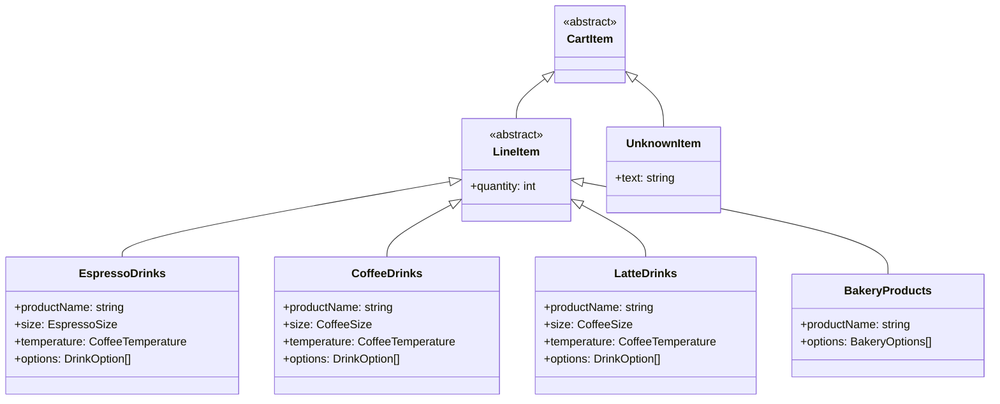

**Design rationale:**

1. **Abstract base (`CartItem`)**: Defines the contract for all items [examples/CoffeeShop/CoffeeShopSchema.cs:24-32]()
2. **Intermediate abstract (`LineItem`)**: Shares common properties like `quantity` [examples/CoffeeShop/CoffeeShopSchema.cs:42-46]()
3. **Concrete types**: Specific product categories with tailored properties [examples/CoffeeShop/CoffeeShopSchema.cs:48-107]()
4. **Fallback type (`UnknownItem`)**: Handles partial understanding [examples/CoffeeShop/CoffeeShopSchema.cs:35-40]()

**Sources:** [examples/CoffeeShop/CoffeeShopSchema.cs:18-107]()

---

### Pattern 2: Nested Polymorphism for Options

Complex domains benefit from hierarchical polymorphism. Options can have their own type hierarchies.

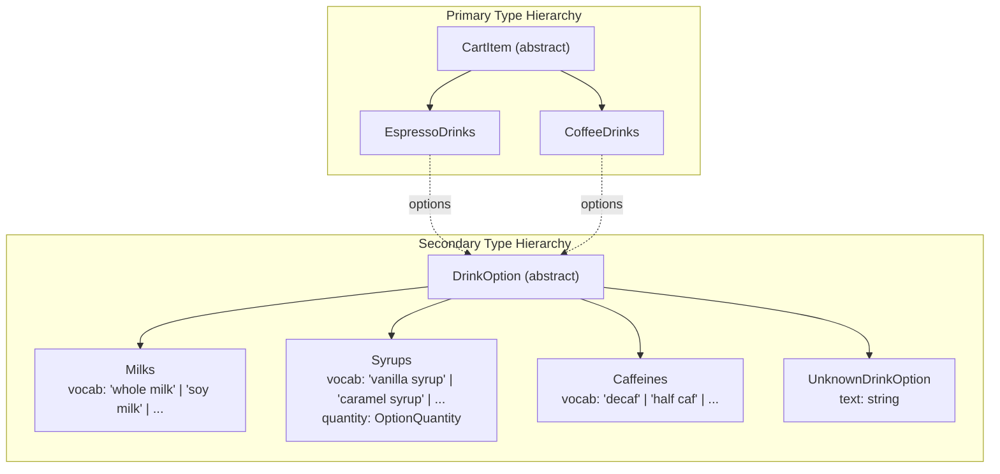

**Implementation in CoffeeShop:**

The `DrinkOption` abstract class supports seven concrete option types [examples/CoffeeShop/CoffeeShopSchema.cs:136-211](), each with specific vocabularies:

- `Creamers`: 10 varieties [examples/CoffeeShop/CoffeeShopSchema.cs:266-269]()
- `Milks`: 7 varieties [examples/CoffeeShop/CoffeeShopSchema.cs:271-273]()
- `Caffeines`: 5 levels [examples/CoffeeShop/CoffeeShopSchema.cs:275]()
- `Sweetners`: 6 types with optional quantity [examples/CoffeeShop/CoffeeShopSchema.cs:277]()
- `Syrups`: 11 flavors with optional quantity [examples/CoffeeShop/CoffeeShopSchema.cs:278-281]()
- `Toppings`: 6 options with optional quantity [examples/CoffeeShop/CoffeeShopSchema.cs:276]()
- `LattePreparations`: 6 preparation styles [examples/CoffeeShop/CoffeeShopSchema.cs:283]()

**Sources:** [examples/CoffeeShop/CoffeeShopSchema.cs:136-211](), [examples/CoffeeShop/CoffeeShopSchema.cs:266-289]()

---

### Pattern 3: The UnknownItem Fallback Pattern

Always provide an "escape hatch" for unrecognized input. This prevents the model from forcing data into incorrect types.

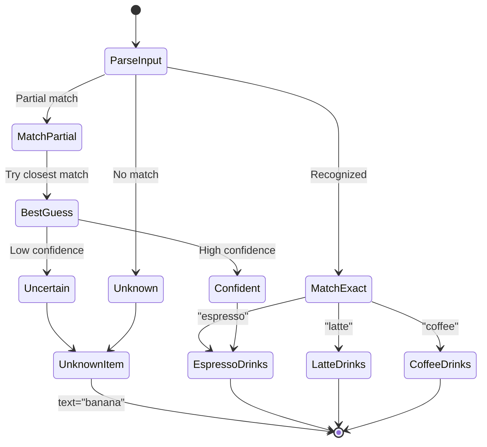

**UnknownItem implementation requirements:**

1. **Comment attribute**: Explicit instruction to use as fallback [examples/CoffeeShop/CoffeeShopSchema.cs:34]()
2. **Text property**: Capture the unrecognized input [examples/CoffeeShop/CoffeeShopSchema.cs:38-39]()
3. **Inheritance**: Include in polymorphic hierarchy [examples/CoffeeShop/CoffeeShopSchema.cs:25]()
4. **Application handling**: Check for unknown items post-translation [examples/CoffeeShop/Program.cs:40-55]()

**Two-level unknown pattern:**

CoffeeShop implements unknown items at two levels:
- `UnknownItem` for unrecognized cart items [examples/CoffeeShop/CoffeeShopSchema.cs:35-40]()
- `UnknownDrinkOption` for unrecognized drink options [examples/CoffeeShop/CoffeeShopSchema.cs:148-153]()

**Sources:** [examples/CoffeeShop/CoffeeShopSchema.cs:34-40](), [examples/CoffeeShop/CoffeeShopSchema.cs:147-153](), [examples/CoffeeShop/Program.cs:40-55]()

---

## Vocabulary Design Guidelines

Vocabularies are one of TypeChat's most powerful features. Design them carefully for maximum impact.

### Vocabulary Selection Criteria

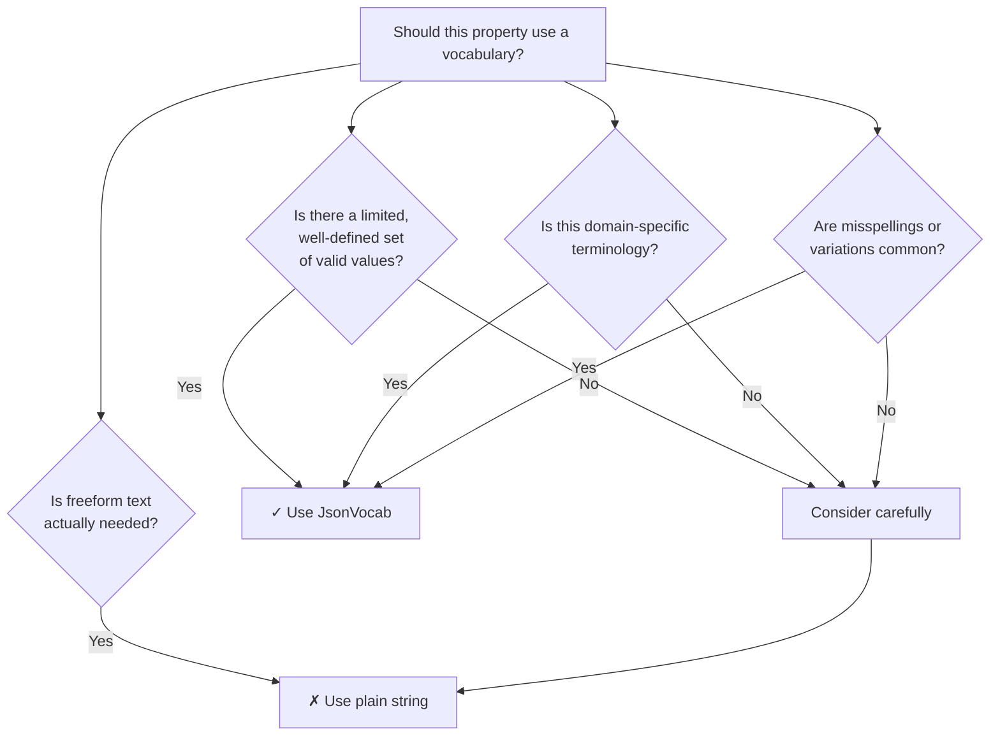

### Vocabulary Organization Strategies

**Strategy 1: Group by semantic category**

Organize vocabularies by the conceptual category they represent:

```csharp
// Product categories - what you're ordering
public const string EspressoDrinks = "espresso | lungo | ristretto | macchiato";
public const string LatteDrinks = "cappuccino | flat white | latte | latte macchiato| mocha | chai latte";

// Customization categories - how you modify it
public const string Milks = "whole milk | two percent milk | nonfat milk | coconut milk | ...";
public const string Syrups = "almond syrup | buttered rum syrup | caramel syrup | ...";
public const string Toppings = "cinnamon | foam | ice | nutmeg | whipped cream | water";
```

[examples/CoffeeShop/CoffeeShopSchema.cs:260-276]()

**Strategy 2: Include common variations**

Anticipate how users will naturally express concepts:

```csharp
// "latte" and "latte macchiato" are both included
public const string LatteDrinks = "cappuccino | flat white | latte | latte macchiato| mocha | chai latte";

// Multiple ways to express milk percentages
public const string Milks = "whole milk | two percent milk | nonfat milk | ...";
```

[examples/CoffeeShop/CoffeeShopSchema.cs:264](), [examples/CoffeeShop/CoffeeShopSchema.cs:271-273]()

**Strategy 3: Balance specificity and flexibility**

| Too Restrictive | Well-Balanced | Too Permissive |
|----------------|---------------|----------------|
| `"espresso"` (only one option) | `"espresso \| lungo \| ristretto"` | `string` (no constraint) |
| Model frustrated | Model guided | Model confused |

**Sources:** [examples/CoffeeShop/CoffeeShopSchema.cs:258-289]()

---

### Vocabulary Property Name Alignment

When using `JsonVocab`, align the `PropertyName` parameter with the actual JSON property name:

```csharp
[JsonVocab(CoffeeShopVocabs.EspressoDrinks, PropertyName = "productName")]
[JsonPropertyName("productName")]
public string Name { get; set; }
```

[examples/CoffeeShop/CoffeeShopSchema.cs:50-52]()

**Why this matters:**

1. **Validation**: Enables runtime enforcement of vocabulary constraints [src/typechat.schema/TypescriptExporter.cs:589-598]()
2. **Error messages**: Provides clear feedback when violations occur
3. **Schema clarity**: Makes the relationship between C# and JSON explicit

**Common pattern across CoffeeShop schema:**

Every vocabulary-constrained property follows this pattern [examples/CoffeeShop/CoffeeShopSchema.cs:50-52](), [examples/CoffeeShop/CoffeeShopSchema.cs:67-69](), [examples/CoffeeShop/CoffeeShopSchema.cs:84-86](), [examples/CoffeeShop/CoffeeShopSchema.cs:101-103]().

**Sources:** [examples/CoffeeShop/CoffeeShopSchema.cs:50-52](), [src/typechat.schema/TypescriptExporter.cs:544-601]()

---

## Default Values and Nullability

Strategic use of default values and optional fields guides the language model's behavior.

### Default Value Strategy

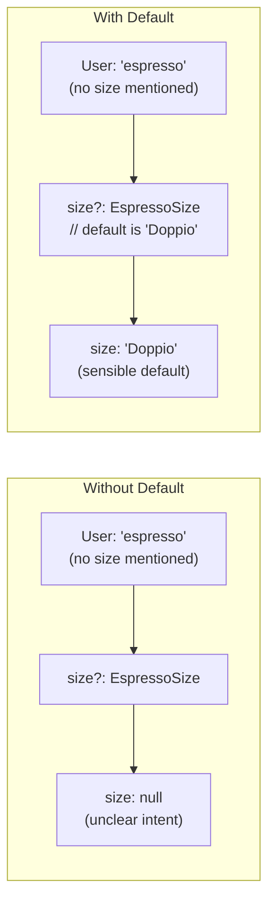

**Default value examples from CoffeeShop:**

| Type | Property | Default | Rationale |
|------|----------|---------|-----------|
| `EspressoDrinks` | `Size` | `Doppio` | Standard double shot [examples/CoffeeShop/CoffeeShopSchema.cs:59]() |
| `CoffeeDrinks` | `Size` | `Grande` | Most common size [examples/CoffeeShop/CoffeeShopSchema.cs:76]() |
| `LatteDrinks` | `Size` | `Grande` | Most common size [examples/CoffeeShop/CoffeeShopSchema.cs:93]() |
| `LineItem` | `Quantity` | `1` | Single item assumption [examples/CoffeeShop/CoffeeShopSchema.cs:45]() |

**Comment + default pattern:**

```csharp
[JsonPropertyName("size")]
[Comment("The default is 'Doppio'")]
public EspressoSize? Size { get; set; } = EspressoSize.Doppio;
```

[examples/CoffeeShop/CoffeeShopSchema.cs:57-59]()

**Sources:** [examples/CoffeeShop/CoffeeShopSchema.cs:45](), [examples/CoffeeShop/CoffeeShopSchema.cs:57-59](), [examples/CoffeeShop/CoffeeShopSchema.cs:74-76](), [examples/CoffeeShop/CoffeeShopSchema.cs:91-93]()

---

### Nullability Strategy Matrix

| Scenario | Type | Rationale |
|----------|------|-----------|
| **Always required** | `string Name` | Non-nullable, no default. Must be provided. |
| **Optional, no default** | `CoffeeSize? Size` | Nullable. User may not specify; no assumption. |
| **Optional with sensible default** | `CoffeeSize? Size = Grande` | Nullable but defaults. Guides model behavior. |
| **Array, possibly empty** | `DrinkOption[]? Options` | Nullable array. Empty is different from null. |
| **Required array** | `CartItem[] Items` | Non-nullable array. Must contain items. |

**Examples in CoffeeShop:**

- **Required**: `CartItem[] Items` (cart must have items) [examples/CoffeeShop/CoffeeShopSchema.cs:21]()
- **Optional**: `CoffeeTemperature? Temperature` (not always specified) [examples/CoffeeShop/CoffeeShopSchema.cs:72]()
- **Optional with default**: `EspressoSize? Size = Doppio` (defaults when omitted) [examples/CoffeeShop/CoffeeShopSchema.cs:59]()
- **Optional array**: `DrinkOption[]? Options` (may have no customizations) [examples/CoffeeShop/CoffeeShopSchema.cs:62]()

**Sources:** [examples/CoffeeShop/CoffeeShopSchema.cs:21](), [examples/CoffeeShop/CoffeeShopSchema.cs:54-62](), [examples/CoffeeShop/CoffeeShopSchema.cs:72]()

---

## Schema Complexity Management

### Complexity Trade-offs

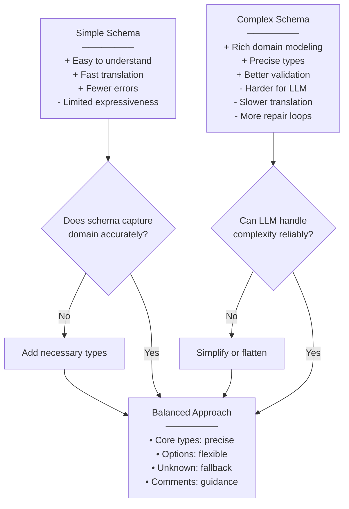

### Complexity Metrics

**CoffeeShop schema complexity analysis:**

| Metric | Count | Notes |
|--------|-------|-------|
| Total types | 24 | Including enums and polymorphic types |
| Abstract types | 3 | `CartItem`, `LineItem`, `DrinkOption` |
| Concrete types | 19 | Product and option types |
| Polymorphic hierarchies | 2 | Cart items and drink options |
| Vocabularies | 12 | Constraining string values |
| Enum types | 3 | `CoffeeSize`, `CoffeeTemperature`, `EspressoSize` |

[examples/CoffeeShop/CoffeeShopSchema.cs:1-290]()

**Complexity justified by:**
- Real-world domain complexity (coffee shops have many options)
- Vocabularies reduce ambiguity significantly
- UnknownItem patterns provide safety valves
- Comments guide the model through complexity

**Sources:** [examples/CoffeeShop/CoffeeShopSchema.cs:1-290]()

---

### When to Split Schemas

Consider splitting a schema when:

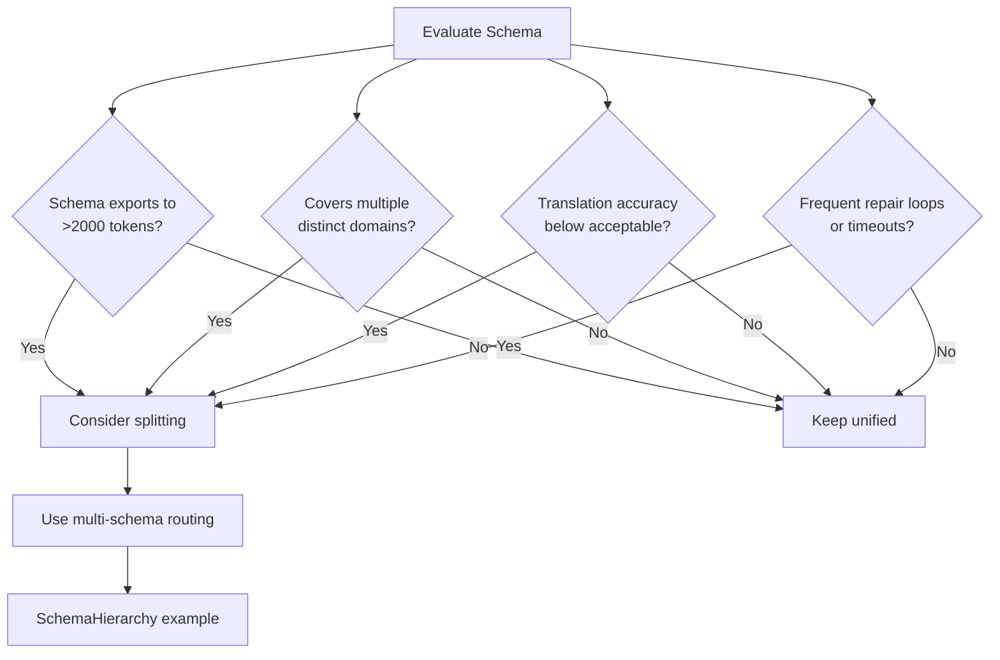

**Multi-schema example:**

SchemaHierarchy routes between five distinct schemas [examples/SchemaHierarchy/Program.cs:43-48]():
- `Cart` (coffee shop)
- `CalendarActions` (calendar operations)
- `Order` (restaurant orders)
- `SentimentResponse` (sentiment analysis)
- `HealthDataResponse` (health data collection)

Each schema focuses on a single domain, improving accuracy and reducing complexity.

**Sources:** [examples/SchemaHierarchy/Program.cs:1-67]()

---

## Common Anti-Patterns and Pitfalls

### Anti-Pattern 1: Overly Generic Property Names

**❌ Poor:**
```csharp
public class Order
{
    public string Value { get; set; }  // What kind of value?
    public string Type { get; set; }   // Type of what?
    public string Data { get; set; }   // What data?
}
```

**✓ Good:**
```csharp
public class Order
{
    public string ProductName { get; set; }
    public string ProductCategory { get; set; }
    public string CustomerInstructions { get; set; }
}
```

**Why:** Generic names like `Value`, `Data`, `Type` give the model no semantic guidance.

---

### Anti-Pattern 2: Missing Vocabularies for Known Sets

**❌ Poor:**
```csharp
public class DrinkOrder
{
    public string Size { get; set; }  // "large"? "huge"? "grande"?
}
```

**✓ Good:**
```csharp
[JsonConverter(typeof(JsonStringEnumConverter))]
public enum CoffeeSize
{
    Short, Tall, Grande, Venti
}

public class DrinkOrder
{
    public CoffeeSize Size { get; set; }
}
```

[examples/CoffeeShop/CoffeeShopSchema.cs:110-116]()

**Why:** Constraining to valid values prevents invalid data and reduces ambiguity.

---

### Anti-Pattern 3: No Fallback for Unrecognized Input

**❌ Poor:**
```csharp
[JsonPolymorphic]
[JsonDerivedType(typeof(Coffee), typeDiscriminator: "Coffee")]
[JsonDerivedType(typeof(Pastry), typeDiscriminator: "Pastry")]
public abstract class Item { }
```

**✓ Good:**
```csharp
[JsonPolymorphic]
[JsonDerivedType(typeof(UnknownItem), typeDiscriminator: "UnknownItem")]
[JsonDerivedType(typeof(Coffee), typeDiscriminator: "Coffee")]
[JsonDerivedType(typeof(Pastry), typeDiscriminator: "Pastry")]
public abstract class Item { }

[Comment("Use this type for items that match nothing else")]
public class UnknownItem : Item
{
    [Comment("The text that wasn't understood")]
    public string Text { get; set; }
}
```

[examples/CoffeeShop/CoffeeShopSchema.cs:24-40]()

**Why:** Without a fallback, the model may force invalid data into incorrect types.

---

### Anti-Pattern 4: Insufficient Comments on Abstract Types

**❌ Poor:**
```csharp
public abstract class Option { }
```

**✓ Good:**
```csharp
[Comment("Use this type for DrinkOptions that match nothing else OR if you are NOT SURE.")]
public class UnknownDrinkOption : DrinkOption
{
    [Comment("The text that wasn't understood")]
    public string Text { get; set; }
}
```

[examples/CoffeeShop/CoffeeShopSchema.cs:147-153]()

**Why:** Comments guide the model on when and how to use fallback types.

---

### Anti-Pattern 5: Excessive Nesting

**❌ Poor:**
```csharp
public class Order
{
    public OrderDetails Details { get; set; }
}

public class OrderDetails
{
    public OrderItems Items { get; set; }
}

public class OrderItems
{
    public OrderItem[] List { get; set; }
}
// 3 levels deep to get to actual items
```

**✓ Good:**
```csharp
public class Order
{
    public OrderItem[] Items { get; set; }
}
// Direct access to items
```

**Why:** Excessive nesting increases cognitive load for both the model and developers.

---

### Anti-Pattern 6: Polymorphism Without Discriminators

**❌ Poor:**
```csharp
[JsonPolymorphic]  // No discriminator configuration
public abstract class CartItem { }
```

**✓ Good:**
```csharp
[JsonPolymorphic]
[JsonDerivedType(typeof(UnknownItem), typeDiscriminator: nameof(UnknownItem))]
[JsonDerivedType(typeof(EspressoDrinks), typeDiscriminator: nameof(EspressoDrinks))]
public abstract class CartItem { }
```

[examples/CoffeeShop/CoffeeShopSchema.cs:24-32]()

**Why:** Explicit discriminators ensure reliable type resolution during deserialization.

---

## Schema Design Checklist

Use this checklist when designing or reviewing a schema:

### Naming and Structure
- [ ] Property names are descriptive and domain-specific (not `Name`, but `ProductName`)
- [ ] Type names clearly indicate their purpose
- [ ] Inheritance hierarchies are shallow (≤3 levels)
- [ ] No generic property names like `Value`, `Data`, `Type`

### Vocabularies and Constraints
- [ ] All domain-specific terms use `[JsonVocab]`
- [ ] Vocabulary values include common variations
- [ ] Enums are used for fixed value sets
- [ ] `PropertyName` parameter matches JSON property name

### Polymorphism and Fallbacks
- [ ] Polymorphic types have explicit `[JsonDerivedType]` attributes
- [ ] Every polymorphic hierarchy includes an `UnknownXxx` fallback
- [ ] Fallback types have clarifying `[Comment]` attributes
- [ ] Discriminator values are consistent

### Comments and Guidance
- [ ] Abstract types explain when to use each derived type
- [ ] Default values are documented in `[Comment]` attributes
- [ ] Unusual or non-obvious fields have explanatory comments
- [ ] Required fields are marked with `[Comment("Required")]`

### Nullability and Defaults
- [ ] Required properties are non-nullable
- [ ] Optional properties are nullable (`?`)
- [ ] Sensible defaults are provided where appropriate
- [ ] Arrays use nullable (`[]?`) when they can be omitted

### Complexity Management
- [ ] Schema complexity matches domain complexity
- [ ] Related concepts are grouped in nested types
- [ ] If schema is very large, consider multi-schema routing
- [ ] Schema can be understood by reading generated TypeScript

### Validation Support
- [ ] Application checks for `UnknownItem` instances [examples/CoffeeShop/Program.cs:40-55]()
- [ ] Vocabulary enforcement is enabled where needed [src/typechat.schema/TypescriptExporter.cs:594-598]()
- [ ] Schema can be serialized and deserialized correctly

**Sources:** [examples/CoffeeShop/CoffeeShopSchema.cs:1-290](), [examples/CoffeeShop/Program.cs:1-77](), [src/typechat.schema/TypescriptExporter.cs:1-768]()

---

## Testing Schema Designs

Validate schema effectiveness through systematic testing:

### Test Input Categories

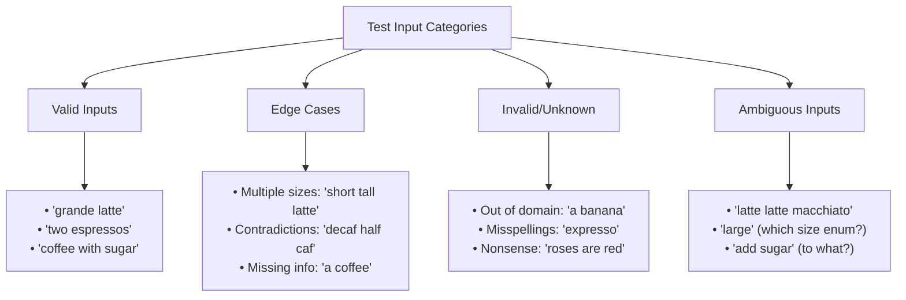

**CoffeeShop test inputs:** [examples/CoffeeShop/input.txt:1-72]()

Test categories in input.txt:
- Lines 1-45: Valid orders with increasing complexity
- Lines 49-60: Valid with edge cases (multiple items, specific requests)
- Lines 65-69: Invalid inputs (non-coffee items, out of domain)

**Sources:** [examples/CoffeeShop/input.txt:1-72]()

---

### Schema Test Results Analysis

Monitor these metrics:

| Metric | Target | Indicates |
|--------|--------|-----------|
| **First-attempt success rate** | >80% | Schema clarity |
| **Repair attempts needed** | <2 avg | Validation robustness |
| **UnknownItem frequency** | 5-15% | Fallback effectiveness |
| **Translation time** | <5 sec | Complexity appropriateness |
| **Token usage** | <2000/request | Schema size |

**What to adjust based on results:**

- **High repair rate:** Add more comments, simplify types, or improve vocabularies
- **Low UnknownItem rate:** May be over-constraining; model might be forcing bad matches
- **High UnknownItem rate:** Vocabularies may be too restrictive or missing variations
- **Long translation time:** Schema may be too complex; consider splitting

**Sources:** [examples/CoffeeShop/input.txt:1-72]()

---

## Summary of Best Practices

### Top 10 Schema Design Rules

1. **Use descriptive property names**: `ProductName` not `Name`, `CoffeeSize` not `Size`
2. **Constrain with vocabularies**: Define allowed values for domain terms
3. **Include UnknownItem fallbacks**: Provide escape hatches in polymorphic hierarchies
4. **Add strategic comments**: Guide the model's classification decisions
5. **Set sensible defaults**: Document and implement common-case defaults
6. **Keep hierarchies shallow**: Avoid deep nesting (≤3 levels)
7. **Align property names**: Match `JsonVocab.PropertyName` with `JsonPropertyName`
8. **Use explicit discriminators**: Configure `JsonDerivedType` for all polymorphic types
9. **Test with real inputs**: Validate against representative user requests
10. **Balance complexity**: Match schema complexity to domain complexity, no more

**Sources:** [examples/CoffeeShop/CoffeeShopSchema.cs:1-290](), [src/typechat.schema/TypescriptExporter.cs:1-768]()

---

