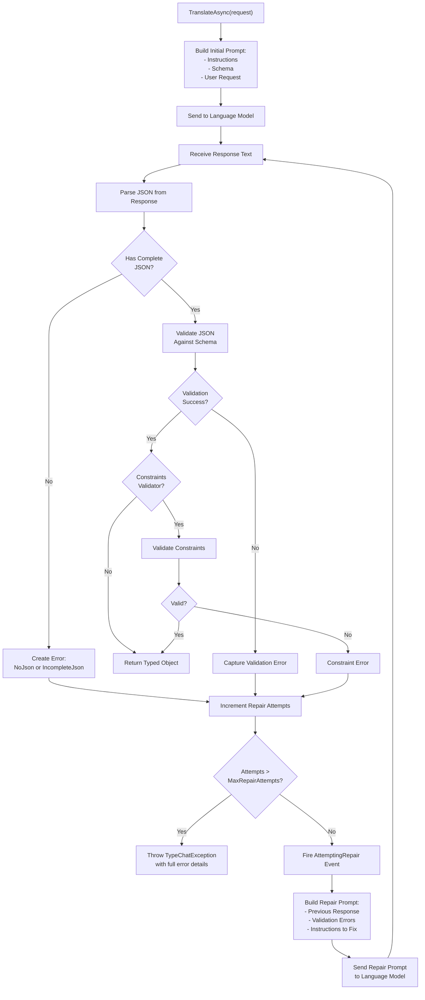
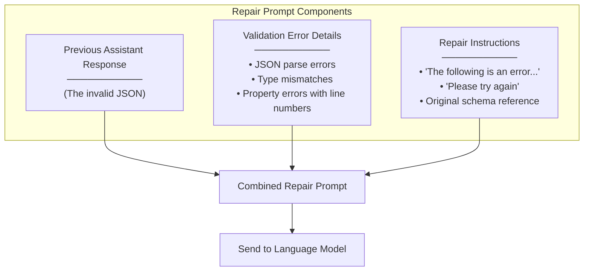
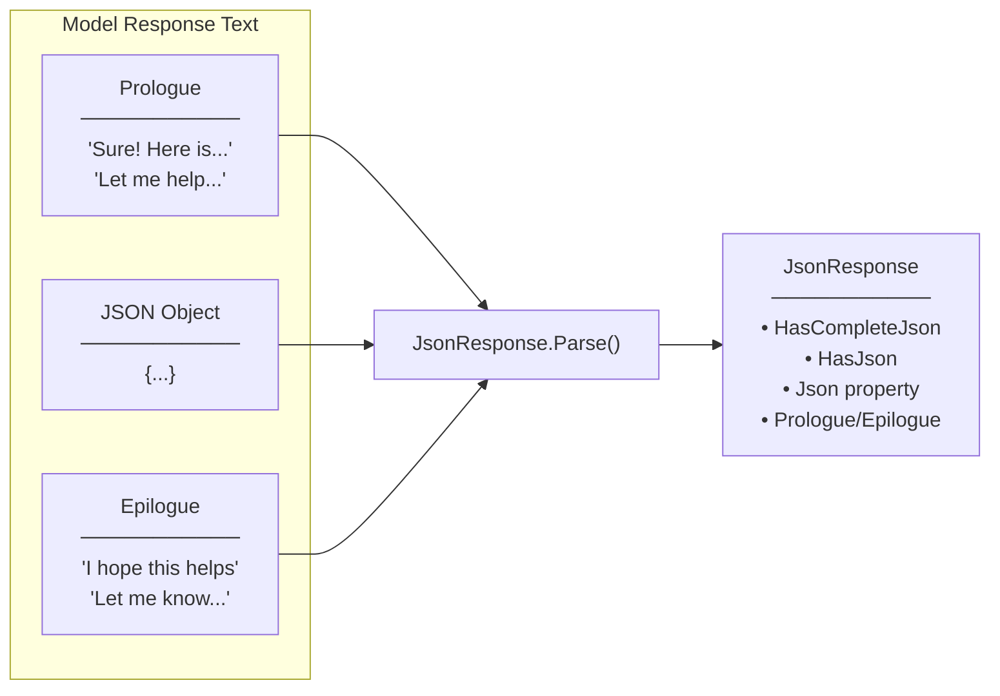
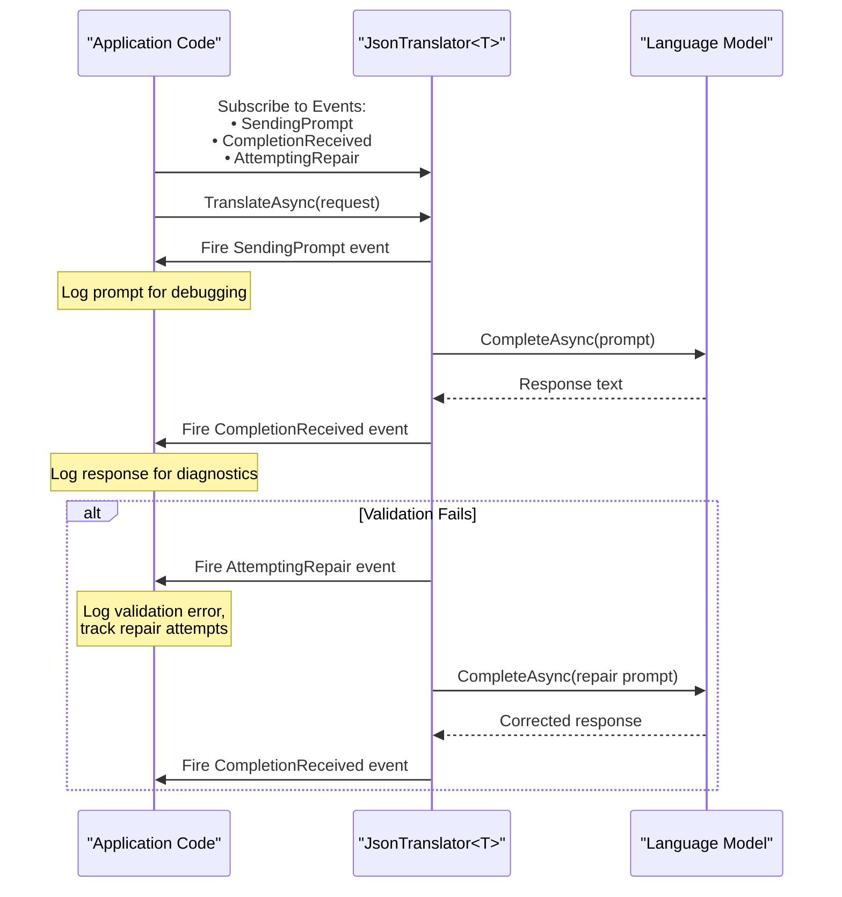
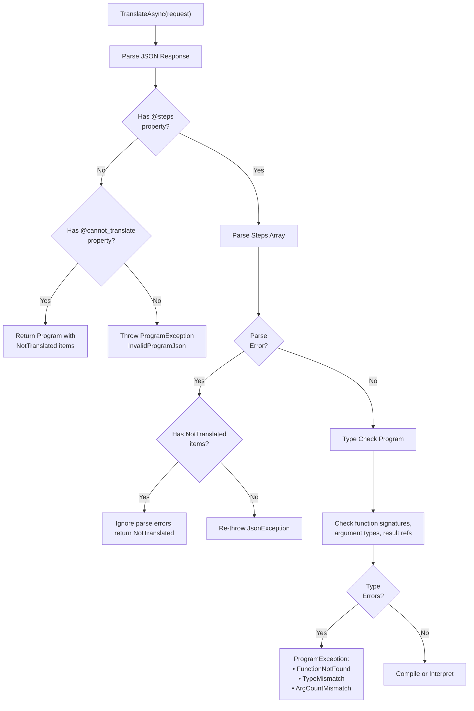
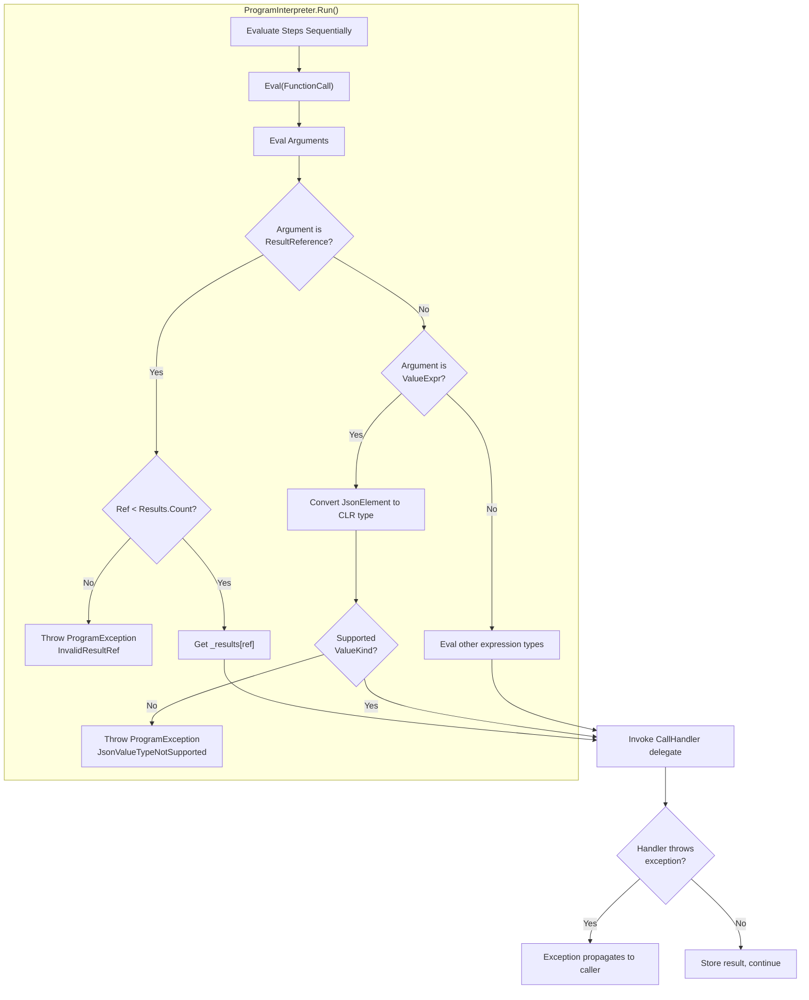

<!-- source: DeepWiki mcp.deepwiki.com · repo microsoft/typechat.net · page 11.2 Error Handling · fetched 2026-10-26 -->

# Error Handling

<details>
<summary>Relevant source files</summary>

The following files were used as context for generating this wiki page:

- [examples/MultiSchema/Program.cs](examples/MultiSchema/Program.cs)
- [src/typechat.program/ProgramException.cs](src/typechat.program/ProgramException.cs)
- [src/typechat.program/ProgramInterpreter.cs](src/typechat.program/ProgramInterpreter.cs)
- [src/typechat.program/ProgramParser.cs](src/typechat.program/ProgramParser.cs)
- [src/typechat/JsonResponse.cs](src/typechat/JsonResponse.cs)
- [src/typechat/JsonSerializerTypeValidator.cs](src/typechat/JsonSerializerTypeValidator.cs)
- [src/typechat/JsonTranslator.cs](src/typechat/JsonTranslator.cs)
- [src/typechat/ModelInfo.cs](src/typechat/ModelInfo.cs)
- [src/typechat/Prompt.cs](src/typechat/Prompt.cs)
- [src/typechat/TypeChatException.cs](src/typechat/TypeChatException.cs)

</details>


This page describes the error handling mechanisms in TypeChat.NET, including exception types, validation failures, automatic repair strategies, and diagnostic events. It covers error handling for both JSON translation and program execution.

For information about validation and repair mechanisms, see [Validation and Repair](#3.3). For debugging techniques, see [Debugging Techniques](#12.2).

---

## Exception Hierarchy

TypeChat.NET defines two primary exception types to handle errors at different layers of the system.

### TypeChatException

`TypeChatException` is thrown during JSON translation when the language model fails to produce valid output. It includes structured information about the failure, including the original request, the model's response, and a specific error code.

| Error Code | Description | When It Occurs |
|------------|-------------|----------------|
| `Unknown` | Unspecified error | Default error state |
| `NoJsonObject` | Model did not return JSON | Response contains no JSON braces `{}` |
| `JsonValidation` | JSON validation failed | JSON does not match target schema after all repair attempts |
| `NoTranslator` | No suitable translator found | Multi-schema routing could not find a matching translator |

**Key Properties:**
- `ErrorCode Code` - The specific error code
- `string Request` - The original user request that caused the error
- `JsonResponse? Response` - The model's response, including any partial JSON

Sources: [src/typechat/TypeChatException.cs:1-101]()

### ProgramException

`ProgramException` is thrown during program translation, compilation, or execution when issues occur with generated programs.

| Error Code | Description | When It Occurs |
|------------|-------------|----------------|
| `InvalidProgramJson` | Invalid program structure | JSON does not contain valid program syntax |
| `JsonValueTypeNotSupported` | Unsupported JSON value type | Unknown `JsonValueKind` encountered |
| `TypeMismatch` | Function argument type error | Argument type does not match expected parameter type |
| `InvalidResultRef` | Invalid result reference | `@ref` references non-existent or unavailable result |
| `ArgCountMismatch` | Wrong number of arguments | Function called with incorrect argument count |
| `FunctionNotFound` | Function does not exist | `@func` name not found in target API |
| `UnknownExpression` | Unrecognized expression type | Unknown expression node in program AST |

Sources: [src/typechat.program/ProgramException.cs:1-77]()

---

## The Validation and Repair Loop

TypeChat's core innovation is its automatic validation and repair mechanism. When the language model produces invalid JSON, the system feeds the validation errors back to the model to request corrections.

### Validation and Repair Workflow



**Key Configuration:**
- `MaxRepairAttempts` property (default = 1) controls how many repair attempts are made
- Set to 0 to disable repair and fail immediately on validation errors
- Each repair attempt includes the previous response and specific error messages

Sources: [src/typechat/JsonTranslator.cs:199-252]()

### Repair Prompt Construction

The repair prompt is constructed to give the language model precise feedback about what went wrong:



The `JsonSerializerTypeValidator` formats errors to include:
- Error message from JSON deserialization
- Property path where the error occurred (e.g., `"drinks.0.temperature"`)
- Line number in the JSON where the error was found
- Extract of the problematic line

Sources: [src/typechat/JsonTranslator.cs:267-270](), [src/typechat/JsonSerializerTypeValidator.cs:68-84]()

---

## Response Parsing and Incomplete JSON

The `JsonResponse` class handles model responses that may contain incomplete or malformed JSON, including prologue and epilogue text around the JSON object.

### Response Structure



**Parsing Logic:**
1. Find first `{` and last `}` in response
2. If no `{` found → entire text is prologue, `HasJson = false`
3. If `{` but no matching `}` → incomplete JSON, `HasCompleteJson = false`
4. If both found → extract JSON, set prologue/epilogue, `HasCompleteJson = true`

**Error Handling:**
- Incomplete JSON (has `{` but no `}`) triggers repair with error message "Json Object is incomplete"
- No JSON at all triggers repair with error message "The response is not Json"

Sources: [src/typechat/JsonResponse.cs:1-103]()

---

## Diagnostic Events

`JsonTranslator<T>` exposes events that allow monitoring of the translation process and capture errors for logging or debugging.

### Available Events

| Event | Type | When Fired | Use Case |
|-------|------|------------|----------|
| `SendingPrompt` | `Action<Prompt>` | Before sending prompt to model | Log prompts, inspect requests |
| `CompletionReceived` | `Action<string>` | After receiving model response | Log raw responses, capture output |
| `AttemptingRepair` | `Action<string>` | Before starting repair attempt | Monitor validation failures, track repair count |

### Event Subscription Pattern



**Event Safety:**
Events are wrapped in try-catch blocks [src/typechat/JsonTranslator.cs:291-313]() so that exceptions in event handlers do not disrupt the translation process.

Sources: [src/typechat/JsonTranslator.cs:152-166](), [src/typechat/JsonTranslator.cs:291-313]()

---

## Exception Handling Patterns

### Pattern 1: Basic Error Handling

```csharp
try
{
    var result = await translator.TranslateAsync(userInput);
    // Process result
}
catch (TypeChatException ex)
{
    switch (ex.Code)
    {
        case TypeChatException.ErrorCode.NoJsonObject:
            // Model didn't return JSON - may need to adjust prompt
            Console.WriteLine("Model did not return valid JSON");
            break;
        
        case TypeChatException.ErrorCode.JsonValidation:
            // Validation failed after all repair attempts
            Console.WriteLine($"Validation failed: {ex.Message}");
            // Check ex.Response for partial JSON
            break;
        
        case TypeChatException.ErrorCode.NoTranslator:
            // For multi-schema routing scenarios
            Console.WriteLine("Could not find suitable translator");
            break;
    }
}
```

### Pattern 2: Monitoring with Events

```csharp
var translator = new JsonTranslator<MyType>(model);

// Track repair attempts
int repairCount = 0;
translator.AttemptingRepair += (errorMessage) => {
    repairCount++;
    Logger.LogWarning($"Repair attempt {repairCount}: {errorMessage}");
};

// Log all prompts for debugging
translator.SendingPrompt += (prompt) => {
    Logger.LogDebug($"Sending prompt: {prompt}");
};

// Capture raw responses
translator.CompletionReceived += (response) => {
    Logger.LogDebug($"Received: {response}");
};
```

### Pattern 3: Controlling Repair Behavior

```csharp
// Fail fast without repair attempts
translator.MaxRepairAttempts = 0;

// Allow more repair attempts for complex schemas
translator.MaxRepairAttempts = 3;

// Monitor repair rate to detect schema issues
var successCount = 0;
var repairCount = 0;

translator.AttemptingRepair += _ => repairCount++;

try {
    var result = await translator.TranslateAsync(input);
    successCount++;
} catch (TypeChatException) {
    // Handle error
}

// If repair rate is high, schema may need improvement
var repairRate = (double)repairCount / (successCount + repairCount);
```

Sources: [src/typechat/JsonTranslator.cs:135-146](), [src/typechat/JsonTranslator.cs:185-252]()

---

## Program Execution Errors

Program translation and execution introduce additional error scenarios specific to code generation.

### Program Translation Error Flow



### Common Program Errors

**Function Not Found:**
```
ProgramException.ErrorCode.FunctionNotFound
Message: "@func calculateTotal not found in API"
```
Occurs when the program references a function that doesn't exist in the target API.

**Argument Count Mismatch:**
```
ProgramException.ErrorCode.ArgCountMismatch  
Message: "@func add: Wrong number of arguments passed. Expected 2, Got 3"
```
Occurs when a function call has the wrong number of arguments.

**Type Mismatch:**
```
ProgramException.ErrorCode.TypeMismatch
Message: "TypeMismatch: @func multiply @arg value: Expected Double, Got String"
```
Occurs when an argument type doesn't match the expected parameter type.

**Invalid Result Reference:**
```
ProgramException.ErrorCode.InvalidResultRef
Message: "Referencing @ref: 5 that is not available yet. Only 2 results available"
```
Occurs when a `@ref` references a step that hasn't executed yet or doesn't exist.

Sources: [src/typechat.program/ProgramException.cs:1-77](), [src/typechat.program/ProgramParser.cs:39-77]()

### Runtime Execution Errors

The `ProgramInterpreter` can encounter errors during execution:



**Error Handling Strategy:**
- Program execution stops on first error
- Exceptions from the call handler propagate directly to the caller
- Invalid result references are caught during evaluation [src/typechat.program/ProgramInterpreter.cs:236-243]()
- Unsupported JSON value types throw immediately [src/typechat.program/ProgramInterpreter.cs:185-200]()

Sources: [src/typechat.program/ProgramInterpreter.cs:1-257]()

---

## Best Practices for Error Handling

### 1. Set Appropriate MaxRepairAttempts

**For simple schemas:**
```csharp
translator.MaxRepairAttempts = 1; // Default, usually sufficient
```

**For complex nested schemas:**
```csharp
translator.MaxRepairAttempts = 2; // Allow more repair attempts
```

**For high-confidence scenarios:**
```csharp
translator.MaxRepairAttempts = 0; // Fail fast, no repair
```

### 2. Use Events for Diagnostics

Always subscribe to events during development to understand error patterns:

```csharp
translator.AttemptingRepair += (error) => {
    // Log to identify schema design issues
    // High repair rates indicate problems
};
```

### 3. Handle NotTranslated Items

For program translation, check for partial understanding:

```csharp
var program = await programTranslator.TranslateAsync(request);

if (program.HasNotTranslated)
{
    Console.WriteLine("Could not fully understand:");
    foreach (var item in program.NotTranslated)
    {
        Console.WriteLine($"  - {item}");
    }
    // Decide whether to proceed with partial program
}
```

### 4. Differentiate Error Types

```csharp
try
{
    var result = await translator.TranslateAsync(input);
}
catch (TypeChatException ex) when (ex.Code == TypeChatException.ErrorCode.NoJsonObject)
{
    // Prompt engineering issue - model not returning JSON
    // May need to adjust system instructions
}
catch (TypeChatException ex) when (ex.Code == TypeChatException.ErrorCode.JsonValidation)
{
    // Schema mismatch - likely schema design issue
    // Review ex.Message for specific validation errors
}
catch (ProgramException ex) when (ex.Code == ProgramException.ErrorCode.FunctionNotFound)
{
    // API definition issue - function not in target interface
}
catch (ProgramException ex) when (ex.Code == ProgramException.ErrorCode.TypeMismatch)
{
    // Type safety issue - review API signatures
}
```

### 5. Provide User-Friendly Error Messages

```csharp
try
{
    return await translator.TranslateAsync(userInput);
}
catch (TypeChatException ex)
{
    // Don't expose raw exception to end users
    switch (ex.Code)
    {
        case TypeChatException.ErrorCode.JsonValidation:
            return "I couldn't quite understand that. Could you rephrase?";
        
        case TypeChatException.ErrorCode.NoJsonObject:
            return "I'm having trouble processing your request. Please try again.";
        
        default:
            return "An error occurred. Please try again later.";
    }
}
```

### 6. Monitor Error Rates

Track error rates to identify when schema improvements are needed:

```csharp
var metrics = new TranslationMetrics();

translator.AttemptingRepair += _ => metrics.RepairAttempts++;
translator.CompletionReceived += _ => metrics.TotalRequests++;

// Alert if repair rate exceeds threshold
if (metrics.RepairRate > 0.3) // 30% repair rate
{
    Logger.LogWarning("High repair rate detected - review schema design");
}
```

Sources: [src/typechat/JsonTranslator.cs:135-146](), [src/typechat.program/ProgramParser.cs:55-68]()

---

## Multi-Schema Error Handling

When using multi-schema routing, handle the `NoTranslator` error code appropriately:

```csharp
var router = new TextRequestRouter<IHandler>(model);
// ... configure routes ...

try
{
    var match = await router.ClassifyRequestAsync(input);
    if (match.Value != null)
    {
        await match.Value.HandleAsync(input);
    }
    else
    {
        // No matching translator found
        Console.WriteLine("I don't know how to help with that.");
        // Optionally show available capabilities
    }
}
catch (TypeChatException ex) when (ex.Code == TypeChatException.ErrorCode.NoTranslator)
{
    // Classification failed to find match
    // Provide fallback behavior
}
```

Sources: [examples/MultiSchema/Program.cs:38-54]()

---

