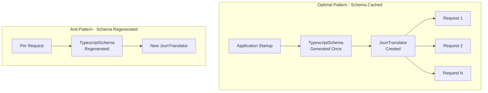
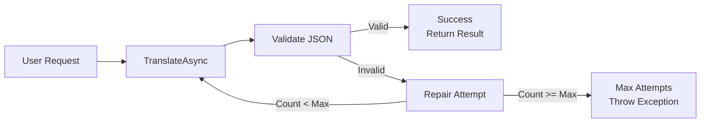
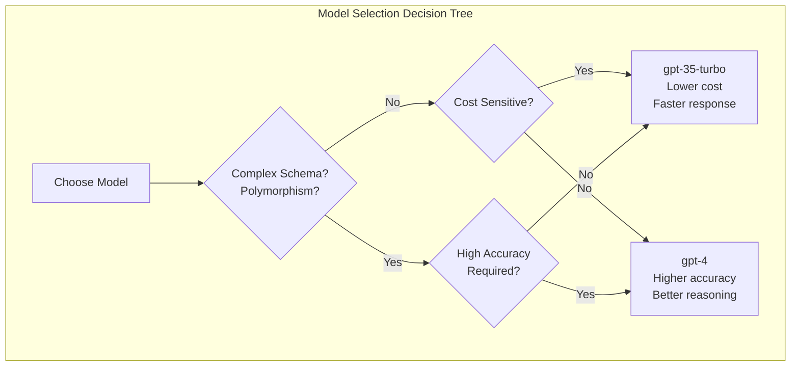
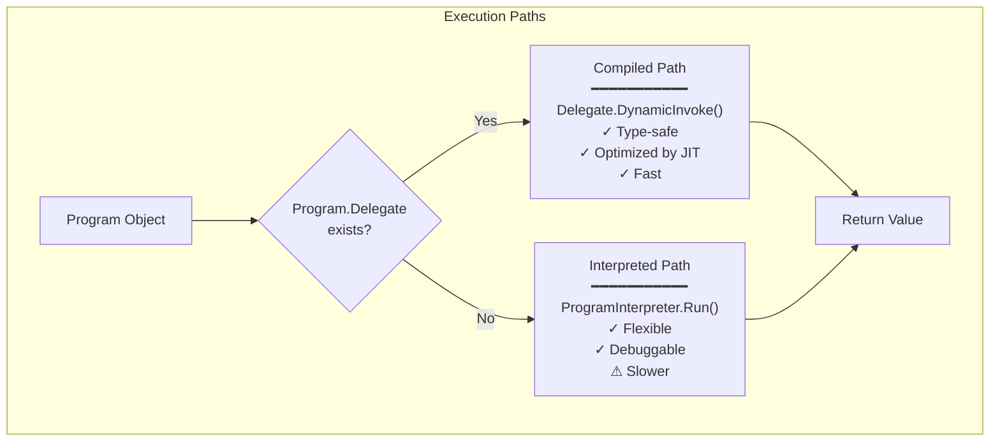
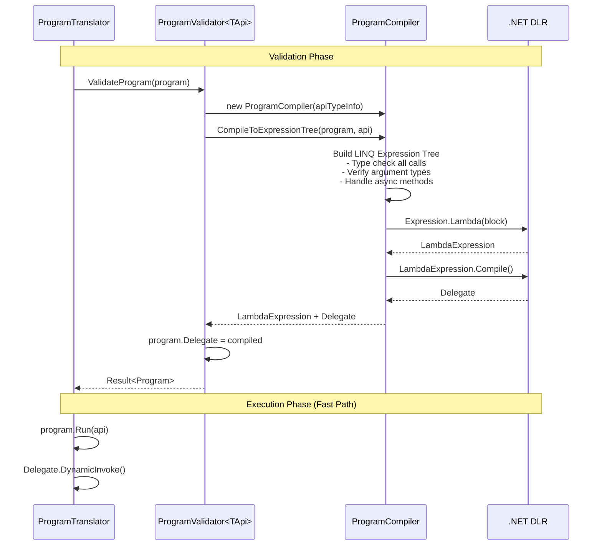
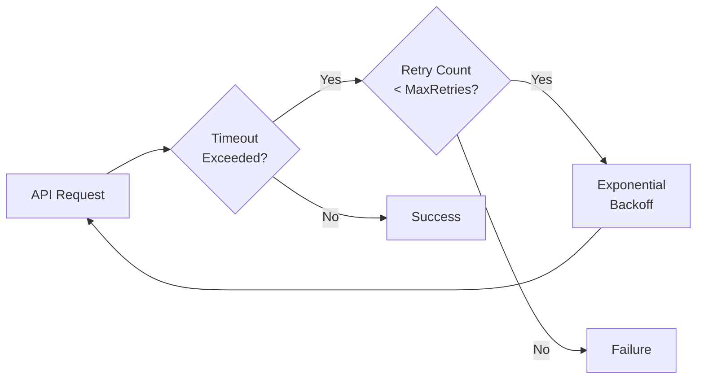
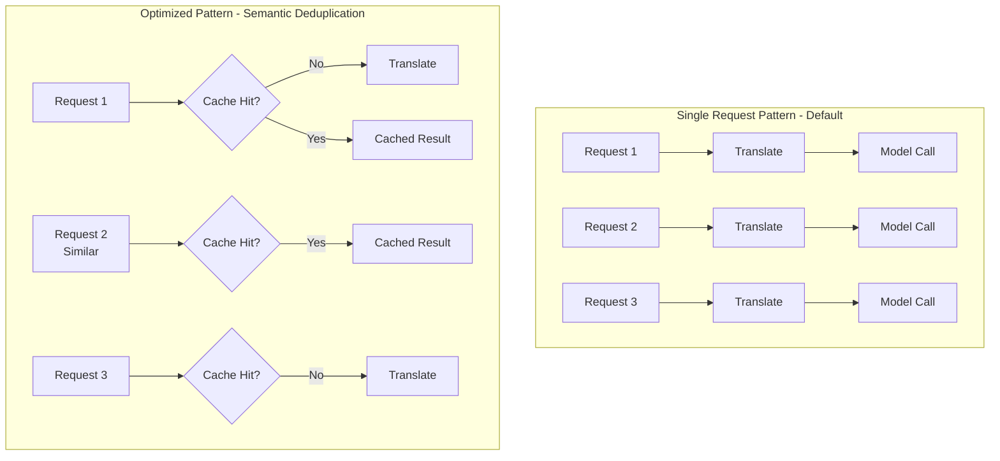
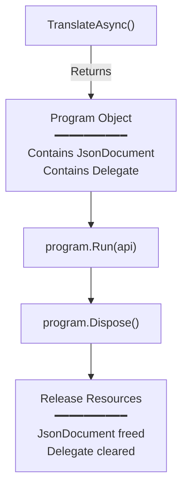
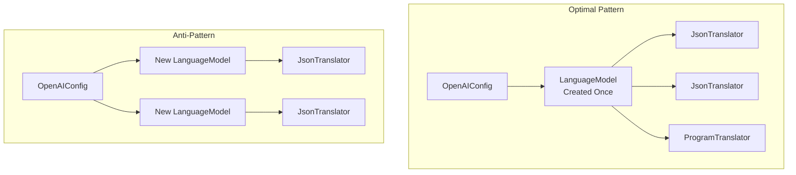
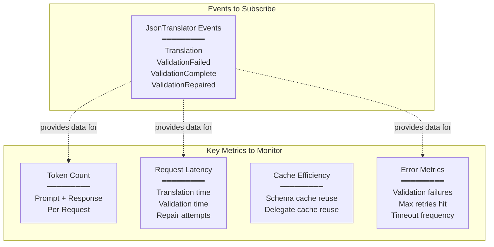

<!-- source: DeepWiki mcp.deepwiki.com · repo microsoft/typechat.net · page 11.3 Performance Optimization · fetched 2026-10-26 -->

# Performance Optimization

<details>
<summary>Relevant source files</summary>

The following files were used as context for generating this wiki page:

- [README.md](README.md)
- [examples/Math/Program.cs](examples/Math/Program.cs)
- [examples/Sentiment/Program.cs](examples/Sentiment/Program.cs)
- [examples/appSettings.json](examples/appSettings.json)
- [src/typechat.program/ProgramCompiler.cs](src/typechat.program/ProgramCompiler.cs)
- [src/typechat.program/ProgramSchemaImpl.cs](src/typechat.program/ProgramSchemaImpl.cs)
- [src/typechat.program/ProgramTranslator.cs](src/typechat.program/ProgramTranslator.cs)
- [src/typechat.program/ProgramValidator.cs](src/typechat.program/ProgramValidator.cs)

</details>


This document covers strategies for optimizing TypeChat.NET applications across three key dimensions: token usage (which directly impacts API costs), execution performance, and resource management. These optimizations apply to all TypeChat components including `JsonTranslator<T>`, `ProgramTranslator<TApi>`, and conversational agents.

For schema design best practices that also impact performance, see [Schema Design](#11.1). For error handling strategies that affect retry behavior, see [Error Handling](#11.2).

## Token Usage Optimization

Language model API calls are billed per token. Reducing token consumption directly reduces operational costs while maintaining functionality.

### Schema Caching

TypeScript schemas are generated once and reused across all translation requests. The `TypescriptSchema` object should be created during initialization, not per-request.



**Sources:** [src/typechat.program/ProgramTranslator.cs:46-51]()

The `ProgramTranslator` class uses a static field to cache the program schema:

| Optimization | Implementation | Impact |
|-------------|----------------|---------|
| Static Schema | `static readonly TypescriptSchema ProgramSchema` | Schema generated once per application lifetime |
| Reusable Translator | Create translator at startup, reuse for all requests | Eliminates schema generation overhead |
| Language Model Reuse | Single `LanguageModel` instance | Maintains HTTP client pool |

**Sources:** [src/typechat.program/ProgramTranslator.cs:46-51](), [README.md:193-207]()

### Controlling Repair Attempts

The `MaxRepairAttempts` property controls how many times TypeChat will attempt to repair invalid JSON. Each repair attempt consumes additional tokens.



| Setting | Token Impact | Use Case |
|---------|-------------|----------|
| `MaxRepairAttempts = 1` | Minimal - fails fast | Simple schemas, cost-sensitive applications |
| `MaxRepairAttempts = 2-3` | Moderate - default | Most production scenarios |
| `MaxRepairAttempts = 5+` | High - multiple retries | Complex schemas, high accuracy requirements |

**Example configuration:**

```csharp
var translator = new JsonTranslator<CalendarActions>(model);
translator.MaxRepairAttempts = 2;  // Limit to 2 repair attempts
```

**Sources:** [examples/Math/Program.cs:20](), [src/typechat.program/ProgramTranslator.cs:89-94]()

### Model Selection Strategy

Different OpenAI models have different token costs and capabilities. Choose the appropriate model for your use case.



| Model | Best For | Token Cost | Considerations |
|-------|----------|------------|----------------|
| `gpt-35-turbo` | Simple schemas, high volume | Lower | May require more repair attempts |
| `gpt-4` | Complex schemas, polymorphism, programs | Higher | Fewer repair attempts, better first-try accuracy |
| `ada-002` | Embeddings only | Lowest | Not for translation |

**Sources:** [README.md:80-85](), [examples/appSettings.json:1-21]()

### Schema Design for Efficiency

Concise schemas consume fewer tokens in prompts. Apply these principles:

| Technique | Example | Token Savings |
|-----------|---------|---------------|
| Vocabularies | `[JsonVocab("milk | cream | sugar")]` | Constrains LLM output space |
| Minimal comments | Avoid verbose `[Comment]` attributes | Reduces prompt size |
| Type reuse | Shared base types for polymorphism | Prevents schema duplication |
| Avoid deep nesting | Flatten object hierarchies where possible | Reduces schema complexity |

**Sources:** [README.md:38-45]()

## Execution Performance

Program execution can be optimized through compilation and caching strategies.

### Compiled vs Interpreted Execution

`ProgramTranslator<TApi>` offers two execution paths with significant performance differences:



**Performance comparison for repeated execution:**

| Execution Mode | First Execution | Subsequent Executions | Use Case |
|----------------|----------------|----------------------|----------|
| Compiled (with `ProgramValidator<TApi>`) | ~10-50ms (compilation) | <1ms | Production, repeated execution |
| Interpreted | ~5-10ms | ~5-10ms | Development, debugging, one-time execution |

**Sources:** [src/typechat.program/ProgramSchemaImpl.cs:72-86](), [src/typechat.program/ProgramCompiler.cs:1-459]()

### Compilation Process

The `ProgramValidator<TApi>` automatically compiles programs into delegates during validation:



**Key compilation steps:**

1. **Type Checking** - [src/typechat.program/ProgramCompiler.cs:154-207](): Verifies all function calls match API signatures
2. **Expression Tree Building** - [src/typechat.program/ProgramCompiler.cs:46-59](): Converts JSON AST to LINQ expressions
3. **Async Handling** - [src/typechat.program/ProgramCompiler.cs:374-390](): Wraps Task-returning methods with synchronous waits
4. **JIT Compilation** - Delegate creation triggers JIT optimization

**Sources:** [src/typechat.program/ProgramValidator.cs:77-90](), [src/typechat.program/ProgramCompiler.cs:14-459]()

### Delegate Caching and Reuse

Once compiled, the `Program.Delegate` can be reused for the same program structure with different API implementations:

```csharp
// First execution - compilation happens
Program program = await translator.TranslateAsync("add 2 and 3");
var result1 = program.Run(api);  // Compiles to delegate

// Second execution - reuses compiled delegate
var result2 = program.Run(api);  // Fast path: delegate invocation

// Same program structure, different API instance
var api2 = new MathAPI();
var result3 = program.Run(api2);  // Still uses compiled delegate
```

**Sources:** [src/typechat.program/ProgramSchemaImpl.cs:64-86]()

### API Implementation Patterns

The implementation of your API methods impacts execution performance:

| Pattern | Performance | Implementation |
|---------|------------|----------------|
| Synchronous methods | Fastest | `double Add(double a, double b)` |
| Async methods (awaited) | Overhead from Task unwrapping | `Task<double> AddAsync(...)` |
| Void returns | Fastest for side effects | `void Log(string message)` |

The compiler automatically handles async methods by generating synchronous waits via `CompilerApi.WaitForResult()` at [src/typechat.program/ProgramCompiler.cs:448-457]().

**Sources:** [src/typechat.program/ProgramCompiler.cs:374-390](), [src/typechat.program/ProgramCompiler.cs:409-458]()

## Request Configuration

HTTP client configuration impacts both performance and reliability.

### Retry and Timeout Settings

Configure `OpenAIConfig` properties to balance responsiveness and resilience:



**Configuration in appSettings.json:**

| Setting | Default | Recommended Range | Impact |
|---------|---------|-------------------|--------|
| `MaxRetries` | 2 | 1-3 | Transient network failure recovery |
| `TimeoutMs` | 30000 (30s) | 15000-60000 | Prevents indefinite hangs |

**Sources:** [examples/appSettings.json:9-13]()

### Request Batching Considerations

TypeChat processes requests individually. For high-volume scenarios, consider:



**Implementation strategies:**

1. **Application-level caching** - Cache translation results by input hash
2. **Semantic deduplication** - Use embeddings to detect similar requests
3. **Parallel processing** - Use `Task.WhenAll()` for independent requests

**Sources:** N/A - application-level pattern

## Resource Management

Proper resource disposal prevents memory leaks and resource exhaustion.

### Disposing Programs

`Program` objects implement `IDisposable` because they hold `JsonDocument` references:



**Correct usage pattern:**

```csharp
// Using statement ensures disposal
using Program program = await translator.TranslateAsync(input);
program.Run(api);
// program.Dispose() called automatically

// Manual disposal
Program program = await translator.TranslateAsync(input);
try {
    program.Run(api);
} finally {
    program.Dispose();
}
```

**What gets disposed:**
- `JsonDocument` at [src/typechat.program/ProgramSchemaImpl.cs:11]() - releases unmanaged memory
- `Delegate` reference cleared at [src/typechat.program/ProgramSchemaImpl.cs:108]() - allows GC

**Sources:** [src/typechat.program/ProgramSchemaImpl.cs:9-110](), [examples/Math/Program.cs:30]()

### Language Model Reuse

`LanguageModel` instances should be created once and reused to maintain HTTP client connection pooling:



**Benefits of model reuse:**
- HTTP client connection pooling (fewer TCP handshakes)
- Reduced memory allocation
- Consistent retry/timeout behavior

**Sources:** [README.md:193-207](), [examples/Sentiment/Program.cs:10-17]()

### Memory Pressure from Large Schemas

Complex schemas with many vocabularies or large type hierarchies increase memory usage:

| Component | Memory Impact | Mitigation |
|-----------|---------------|------------|
| `TypescriptSchema.SchemaText` | String storage (~1-50KB per schema) | Static caching, share across translators |
| `JsonDocument` in validation | Temporary (~2x JSON size) | Dispose after translation |
| Compiled delegates | IL code (~5-50KB per program) | Only compile frequently-used patterns |
| Vocabulary dictionaries | ~100 bytes per vocab entry | Use vocabularies judiciously |

**Sources:** [README.md:36-45]()

## Monitoring and Measurement

Implement telemetry to identify performance bottlenecks:



**Event subscription for monitoring:**

```csharp
translator.Translation += (sender, e) => {
    // Log: input length, prompt tokens
};

translator.ValidationComplete += (sender, e) => {
    // Log: validation time, success/failure, repair count
};

translator.ValidationRepaired += (sender, e) => {
    // Alert: repair attempt (indicates schema/model mismatch)
};
```

**Key Performance Indicators (KPIs):**

| Metric | Target | Action if Exceeded |
|--------|--------|-------------------|
| Average tokens/request | <2000 | Simplify schema, reduce comments |
| 95th percentile latency | <3s | Check timeout settings, consider gpt-3.5-turbo |
| Repair rate | <20% | Improve schema clarity, consider gpt-4 |
| Cache hit rate | >80% | Verify schema caching implementation |

**Sources:** [README.md:17]() (mentions events in examples)

## Performance Checklist

Use this checklist to ensure optimal performance:

**Initialization:**
- [ ] Create `LanguageModel` once at startup
- [ ] Create translators once, reuse for all requests
- [ ] Schema generation happens at initialization, not per-request
- [ ] Configure `MaxRepairAttempts` based on cost/accuracy requirements

**Runtime:**
- [ ] Use `using` statement for `Program` objects
- [ ] Set appropriate `TimeoutMs` and `MaxRetries` for your environment
- [ ] Monitor token usage via events
- [ ] Use compiled programs for repeated execution

**Production:**
- [ ] Implement application-level caching for common requests
- [ ] Choose appropriate model (gpt-3.5-turbo vs gpt-4) based on complexity
- [ ] Monitor validation failure and repair rates
- [ ] Configure logging for performance metrics

**Sources:** Multiple files across codebase

---

