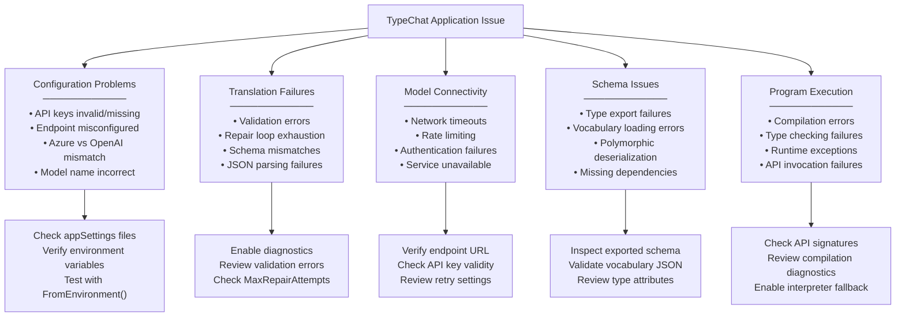
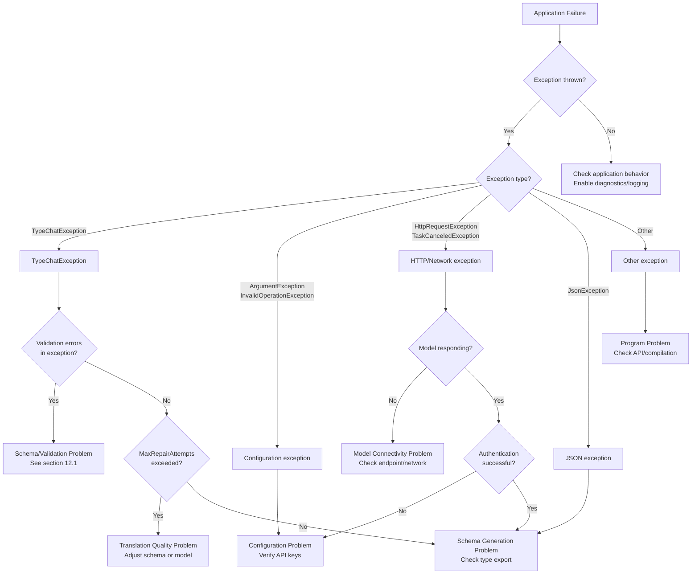
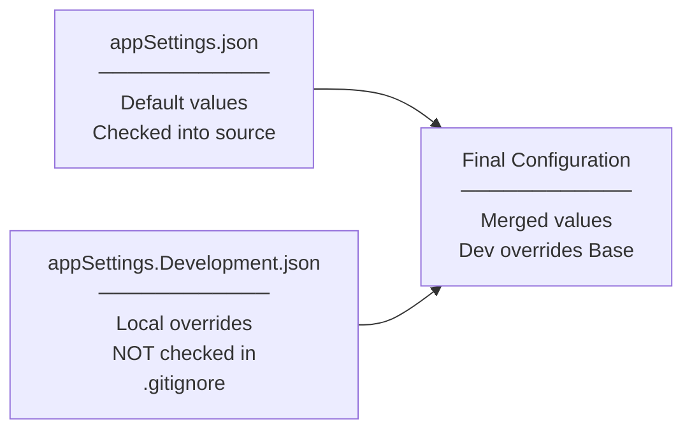
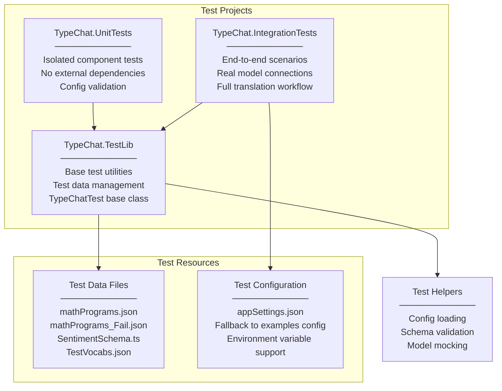

<!-- source: DeepWiki mcp.deepwiki.com · repo microsoft/typechat.net · page 12 Troubleshooting · fetched 2026-10-26 -->

# Troubleshooting

<details>
<summary>Relevant source files</summary>

The following files were used as context for generating this wiki page:

- [README.md](README.md)
- [examples/Sentiment/Program.cs](examples/Sentiment/Program.cs)
- [examples/appSettings.json](examples/appSettings.json)
- [tests/TypeChat.IntegrationTests/TypeChat.IntegrationTests.csproj](tests/TypeChat.IntegrationTests/TypeChat.IntegrationTests.csproj)
- [tests/TypeChat.IntegrationTests/appSettings.json](tests/TypeChat.IntegrationTests/appSettings.json)
- [tests/TypeChat.TestLib/TypeChat.TestLib.csproj](tests/TypeChat.TestLib/TypeChat.TestLib.csproj)
- [tests/TypeChat.UnitTests/TestConfig.cs](tests/TypeChat.UnitTests/TestConfig.cs)
- [tests/TypeChat.UnitTests/TypeChat.UnitTests.csproj](tests/TypeChat.UnitTests/TypeChat.UnitTests.csproj)

</details>


This page provides an overview of troubleshooting TypeChat.NET applications, including common problem areas, diagnostic workflows, and initial steps for resolving issues. For detailed catalogs of specific errors and their solutions, see [Common Errors](#12.1). For in-depth debugging techniques and tools, see [Debugging Techniques](#12.2).

For guidance on handling validation failures and repair mechanisms at the application level, see [Validation and Repair](#3.3). For best practices on error handling patterns, see [Error Handling](#11.2).

## Problem Categories

TypeChat.NET issues typically fall into one of five major categories, each with distinct symptoms and diagnostic approaches:



**Sources:** [README.md:149-208](), [examples/appSettings.json](), [tests/TypeChat.IntegrationTests/appSettings.json]()

## Diagnostic Workflow

When troubleshooting a TypeChat.NET application, follow this systematic workflow to identify the root cause:



**Sources:** [README.md:28-36](), [src/typechat/JsonTranslator.cs]()

## Configuration Issues

Configuration problems are the most common source of issues, particularly for new users. The `OpenAIConfig` class manages all connection settings and can be loaded from multiple sources.

### Configuration Loading Methods

| Method | Source | Use Case |
|--------|--------|----------|
| `Config.LoadOpenAI()` | appSettings.json + appSettings.Development.json | Examples and local development |
| `OpenAIConfig.LoadFromJsonFile(path)` | Specified JSON file | Custom configuration locations |
| `OpenAIConfig.FromEnvironment()` | Environment variables | Production deployments, CI/CD |

**Sources:** [README.md:192-207](), [examples/Sentiment/Program.cs:12-16]()

### Configuration File Locations

The examples use a hierarchical configuration approach where `appSettings.Development.json` overrides `appSettings.json`:



The test projects attempt to locate configuration using fallback logic:

1. Local `appSettings.Development.json` in test project directory
2. Fallback to `examples/appSettings.Development.json`
3. Base `appSettings.json` as defaults

**Sources:** [tests/TypeChat.IntegrationTests/TypeChat.IntegrationTests.csproj:34-47](), [tests/TypeChat.UnitTests/TypeChat.UnitTests.csproj:15-17]()

### Environment Variables

When using `OpenAIConfig.FromEnvironment()`, the following environment variables are checked:

| Azure OpenAI | Standard OpenAI | Purpose |
|--------------|-----------------|---------|
| `AZURE_OPENAI_ENDPOINT` | `OPENAI_ENDPOINT` | API endpoint URL |
| `AZURE_OPENAI_API_KEY` | `OPENAI_API_KEY` | Authentication key or "identity" |
| - | `OPENAI_ORGANIZATION` | OpenAI organization ID |
| `OPENAI_MODEL` | `OPENAI_MODEL` | Model/deployment name |
| `OPENAI_EMBEDDINGMODEL` | `OPENAI_EMBEDDINGMODEL` | Embedding model name |

**Sources:** [README.md:195-198](), [tests/TypeChat.UnitTests/TestConfig.cs:8-100]()

### Azure Identity Configuration

For production scenarios using Azure identity instead of API keys, use the special key value `"identity"`:

```json
{
  "OpenAI": {
    "Azure": true,
    "ApiKey": "identity",
    "Endpoint": "https://YOUR_RESOURCE_NAME.openai.azure.com",
    "Model": "gpt-35-turbo"
  }
}
```

This instructs TypeChat to use `DefaultAzureCredential` for authentication, which works with managed identities, Azure CLI credentials, and other Azure identity providers.

**Sources:** [README.md:158-179]()

## Translation and Validation Failures

Translation failures occur during the core TypeChat workflow when the language model produces JSON that cannot be validated or deserialized. The system attempts automatic repair, but this can fail.

### Translation Failure Points

```mermaid
sequenceDiagram
    participant App as "Application"
    participant JT as "JsonTranslator&lt;T&gt;"
    participant LM as "LanguageModel"
    participant Val as "Validator"
    
    Note over App,Val: Translation Attempt
    App->>JT: TranslateAsync(input)
    JT->>LM: CompleteAsync(prompt)
    LM-->>JT: Response text
    
    alt Parse Failure
        JT->>JT: Parse JSON
        Note right of JT: JsonException thrown<br/>Invalid JSON syntax
    end
    
    JT->>Val: Validate JSON
    
    alt Validation Failure (attempt < MaxRepairAttempts)
        Val-->>JT: Validation errors
        Note right of JT: Repair loop iteration
        JT->>LM: CompleteAsync(repair prompt)
        LM-->>JT: Repaired response
    else Max Attempts Exceeded
        Val-->>JT: Still invalid
        JT-->>App: TypeChatException
        Note right of App: Check validation errors<br/>Review schema<br/>Consider adjusting MaxRepairAttempts
    end
    
    alt Deserialization Failure
        JT->>JT: Deserialize to T
        Note right of JT: JsonException thrown<br/>Type mismatch
    end
```

### Key Configuration Properties

The `JsonTranslator<T>` class exposes configuration properties that affect validation behavior:

| Property | Default | Purpose |
|----------|---------|---------|
| `MaxRepairAttempts` | 3 | Maximum validation repair iterations |
| `StripComments` | true | Strip JSON comments before parsing |
| `CreatePrompts` | DefaultPrompts | Customize prompt generation |

To increase repair attempts for complex schemas:

```csharp
var translator = new JsonTranslator<ComplexType>(model)
{
    MaxRepairAttempts = 5
};
```

**Sources:** [README.md:28-36](), [src/typechat/JsonTranslator.cs]()

## Model Connectivity

Connectivity issues manifest as HTTP exceptions, timeouts, or authentication failures when communicating with OpenAI or Azure OpenAI services.

### HTTP Configuration

The `OpenAIConfig` class includes retry and timeout settings:

```json
{
  "OpenAI": {
    "MaxRetries": 2,
    "TimeoutMs": 30000
  }
}
```

| Setting | Default | Purpose |
|---------|---------|---------|
| `MaxRetries` | 2 | HTTP retry attempts for transient failures |
| `TimeoutMs` | 30000 | Request timeout in milliseconds (30 seconds) |

**Sources:** [examples/appSettings.json:9-13]()

### Endpoint Validation

Verify that endpoint URLs are correctly formatted:

| Service | Expected Format | Example |
|---------|----------------|---------|
| Azure OpenAI | `https://{resource}.openai.azure.com` | `https://myresource.openai.azure.com` |
| OpenAI | `https://api.openai.com/v1/chat/completions` | `https://api.openai.com/v1/chat/completions` |

**Sources:** [README.md:162-189]()

## Quick Diagnostics Checklist

Use this checklist to quickly identify common issues:

### Configuration Checks

- [ ] `appSettings.Development.json` exists and contains valid values (not `"?"`)
- [ ] `Azure` property matches the service type (true for Azure OpenAI, false for OpenAI)
- [ ] `Endpoint` URL is correctly formatted for the service type
- [ ] `ApiKey` is valid or set to `"identity"` for Azure identity
- [ ] `Model` name matches an existing deployment (Azure) or model (OpenAI)
- [ ] For tests: configuration file is copied to output directory

**Sources:** [README.md:149-190](), [tests/TypeChat.IntegrationTests/TypeChat.IntegrationTests.csproj:34-47]()

### Translation Checks

- [ ] Schema exports without errors (check TypeScript output)
- [ ] Vocabularies load correctly (check JSON syntax)
- [ ] `MaxRepairAttempts` is sufficient for schema complexity
- [ ] Request input is clear and within model's capabilities
- [ ] Model has sufficient context window for schema size

**Sources:** [README.md:28-45]()

### Program Checks (for TypeChat.Program)

- [ ] API interface methods have supported signatures
- [ ] Program compilation diagnostics are reviewed
- [ ] Interpreter fallback works if compilation fails
- [ ] API implementation is provided to executor

**Sources:** [README.md:47-67]()

### Test Execution Checks

- [ ] API keys/credentials are configured for integration tests
- [ ] Test data files are copied to output directory (`*.json`, `*.ts`)
- [ ] Network connectivity to OpenAI services is available
- [ ] Sufficient API quota/rate limits are available

**Sources:** [tests/TypeChat.TestLib/TypeChat.TestLib.csproj:28-47]()

## Test Infrastructure for Diagnostics

The test projects provide infrastructure that can be used for diagnostic purposes:



Key test utilities for diagnostics:

| Class/File | Purpose |
|------------|---------|
| `TypeChatTest` | Base class with common test utilities |
| `mathPrograms_Fail.json` | Known failure cases for validation |
| `TestVocabs.json` | Vocabulary loading test data |
| `SentimentSchema.ts` | Hand-authored schema for comparison |

**Sources:** [tests/TypeChat.TestLib/TypeChat.TestLib.csproj:28-47](), [tests/TypeChat.UnitTests/TestConfig.cs:1-100]()

## Next Steps

For comprehensive coverage of specific error messages and their resolutions, see [Common Errors](#12.1).

For detailed debugging techniques including event tracing, logging, and diagnostic tools, see [Debugging Techniques](#12.2).

For guidance on schema design that minimizes translation failures, see [Schema Design](#11.1).

For understanding the validation and repair mechanism in depth, see [Validation and Repair](#3.3).

**Sources:** [README.md:1-243](), [examples/Sentiment/Program.cs:1-43](), [tests/TypeChat.IntegrationTests/TypeChat.IntegrationTests.csproj:1-50](), [tests/TypeChat.UnitTests/TypeChat.UnitTests.csproj:1-36](), [tests/TypeChat.TestLib/TypeChat.TestLib.csproj:1-50]()

---

