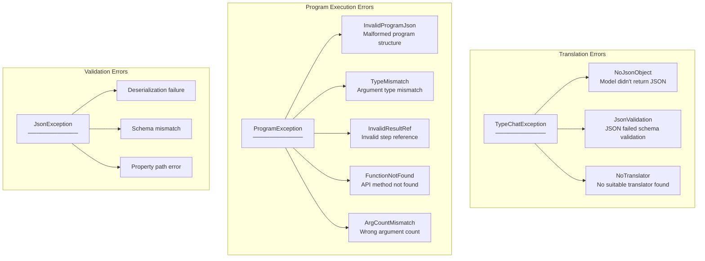
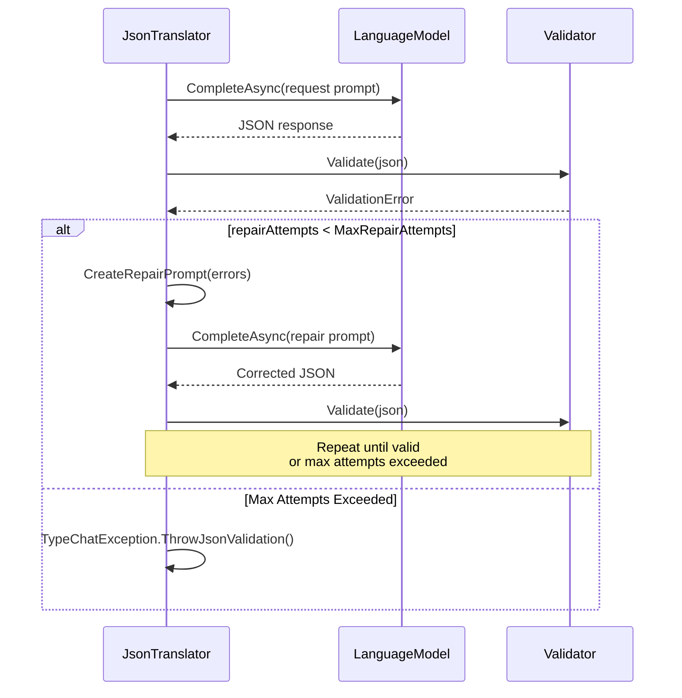
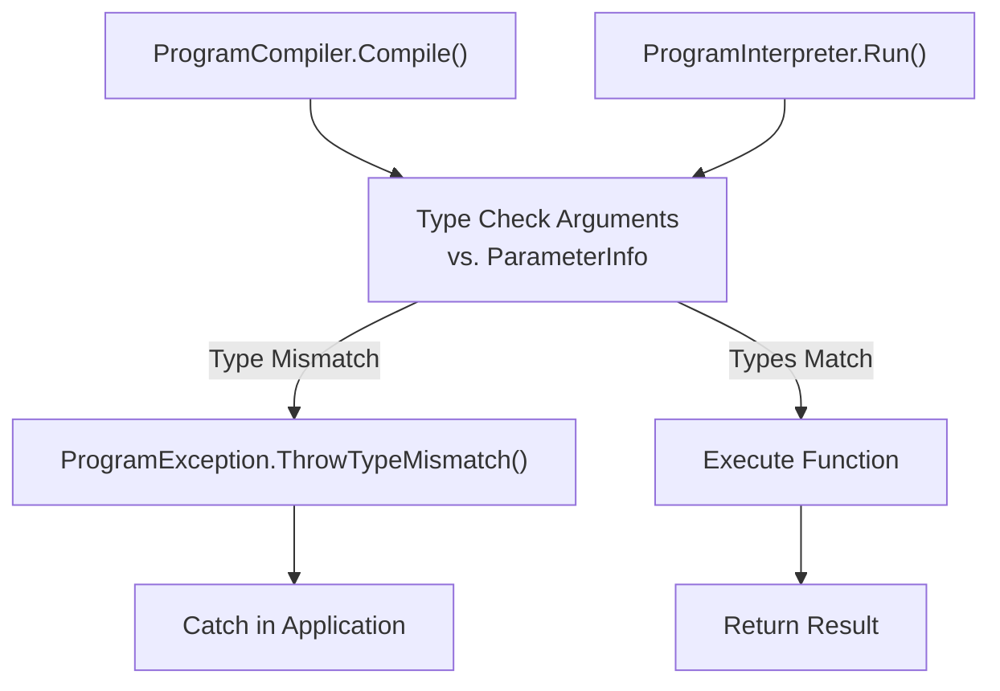
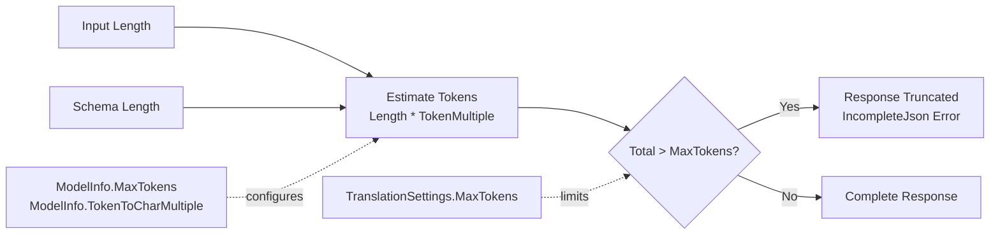
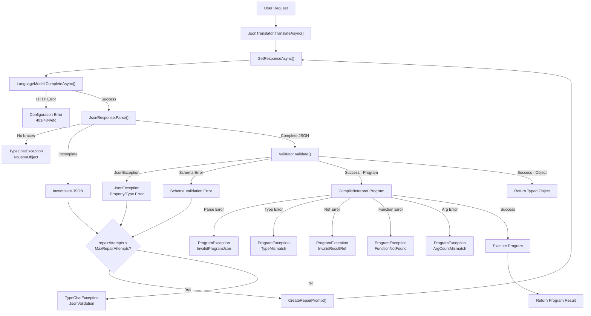

<!-- source: DeepWiki mcp.deepwiki.com · repo microsoft/typechat.net · page 12.1 Common Errors · fetched 2026-10-26 -->

# Common Errors

<details>
<summary>Relevant source files</summary>

The following files were used as context for generating this wiki page:

- [examples/MultiSchema/Program.cs](examples/MultiSchema/Program.cs)
- [src/typechat.program/ProgramException.cs](src/typechat.program/ProgramException.cs)
- [src/typechat.program/ProgramInterpreter.cs](src/typechat.program/ProgramInterpreter.cs)
- [src/typechat.program/ProgramParser.cs](src/typechat.program/ProgramParser.cs)
- [src/typechat/JsonResponse.cs](src/typechat/JsonResponse.cs)
- [src/typechat/JsonSerializerTypeValidator.cs](src/typechat/JsonSerializerTypeValidator.cs)
- [src/typechat/JsonTranslator.cs](src/typechat/JsonTranslator.cs)
- [src/typechat/ModelInfo.cs](src/typechat/ModelInfo.cs)
- [src/typechat/Prompt.cs](src/typechat/Prompt.cs)
- [src/typechat/TypeChatException.cs](src/typechat/TypeChatException.cs)

</details>


This page catalogs common errors that occur when using TypeChat.NET, their causes, and how to resolve them. Understanding these error patterns helps you quickly diagnose and fix issues during development and production use.

For debugging techniques and tools to investigate these errors, see [Debugging Techniques](#12.2). For best practices to prevent errors, see [Error Handling](#11.2).

## Error Categories Overview

TypeChat.NET errors fall into three main categories, each with distinct error codes and resolution strategies:



**Sources:** [src/typechat/TypeChatException.cs:1-101](), [src/typechat.program/ProgramException.cs:1-77](), [src/typechat/JsonSerializerTypeValidator.cs:54-85]()

## Translation Errors (TypeChatException)

`TypeChatException` is thrown by `JsonTranslator<T>` when translation from natural language to typed objects fails. These errors occur during the translation workflow described in [JsonTranslator](#3.1).

### NoJsonObject Error

**Cause:** The language model returned text that does not contain any JSON object (no `{` found).

**Error Code:** `TypeChatException.ErrorCode.NoJsonObject`

**Common Scenarios:**
- Model misunderstands the task and returns conversational text
- Prompt instructions are unclear or missing
- Model refuses to generate JSON for the request
- Model returns an apology or explanation instead of JSON

**Example Response:**
```
I'm sorry, but I cannot process that request as it violates...
```

**Resolution:**
1. Review your prompt instructions (see [Prompts and Prompt Engineering](#3.5))
2. Ensure the request is appropriate for your schema
3. Check that `IJsonTranslatorPrompts` includes clear JSON generation instructions
4. Consider using a more capable model

**Detection in Code:**

The error is thrown from [src/typechat/JsonTranslator.cs:225-233]() when `JsonResponse.HasCompleteJson` is false and `JsonResponse.HasJson` is also false:

```csharp
if (!jsonResponse.HasJson)
{
    validationResult = Result<T>.Error(TypeChatException.NoJson(jsonResponse));
}
```

**Sources:** [src/typechat/TypeChatException.cs:71-79](), [src/typechat/JsonResponse.cs:61-101](), [src/typechat/JsonTranslator.cs:225-233]()

### JsonValidation Error

**Cause:** The model returned JSON, but it failed validation against the schema or deserialization into type `T`.

**Error Code:** `TypeChatException.ErrorCode.JsonValidation`

**Common Scenarios:**
- Missing required properties
- Wrong property types (e.g., string instead of number)
- Invalid enum values
- Malformed nested objects
- Schema definition doesn't match C# type

**Example Error Message:**
```
### JSON ERROR:
The JSON value could not be converted to System.Int32. Path: $.items[0].quantity | LineNumber: 5 | BytePositionInLine: 20.
Property with error: items[0].quantity
### Errors here:
  "quantity": "three",
```

**Resolution:**
1. Check `MaxRepairAttempts` is > 0 to enable automatic repair (default is 1)
2. Review schema definition for ambiguity (see [Schema Design](#11.1))
3. Use `JsonVocab` attributes to constrain values (see [Vocabularies](#4.2))
4. Subscribe to `AttemptingRepair` event to monitor repair attempts
5. Ensure schema TypeScript matches C# type structure

**Automatic Repair Loop:**

TypeChat attempts to repair invalid JSON by sending validation errors back to the model. This occurs in [src/typechat/JsonTranslator.cs:236-251]():



**Sources:** [src/typechat/TypeChatException.cs:81-89](), [src/typechat/JsonTranslator.cs:236-251](), [src/typechat/JsonSerializerTypeValidator.cs:52-85]()

### NoTranslator Error

**Cause:** In multi-schema routing scenarios, no suitable translator was found for the request.

**Error Code:** `TypeChatException.ErrorCode.NoTranslator`

**Common Scenarios:**
- Request doesn't match any registered schema in `TextRequestRouter<T>`
- Schema descriptions are too narrow or ambiguous
- Embedding-based routing fails to find similar examples

**Example from MultiSchema:**

[examples/MultiSchema/Program.cs:38-54]() shows handling when no match is found:

```csharp
var match = await _childApps.ClassifyRequestAsync(input, cancelToken);
var processor = match.Value;
if (processor is not null)
{
    Console.WriteLine($"App Selected: {match.Key}");
    await processor.ProcessInputAsync(input, cancelToken);
}
else
{
    Console.WriteLine("No suitable app found to handle your request.");
}
```

**Resolution:**
1. Add a default/fallback translator to handle unmatched requests
2. Review schema descriptions in `TextRequestRouter<T>.Add()`
3. Use embedding-based routing with `VectorTextIndex<T>` (see [Request Routing](#7.4))
4. Expand schema coverage to handle edge cases

**Sources:** [src/typechat/TypeChatException.cs:19-36](), [examples/MultiSchema/Program.cs:38-54]()

### Incomplete JSON Error

**Cause:** The model returned JSON that starts with `{` but is missing the closing `}`.

**Common Scenarios:**
- Response truncated due to token limit
- Model interrupted during generation
- `TranslationSettings.MaxTokens` set too low

**Detection:**

From [src/typechat/JsonTranslator.cs:225-229]():

```csharp
else if (jsonResponse.HasJson)
{
    // Partial json
    validationResult = Result<T>.Error(TypeChatException.IncompleteJson(jsonResponse));
}
```

**Resolution:**
1. Increase `TranslationSettings.MaxTokens` (see [JsonTranslator](#3.1))
2. Simplify schema to reduce output size
3. Check `ModelInfo.MaxTokens` matches your model's capabilities
4. Enable repair attempts to let the model complete the JSON

**Sources:** [src/typechat/TypeChatException.cs:96-99](), [src/typechat/JsonTranslator.cs:225-229](), [src/typechat/JsonResponse.cs:39-45]()

## Program Execution Errors (ProgramException)

`ProgramException` is thrown during program translation, compilation, or execution. These errors occur when using `ProgramTranslator<T>` as described in [ProgramTranslator](#5.1).

### Error Code Reference

| Error Code | Description | Thrown By |
|------------|-------------|-----------|
| `InvalidProgramJson` | JSON doesn't contain valid program structure | `ProgramParser` |
| `JsonValueTypeNotSupported` | Unsupported JSON value type in expression | `ProgramInterpreter` |
| `TypeMismatch` | Function argument type doesn't match parameter | `ProgramCompiler`, `ProgramInterpreter` |
| `InvalidResultRef` | `@ref` references non-existent step | `ProgramCompiler`, `ProgramInterpreter` |
| `ArgCountMismatch` | Wrong number of arguments for function | `ProgramCompiler`, `ProgramInterpreter` |
| `FunctionNotFound` | `@func` name not found in API | `ProgramCompiler`, `ProgramInterpreter` |
| `UnknownExpression` | Unrecognized expression type | `ProgramParser` |

**Sources:** [src/typechat.program/ProgramException.cs:10-23]()

### InvalidProgramJson Error

**Cause:** The JSON returned by the model doesn't conform to the Program schema structure.

**Required Program Structure:**
```typescript
{
  "@steps": [
    { "@func": "functionName", "@args": [...] }
  ],
  "@cannot_translate"?: string[]
}
```

**Common Scenarios:**
- Missing `@steps` array
- Missing `@func` property in function call
- Invalid expression syntax
- Malformed JSON structure

**Example Invalid Program:**
```json
{
  "steps": [  // Wrong: should be "@steps"
    { "function": "add", "arguments": [1, 2] }  // Wrong: should be "@func" and "@args"
  ]
}
```

**Resolution:**
1. Check schema generation includes Program schema (see [Program Structure](#5.2))
2. Review prompt to ensure it requests `@steps`, `@func`, `@args` syntax
3. Verify `ProgramTranslator<T>` is properly configured
4. Enable repair attempts to fix structure errors

**Thrown From:**

[src/typechat.program/ProgramParser.cs:70-77]() when neither `@steps` nor `@cannot_translate` are present:

```csharp
if (program.HasSteps || program.HasNotTranslated)
{
    return program;
}
throw new ProgramException(ProgramException.ErrorCode.InvalidProgramJson, root.ToString());
```

**Sources:** [src/typechat.program/ProgramParser.cs:29-77](), [src/typechat.program/ProgramException.cs:15-16]()

### TypeMismatch Error

**Cause:** A function argument's runtime type doesn't match the expected parameter type.

**Common Scenarios:**
- Model generates string when number expected
- Array passed where single value expected
- Object type mismatch in complex arguments
- ResultReference returns wrong type from previous step

**Example Error Message:**
```
TypeMismatch: @func multiply @arg x: Expected Double, Got String
```

**Detection and Handling:**



**From ProgramException:**

[src/typechat.program/ProgramException.cs:51-62]():

```csharp
internal static void ThrowTypeMismatch(FunctionCall call, ParameterInfo param, Type actual)
{
    throw new ProgramException(
        ProgramException.ErrorCode.TypeMismatch,
        $"TypeMismatch: @func {call.Name} @arg {param.Name}: Expected {param.ParameterType.Name}, Got {actual.Name}"
    );
}
```

**Resolution:**
1. Ensure API method signatures are clear in TypeScript schema
2. Use `ResultReference` carefully - verify previous step types
3. Add type constraints in schema (see [API Definition](#5.5))
4. Check schema export includes correct type information
5. Review model output for type consistency

**Sources:** [src/typechat.program/ProgramException.cs:51-62](), [src/typechat.program/ProgramException.cs:18]()

### ArgCountMismatch Error

**Cause:** Function call has wrong number of arguments compared to API method signature.

**Example Error Message:**
```
@func add: Wrong number of arguments passed. Expected 2, Got 3

{
  "@func": "add",
  "@args": [1, 2, 3]
}
```

**Common Scenarios:**
- Model adds extra arguments
- Model omits required arguments
- API method signature changed but schema not updated
- Overloaded methods causing confusion

**Thrown From:**

[src/typechat.program/ProgramException.cs:39-49]():

```csharp
public static void ThrowArgCountMismatch(FunctionCall call, int expectedCount, int actualCount)
{
    string json = call.Source.ToString();
    string message = $"@func {call.Name}: Wrong number of arguments passed. Expected {expectedCount}, Got {actualCount}\n\n{json}";
    throw new ProgramException(ProgramException.ErrorCode.ArgCountMismatch, message);
}
```

**Resolution:**
1. Verify API interface methods match schema
2. Ensure `ProgramTranslator<T>` generates correct schema for API
3. Avoid method overloading in API interfaces
4. Use optional parameters with default values carefully
5. Enable repair to let model correct argument count

**Sources:** [src/typechat.program/ProgramException.cs:39-49](), [src/typechat.program/ProgramException.cs:20]()

### InvalidResultRef Error

**Cause:** A `@ref` expression references a step that doesn't exist or hasn't executed yet.

**Example Invalid References:**
```json
{
  "@steps": [
    { "@func": "add", "@args": [1, 2] },           // Step 0
    { "@func": "multiply", "@args": [{"@ref": 2}, 3] }  // Error: @ref 2 doesn't exist
  ]
}
```

**Reference Rules:**
- `@ref: 0` references result of first step
- `@ref: N` must have `N < current_step_index`
- Cannot reference future steps
- Cannot reference beyond array bounds

**Thrown From:**

[src/typechat.program/ProgramInterpreter.cs:236-243]() during evaluation:

```csharp
private dynamic Eval(ResultReference expr)
{
    if (expr.Ref >= _results.Count)
    {
        ProgramException.ThrowInvalidResultRef(expr.Ref, _results.Count);
    }
    return _results[expr.Ref];
}
```

**Error Messages:**

[src/typechat.program/ProgramException.cs:64-71]():

```csharp
internal static void ThrowInvalidResultRef(int resultRef, int maxResults)
{
    throw new ProgramException(
        ProgramException.ErrorCode.InvalidResultRef, 
        $"Referencing @ref: {resultRef} that is not available yet. Only {maxResults} results available"
    );
}
```

**Resolution:**
1. Verify `@ref` indices are sequential and valid
2. Ensure model understands step ordering
3. Check program has sufficient steps before reference
4. Review schema examples to show correct reference patterns

**Sources:** [src/typechat.program/ProgramInterpreter.cs:236-243](), [src/typechat.program/ProgramException.cs:64-71](), [src/typechat.program/ProgramException.cs:19]()

### FunctionNotFound Error

**Cause:** A `@func` name doesn't match any method in the target API interface.

**Example:**
```json
{
  "@func": "subtract",  // Error if API doesn't have Subtract() method
  "@args": [10, 3]
}
```

**Common Scenarios:**
- Typo in function name
- API method name doesn't match schema
- API interface not properly exported to TypeScript
- Model invents function that doesn't exist

**Thrown From:**

[src/typechat.program/ProgramException.cs:35-38]():

```csharp
public static void ThrowFunctionNotFound(string name)
{
    throw new ProgramException(
        ProgramException.ErrorCode.FunctionNotFound, 
        $"@func {name} not found in API"
    );
}
```

**Resolution:**
1. Verify API interface includes all required methods
2. Check method names match TypeScript schema export
3. Review `ProgramTranslator<TApi>` generic parameter
4. Ensure schema generation included all API methods
5. Add method documentation to guide model (see [API Definition](#5.5))

**Sources:** [src/typechat.program/ProgramException.cs:35-38](), [src/typechat.program/ProgramException.cs:21]()

### JsonValueTypeNotSupported Error

**Cause:** The program contains a JSON value type that `ProgramInterpreter` cannot evaluate.

**Supported Types:**
- `JsonValueKind.True`
- `JsonValueKind.False`
- `JsonValueKind.String`
- `JsonValueKind.Number`
- `JsonValueKind.Array`
- `JsonValueKind.Object`

**Not Supported:**
- `JsonValueKind.Undefined` (rare in practice)
- Other non-standard value kinds

**Thrown From:**

[src/typechat.program/ProgramInterpreter.cs:185-200]():

```csharp
private dynamic Eval(ValueExpr expr)
{
    switch (expr.Value.ValueKind)
    {
        default:
            throw new ProgramException(
                ProgramException.ErrorCode.JsonValueTypeNotSupported, 
                $"{expr.Value.ValueKind}"
            );
        case JsonValueKind.True:
            return true;
        case JsonValueKind.False:
            return false;
        // ... other cases
    }
}
```

**Resolution:**
1. This error is rare in practice
2. Check for malformed JSON in program
3. Verify `ProgramParser` correctly parses expressions
4. File issue if legitimate JSON value type is unsupported

**Sources:** [src/typechat.program/ProgramInterpreter.cs:185-200](), [src/typechat.program/ProgramException.cs:17]()

## JSON Validation Errors (JsonException)

`JsonException` is thrown during deserialization when JSON structure doesn't match the expected C# type. These occur in `JsonSerializerTypeValidator<T>`.

### Common JsonException Patterns

**Property Not Found:**
```
The JSON object missing required property 'propertyName'. Path: $.items[0] | LineNumber: 5 | BytePositionInLine: 2.
```

**Type Conversion Failed:**
```
The JSON value could not be converted to System.Int32. Path: $.quantity | LineNumber: 3 | BytePositionInLine: 15.
```

**Enum Value Invalid:**
```
The JSON value '123' is not valid for enum type 'Size'. Path: $.size | LineNumber: 4 | BytePositionInLine: 10.
```

### Error Message Format

[src/typechat/JsonSerializerTypeValidator.cs:68-84]() formats errors with context:

```csharp
private string ToErrorString(string json, JsonException error)
{
    StringBuilder sb = new StringBuilder();
    sb.AppendLine("### JSON ERROR:");
    sb.AppendLineNotEmpty(error.Message);
    if (error.Path is not null)
    {
        sb.Append("Property with error: ");
        sb.AppendLine(ParsePath(error.Path));
    }
    if (error.LineNumber is not null)
    {
        sb.AppendLine("### Errors here:");
        json.ExtractLine((long)error.LineNumber, sb);
    }
    return sb.ToString();
}
```

### Property Path Parsing

JSON paths use `$.propertyName` syntax. Nested properties use dot notation:
- `$.items` - top-level array
- `$.items[0]` - first array element
- `$.items[0].quantity` - property in array element
- `$.cart.items[2].size` - deeply nested property

**Path Extraction:**

[src/typechat/JsonSerializerTypeValidator.cs:86-95]() removes the `$.` prefix:

```csharp
private string ParsePath(string path)
{
    const string pathPrefix = "$.";
    int iPrefix = path.IndexOf(pathPrefix);
    if (iPrefix >= 0)
    {
        return path.Substring(iPrefix + pathPrefix.Length);
    }
    return path;
}
```

### Resolution Strategies

1. **Schema Mismatch:** Verify C# type matches TypeScript schema
2. **Nullable Types:** Use `T?` for optional properties
3. **Enum Values:** Ensure all valid values in JsonVocab or enum definition
4. **Nested Objects:** Check all levels of object hierarchy
5. **Array Elements:** Verify element type matches array generic type

**Sources:** [src/typechat/JsonSerializerTypeValidator.cs:52-95]()

## Model Configuration Errors

### Missing API Key

**Symptoms:**
- `HttpRequestException` with 401 Unauthorized
- `OpenAIException` about authentication

**Common Causes:**
- `OPENAI_API_KEY` environment variable not set
- `AZURE_OPENAI_API_KEY` not set for Azure
- `appSettings.json` missing credentials

**Resolution:**
1. Set environment variable: `export OPENAI_API_KEY=sk-...`
2. Or configure in `appSettings.json` (see [Configuration](#2.2))
3. For Azure, set both API key and endpoint
4. Check `Config.LoadOpenAI()` successfully loads credentials

### Token Limit Exceeded

**Symptoms:**
- Truncated responses
- Incomplete JSON
- Model stops mid-generation

**Diagnosis:**



**From ModelInfo:**

[src/typechat/ModelInfo.cs:22-30]() defines token estimation:

```csharp
public ModelInfo(string name, int maxTokens = 4096, double tokenToCharMultiple = 2.5)
{
    _maxTokens = maxTokens;
    _tokenToCharMultiple = tokenToCharMultiple;
    _maxCharCount = (int)((double)maxTokens * tokenToCharMultiple);
}
```

**Resolution:**
1. Increase `ModelInfo.MaxTokens` for capable models
2. Increase `TranslationSettings.MaxTokens` for responses
3. Simplify schema to reduce prompt size
4. Use more capable model (GPT-4 has larger context)
5. Split complex requests into multiple translations

**Sources:** [src/typechat/ModelInfo.cs:1-61]()

### Invalid Model Name

**Symptoms:**
- `HttpRequestException` with 404 Not Found
- Error message about model not existing

**Common Mistakes:**
- Using `gpt-4` when subscription only has `gpt-3.5-turbo`
- Typo in model name (e.g., `gpt-35-turbo` vs `gpt-3.5-turbo`)
- Using OpenAI model name with Azure deployment name

**Resolution:**
1. Verify model name matches your subscription
2. For Azure, use deployment name not model name
3. Check `ModelInfo.Name` configuration
4. Test with known-good model name first

## Error Flow Diagram

The following diagram shows how errors propagate through the TypeChat system:



**Sources:** [src/typechat/JsonTranslator.cs:199-252](), [src/typechat/TypeChatException.cs:1-101](), [src/typechat.program/ProgramException.cs:1-77]()

## Quick Reference Table

| Error Type | Error Code | Common Cause | First Resolution Step |
|------------|------------|--------------|----------------------|
| `TypeChatException` | `NoJsonObject` | Model returned text, not JSON | Check prompts and model capability |
| `TypeChatException` | `JsonValidation` | JSON doesn't match schema | Enable repair attempts, review schema |
| `TypeChatException` | `NoTranslator` | No matching schema in router | Add default handler or expand coverage |
| `ProgramException` | `InvalidProgramJson` | Wrong program structure | Check `@steps`, `@func`, `@args` format |
| `ProgramException` | `TypeMismatch` | Argument type wrong | Verify API signatures match schema |
| `ProgramException` | `ArgCountMismatch` | Wrong argument count | Check method parameter count |
| `ProgramException` | `FunctionNotFound` | Method not in API | Verify API interface completeness |
| `ProgramException` | `InvalidResultRef` | Bad `@ref` index | Check step ordering and indices |
| `JsonException` | N/A | Property/type mismatch | Match C# type to TypeScript schema |
| HTTP Error | 401 | Missing API key | Set environment variable or config |
| HTTP Error | 404 | Invalid model name | Verify model name/deployment |
| Truncation | N/A | Token limit exceeded | Increase MaxTokens or simplify schema |

## Monitoring Errors in Production

Subscribe to `JsonTranslator<T>` events to monitor and log errors:

```csharp
translator.AttemptingRepair += (errorMessage) =>
{
    // Log validation errors being sent for repair
    Console.WriteLine($"Repair attempt: {errorMessage}");
};

translator.SendingPrompt += (prompt) =>
{
    // Monitor prompt size to detect token issues
    int length = prompt.GetLength();
    if (length > warningThreshold)
    {
        Console.WriteLine($"Warning: Large prompt ({length} chars)");
    }
};
```

For more monitoring and debugging techniques, see [Debugging Techniques](#12.2).

**Sources:** [src/typechat/JsonTranslator.cs:155-166](), [src/typechat/Prompt.cs:158-170]()

---

