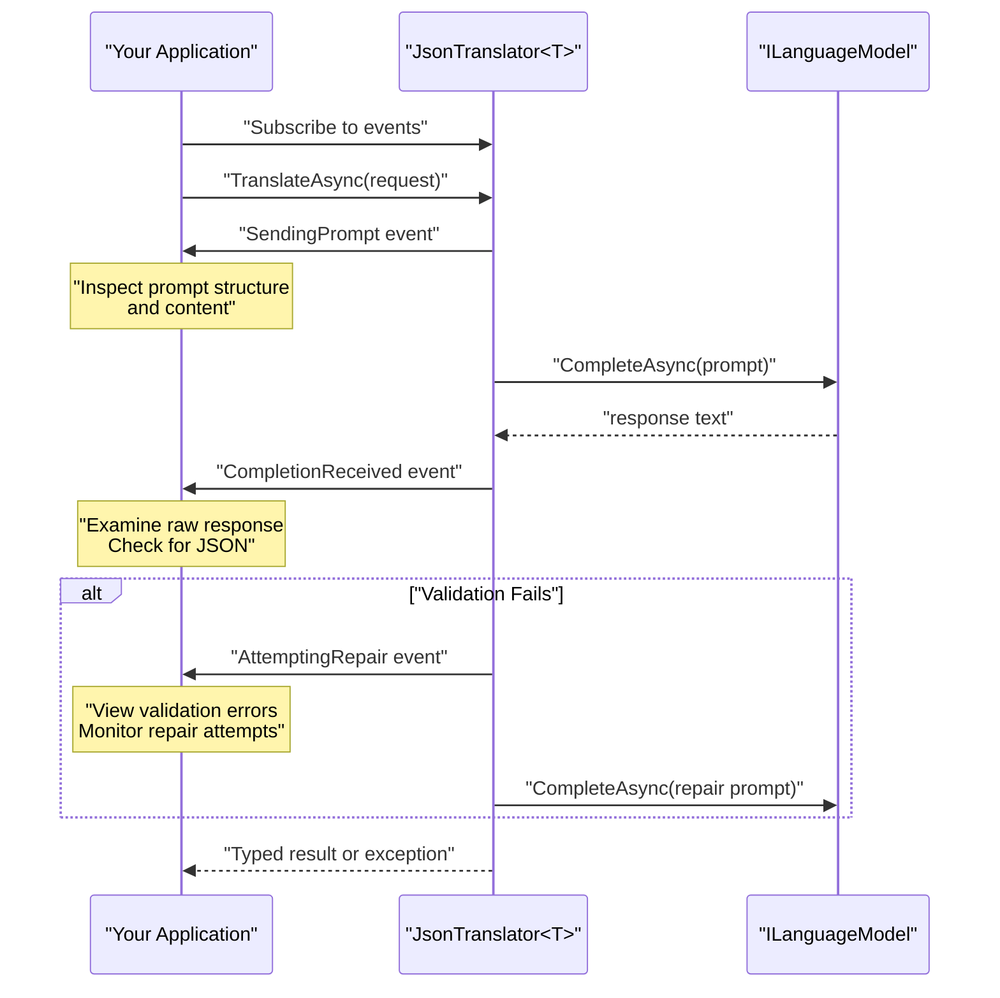
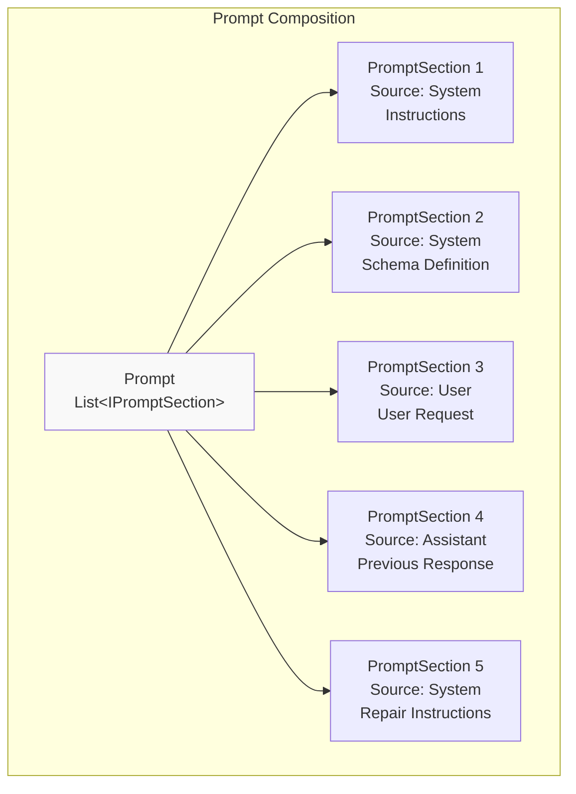
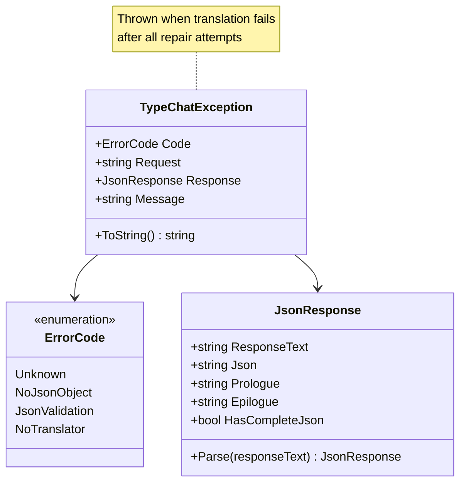
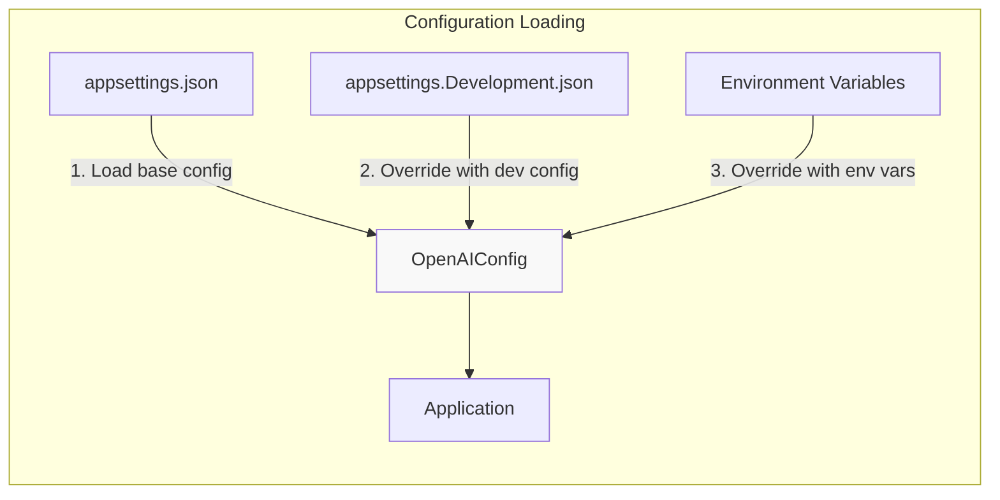
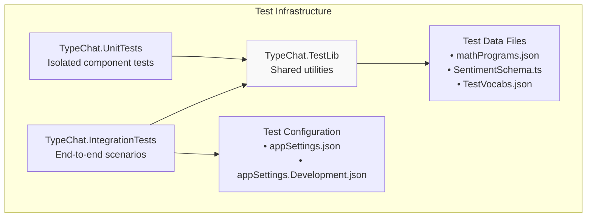
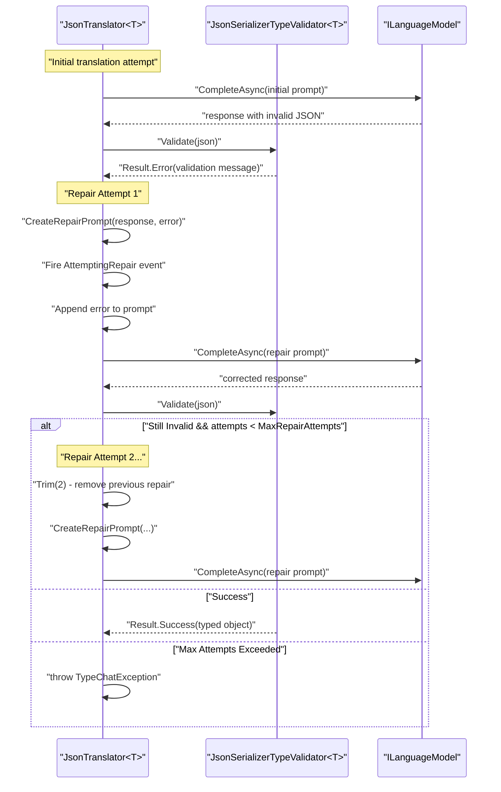
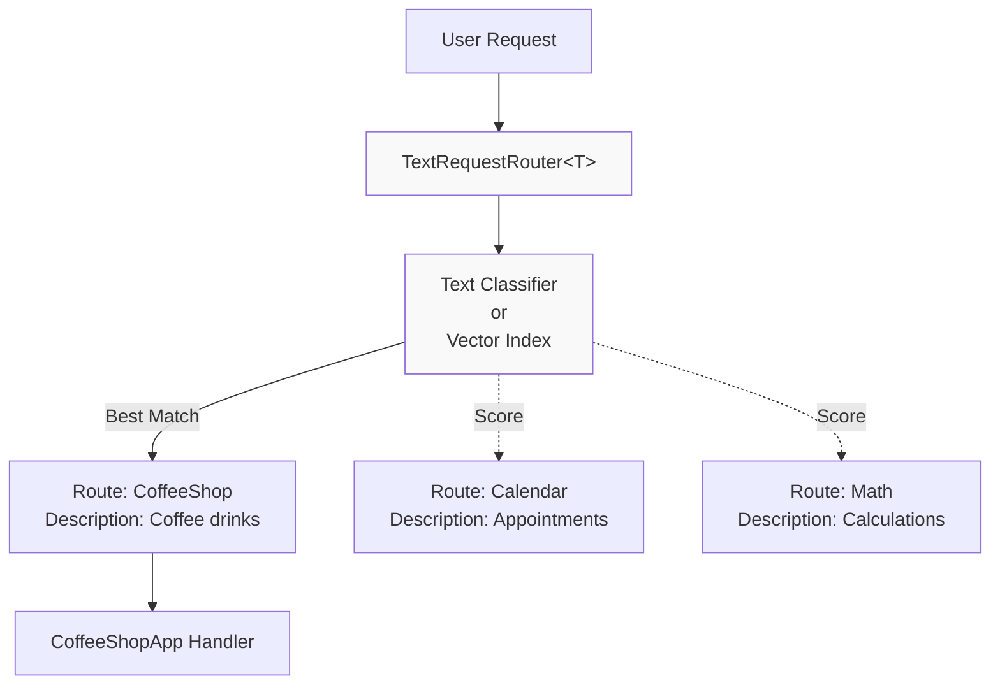

<!-- source: DeepWiki mcp.deepwiki.com · repo microsoft/typechat.net · page 12.2 Debugging Techniques · fetched 2026-10-26 -->

# Debugging Techniques

<details>
<summary>Relevant source files</summary>

The following files were used as context for generating this wiki page:

- [examples/MultiSchema/Program.cs](examples/MultiSchema/Program.cs)
- [src/typechat/JsonResponse.cs](src/typechat/JsonResponse.cs)
- [src/typechat/JsonSerializerTypeValidator.cs](src/typechat/JsonSerializerTypeValidator.cs)
- [src/typechat/JsonTranslator.cs](src/typechat/JsonTranslator.cs)
- [src/typechat/ModelInfo.cs](src/typechat/ModelInfo.cs)
- [src/typechat/Prompt.cs](src/typechat/Prompt.cs)
- [src/typechat/TypeChatException.cs](src/typechat/TypeChatException.cs)
- [tests/TypeChat.IntegrationTests/TypeChat.IntegrationTests.csproj](tests/TypeChat.IntegrationTests/TypeChat.IntegrationTests.csproj)
- [tests/TypeChat.IntegrationTests/appSettings.json](tests/TypeChat.IntegrationTests/appSettings.json)
- [tests/TypeChat.TestLib/TypeChat.TestLib.csproj](tests/TypeChat.TestLib/TypeChat.TestLib.csproj)
- [tests/TypeChat.UnitTests/TestConfig.cs](tests/TypeChat.UnitTests/TestConfig.cs)
- [tests/TypeChat.UnitTests/TypeChat.UnitTests.csproj](tests/TypeChat.UnitTests/TypeChat.UnitTests.csproj)

</details>


This page describes techniques and tools for debugging TypeChat applications. These techniques help diagnose issues with translation failures, validation errors, prompt construction, model responses, and configuration problems.

For information about common errors and their solutions, see [Common Errors](#12.1). For best practices on error handling patterns, see [Error Handling](#11.2).

---

## Overview of Debugging Facilities

TypeChat provides several built-in mechanisms for debugging translation workflows:

| Debugging Feature | Code Entity | Purpose |
|-------------------|-------------|---------|
| Translation Events | `JsonTranslator<T>.SendingPrompt` | Inspect prompts before they're sent to the model |
| Translation Events | `JsonTranslator<T>.CompletionReceived` | Examine raw model responses |
| Translation Events | `JsonTranslator<T>.AttemptingRepair` | Monitor validation failures and repair attempts |
| Exception Details | `TypeChatException` | Detailed error information including request and response |
| Validation Errors | `JsonSerializerTypeValidator` | Structured error messages with line numbers and property paths |
| Response Parsing | `JsonResponse` | Parse model responses into prologue, JSON, and epilogue |
| Prompt Inspection | `Prompt` | Examine and manipulate prompt structure |

Sources: [src/typechat/JsonTranslator.cs:155-165](), [src/typechat/TypeChatException.cs:8-100](), [src/typechat/JsonSerializerTypeValidator.cs:9-96](), [src/typechat/JsonResponse.cs:9-102](), [src/typechat/Prompt.cs:8-192]()

---

## Translation Event System

The `JsonTranslator<T>` class exposes three events that allow you to monitor the translation workflow in real-time.

### Event-Based Debugging Flow



**Diagram: Event-based debugging workflow showing when each event fires during translation**

Sources: [src/typechat/JsonTranslator.cs:150-165](), [src/typechat/JsonTranslator.cs:199-252]()

### Using Translation Events

```csharp
// Example: Subscribing to all translation events for debugging
var translator = new JsonTranslator<MyType>(model);

translator.SendingPrompt += (prompt) =>
{
    Console.WriteLine("=== SENDING PROMPT ===");
    Console.WriteLine($"Sections: {prompt.Count}");
    Console.WriteLine($"Length: {prompt.GetLength()} chars");
    Console.WriteLine(prompt.ToString(includeSource: true));
    Console.WriteLine("======================");
};

translator.CompletionReceived += (response) =>
{
    Console.WriteLine("=== MODEL RESPONSE ===");
    Console.WriteLine(response);
    
    // Parse the response to inspect its structure
    var jsonResponse = JsonResponse.Parse(response);
    if (jsonResponse.HasPrologue)
        Console.WriteLine($"Prologue: {jsonResponse.Prologue}");
    if (jsonResponse.HasCompleteJson)
        Console.WriteLine($"JSON: {jsonResponse.Json}");
    if (jsonResponse.HasEpilogue)
        Console.WriteLine($"Epilogue: {jsonResponse.Epilogue}");
    Console.WriteLine("======================");
};

translator.AttemptingRepair += (validationError) =>
{
    Console.WriteLine("=== ATTEMPTING REPAIR ===");
    Console.WriteLine(validationError);
    Console.WriteLine("=========================");
};
```

The event handlers are invoked at specific points in the translation workflow defined in [src/typechat/JsonTranslator.cs:259-264]() and [src/typechat/JsonTranslator.cs:241]().

Sources: [src/typechat/JsonTranslator.cs:155-165](), [src/typechat/JsonTranslator.cs:291-313]()

---

## Inspecting Prompts

The `Prompt` class provides methods for examining prompt structure and content, which is essential for debugging why a model might not be producing the expected output.

### Prompt Structure



**Diagram: Structure of a Prompt object showing multiple sections with sources**

### Prompt Inspection Methods

| Method | Description | Use Case |
|--------|-------------|----------|
| `ToString(includeSource: bool)` | Concatenate all sections into a string | View complete prompt sent to model |
| `GetLength()` | Calculate total character count | Check against token limits |
| `JoinSections(separator, includeSource, sb)` | Build custom representation | Format prompt for logging |
| `Last()` | Get most recent section | Inspect repair prompts |
| `Count` | Number of sections | Verify prompt structure |

Sources: [src/typechat/Prompt.cs:145-180]()

### Example: Logging Prompts to File

```csharp
// Example: Write prompts to file for analysis
translator.SendingPrompt += (prompt) =>
{
    var sb = new StringBuilder();
    sb.AppendLine($"=== PROMPT AT {DateTime.Now} ===");
    sb.AppendLine($"Section Count: {prompt.Count}");
    sb.AppendLine();
    
    for (int i = 0; i < prompt.Count; i++)
    {
        var section = prompt[i];
        sb.AppendLine($"Section {i + 1} [{section.Source}]:");
        sb.AppendLine(section.GetText());
        sb.AppendLine();
    }
    
    File.AppendAllText("debug_prompts.log", sb.ToString());
};
```

Sources: [src/typechat/Prompt.cs:125-156]()

---

## Understanding TypeChatException

`TypeChatException` provides detailed information about translation failures, including the original request, the model's response, and the specific error that occurred.

### TypeChatException Structure



**Diagram: TypeChatException structure with related types**

Sources: [src/typechat/TypeChatException.cs:8-100](), [src/typechat/JsonResponse.cs:9-102]()

### Handling TypeChatException

```csharp
// Example: Comprehensive exception handling
try
{
    var result = await translator.TranslateAsync(input);
    // Process result
}
catch (TypeChatException ex)
{
    Console.WriteLine($"Translation failed with code: {ex.Code}");
    Console.WriteLine();
    
    // Log the original request
    Console.WriteLine("Original Request:");
    Console.WriteLine(ex.Request);
    Console.WriteLine();
    
    // Examine the model's response
    if (ex.Response != null)
    {
        var response = ex.Response;
        Console.WriteLine($"Model returned JSON: {response.HasCompleteJson}");
        
        if (response.HasPrologue)
        {
            Console.WriteLine("Model Prologue:");
            Console.WriteLine(response.Prologue);
        }
        
        if (response.HasJson)
        {
            Console.WriteLine("JSON Content:");
            Console.WriteLine(response.Json);
        }
        
        if (response.HasEpilogue)
        {
            Console.WriteLine("Model Epilogue:");
            Console.WriteLine(response.Epilogue);
        }
    }
    
    // Display the validation error
    Console.WriteLine("Error Details:");
    Console.WriteLine(ex.Message);
}
```

Sources: [src/typechat/TypeChatException.cs:43-99](), [src/typechat/JsonTranslator.cs:237-240]()

---

## Validation Error Messages

The `JsonSerializerTypeValidator` formats validation errors with specific details about what went wrong during JSON deserialization.

### Validation Error Format

When validation fails, the error message includes:

1. **Error description**: What went wrong during deserialization
2. **Property path**: The JSON path to the property that caused the error (e.g., `$.items[0].quantity`)
3. **Line context**: The specific line in the JSON where the error occurred

The error formatting logic is implemented in [src/typechat/JsonSerializerTypeValidator.cs:68-84]().

### Example Validation Error

```
### JSON ERROR:
The JSON value could not be converted to System.Int32

Property with error: items[0].quantity

### Errors here:
    "quantity": "five",
```

This structured error message is then sent back to the model during repair attempts as implemented in [src/typechat/JsonTranslator.cs:267-269]().

Sources: [src/typechat/JsonSerializerTypeValidator.cs:52-96](), [src/typechat/JsonTranslator.cs:241-250]()

---

## Configuration Debugging

Configuration issues are a common source of errors. TypeChat supports both file-based and environment variable configuration.

### Configuration Sources



**Diagram: Configuration loading priority with environment variables taking precedence**

### Environment Variable Names

| Configuration | Environment Variable | Purpose |
|--------------|---------------------|---------|
| Azure OpenAI Endpoint | `AZURE_OPENAI_ENDPOINT` | Azure OpenAI service endpoint URL |
| Azure OpenAI API Key | `AZURE_OPENAI_API_KEY` | Azure authentication key |
| OpenAI Endpoint | `OPENAI_ENDPOINT` | OpenAI service endpoint (optional) |
| OpenAI API Key | `OPENAI_API_KEY` | OpenAI authentication key |
| OpenAI Organization | `OPENAI_ORGANIZATION` | OpenAI organization ID |
| OpenAI Model | `OPENAI_MODEL` | Chat model name (e.g., gpt-4) |
| OpenAI Embedding Model | `OPENAI_EMBEDDINGMODEL` | Embedding model name |

The configuration system is tested in [tests/TypeChat.UnitTests/TestConfig.cs]() which demonstrates how environment variables override file-based configuration.

Sources: [tests/TypeChat.UnitTests/TestConfig.cs:8-100](), [tests/TypeChat.IntegrationTests/appSettings.json:1-14]()

### Debugging Configuration Issues

```csharp
// Example: Verify configuration loading
var config = OpenAIConfig.FromEnvironment();

Console.WriteLine("=== Configuration ===");
Console.WriteLine($"Azure: {config.Azure}");
Console.WriteLine($"Endpoint: {config.Endpoint}");
Console.WriteLine($"API Key: {(string.IsNullOrEmpty(config.ApiKey) ? "NOT SET" : "SET")}");
Console.WriteLine($"Model: {config.Model}");
Console.WriteLine($"Organization: {config.Organization}");
Console.WriteLine("=====================");

// Verify the configuration is valid before creating translator
if (string.IsNullOrEmpty(config.Endpoint))
    throw new InvalidOperationException("Endpoint not configured");
if (string.IsNullOrEmpty(config.ApiKey))
    throw new InvalidOperationException("API key not configured");
if (string.IsNullOrEmpty(config.Model))
    throw new InvalidOperationException("Model not configured");
```

Sources: [tests/TypeChat.UnitTests/TestConfig.cs:8-99]()

---

## Test Infrastructure for Debugging

The test infrastructure provides utilities and patterns that can be used for debugging applications.

### Test Project Structure



**Diagram: Test infrastructure organization**

Sources: [tests/TypeChat.IntegrationTests/TypeChat.IntegrationTests.csproj:15-32](), [tests/TypeChat.UnitTests/TypeChat.UnitTests.csproj:19-33](), [tests/TypeChat.TestLib/TypeChat.TestLib.csproj:10-47]()

### Using Test Data for Debugging

The test library includes structured test data files that can be used to debug and validate behavior:

| Test Data File | Purpose | Location |
|----------------|---------|----------|
| `mathPrograms.json` | Valid program examples | [tests/TypeChat.TestLib/]() |
| `mathPrograms_Fail.json` | Invalid program examples | [tests/TypeChat.TestLib/]() |
| `objectPrograms.json` | Object manipulation programs | [tests/TypeChat.TestLib/]() |
| `stringPrograms.json` | String processing programs | [tests/TypeChat.TestLib/]() |
| `SentimentSchema.ts` | Example TypeScript schema | [tests/TypeChat.TestLib/]() |
| `TestVocabs.json` | Vocabulary test data | [tests/TypeChat.TestLib/]() |

Sources: [tests/TypeChat.TestLib/TypeChat.TestLib.csproj:28-46]()

### Creating Isolated Test Cases

```csharp
// Example: Create minimal reproducible test case
[Fact]
public async Task DebugSpecificTranslation()
{
    // Use a fixed schema and request to isolate the issue
    var schema = SchemaText.FromType<MyType>();
    var validator = new JsonSerializerTypeValidator<MyType>(schema);
    
    // Mock or use real model
    var model = new LanguageModel(OpenAIConfig.FromEnvironment());
    var translator = new JsonTranslator<MyType>(model, validator);
    
    // Subscribe to events for visibility
    translator.SendingPrompt += prompt => 
        TestOutput.WriteLine($"Prompt: {prompt}");
    translator.CompletionReceived += response => 
        TestOutput.WriteLine($"Response: {response}");
    translator.AttemptingRepair += error => 
        TestOutput.WriteLine($"Repair: {error}");
    
    // Test the specific case
    var result = await translator.TranslateAsync("my specific request");
    
    // Verify expectations
    Assert.NotNull(result);
}
```

This pattern is used throughout the integration tests defined in [tests/TypeChat.IntegrationTests/TypeChat.IntegrationTests.csproj:25-31]().

Sources: [tests/TypeChat.IntegrationTests/TypeChat.IntegrationTests.csproj](), [tests/TypeChat.UnitTests/TypeChat.UnitTests.csproj]()

---

## Debugging Repair Loop Behavior

The repair loop is a critical part of TypeChat's functionality. Understanding how it works helps debug validation issues.

### Repair Loop Flow



**Diagram: Repair loop showing how validation errors are fed back to the model**

Sources: [src/typechat/JsonTranslator.cs:199-252]()

### Configuring Repair Attempts

```csharp
// Example: Adjust repair attempts for debugging
var translator = new JsonTranslator<MyType>(model);

// Increase repair attempts to see if model can eventually succeed
translator.MaxRepairAttempts = 3;  // Default is 1

// Monitor each repair attempt
int attemptCount = 0;
translator.AttemptingRepair += (error) =>
{
    attemptCount++;
    Console.WriteLine($"=== Repair Attempt {attemptCount} ===");
    Console.WriteLine(error);
    
    // If repairs consistently fail at same point, may indicate:
    // 1. Schema too complex for model
    // 2. Request ambiguous
    // 3. Model temperature too high
};
```

The `MaxRepairAttempts` property is defined at [src/typechat/JsonTranslator.cs:135-146]() and controls the repair loop behavior at [src/typechat/JsonTranslator.cs:237-240]().

Sources: [src/typechat/JsonTranslator.cs:135-146](), [src/typechat/JsonTranslator.cs:199-252]()

---

## Model Response Debugging

Understanding what the model returns is crucial for debugging translation issues.

### Analyzing JsonResponse

```csharp
// Example: Detailed response analysis
translator.CompletionReceived += (responseText) =>
{
    var response = JsonResponse.Parse(responseText);
    
    Console.WriteLine("=== RESPONSE ANALYSIS ===");
    Console.WriteLine($"Total Length: {responseText.Length} chars");
    Console.WriteLine($"Has Complete JSON: {response.HasCompleteJson}");
    Console.WriteLine($"Has JSON: {response.HasJson}");
    Console.WriteLine();
    
    if (response.HasPrologue)
    {
        Console.WriteLine("PROLOGUE (non-JSON prefix):");
        Console.WriteLine(response.Prologue);
        Console.WriteLine();
    }
    
    if (response.HasJson)
    {
        Console.WriteLine("JSON CONTENT:");
        Console.WriteLine(response.Json);
        
        // Try to parse as JObject to check structure
        try
        {
            var jobj = JObject.Parse(response.Json);
            Console.WriteLine($"Valid JSON with {jobj.Count} properties");
        }
        catch (JsonException ex)
        {
            Console.WriteLine($"JSON Parse Error: {ex.Message}");
        }
        Console.WriteLine();
    }
    
    if (response.HasEpilogue)
    {
        Console.WriteLine("EPILOGUE (non-JSON suffix):");
        Console.WriteLine(response.Epilogue);
        Console.WriteLine();
    }
    
    Console.WriteLine("=========================");
};
```

The `JsonResponse.Parse` method implementation at [src/typechat/JsonResponse.cs:61-101]() extracts JSON from model responses that may contain additional text.

Sources: [src/typechat/JsonResponse.cs:61-101](), [src/typechat/JsonTranslator.cs:215-233]()

---

## Debugging Schema Issues

Schema-related issues often cause validation failures. Inspect the generated TypeScript schema to verify it matches expectations.

### Inspecting Generated Schema

```csharp
// Example: Print the generated TypeScript schema
var translator = new JsonTranslator<MyType>(model);
var schema = translator.Validator.Schema;

Console.WriteLine("=== GENERATED SCHEMA ===");
Console.WriteLine($"Type: {schema.Type.FullName}");
Console.WriteLine();
Console.WriteLine("TypeScript Schema:");
Console.WriteLine(schema.Text);
Console.WriteLine("========================");

// Save schema to file for inspection
File.WriteAllText("debug_schema.ts", schema.Text);
```

This allows you to:
1. Verify type mappings are correct
2. Check that vocabularies are included
3. Ensure polymorphic types have discriminators
4. Validate that the schema is what the model needs

For more information on schema generation, see [Schema Generation](#3.2).

Sources: [src/typechat/JsonTranslator.cs:94-102]()

---

## Debugging Multi-Schema Routing

When using multi-schema routing, debugging requires understanding which schema was selected and why.

### Request Router Debugging



**Diagram: Request routing decision flow showing how requests are classified**

```csharp
// Example: Debug request routing (based on MultiSchema example)
var router = new TextRequestRouter<IInputHandler>(model);

// Add routes with descriptions
router.Add(new CoffeeShopApp(), "CoffeeShop", 
    "Order Coffee Drinks (Italian names included) and Baked Goods");
router.Add(new CalendarApp(), "Calendar", 
    "Actions related to calendars, appointments, meetings, schedules");
router.Add(new MathApp(), "Math", 
    "Calculations using the four basic math operations");

// Log classification results
var input = "I want a large cappuccino";
Console.WriteLine($"Input: {input}");

var match = await router.ClassifyRequestAsync(input);
Console.WriteLine($"Selected Route: {match.Key}");
Console.WriteLine($"Has Handler: {match.Value != null}");

// Inspect all scores if using vector-based routing
// This requires accessing internal scoring logic
```

The routing implementation pattern is shown in [examples/MultiSchema/Program.cs:29-68]().

Sources: [examples/MultiSchema/Program.cs:29-68]()

---

## Summary of Debugging Workflow

| Step | Technique | Key Code Entity |
|------|-----------|----------------|
| 1. Subscribe to events | Attach to `SendingPrompt`, `CompletionReceived`, `AttemptingRepair` | [src/typechat/JsonTranslator.cs:155-165]() |
| 2. Inspect prompts | Log `Prompt.ToString(true)` to see all sections with sources | [src/typechat/Prompt.cs:152-156]() |
| 3. Analyze responses | Parse with `JsonResponse.Parse()` to separate JSON from text | [src/typechat/JsonResponse.cs:61-101]() |
| 4. Examine validation errors | Catch `TypeChatException` and inspect `Message` property | [src/typechat/TypeChatException.cs:43-69]() |
| 5. Check configuration | Verify `OpenAIConfig` values are set correctly | [tests/TypeChat.UnitTests/TestConfig.cs]() |
| 6. Review schema | Output `translator.Validator.Schema.Text` to file | [src/typechat/JsonTranslator.cs:94-102]() |
| 7. Adjust repair attempts | Increase `MaxRepairAttempts` to see if model can self-correct | [src/typechat/JsonTranslator.cs:135-146]() |
| 8. Create test cases | Use test infrastructure to isolate issues | [tests/TypeChat.IntegrationTests/]() |

Sources: [src/typechat/JsonTranslator.cs](), [src/typechat/TypeChatException.cs](), [src/typechat/JsonResponse.cs](), [src/typechat/Prompt.cs]()