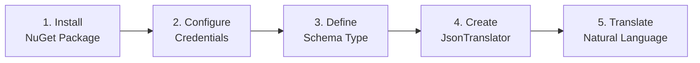
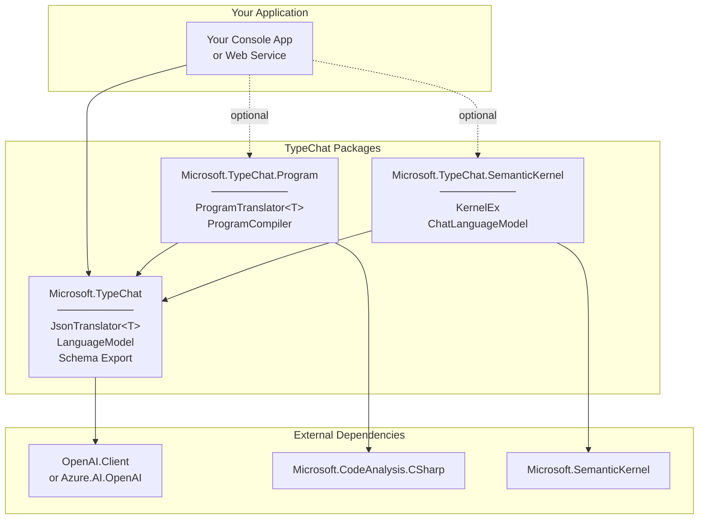
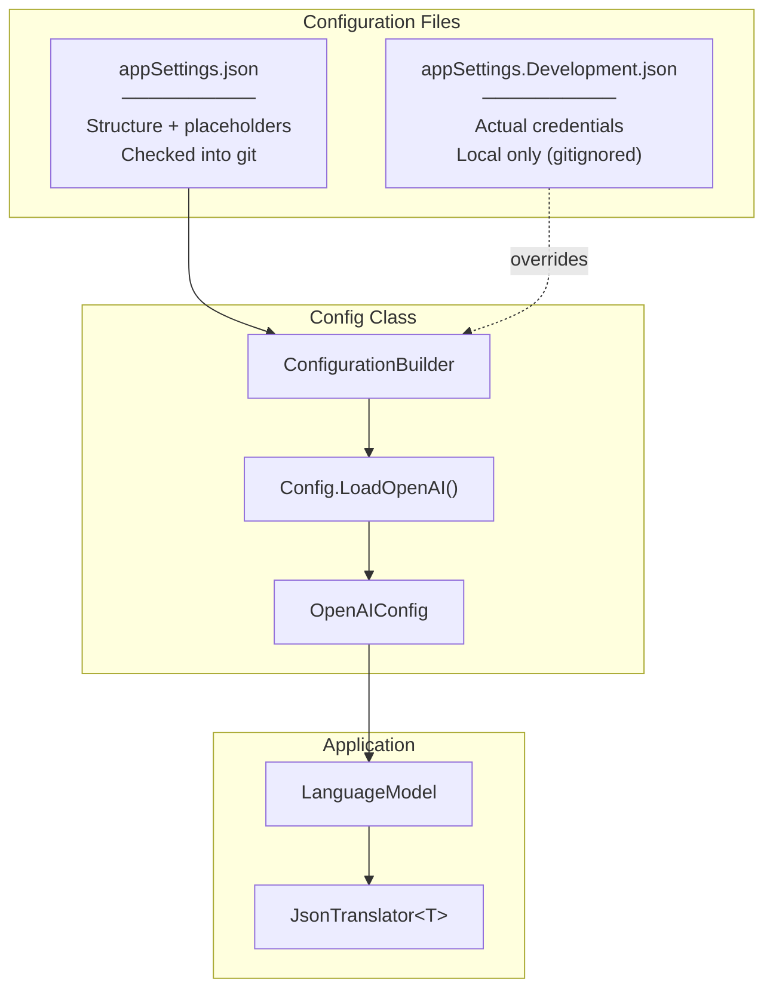
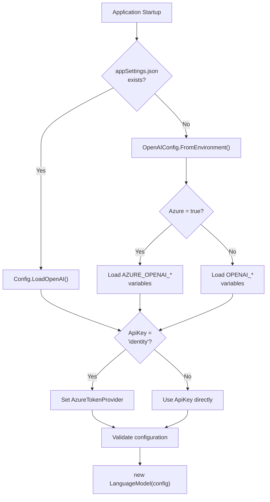
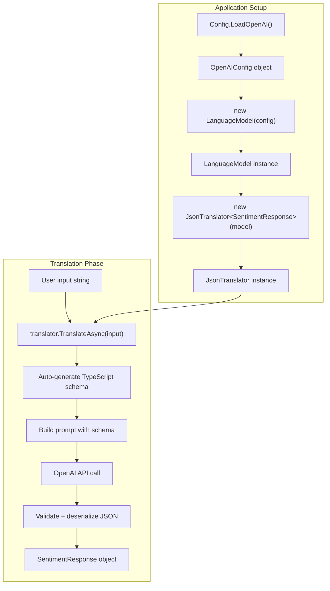

<!-- source: DeepWiki mcp.deepwiki.com · repo microsoft/typechat.net · page 2 Getting Started · fetched 2026-10-26 -->

# Getting Started

<details>
<summary>Relevant source files</summary>

The following files were used as context for generating this wiki page:

- [README.md](README.md)
- [examples/Sentiment/Program.cs](examples/Sentiment/Program.cs)
- [examples/appSettings.json](examples/appSettings.json)
- [examples/typechat.examplesLib/Auth.cs](examples/typechat.examplesLib/Auth.cs)
- [examples/typechat.examplesLib/Config.cs](examples/typechat.examplesLib/Config.cs)
- [src/typechat/HttpEx.cs](src/typechat/HttpEx.cs)
- [src/typechat/LanguageModel.cs](src/typechat/LanguageModel.cs)
- [src/typechat/OpenAIConfig.cs](src/typechat/OpenAIConfig.cs)

</details>


This guide walks you through installing TypeChat.NET, configuring your environment, and building your first translation application. By the end of this page, you will have a working TypeChat application that translates natural language into strongly typed C# objects.

For detailed information about the architecture and core concepts, see [Architecture Overview](#1.2) and [Core Concepts](#3). For more complex scenarios including program translation and conversational agents, see [Program Translation](#5) and [Advanced Features](#7).

---

## Prerequisites and Overview

Before you begin, you need:
- **.NET 6.0 or later**: TypeChat.NET is a cross-platform .NET library
- **OpenAI Access**: An API key for OpenAI or Azure OpenAI services
- **Supported Models**: `gpt-35-turbo`, `gpt-4`, or `ada-002` (for embeddings)

**Getting Started Journey**



**High-Level Translation Flow**

```mermaid
sequenceDiagram
    participant App as "Your Application"
    participant Config as "OpenAIConfig"
    participant LM as "LanguageModel"
    participant JT as "JsonTranslator&lt;T&gt;"
    participant OpenAI as "OpenAI API"
    
    App->>Config: Load from appSettings<br/>or environment
    App->>LM: new LanguageModel(config)
    App->>JT: new JsonTranslator&lt;T&gt;(model)
    
    Note over App,OpenAI: Translation Phase
    App->>JT: TranslateAsync(userInput)
    JT->>JT: Generate TypeScript schema
    JT->>OpenAI: Send prompt + schema
    OpenAI-->>JT: JSON response
    JT->>JT: Validate + deserialize
    JT-->>App: Typed object T
```

**Sources:** [README.md:1-243](), [examples/Sentiment/Program.cs:1-43]()

---

## Installation

TypeChat.NET is distributed as NuGet packages. Install the packages you need based on your scenario:

| Package | Purpose | Install Command |
|---------|---------|-----------------|
| **Microsoft.TypeChat** | Core translation: `JsonTranslator<T>`, schema generation, validation | `dotnet add package Microsoft.TypeChat` |
| **Microsoft.TypeChat.Program** | Program synthesis: `ProgramTranslator<T>`, code generation | `dotnet add package Microsoft.TypeChat.Program` |
| **Microsoft.TypeChat.SemanticKernel** | Semantic Kernel integration: model adapters, plugin programs | `dotnet add package Microsoft.TypeChat.SemanticKernel` |

**Package Dependency Architecture**



**For Most Scenarios:** Start with just `Microsoft.TypeChat`. Add `Microsoft.TypeChat.Program` if you need code generation, or `Microsoft.TypeChat.SemanticKernel` if integrating with Semantic Kernel.

**Building from Source:**
```bash
git clone https://github.com/microsoft/typechat.net
cd typechat.net
dotnet build TypeChat.sln
```

**Sources:** [README.md:87-113]()

---

## Configuration

TypeChat.NET requires configuration to connect to OpenAI or Azure OpenAI services. You can configure using either settings files or environment variables.

### Configuration File Approach

The recommended approach for development is using JSON configuration files. The examples use two files:
- `appSettings.json`: Checked into source control, contains structure but no secrets
- `appSettings.Development.json`: Local only (gitignored), contains your actual credentials

**Configuration File Structure**



**appSettings.json Structure** (see [examples/appSettings.json:1-22]()):
```json
{
  "OpenAI": {
    "Azure": true,
    "Endpoint": "?",
    "ApiKey": "?",
    "Model": "gpt-35-turbo",
    "MaxRetries": 2,
    "TimeoutMs": 30000
  },
  "OpenAI_Embedding": {
    "Azure": true,
    "ApiKey": "?", 
    "Endpoint": "?",
    "Model": "ada-002"
  }
}
```

**Configuration Properties Table**

| Property | Description | Azure OpenAI Example | OpenAI Example |
|----------|-------------|---------------------|----------------|
| `Azure` | Use Azure OpenAI service? | `true` | `false` |
| `Endpoint` | Service endpoint | `https://YOUR_RESOURCE.openai.azure.com` | `https://api.openai.com/v1/chat/completions` |
| `ApiKey` | API key or `"identity"` | Your key or `"identity"` | Your OpenAI key |
| `Model` | Model/deployment name | `gpt-35-turbo` (deployment) | `gpt-3.5-turbo` (model) |
| `MaxRetries` | HTTP retry attempts | `2` | `2` |
| `TimeoutMs` | Request timeout | `30000` | `30000` |
| `Organization` | OpenAI organization | (not used) | Your org ID |

**Loading Configuration in Code** (see [examples/typechat.examplesLib/Config.cs:43-52]()):
```csharp
// Load from appSettings.json + appSettings.Development.json
OpenAIConfig config = Config.LoadOpenAI();

// Create language model
var model = new LanguageModel(config);
```

### Azure Identity (Token-Based Authentication)

Instead of API keys, you can use Azure AD authentication with role-based access control:

1. Set `"ApiKey": "identity"` in your configuration
2. Authenticate using Azure CLI: `az login`
3. Grant your identity the **Cognitive Services OpenAI User** role on your Azure OpenAI resource

The `Config.LoadOpenAI()` method automatically detects the `"identity"` keyword and configures `AzureTokenProvider.Default` which uses `DefaultAzureCredential` (see [examples/typechat.examplesLib/Config.cs:47-50]() and [examples/typechat.examplesLib/Auth.cs:14-47]()).

### Environment Variable Approach

For production or containerized deployments, use environment variables:

**Environment Variable Names** (see [src/typechat/OpenAIConfig.cs:14-52]()):

| Variable | Description |
|----------|-------------|
| `AZURE_OPENAI_ENDPOINT` | Azure OpenAI endpoint |
| `AZURE_OPENAI_API_KEY` | Azure OpenAI API key |
| `OPENAI_ENDPOINT` | OpenAI endpoint |
| `OPENAI_API_KEY` | OpenAI API key |
| `OPENAI_MODEL` | Model name |
| `OPENAI_EMBEDDINGMODEL` | Embedding model name |
| `OPENAI_ORGANIZATION` | OpenAI organization |

**Loading from Environment** (see [src/typechat/OpenAIConfig.cs:130-155]()):
```csharp
OpenAIConfig config = OpenAIConfig.FromEnvironment();
var model = new LanguageModel(config);
```

**Configuration Resolution Flow**



**Sources:** [README.md:148-208](), [examples/appSettings.json:1-22](), [src/typechat/OpenAIConfig.cs:1-172](), [examples/typechat.examplesLib/Config.cs:1-106](), [examples/typechat.examplesLib/Auth.cs:1-106]()

---

## Your First Translation

The simplest TypeChat.NET application is the Sentiment example, which translates natural language text into a structured sentiment response.

### The Schema Type

First, define a C# type representing the structure you want to translate to. TypeChat will automatically generate TypeScript schema from this type (see [Schema Generation](#3.2) for details).

For the Sentiment example, the schema type is `SentimentResponse`:
```csharp
public class SentimentResponse
{
    public string Sentiment { get; set; }
}
```

### Creating the Translator

**Complete Sentiment Application** (see [examples/Sentiment/Program.cs:1-43]()):



**Step-by-Step Code Walkthrough:**

1. **Load Configuration** ([examples/Sentiment/Program.cs:12-16]()):
   ```csharp
   OpenAIConfig config = Config.LoadOpenAI();
   // Alternative: OpenAIConfig.FromEnvironment()
   // Alternative: OpenAIConfig.LoadFromJsonFile("path")
   ```

2. **Create Language Model** ([examples/Sentiment/Program.cs:16]()):
   ```csharp
   var model = new LanguageModel(config);
   ```
   The `LanguageModel` class ([src/typechat/LanguageModel.cs:8-169]()) implements `ILanguageModel` and handles OpenAI/Azure OpenAI API calls.

3. **Create JsonTranslator** ([examples/Sentiment/Program.cs:16]()):
   ```csharp
   var translator = new JsonTranslator<SentimentResponse>(model);
   ```
   `JsonTranslator<T>` is the core class that:
   - Generates TypeScript schema from `SentimentResponse`
   - Constructs prompts with the schema
   - Calls the language model
   - Validates and deserializes the JSON response
   - Repairs invalid responses (see [Validation and Repair](#3.3))

4. **Translate User Input** ([examples/Sentiment/Program.cs:21]()):
   ```csharp
   SentimentResponse response = await translator.TranslateAsync(input);
   ```
   The `TranslateAsync` method returns a strongly-typed `SentimentResponse` object.

5. **Use the Result** ([examples/Sentiment/Program.cs:22]()):
   ```csharp
   Console.WriteLine($"The sentiment is {response.Sentiment}");
   ```

### Translation Lifecycle

**Detailed Translation Flow with Code References**

```mermaid
sequenceDiagram
    participant App as "SentimentApp:19-23"
    participant JT as "JsonTranslator&lt;T&gt;"
    participant SE as "TypescriptExporter"
    participant LM as "LanguageModel:47-55"
    participant Val as "IJsonTypeValidator"
    participant API as "OpenAI API"
    
    Note over App,API: Initialization (Constructor)
    App->>JT: new JsonTranslator&lt;SentimentResponse&gt;(model)
    JT->>SE: Export schema for SentimentResponse
    SE-->>JT: TypeScript schema text
    
    Note over App,API: Translation Request
    App->>JT: TranslateAsync(input)
    JT->>JT: Build prompt:<br/>instructions + schema + input
    JT->>LM: CompleteAsync(prompt)
    LM->>API: HTTP POST request
    API-->>LM: Response text
    LM-->>JT: Response string
    
    JT->>JT: Extract JSON from response
    JT->>Val: Validate JSON against schema
    
    alt Valid JSON
        Val-->>JT: Success
        JT->>JT: Json.Parse&lt;SentimentResponse&gt;()
        JT-->>App: SentimentResponse object
    else Invalid JSON (attempt < MaxRepairAttempts)
        Val-->>JT: Validation error messages
        JT->>JT: Build repair prompt with errors
        JT->>LM: CompleteAsync(repair prompt)
        Note over JT,API: Retry loop (up to 3 attempts)
    else Max Attempts Exceeded
        JT-->>App: Throw TypeChatException
    end
```

### Running the Example

**Option 1: Interactive Mode**
```bash
cd examples/Sentiment
dotnet run
```
Type sentences and press Enter to see sentiment analysis:
```
😀> I love this framework!
The sentiment is positive

😀> This is confusing.
The sentiment is negative
```

**Option 2: Batch Mode**
```bash
dotnet run input.txt
```
Processes all lines from `input.txt` and outputs results.

### Key Classes and Their Roles

| Class | Location | Purpose |
|-------|----------|---------|
| `OpenAIConfig` | [src/typechat/OpenAIConfig.cs:9-172]() | Configuration container for OpenAI credentials and settings |
| `Config` | [examples/typechat.examplesLib/Config.cs:8-106]() | Helper for loading configuration from files |
| `LanguageModel` | [src/typechat/LanguageModel.cs:8-169]() | Implements `ILanguageModel`, handles OpenAI API communication |
| `JsonTranslator<T>` | Referenced, full details in [JsonTranslator](#3.1) | Core translation engine: schema generation, validation, repair |
| `ConsoleApp` | Referenced in [examples/Sentiment/Program.cs:6]() | Base class for console examples with input processing |

### What Happens Under the Hood

1. **Schema Generation**: TypeChat analyzes the `SentimentResponse` type and generates TypeScript schema describing its structure
2. **Prompt Construction**: A prompt is built containing:
   - Instructions for the language model
   - The generated TypeScript schema
   - The user's input text
3. **API Call**: The prompt is sent to the OpenAI model via the `LanguageModel` class
4. **Response Processing**: The model's response (JSON text) is extracted and validated
5. **Validation**: The JSON is checked against the schema using a validator
6. **Repair Loop**: If validation fails, error messages are sent back to the model for correction (up to 3 attempts)
7. **Deserialization**: Valid JSON is deserialized into a `SentimentResponse` object

For detailed information on each of these steps, see:
- [Schema Generation](#3.2)
- [Prompts and Prompt Engineering](#3.5)
- [Validation and Repair](#3.3)
- [JsonTranslator](#3.1)

**Sources:** [examples/Sentiment/Program.cs:1-43](), [src/typechat/LanguageModel.cs:1-169](), [README.md:77-128]()

---

## Next Steps

Now that you have a working TypeChat application, explore:

- **[Configuration](#2.2)**: Detailed configuration options and advanced authentication
- **[Core Concepts](#3)**: Deep dive into `JsonTranslator`, schema generation, and validation
- **[Schema Definition](#4)**: Learn to define complex schemas with vocabularies, polymorphism, and constraints
- **[Program Translation](#5)**: Generate executable programs from natural language
- **[Examples](#8)**: Study more complex examples like CoffeeShop, Math, and HealthData

### Common Patterns

**Pattern 1: Single Configuration, Multiple Translators**
```csharp
OpenAIConfig config = Config.LoadOpenAI();
var model = new LanguageModel(config);

var sentimentTranslator = new JsonTranslator<SentimentResponse>(model);
var calendarTranslator = new JsonTranslator<CalendarActions>(model);
```

**Pattern 2: Using Semantic Kernel**
```csharp
var kernel = Kernel.CreateBuilder()
    .AddAzureOpenAIChatCompletion(deploymentName, endpoint, apiKey)
    .Build();
    
var model = new ChatLanguageModel(kernel.GetService<IChatCompletionService>());
var translator = new JsonTranslator<T>(model);
```

**Pattern 3: Custom Language Model**
Implement `ILanguageModel` ([src/typechat/ILanguageModel.cs]()) for custom model providers.

**Sources:** [README.md:1-243](), [examples/Sentiment/Program.cs:1-43]()

---

