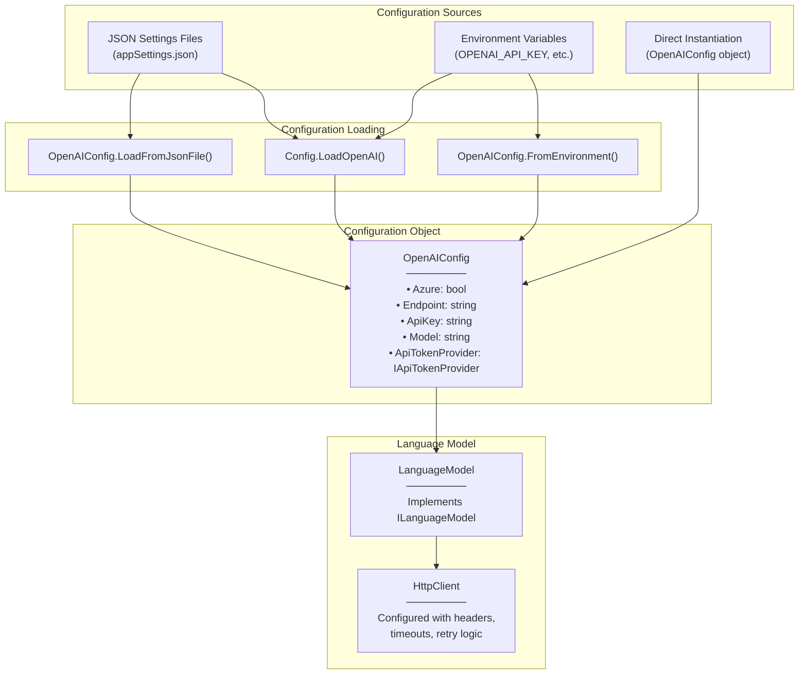
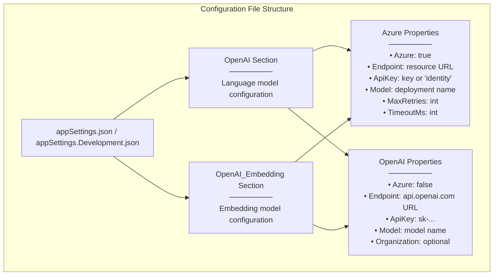
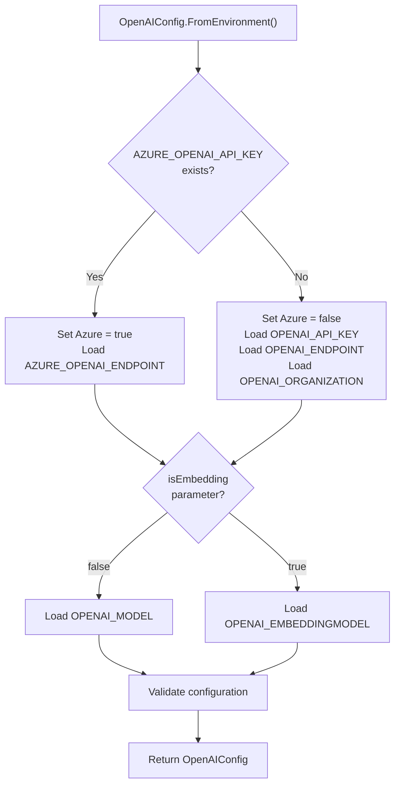
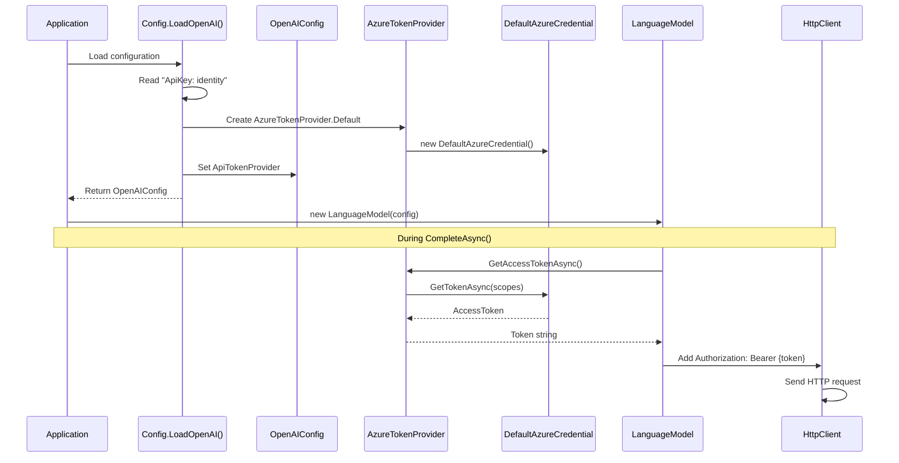
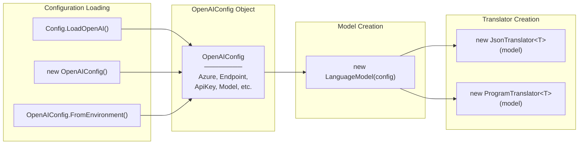

<!-- source: DeepWiki mcp.deepwiki.com · repo microsoft/typechat.net · page 2.2 Configuration · fetched 2026-10-26 -->

# Configuration

<details>
<summary>Relevant source files</summary>

The following files were used as context for generating this wiki page:

- [README.md](README.md)
- [examples/Sentiment/Program.cs](examples/Sentiment/Program.cs)
- [examples/appSettings.json](examples/appSettings.json)
- [examples/typechat.examplesLib/Auth.cs](examples/typechat.examplesLib/Auth.cs)
- [examples/typechat.examplesLib/Config.cs](examples/typechat.examplesLib/Config.cs)
- [src/typechat/HttpEx.cs](src/typechat/HttpEx.cs)
- [src/typechat/LanguageModel.cs](src/typechat/LanguageModel.cs)
- [src/typechat/OpenAIConfig.cs](src/typechat/OpenAIConfig.cs)

</details>


This page describes how to configure OpenAI and Azure OpenAI credentials for TypeChat.NET applications. Configuration can be provided through JSON settings files or environment variables. Both approaches support API key-based authentication and Azure identity-based authentication (token providers).

For information about installing TypeChat.NET packages, see [Installation](#2.1). For creating your first application after configuration, see [Your First Translation](#2.3).

---

## Configuration Overview

TypeChat.NET provides three methods for supplying configuration to the `LanguageModel` class:



**Sources:** [src/typechat/OpenAIConfig.cs](), [src/typechat/LanguageModel.cs](), [examples/typechat.examplesLib/Config.cs]()

---

## File-Based Configuration

The recommended approach for examples and development is using JSON settings files. TypeChat.NET uses the standard ASP.NET Core configuration system with hierarchical overrides.

### Configuration Files

Two configuration files are used:

| File | Purpose | Version Control |
|------|---------|-----------------|
| `appSettings.json` | Default configuration with placeholder values | **Checked into source control** |
| `appSettings.Development.json` | Local development overrides with real credentials | **Never checked in** (in .gitignore) |

The `appSettings.Development.json` file overrides values from `appSettings.json` when present [examples/typechat.examplesLib/Config.cs:27-30]().

### Configuration Structure



**Sources:** [examples/appSettings.json](), [examples/typechat.examplesLib/Config.cs:43-52]()

### Azure OpenAI Configuration Example

```json
{
  "OpenAI": {
    "Azure": true,
    "Endpoint": "https://YOUR_RESOURCE_NAME.openai.azure.com",
    "ApiKey": "YOUR_API_KEY_OR_identity",
    "Model": "gpt-35-turbo",
    "MaxRetries": 2,
    "TimeoutMs": 30000
  }
}
```

**Key Properties:**
- `Azure`: Set to `true` for Azure OpenAI Service [src/typechat/OpenAIConfig.cs:59]()
- `Endpoint`: Azure resource URL [src/typechat/OpenAIConfig.cs:64]()
- `ApiKey`: API key or the special value `"identity"` for Azure identity authentication [examples/typechat.examplesLib/Config.cs:12]()
- `Model`: Azure deployment name (not the underlying model name) [src/typechat/OpenAIConfig.cs:79]()

### OpenAI Service Configuration Example

```json
{
  "OpenAI": {
    "Azure": false,
    "Endpoint": "https://api.openai.com/v1/chat/completions",
    "ApiKey": "sk-...",
    "Model": "gpt-3.5-turbo",
    "Organization": "org-..."
  }
}
```

**Key Properties:**
- `Azure`: Set to `false` for OpenAI Service [src/typechat/OpenAIConfig.cs:59]()
- `Endpoint`: OpenAI API endpoint [src/typechat/OpenAIConfig.cs:64]()
- `ApiKey`: OpenAI API key starting with `sk-` [src/typechat/OpenAIConfig.cs:69]()
- `Organization`: Optional organization ID [src/typechat/OpenAIConfig.cs:74]()

### Loading File-Based Configuration

The `Config.LoadOpenAI()` helper method loads configuration from the JSON files:

```csharp
// Load from appSettings.json and appSettings.Development.json
OpenAIConfig config = Config.LoadOpenAI();
var model = new LanguageModel(config);
```

This method:
1. Loads `appSettings.json` [examples/typechat.examplesLib/Config.cs:25]()
2. Applies overrides from `appSettings.Development.json` if present [examples/typechat.examplesLib/Config.cs:27-30]()
3. Binds the `OpenAI` section to an `OpenAIConfig` object [examples/typechat.examplesLib/Config.cs:32-40]()
4. Configures Azure identity if `ApiKey` is `"identity"` [examples/typechat.examplesLib/Config.cs:47-50]()

**Sources:** [examples/typechat.examplesLib/Config.cs:43-52](), [examples/Sentiment/Program.cs:12-16]()

---

## Environment Variable Configuration

For deployment scenarios or CI/CD pipelines, configuration can be loaded from environment variables.

### Environment Variable Names

The `OpenAIConfig.VariableNames` class defines standard environment variable names:

| Environment Variable | Purpose | Service |
|---------------------|---------|---------|
| `AZURE_OPENAI_API_KEY` | Azure OpenAI API key | Azure OpenAI |
| `AZURE_OPENAI_ENDPOINT` | Azure OpenAI resource endpoint | Azure OpenAI |
| `OPENAI_API_KEY` | OpenAI API key | OpenAI |
| `OPENAI_ENDPOINT` | OpenAI API endpoint | OpenAI |
| `OPENAI_ORGANIZATION` | OpenAI organization ID | OpenAI |
| `OPENAI_MODEL` | Language model name/deployment | Both |
| `OPENAI_EMBEDDINGMODEL` | Embedding model name/deployment | Both |

**Sources:** [src/typechat/OpenAIConfig.cs:14-52]()

### Service Detection Logic



**Sources:** [src/typechat/OpenAIConfig.cs:130-155]()

### Loading Environment-Based Configuration

```csharp
// Load language model configuration from environment
OpenAIConfig config = OpenAIConfig.FromEnvironment();

// Load embedding model configuration from environment
OpenAIConfig embeddingConfig = OpenAIConfig.FromEnvironment(isEmbedding: true);
```

The `Config` class also supports environment variables as a fallback when configuration files are not present [examples/typechat.examplesLib/Config.cs:74-89]().

**Sources:** [src/typechat/OpenAIConfig.cs:130-155](), [examples/typechat.examplesLib/Config.cs:74-89]()

---

## OpenAIConfig Properties

The `OpenAIConfig` class provides comprehensive configuration for language model access:

### Core Properties

| Property | Type | Default | Description |
|----------|------|---------|-------------|
| `Azure` | `bool` | `true` | Use Azure OpenAI Service vs OpenAI Service |
| `Endpoint` | `string` | Required | API endpoint URL |
| `ApiKey` | `string` | Required | API key or `"identity"` for Azure identity |
| `Model` | `string` | `null` | Model name or Azure deployment name |
| `Organization` | `string` | `null` | OpenAI organization ID (OpenAI Service only) |
| `ApiVersion` | `string` | `"2023-05-15"` | Azure OpenAI API version |

**Sources:** [src/typechat/OpenAIConfig.cs:54-85]()

### HTTP Configuration Properties

| Property | Type | Default | Description |
|----------|------|---------|-------------|
| `TimeoutMs` | `int` | `15000` | HTTP request timeout in milliseconds |
| `MaxRetries` | `int` | `3` | Maximum retry attempts for transient errors |
| `MaxPauseMs` | `int` | `1000` | Pause duration between retries in milliseconds |

The `HttpClient` automatically retries transient HTTP errors (429, 500, 502, 503, 504) up to `MaxRetries` times [src/typechat/HttpEx.cs:33-43]().

**Sources:** [src/typechat/OpenAIConfig.cs:88-93](), [src/typechat/HttpEx.cs:11-51]()

### Token Provider Property

| Property | Type | Default | Description |
|----------|------|---------|-------------|
| `ApiTokenProvider` | `IApiTokenProvider` | `null` | Provider for Azure access tokens |

When set, the `LanguageModel` class uses `ApiTokenProvider.GetAccessTokenAsync()` instead of static API keys [src/typechat/LanguageModel.cs:52]().

**Sources:** [src/typechat/OpenAIConfig.cs:96-103](), [src/typechat/LanguageModel.cs:47-55]()

---

## Azure Identity Authentication

TypeChat.NET supports Azure identity-based authentication using the Azure SDK's `DefaultAzureCredential`. This eliminates the need to store API keys in configuration files.

### Azure Identity Configuration Flow



**Sources:** [examples/typechat.examplesLib/Config.cs:47-50](), [examples/typechat.examplesLib/Auth.cs:49-56](), [src/typechat/LanguageModel.cs:52-53]()

### Enabling Azure Identity

Set the `ApiKey` property to the special value `"identity"`:

```json
{
  "OpenAI": {
    "Azure": true,
    "ApiKey": "identity",
    "Endpoint": "https://YOUR_RESOURCE_NAME.openai.azure.com",
    "Model": "gpt-35-turbo"
  }
}
```

The `Config.LoadOpenAI()` method detects this value and configures `AzureTokenProvider.Default` [examples/typechat.examplesLib/Config.cs:47-50]().

### AzureTokenProvider Implementation

The `AzureTokenProvider` class manages Azure access tokens with automatic refresh:

**Key Features:**
- Uses `DefaultAzureCredential` to obtain tokens [examples/typechat.examplesLib/Auth.cs:43]()
- Caches tokens until expiration [examples/typechat.examplesLib/Auth.cs:51-56]()
- Automatically refreshes expired tokens [examples/typechat.examplesLib/Auth.cs:63-76]()
- Thread-safe token refresh using `SemaphoreSlim` [examples/typechat.examplesLib/Auth.cs:65]()
- Uses Cognitive Services scope: `https://cognitiveservices.azure.com/.default` [examples/typechat.examplesLib/Auth.cs:98-100]()

**Sources:** [examples/typechat.examplesLib/Auth.cs:14-105]()

### Azure Identity Prerequisites

To use Azure identity authentication:

1. Configure your Azure OpenAI resource for role-based access control (RBAC)
2. Grant the appropriate identity the "Cognitive Services OpenAI User" role
3. Authenticate using one of the credential sources supported by `DefaultAzureCredential`:
   - Azure CLI (`az login`)
   - Environment variables
   - Managed identity (in Azure)
   - Visual Studio credentials
   - Other Azure SDK credential sources

**Sources:** [README.md:151-158]()

---

## Embedding Model Configuration

TypeChat.NET supports separate configuration for embedding models used in vectorization and semantic search scenarios.

### Embedding Configuration Section

Add an `OpenAI_Embedding` section to configure embedding models:

```json
{
  "OpenAI": {
    "Azure": true,
    "Endpoint": "https://YOUR_RESOURCE_NAME.openai.azure.com",
    "ApiKey": "YOUR_API_KEY",
    "Model": "gpt-35-turbo"
  },
  "OpenAI_Embedding": {
    "Azure": true,
    "Endpoint": "https://YOUR_RESOURCE_NAME.openai.azure.com",
    "ApiKey": "YOUR_API_KEY",
    "Model": "ada-002"
  }
}
```

### Loading Embedding Configuration

The `Config` class provides access to both language model and embedding model configurations:

```csharp
var config = new Config();

// Language model configuration
OpenAIConfig languageModelConfig = config.OpenAI;

// Embedding model configuration
OpenAIConfig embeddingModelConfig = config.OpenAIEmbeddings;
```

The constructor attempts to load embedding configuration from either `OpenAI_Embeddings` (legacy) or `OpenAI_Embedding` (current) sections [examples/typechat.examplesLib/Config.cs:64-72]().

### Environment Variables for Embeddings

When using environment variables, set `isEmbedding: true` to load embedding-specific configuration:

```csharp
OpenAIConfig embeddingConfig = OpenAIConfig.FromEnvironment(isEmbedding: true);
```

This loads the model name from `OPENAI_EMBEDDINGMODEL` instead of `OPENAI_MODEL` [src/typechat/OpenAIConfig.cs:145-152]().

**Sources:** [examples/appSettings.json:15-20](), [examples/typechat.examplesLib/Config.cs:54-104](), [src/typechat/OpenAIConfig.cs:130-155]()

---

## Configuration in Code

### Basic Configuration Pattern



**Sources:** [examples/Sentiment/Program.cs:10-16]()

### Example: File-Based Configuration

The Sentiment example demonstrates the standard configuration pattern [examples/Sentiment/Program.cs:10-16]():

```csharp
// Load from appSettings.json and appSettings.Development.json
OpenAIConfig config = Config.LoadOpenAI();

// Create language model
var model = new LanguageModel(config);

// Create translator
var translator = new JsonTranslator<SentimentResponse>(model);
```

### Example: Environment-Based Configuration

Alternative pattern using environment variables:

```csharp
// Load from environment variables
OpenAIConfig config = OpenAIConfig.FromEnvironment();

// Create language model
var model = new LanguageModel(config);

// Create translator
var translator = new JsonTranslator<SentimentResponse>(model);
```

### Example: Direct Configuration

For programmatic configuration:

```csharp
var config = new OpenAIConfig
{
    Azure = true,
    Endpoint = "https://my-resource.openai.azure.com",
    ApiKey = "my-api-key",
    Model = "gpt-35-turbo",
    MaxRetries = 5,
    TimeoutMs = 60000
};

var model = new LanguageModel(config);
```

### Example: Azure Identity Configuration

```csharp
OpenAIConfig config = Config.LoadOpenAI();
// If ApiKey is "identity", Config.LoadOpenAI() automatically sets:
// config.ApiTokenProvider = AzureTokenProvider.Default;

var model = new LanguageModel(config);
```

**Sources:** [examples/Sentiment/Program.cs:10-16](), [examples/typechat.examplesLib/Config.cs:43-52](), [README.md:198-207]()

---

## Configuration Validation

The `OpenAIConfig.Validate()` method ensures required properties are set [src/typechat/OpenAIConfig.cs:109-123]():

**Validation Rules:**
- `Endpoint` must be non-empty and not `"?"`
- `ApiKey` must be non-empty and not `"?"`

The `LanguageModel` constructor automatically validates configuration [src/typechat/LanguageModel.cs:27]():

```csharp
public LanguageModel(OpenAIConfig config, ModelInfo? model = null, HttpClient? client = null)
{
    ArgumentVerify.ThrowIfNull(config, nameof(config));
    config.Validate();  // Throws ArgumentException if invalid
    // ...
}
```

**Sources:** [src/typechat/OpenAIConfig.cs:109-123](), [src/typechat/LanguageModel.cs:24-33]()

---

