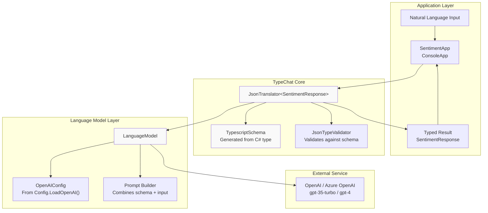
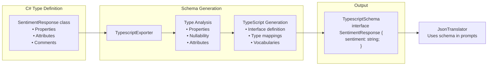
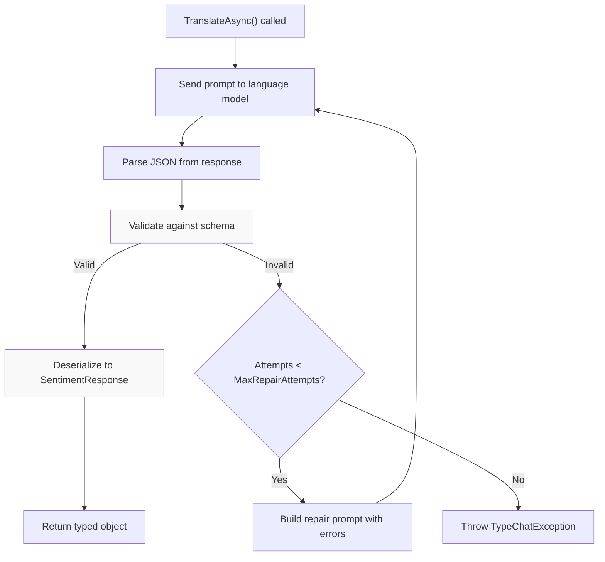

<!-- source: DeepWiki mcp.deepwiki.com · repo microsoft/typechat.net · page 2.3 Your First Translation · fetched 2026-10-26 -->

# Your First Translation

<details>
<summary>Relevant source files</summary>

The following files were used as context for generating this wiki page:

- [README.md](README.md)
- [examples/CoffeeShop/CoffeeShopSchema.cs](examples/CoffeeShop/CoffeeShopSchema.cs)
- [examples/CoffeeShop/Program.cs](examples/CoffeeShop/Program.cs)
- [examples/CoffeeShop/input.txt](examples/CoffeeShop/input.txt)
- [examples/Sentiment/Program.cs](examples/Sentiment/Program.cs)
- [examples/appSettings.json](examples/appSettings.json)
- [src/typechat.schema/TypescriptExporter.cs](src/typechat.schema/TypescriptExporter.cs)

</details>


This page provides a step-by-step tutorial for creating your first TypeChat.NET translation application. You will learn how to translate natural language input into strongly typed C# objects using `JsonTranslator<T>`.

For information about installing packages and setting up dependencies, see [Installation](#2.1). For configuring OpenAI credentials and settings, see [Configuration](#2.2). For comprehensive documentation on `JsonTranslator<T>` features, see [JsonTranslator](#3.1).

## Overview

This tutorial demonstrates the core TypeChat.NET workflow by building a simple sentiment analysis application. The complete example is available at [examples/Sentiment]() in the repository.

The basic steps are:
1. Define a C# type representing the desired output structure
2. Create a `JsonTranslator<T>` instance with a language model
3. Call `TranslateAsync()` to convert natural language into typed objects
4. Use the strongly typed result in your application

**Sources:** [README.md:1-243](), [examples/Sentiment/Program.cs:1-42]()

## Defining the Schema Type

The first step is defining a C# type that represents the structure you want the language model to produce. TypeChat.NET will automatically convert this type into a TypeScript schema that guides the model's output.

For sentiment analysis, define a simple class:

```csharp
public class SentimentResponse
{
    public string Sentiment { get; set; }
}
```

This type can be expanded to include additional properties as needed. The language model will generate JSON that conforms to this structure, which TypeChat.NET will validate and deserialize.

**Sources:** [examples/Sentiment/SentimentResponse.cs](), [README.md:28-45]()

## Creating the Translator

Create a `JsonTranslator<T>` instance by providing a `LanguageModel` configured with your OpenAI credentials:

```csharp
OpenAIConfig config = Config.LoadOpenAI();
var translator = new JsonTranslator<SentimentResponse>(new LanguageModel(config));
```

The `Config.LoadOpenAI()` helper loads configuration from `appSettings.json` or `appSettings.Development.json`. The translator is now ready to process natural language input.

**Sources:** [examples/Sentiment/Program.cs:12-16](), [README.md:193-207]()

## Translation Workflow

The following diagram shows the complete translation workflow, including the actual classes and methods involved:

```mermaid
sequenceDiagram
    participant User as "Natural Language Input"
    participant App as "Application Code"
    participant JT as "JsonTranslator&lt;SentimentResponse&gt;"
    participant LM as "LanguageModel"
    participant TS as "TypescriptExporter"
    participant Val as "IJsonTypeValidator"
    participant API as "OpenAI API"
    
    Note over App: Initialization
    App->>JT: new JsonTranslator&lt;T&gt;(model)
    JT->>TS: TypescriptExporter.GenerateSchema(typeof(T))
    TS-->>JT: TypescriptSchema
    
    Note over User,API: Translation Request
    User->>App: "I love this product!"
    App->>JT: TranslateAsync(input)
    JT->>JT: Build prompt with schema
    JT->>LM: CompleteAsync(prompt)
    LM->>API: HTTP request
    API-->>LM: Response text
    LM-->>JT: Response
    
    JT->>JT: Parse JSON
    JT->>Val: Validate(json, schema)
    
    alt Valid JSON
        Val-->>JT: Success
        JT->>JT: Deserialize to SentimentResponse
        JT-->>App: SentimentResponse object
        App->>App: response.Sentiment == "positive"
        App-->>User: "The sentiment is positive"
    else Invalid JSON
        Val-->>JT: Validation errors
        JT->>JT: Build repair prompt
        Note over JT,API: Retry with errors feedback
    end
```

**Sources:** [src/typechat/JsonTranslator.cs](), [README.md:28-37](), [examples/Sentiment/Program.cs:19-22]()

## Processing Input

Call `TranslateAsync()` with natural language input to perform the translation:

```csharp
string input = "I love this product!";
SentimentResponse response = await translator.TranslateAsync(input, cancelToken);
Console.WriteLine($"The sentiment is {response.Sentiment}");
```

The method returns a strongly typed `SentimentResponse` object. If translation or validation fails, a `TypeChatException` is thrown.

**Sources:** [examples/Sentiment/Program.cs:19-22](), [README.md:8-15]()

## Component Architecture

The following diagram shows how the key components work together in a translation application:



**Sources:** [examples/Sentiment/Program.cs:1-42](), [src/typechat/JsonTranslator.cs](), [src/typechat/LanguageModel.cs]()

## Complete Example Application

Here is the complete structure of a minimal translation application:

[examples/Sentiment/Program.cs:1-42]()

### Key Components

| Component | Purpose | Configuration |
|-----------|---------|---------------|
| `JsonTranslator<T>` | Translates natural language to typed objects | Created with `LanguageModel` instance |
| `LanguageModel` | Provides access to OpenAI language models | Created with `OpenAIConfig` |
| `OpenAIConfig` | Stores API credentials and endpoint settings | Loaded via `Config.LoadOpenAI()` |
| `ConsoleApp` | Base class for console applications | Optional helper from `TypeChat.ExamplesLib` |

**Sources:** [examples/Sentiment/Program.cs:1-42](), [README.md:77-96]()

## Configuration Details

The translator requires valid OpenAI credentials. The configuration is loaded from `appSettings.Development.json`:

[examples/appSettings.json:1-22]()

For Azure OpenAI:
```json
{
  "OpenAI": {
    "Azure": true,
    "ApiKey": "YOUR_API_KEY",
    "Endpoint": "https://YOUR_RESOURCE_NAME.openai.azure.com",
    "Model": "gpt-35-turbo"
  }
}
```

For OpenAI service:
```json
{
  "OpenAI": {
    "Azure": false,
    "ApiKey": "YOUR_API_KEY",
    "Endpoint": "https://api.openai.com/v1/chat/completions",
    "Model": "gpt-3.5-turbo"
  }
}
```

**Sources:** [README.md:148-190](), [examples/appSettings.json:1-22]()

## Schema Generation Process

When you create a `JsonTranslator<T>`, TypeChat.NET automatically generates a TypeScript schema from your C# type. This process is handled by `TypescriptExporter`:



The schema is automatically included in prompts sent to the language model, ensuring the model produces JSON that matches your C# type structure.

**Sources:** [src/typechat.schema/TypescriptExporter.cs:1-767](), [README.md:32-45]()

## Validation and Repair

TypeChat.NET validates the language model's JSON output against the generated schema. If validation fails, the error messages are sent back to the model to "repair" the JSON:



The default `MaxRepairAttempts` is 3, but can be configured:

```csharp
translator.MaxRepairAttempts = 5;
```

**Sources:** [src/typechat/JsonTranslator.cs](), [examples/CoffeeShop/Program.cs:19](), [README.md:28-37]()

## Running the Application

To run the sentiment analysis example:

1. Ensure configuration is set up in `appSettings.Development.json`
2. Build and run the application
3. Enter natural language input at the prompt
4. Receive typed sentiment analysis results

Example session:
```
😀> I love this product!
The sentiment is positive

😀> This is terrible
The sentiment is negative

😀> It's okay I guess
The sentiment is neutral
```

**Sources:** [examples/Sentiment/Program.cs:25-40](), [README.md:117-146]()

## Next Steps

After mastering basic translation:

- **Complex Schemas**: Learn about polymorphic types, vocabularies, and nested structures in [Schema Definition](#4)
- **Error Handling**: Understand validation failures and repair mechanisms in [Validation and Repair](#3.3)
- **Advanced Translation**: Explore `JsonTranslator<T>` configuration options in [JsonTranslator](#3.1)
- **Program Translation**: Generate executable code from natural language using [Program Translation](#5)
- **Examples**: Study more complex examples like [CoffeeShop Example](#8.1)

**Sources:** [README.md:115-146]()

---

