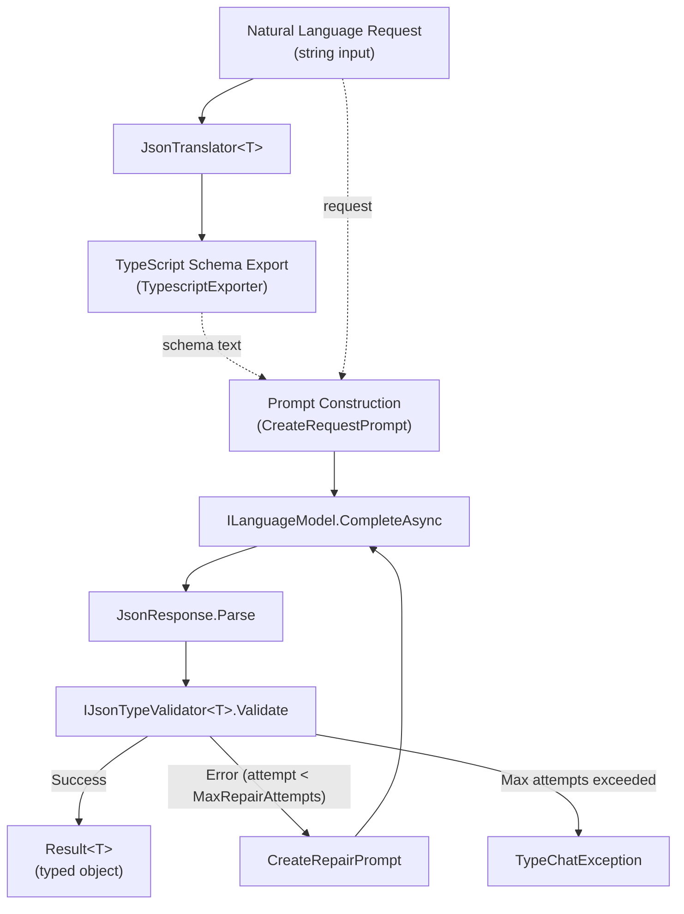
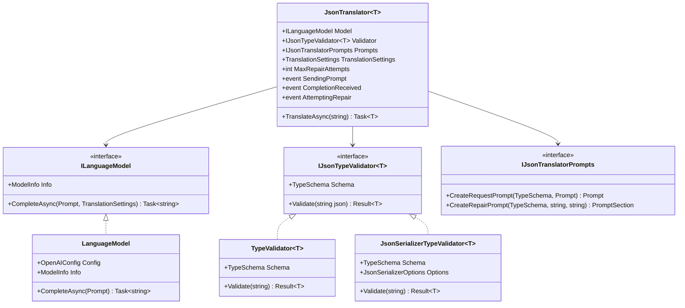
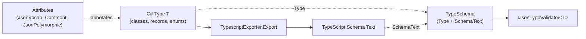
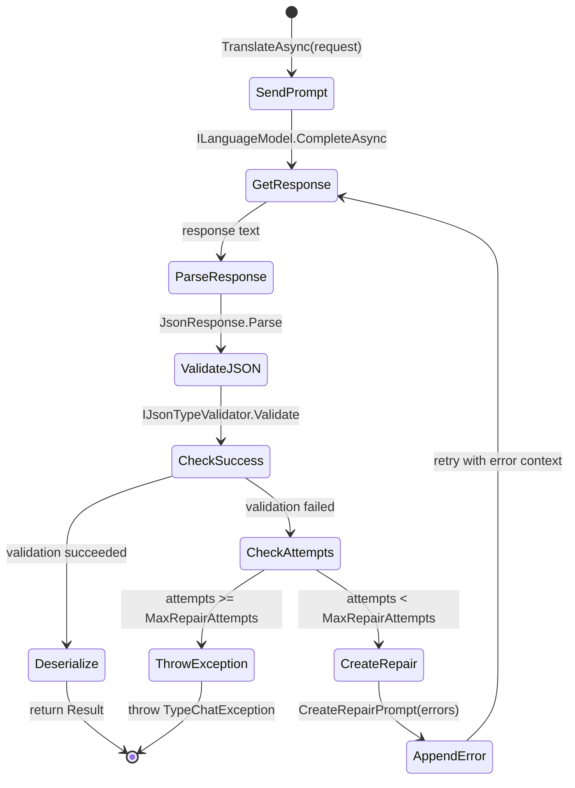
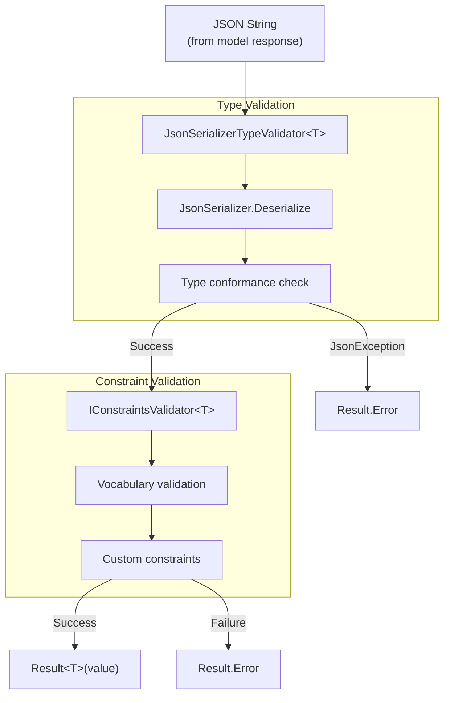
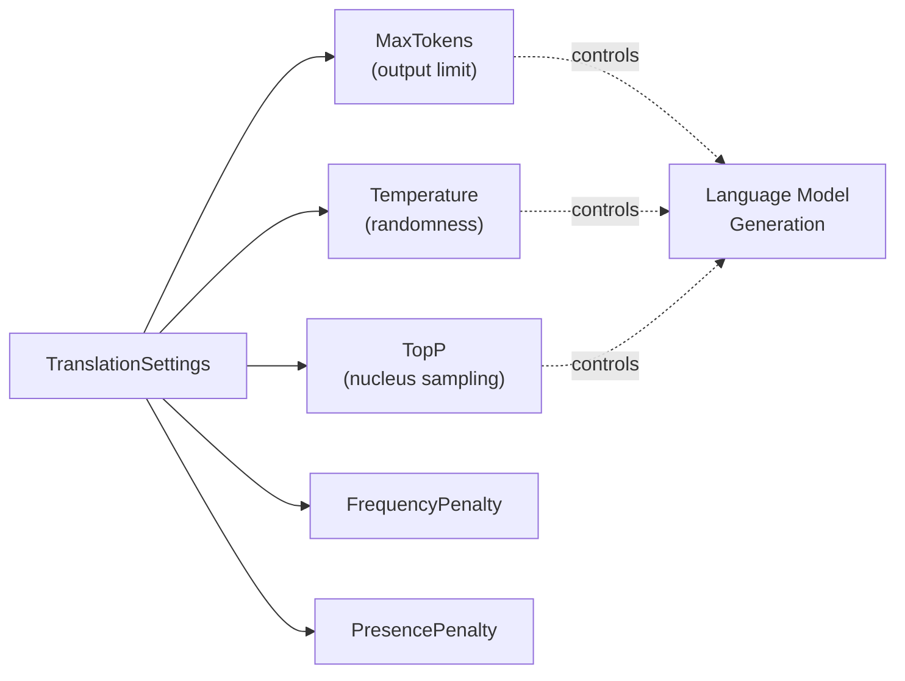
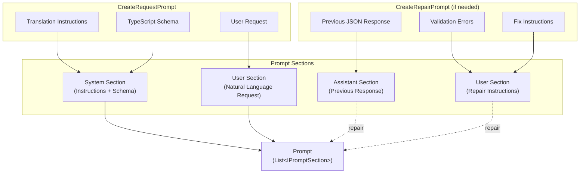
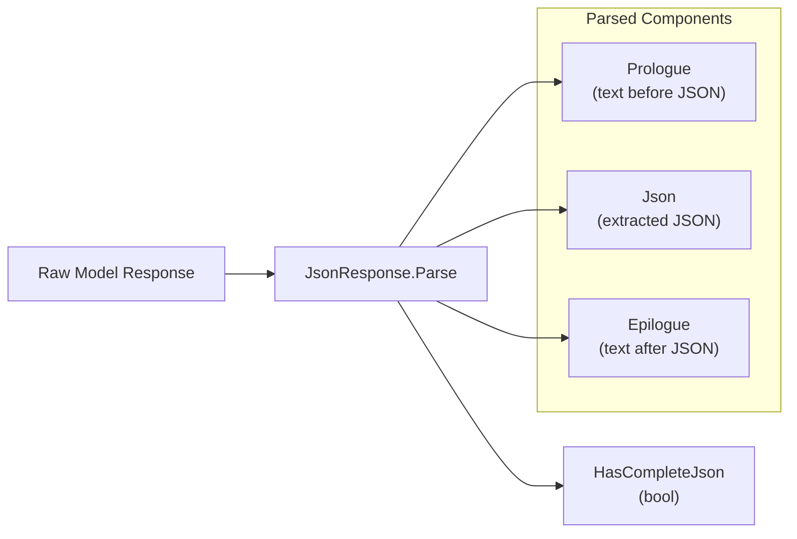
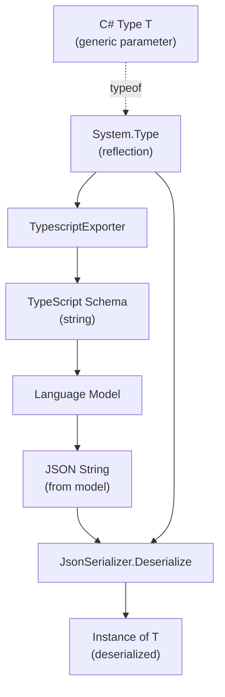

<!-- source: DeepWiki mcp.deepwiki.com · repo microsoft/typechat.net · page 3 Core Concepts · fetched 2026-10-26 -->

# Core Concepts

<details>
<summary>Relevant source files</summary>

The following files were used as context for generating this wiki page:

- [README.md](README.md)
- [examples/MultiSchema/Program.cs](examples/MultiSchema/Program.cs)
- [examples/Sentiment/Program.cs](examples/Sentiment/Program.cs)
- [examples/appSettings.json](examples/appSettings.json)
- [src/typechat/JsonResponse.cs](src/typechat/JsonResponse.cs)
- [src/typechat/JsonSerializerTypeValidator.cs](src/typechat/JsonSerializerTypeValidator.cs)
- [src/typechat/JsonTranslator.cs](src/typechat/JsonTranslator.cs)
- [src/typechat/ModelInfo.cs](src/typechat/ModelInfo.cs)
- [src/typechat/Prompt.cs](src/typechat/Prompt.cs)
- [src/typechat/TypeChatException.cs](src/typechat/TypeChatException.cs)

</details>


This page provides a comprehensive overview of the fundamental concepts and components that power TypeChat.NET. It explains the translation pipeline that converts natural language requests into strongly-typed C# objects, the role of schemas in guiding language models, and the validation-repair mechanism that ensures type safety.

For step-by-step tutorials on using these components, see [Getting Started](#2). For detailed reference documentation on specific classes, see [API Reference](#10).

## The Translation Pipeline

TypeChat.NET's core workflow transforms unstructured natural language into validated, strongly-typed objects through a multi-stage pipeline.

### Translation Workflow



**Sources:** [src/typechat/JsonTranslator.cs:1-314](), [src/typechat/JsonResponse.cs:1-103]()

The pipeline consists of the following stages:

| Stage | Component | Purpose |
|-------|-----------|---------|
| **Schema Generation** | `TypescriptExporter` | Converts C# type `T` to TypeScript schema text |
| **Prompt Construction** | `IJsonTranslatorPrompts` | Builds prompt containing instructions, schema, and request |
| **Model Completion** | `ILanguageModel` | Sends prompt to LLM, receives raw text response |
| **Response Parsing** | `JsonResponse` | Extracts JSON from response (handles prologue/epilogue) |
| **Validation** | `IJsonTypeValidator<T>` | Validates JSON and deserializes to type `T` |
| **Repair Loop** | `CreateRepairPrompt` | On failure, sends errors back to model for correction |
| **Result** | `Result<T>` | Returns validated object or throws exception |

**Sources:** [src/typechat/JsonTranslator.cs:199-252]()

## Core Components

TypeChat.NET's architecture centers around several key abstractions that work together to enable type-safe natural language translation.

### Primary Classes



**Sources:** [src/typechat/JsonTranslator.cs:23-66](), [src/typechat/ILanguageModel.cs](), [src/typechat/IJsonTypeValidator.cs]()

### Component Responsibilities

| Component | Type | Responsibility |
|-----------|------|----------------|
| `JsonTranslator<T>` | Class | Orchestrates the translation pipeline; manages validation-repair loop |
| `ILanguageModel` | Interface | Abstracts language model interaction; implemented by `LanguageModel` |
| `IJsonTypeValidator<T>` | Interface | Validates JSON conforms to schema; deserializes to type `T` |
| `IJsonTranslatorPrompts` | Interface | Generates prompts for initial translation and repair attempts |
| `TypeSchema` | Class | Encapsulates type information and schema text for a given type |
| `Prompt` | Class | Represents multi-section prompt with source tracking (System/User/Assistant) |
| `Result<T>` | Struct | Discriminated union: success with value or error with message |
| `JsonResponse` | Class | Parses model response, extracting JSON from surrounding text |

**Sources:** [src/typechat/JsonTranslator.cs:23-146](), [src/typechat/Prompt.cs:1-193](), [src/typechat/JsonResponse.cs:1-103]()

## Schema-Driven Translation

TypeChat.NET uses TypeScript schemas to describe the expected structure of JSON that language models should generate. This approach leverages TypeScript's concise type syntax while targeting C# types.

### Schema Generation Flow



**Sources:** [src/typechat.schema/TypescriptExporter.cs](), [examples/Sentiment/SentimentResponse.cs]()

### Schema Components

The schema generation process considers:

| Element | Source | Purpose |
|---------|--------|---------|
| **Type Structure** | C# properties, fields, methods | Maps to TypeScript interface/type definitions |
| **Dependencies** | Referenced types | Recursively exports dependent types |
| **Vocabularies** | `[JsonVocab]` attribute | Constrains string properties to specific values |
| **Comments** | `[Comment]` attribute, XML docs | Provides semantic guidance to the model |
| **Polymorphism** | `[JsonPolymorphic]` attribute | Supports type hierarchies with discriminators |
| **Nullability** | `?` annotations | Translates to optional TypeScript properties |

**Sources:** [README.md:38-45](), [src/typechat.schema/]()

### Example: From C# to Schema

A simple C# type:

```csharp
public class SentimentResponse
{
    [Comment("The sentiment of the text")]
    public string Sentiment { get; set; }
    
    [Comment("Explanation for the sentiment")]
    public string Reason { get; set; }
}
```

Generates TypeScript schema:

```typescript
// The sentiment of the text
export type Sentiment = string;

// Explanation for the sentiment  
export type Reason = string;

export interface SentimentResponse {
    sentiment: Sentiment;
    reason: Reason;
}
```

This schema is embedded in the prompt sent to the language model, guiding it to produce JSON matching this structure.

**Sources:** [examples/Sentiment/SentimentResponse.cs]()

## Validation and Repair Mechanism

TypeChat.NET's validation-repair loop is a key innovation that improves reliability when working with stochastic language models.

### Repair Loop Architecture



**Sources:** [src/typechat/JsonTranslator.cs:199-252]()

### Repair Process Details

When validation fails, the repair mechanism:

1. **Captures Error Details**: The validator returns specific error messages (JSON parsing errors, type mismatches, constraint violations)
2. **Constructs Repair Prompt**: `CreateRepairPrompt` builds a new prompt section containing:
   - The original invalid JSON response
   - Detailed error messages explaining what's wrong
   - Instructions to fix the errors
3. **Appends to Conversation**: The repair prompt is appended to the existing prompt history, maintaining context
4. **Retries**: The model is invoked again with the error context
5. **Limits Attempts**: After `MaxRepairAttempts` (default: 1), throws `TypeChatException`

**Sources:** [src/typechat/JsonTranslator.cs:234-251](), [src/typechat/IJsonTranslatorPrompts.cs]()

### Validation Components



**Sources:** [src/typechat/JsonSerializerTypeValidator.cs:1-152](), [src/typechat/JsonTranslator.cs:275-289]()

The validation system operates in two phases:

| Phase | Component | Validates |
|-------|-----------|-----------|
| **Type Validation** | `IJsonTypeValidator<T>` | JSON structure matches schema; can deserialize to type `T` |
| **Constraint Validation** | `IConstraintsValidator<T>` (optional) | Business rules, vocabulary constraints, cross-field validation |

**Sources:** [src/typechat/JsonTranslator.cs:94-111]()

## Translation Settings and Configuration

TypeChat.NET provides extensive configuration options to control the translation process.

### Translation Settings



**Sources:** [src/typechat/TranslationSettings.cs]()

### JsonTranslator Configuration

The `JsonTranslator<T>` class exposes several configurable properties:

| Property | Type | Purpose | Default |
|----------|------|---------|---------|
| `Model` | `ILanguageModel` | The language model to use | (required) |
| `Validator` | `IJsonTypeValidator<T>` | Type validator for schema validation | `TypeValidator<T>` |
| `ConstraintsValidator` | `IConstraintsValidator<T>?` | Optional additional validation | `null` |
| `Prompts` | `IJsonTranslatorPrompts` | Prompt generation strategy | `JsonTranslatorPrompts.Default` |
| `TranslationSettings` | `TranslationSettings` | Model parameters (MaxTokens, etc.) | Default settings |
| `MaxRepairAttempts` | `int` | Number of repair attempts on validation failure | `1` |

**Sources:** [src/typechat/JsonTranslator.cs:86-146]()

### Observable Events

`JsonTranslator<T>` provides events for monitoring and debugging:

```csharp
// Event: Sending a prompt to the model
public event Action<Prompt> SendingPrompt;

// Event: Received raw response from model
public event Action<string> CompletionReceived;

// Event: Attempting repair with validation errors
public event Action<string> AttemptingRepair;
```

These events enable logging, telemetry, and debugging without modifying translator code.

**Sources:** [src/typechat/JsonTranslator.cs:152-165]()

## Prompt Structure

TypeChat.NET uses structured prompts with multiple sections, each tagged with a source (System, User, Assistant).

### Prompt Architecture



**Sources:** [src/typechat/Prompt.cs:1-193](), [src/typechat/IJsonTranslatorPrompts.cs]()

### Prompt Section Sources

The `PromptSection` class tracks the source of each section:

| Source | Role | Used For |
|--------|------|----------|
| `System` | Instructions | Translation rules, schema definition, system-level guidance |
| `User` | Request | Natural language input, repair requests with error details |
| `Assistant` | Response | Previous model responses (used in repair loop for context) |

**Sources:** [src/typechat/PromptSection.cs]()

This multi-turn conversation structure allows the repair loop to provide context about previous attempts, helping the model understand what went wrong and how to fix it.

## Error Handling

TypeChat.NET uses structured error handling to provide actionable diagnostics.

### Exception Types

```mermaid
classDiagram
    class TypeChatException {
        +ErrorCode Code
        +string Request
        +JsonResponse Response
        +NoJsonObject
        +JsonValidation
        +NoTranslator
    }
    
    class JsonException {
        +string Message
        +string Path
        +long LineNumber
    }
    
    class Result~T~ {
        +bool Success
        +T Value
        +string Message
        +Error(string)
    }
    
    TypeChatException --> JsonResponse
    Result~T~ -.contains errors from.-> JsonException
```

**Sources:** [src/typechat/TypeChatException.cs:1-101](), [src/typechat/Result.cs]()

### Error Codes

| Error Code | Meaning | Thrown When |
|------------|---------|-------------|
| `NoJsonObject` | Response contains no JSON | Model returns plain text with no `{` `}` braces |
| `JsonValidation` | JSON failed type validation | JSON structure doesn't match schema or deserialization fails |
| `NoTranslator` | No suitable translator found | Multi-schema routing finds no matching translator |

**Sources:** [src/typechat/TypeChatException.cs:19-37]()

### JsonResponse Parsing

The `JsonResponse` class handles model responses that may contain text before or after the JSON object:



The parser identifies:
- `Prologue`: Text before the first `{`
- `Json`: Text between outermost `{` and `}`
- `Epilogue`: Text after the last `}`
- `HasCompleteJson`: Whether JSON has both opening and closing braces

**Sources:** [src/typechat/JsonResponse.cs:1-103]()

## Type System Integration

TypeChat.NET bridges C# types with TypeScript schema and JSON serialization.

### Type Flow



**Sources:** [src/typechat/TypeSchema.cs](), [src/typechat.schema/TypescriptExporter.cs]()

### Schema Text Formats

TypeChat.NET supports multiple ways to provide schema:

| Format | Use Case | Example |
|--------|----------|---------|
| **Auto-generated** | Most common; automatic from type `T` | `new JsonTranslator<Cart>(model)` |
| **Explicit SchemaText** | Custom schema or hand-authored TypeScript | `new JsonTranslator(model, schemaText)` |
| **TypeValidator** | Advanced: custom validation logic | `new JsonTranslator(model, customValidator)` |

**Sources:** [src/typechat/JsonTranslator.cs:39-84](), [README.md:34-45]()

This flexibility allows developers to start with auto-generated schemas and progressively enhance them with custom schema text or validation logic as needed.

---

**Summary**: TypeChat.NET's core architecture centers on type-safe translation through schema-driven prompts, robust validation, and automatic repair. The `JsonTranslator<T>` orchestrates interaction between language models, schema generation, and validators to transform natural language into strongly-typed objects. The validation-repair loop ensures reliability by feeding errors back to the model for correction, while the flexible type system enables both automatic and custom schema generation. For implementation details on each component, see the child pages of this section: [JsonTranslator](#3.1), [Schema Generation](#3.2), [Validation and Repair](#3.3), [Language Models](#3.4), and [Prompts and Prompt Engineering](#3.5).

---

