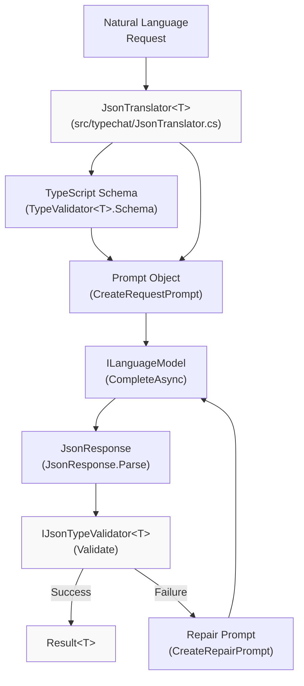
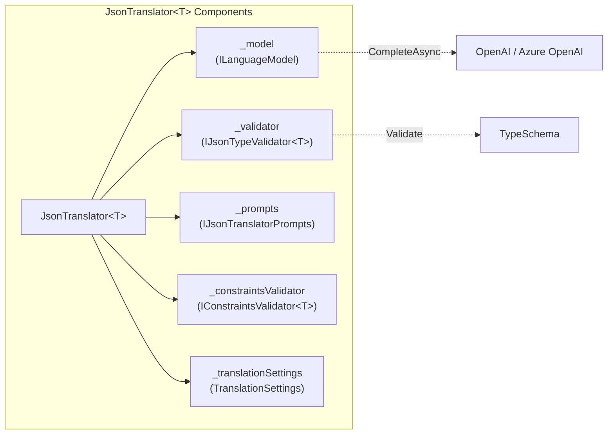
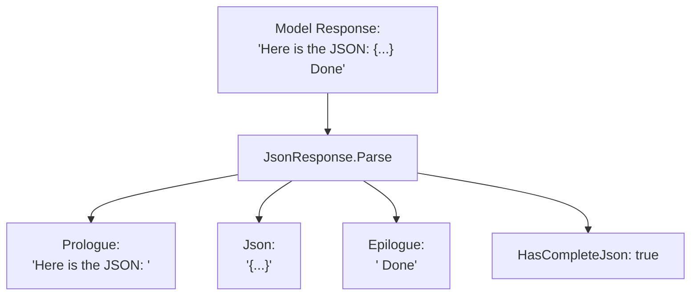
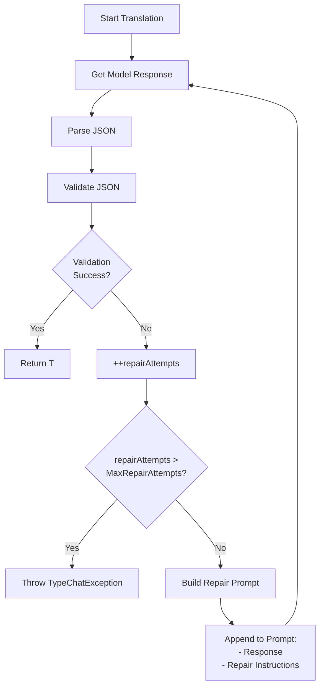
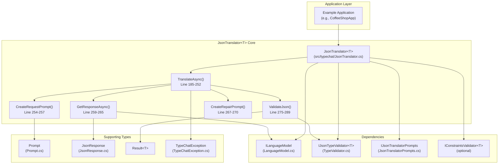

<!-- source: DeepWiki mcp.deepwiki.com · repo microsoft/typechat.net · page 3.1 JsonTranslator · fetched 2026-10-26 -->

# JsonTranslator

<details>
<summary>Relevant source files</summary>

The following files were used as context for generating this wiki page:

- [README.md](README.md)
- [examples/MultiSchema/Program.cs](examples/MultiSchema/Program.cs)
- [examples/Sentiment/Program.cs](examples/Sentiment/Program.cs)
- [examples/appSettings.json](examples/appSettings.json)
- [src/typechat/JsonResponse.cs](src/typechat/JsonResponse.cs)
- [src/typechat/JsonSerializerTypeValidator.cs](src/typechat/JsonSerializerTypeValidator.cs)
- [src/typechat/JsonTranslator.cs](src/typechat/JsonTranslator.cs)
- [src/typechat/ModelInfo.cs](src/typechat/ModelInfo.cs)
- [src/typechat/Prompt.cs](src/typechat/Prompt.cs)
- [src/typechat/TypeChatException.cs](src/typechat/TypeChatException.cs)

</details>


## Purpose and Scope

`JsonTranslator<T>` is the core component of TypeChat.NET that translates natural language requests into strongly typed objects. It orchestrates the complete translation workflow: generating TypeScript schemas from C# types, prompting language models, validating JSON responses, and automatically repairing validation errors.

This page covers the `JsonTranslator<T>` class, its configuration options, lifecycle, and events. For information about schema generation, see [Schema Generation](#3.2). For validation and repair mechanisms, see [Validation and Repair](#3.3). For language model configuration, see [Language Models](#3.4). For customizing prompts, see [Prompts and Prompt Engineering](#3.5).

**Sources:** [README.md:1-43](), [src/typechat/JsonTranslator.cs:1-314]()

## Overview

`JsonTranslator<T>` implements a validation-repair loop that transforms natural language into typed objects:

1. **Schema Generation**: Automatically exports a TypeScript schema from the C# type `T`
2. **Prompt Construction**: Builds a prompt containing instructions, schema, and user request
3. **Model Invocation**: Sends the prompt to the language model for completion
4. **JSON Extraction**: Extracts JSON from the model's response (handling prologues/epilogues)
5. **Validation**: Deserializes and validates JSON against the schema
6. **Repair**: If validation fails, sends errors back to the model for correction (up to `MaxRepairAttempts` times)
7. **Return**: Returns a validated, strongly-typed object of type `T`



**Sources:** [src/typechat/JsonTranslator.cs:6-21](), [README.md:28-35]()

## Class Structure and Construction

### Core Dependencies

`JsonTranslator<T>` requires two primary dependencies:

| Dependency | Type | Purpose |
|------------|------|---------|
| **Language Model** | `ILanguageModel` | Generates JSON completions from prompts |
| **Validator** | `IJsonTypeValidator<T>` | Validates and deserializes JSON to type `T` |



**Sources:** [src/typechat/JsonTranslator.cs:27-33]()

### Constructor Overloads

`JsonTranslator<T>` provides three constructor overloads for different use cases:

#### 1. Automatic Schema Generation with Vocabularies

```csharp
public JsonTranslator(
    ILanguageModel model, 
    IJsonTranslatorPrompts? prompts = null, 
    IVocabCollection? knownVocabs = null)
```

**Use Case**: Most common scenario. Automatically generates TypeScript schema from type `T` and supports dynamic vocabulary loading.

**Implementation Details**:
- Creates a `TypeValidator<T>` internally [src/typechat/JsonTranslator.cs:79]()
- Uses `JsonTranslatorPrompts.Default` if no custom prompts provided [src/typechat/JsonTranslator.cs:80]()
- Sets `MaxRepairAttempts = 1` [src/typechat/JsonTranslator.cs:83]()

**Sources:** [src/typechat/JsonTranslator.cs:74-84]()

#### 2. Custom Validator

```csharp
public JsonTranslator(
    ILanguageModel model,
    IJsonTypeValidator<T> validator,
    IJsonTranslatorPrompts? prompts = null)
```

**Use Case**: Advanced scenarios requiring custom validation logic or schema generation.

**Sources:** [src/typechat/JsonTranslator.cs:50-66]()

#### 3. Manual Schema Text

```csharp
public JsonTranslator(
    ILanguageModel model, 
    SchemaText schema)
```

**Use Case**: When providing hand-authored TypeScript schemas instead of auto-generated ones.

**Implementation Details**:
- Creates a `JsonSerializerTypeValidator<T>` with the provided schema [src/typechat/JsonTranslator.cs:40]()

**Sources:** [src/typechat/JsonTranslator.cs:39-42]()

### Example: Basic Construction

```csharp
// From examples/Sentiment/Program.cs:12-16
OpenAIConfig config = Config.LoadOpenAI();
var translator = new JsonTranslator<SentimentResponse>(
    new LanguageModel(config)
);
```

**Sources:** [examples/Sentiment/Program.cs:12-16]()

## Configuration Properties

### Validator and Schema

```csharp
public IJsonTypeValidator<T> Validator { get; set; }
```

The validator performs JSON deserialization and type checking. Replacement validators must provide a compatible `Schema` property.

**Sources:** [src/typechat/JsonTranslator.cs:94-102]()

### Constraints Validator

```csharp
public IConstraintsValidator<T>? ConstraintsValidator { get; set; }
```

Optional validator that runs **after** successful JSON validation to enforce additional business rules or constraints on the typed object.

**Sources:** [src/typechat/JsonTranslator.cs:107-111]()

### Prompts

```csharp
public IJsonTranslatorPrompts Prompts { get; set; }
```

Controls how prompts are constructed for translation and repair. Defaults to `JsonTranslatorPrompts.Default`.

**Sources:** [src/typechat/JsonTranslator.cs:116-124]()

### Translation Settings

```csharp
public TranslationSettings TranslationSettings { get; }
```

Configures model-specific parameters like `MaxTokens`, temperature, and other generation settings.

**Sources:** [src/typechat/JsonTranslator.cs:129]()

### Max Repair Attempts

```csharp
public int MaxRepairAttempts { get; set; }
```

Controls how many times the translator will attempt to repair invalid JSON. Default is `1`.

- `0`: No repair attempts (fail on first validation error)
- `1`: One repair attempt (default)
- `>1`: Multiple repair attempts

**Sources:** [src/typechat/JsonTranslator.cs:135-146](), [src/typechat/JsonTranslator.cs:25]()

## Translation Workflow

### Translation Method Signatures

```csharp
// Simple translation
public Task<T> TranslateAsync(
    string request, 
    CancellationToken cancelToken = default)

// Advanced translation with preamble
public Task<T> TranslateAsync(
    Prompt request,
    IList<IPromptSection>? preamble,
    TranslationSettings? requestSettings = null,
    CancellationToken cancelToken = default)
```

**Sources:** [src/typechat/JsonTranslator.cs:185-205]()

### Detailed Translation Flow

```mermaid
sequenceDiagram
    participant App as "Application"
    participant JT as "JsonTranslator&lt;T&gt;"
    participant JT_CreatePrompt as "CreateRequestPrompt"
    participant JT_GetResponse as "GetResponseAsync"
    participant Model as "ILanguageModel"
    participant JT_Parse as "JsonResponse.Parse"
    participant JT_Validate as "ValidateJson"
    participant Validator as "IJsonTypeValidator&lt;T&gt;"
    participant ConstraintsVal as "IConstraintsValidator&lt;T&gt;"
    participant JT_Repair as "CreateRepairPrompt"
    
    App->>JT: TranslateAsync(request)
    
    Note over JT: repairAttempts = 0
    
    JT->>JT_CreatePrompt: CreateRequestPrompt(request, preamble)
    JT_CreatePrompt-->>JT: Prompt with schema
    
    loop While validation fails
        JT->>JT_GetResponse: GetResponseAsync(prompt, settings)
        Note over JT_GetResponse: Fires SendingPrompt event
        JT_GetResponse->>Model: CompleteAsync(prompt)
        Model-->>JT_GetResponse: responseText
        Note over JT_GetResponse: Fires CompletionReceived event
        JT_GetResponse-->>JT: responseText
        
        JT->>JT_Parse: JsonResponse.Parse(responseText)
        JT_Parse-->>JT: JsonResponse
        
        alt Has Complete JSON
            JT->>JT_Validate: ValidateJson(json)
            JT_Validate->>Validator: Validate(json)
            Validator-->>JT_Validate: Result&lt;T&gt;
            
            alt Validation Success
                JT_Validate->>ConstraintsVal: Validate(value)
                ConstraintsVal-->>JT_Validate: Result&lt;T&gt;
                JT_Validate-->>JT: Result&lt;T&gt;
                JT-->>App: Return T
            else Validation Failure
                JT_Validate-->>JT: Result with error
            end
        else No Complete JSON
            Note over JT: Create error result
        end
        
        Note over JT: ++repairAttempts
        alt repairAttempts > MaxRepairAttempts
            JT-->>App: Throw TypeChatException
        end
        
        Note over JT: Fires AttemptingRepair event
        JT->>JT_Repair: CreateRepairPrompt(responseText, errors)
        JT_Repair-->>JT: PromptSection
        
        Note over JT: Append response and repair to prompt
        JT->>JT: prompt.AppendResponse(responseText)
        JT->>JT: prompt.Append(repairPrompt)
    end
```

**Sources:** [src/typechat/JsonTranslator.cs:199-252]()

### Prompt Construction

The `CreateRequestPrompt` method builds the initial translation prompt:

```csharp
protected virtual Prompt CreateRequestPrompt(
    Prompt request, 
    IList<IPromptSection> preamble)
{
    return _prompts.CreateRequestPrompt(
        _validator.Schema, 
        request, 
        preamble
    );
}
```

**Prompt Structure**:
1. **Preamble**: Optional instructions or context (e.g., conversation history)
2. **System Instructions**: Standard TypeChat translation instructions
3. **Schema**: TypeScript type definitions for `T`
4. **Request**: The user's natural language input

**Sources:** [src/typechat/JsonTranslator.cs:254-257]()

### Response Processing

The `GetResponseAsync` method handles model invocation and event notifications:

```csharp
protected virtual async Task<string> GetResponseAsync(
    Prompt prompt, 
    TranslationSettings requestSettings, 
    CancellationToken cancelToken)
{
    NotifyEvent(SendingPrompt, prompt);
    string responseText = await _model.CompleteAsync(
        prompt, 
        requestSettings, 
        cancelToken
    ).ConfigureAwait(false);
    NotifyEvent(CompletionReceived, responseText);
    return responseText;
}
```

**Sources:** [src/typechat/JsonTranslator.cs:259-265]()

## Validation and Repair Mechanism

### JSON Response Parsing

The `JsonResponse.Parse` method extracts JSON from model responses that may contain additional text:

| Property | Description |
|----------|-------------|
| `ResponseText` | Raw model response |
| `Json` | Text within outermost `{}` braces |
| `Prologue` | Text before the JSON |
| `Epilogue` | Text after the JSON |
| `HasCompleteJson` | Whether JSON is enclosed in `{}` |



**Sources:** [src/typechat/JsonResponse.cs:1-102]()

### Validation Process

The `ValidateJson` method orchestrates validation:

```csharp
private Result<T> ValidateJson(string json)
{
    var result = Validator.Validate(json);
    if (!OnValidationComplete(result))
    {
        return result;
    }
    if (result.Success)
    {
        result = (_constraintsValidator is not null) ?
                 _constraintsValidator.Validate(result.Value) :
                 result;
    }
    return result;
}
```

**Validation Steps**:
1. **Type Validation**: `IJsonTypeValidator<T>.Validate(json)` deserializes and validates against schema
2. **Extension Point**: `OnValidationComplete(result)` allows subclasses to intercept
3. **Constraints Validation**: `IConstraintsValidator<T>.Validate(value)` applies business rules

**Sources:** [src/typechat/JsonTranslator.cs:275-289]()

### Repair Loop

When validation fails, the translator constructs a repair prompt:

```csharp
protected virtual PromptSection CreateRepairPrompt(
    string responseText, 
    Result<T> validationResult)
{
    return _prompts.CreateRepairPrompt(
        _validator.Schema, 
        responseText, 
        validationResult.Message
    );
}
```

**Repair Prompt Structure**:
- Previous response (what the model generated)
- Validation error details (why it failed)
- Instructions to correct the error

The repair prompt is appended to the original prompt, creating a multi-turn conversation:

```
[System] Instructions + Schema
[User] Original request
[Assistant] Invalid JSON response
[User] Repair prompt with errors  ← Added during repair
[Assistant] Corrected JSON response (hopefully)
```

**Sources:** [src/typechat/JsonTranslator.cs:267-270](), [src/typechat/JsonTranslator.cs:236-251]()

### Repair Loop Control Flow



**Sources:** [src/typechat/JsonTranslator.cs:210-251]()

## Events and Diagnostics

`JsonTranslator<T>` exposes three events for monitoring and diagnostics:

### SendingPrompt Event

```csharp
public event Action<Prompt> SendingPrompt;
```

Fired immediately before sending a prompt to the language model. Use this to:
- Log prompts for debugging
- Track prompt construction
- Monitor token usage

**Sources:** [src/typechat/JsonTranslator.cs:155](), [src/typechat/JsonTranslator.cs:261]()

### CompletionReceived Event

```csharp
public event Action<string> CompletionReceived;
```

Fired after receiving a response from the language model. Use this to:
- Log raw model outputs
- Debug JSON extraction issues
- Monitor model behavior

**Sources:** [src/typechat/JsonTranslator.cs:160](), [src/typechat/JsonTranslator.cs:263]()

### AttemptingRepair Event

```csharp
public event Action<string> AttemptingRepair;
```

Fired when validation fails and a repair attempt is initiated. The string parameter contains the validation error message. Use this to:
- Track repair attempts
- Monitor validation failures
- Debug schema or prompt issues

**Sources:** [src/typechat/JsonTranslator.cs:165](), [src/typechat/JsonTranslator.cs:241]()

### Event Usage Pattern

```csharp
var translator = new JsonTranslator<SentimentResponse>(model);

translator.SendingPrompt += (prompt) => 
{
    Console.WriteLine($"Sending prompt: {prompt.GetLength()} chars");
};

translator.CompletionReceived += (response) => 
{
    Console.WriteLine($"Received: {response.Substring(0, Math.Min(100, response.Length))}...");
};

translator.AttemptingRepair += (error) => 
{
    Console.WriteLine($"Repair attempt due to: {error}");
};
```

**Sources:** [src/typechat/JsonTranslator.cs:291-313]()

## Error Handling

### TypeChatException

`JsonTranslator<T>` throws `TypeChatException` when translation fails after exhausting repair attempts.

| Error Code | Scenario | Description |
|------------|----------|-------------|
| `NoJsonObject` | No JSON found in response | Model returned text without any `{}` braces |
| `JsonValidation` | Validation failed after max repairs | JSON validation failed `MaxRepairAttempts` times |

**Exception Properties**:

```csharp
public class TypeChatException : Exception
{
    public ErrorCode Code { get; }           // Error category
    public string Request { get; }           // Original request
    public JsonResponse? Response { get; }   // Last model response
}
```

**Sources:** [src/typechat/TypeChatException.cs:1-100]()

### Exception Throwing Logic

```csharp
// No complete JSON found
if (!jsonResponse.HasCompleteJson)
{
    validationResult = Result<T>.Error(
        TypeChatException.IncompleteJson(jsonResponse)
    );
}
else if (!jsonResponse.HasJson)
{
    validationResult = Result<T>.Error(
        TypeChatException.NoJson(jsonResponse)
    );
}

// Max repair attempts exceeded
if (repairAttempts > _maxRepairAttempts)
{
    TypeChatException.ThrowJsonValidation(
        request, 
        jsonResponse, 
        validationResult.Message
    );
}
```

**Sources:** [src/typechat/JsonTranslator.cs:225-240](), [src/typechat/TypeChatException.cs:71-89]()

### Error Recovery Strategies

1. **Increase MaxRepairAttempts**: Give the model more chances to self-correct
   ```csharp
   translator.MaxRepairAttempts = 3;
   ```

2. **Customize Prompts**: Improve instructions via `IJsonTranslatorPrompts`
   ```csharp
   translator.Prompts = new CustomPrompts();
   ```

3. **Simplify Schema**: Reduce complexity of type `T` to improve model success rate

4. **Event Monitoring**: Use events to identify systematic issues
   ```csharp
   translator.AttemptingRepair += LogRepairAttempt;
   ```

**Sources:** [src/typechat/JsonTranslator.cs:135-146]()

## Usage Patterns

### Basic Translation Pattern

```csharp
// From examples/Sentiment/Program.cs
var translator = new JsonTranslator<SentimentResponse>(
    new LanguageModel(config)
);

SentimentResponse response = await translator.TranslateAsync(
    "I love this product!", 
    cancelToken
);
```

**Sources:** [examples/Sentiment/Program.cs:8-23]()

### Multi-Schema Routing Pattern

```csharp
// From examples/MultiSchema/Program.cs
var router = new TextRequestRouter<IInputHandler>(model);
router.Add(new CoffeeShopApp(), "CoffeeShop", "Order coffee...");
router.Add(new CalendarApp(), "Calendar", "Calendar actions...");

var match = await router.ClassifyRequestAsync(input, cancelToken);
if (match.Value is not null)
{
    await match.Value.ProcessInputAsync(input, cancelToken);
}
```

**Sources:** [examples/MultiSchema/Program.cs:28-54]()

### Custom Validation Pattern

```csharp
// Custom validator with additional logic
var customValidator = new CustomTypeValidator<MyType>();
var translator = new JsonTranslator<MyType>(
    model, 
    customValidator
);

// Additional constraints validation
translator.ConstraintsValidator = new MyConstraintsValidator();
```

**Sources:** [src/typechat/JsonTranslator.cs:50-66](), [src/typechat/JsonTranslator.cs:107-111]()

### Configuration Override Pattern

```csharp
var translator = new JsonTranslator<CalendarActions>(model);

// Override repair attempts
translator.MaxRepairAttempts = 2;

// Override translation settings per-request
var settings = new TranslationSettings 
{ 
    MaxTokens = 2000,
    Temperature = 0.7 
};

var result = await translator.TranslateAsync(
    request, 
    preamble: null,
    requestSettings: settings
);
```

**Sources:** [src/typechat/JsonTranslator.cs:199-205](), [src/typechat/JsonTranslator.cs:129]()

## Architecture Integration



**Sources:** [src/typechat/JsonTranslator.cs:1-314](), [README.md:22-45]()

---

