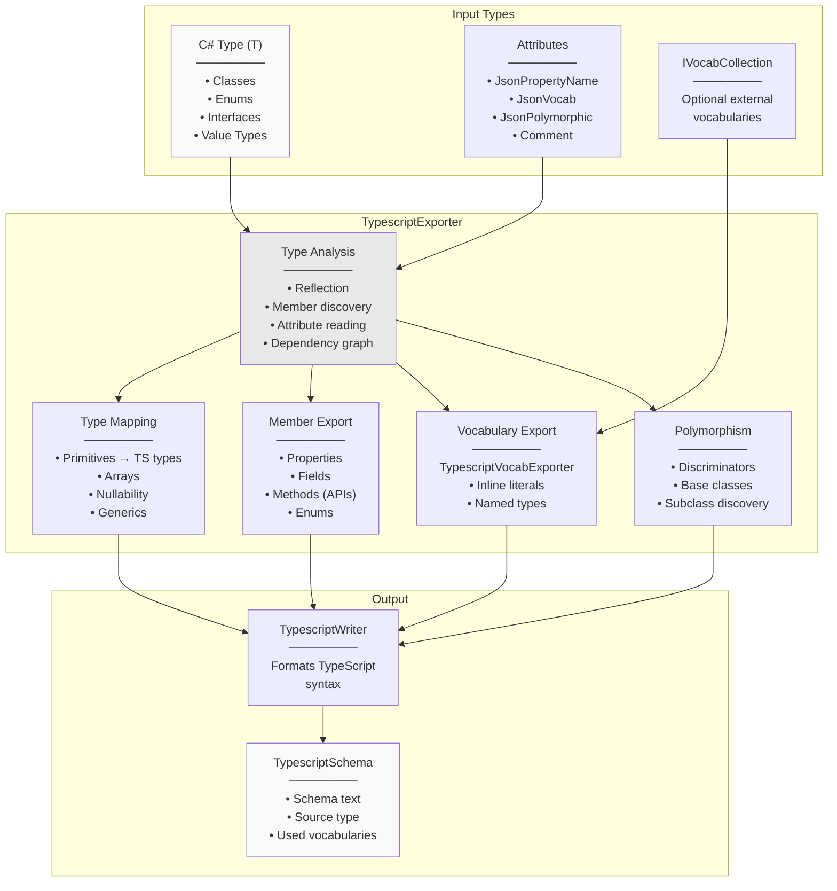
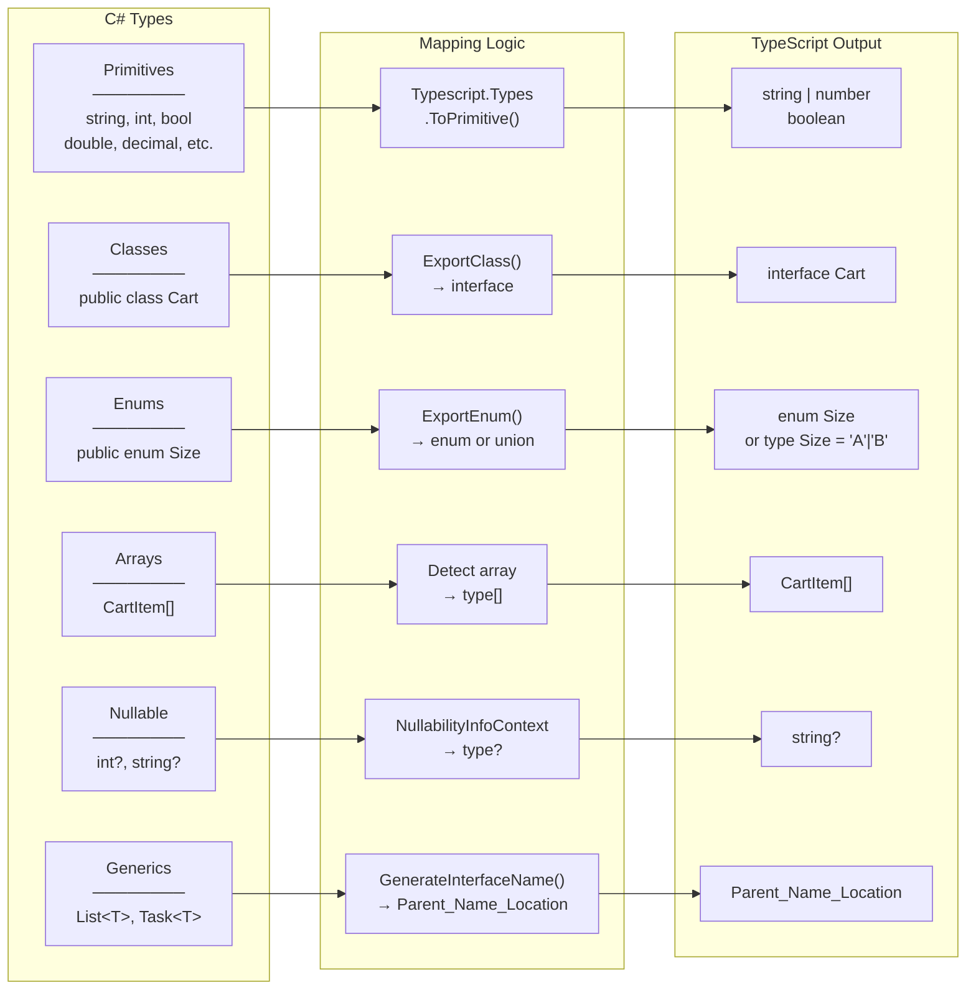
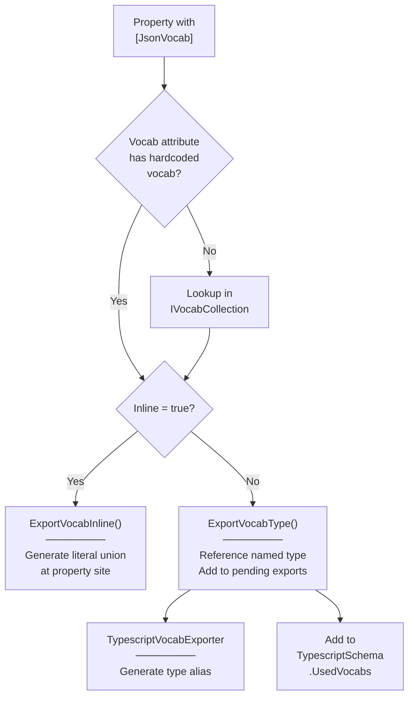
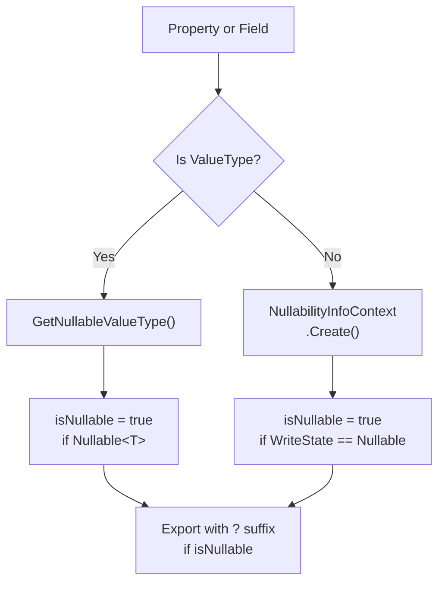
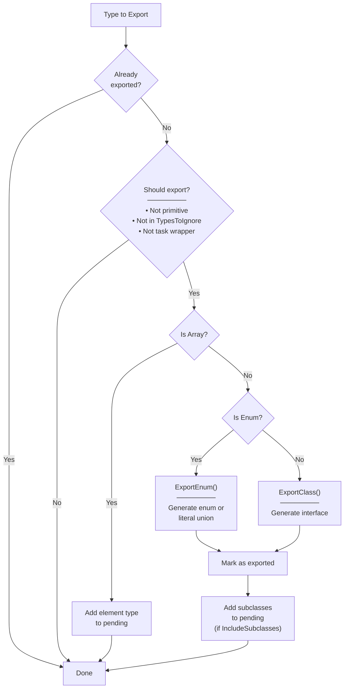

<!-- source: DeepWiki mcp.deepwiki.com · repo microsoft/typechat.net · page 3.2 Schema Generation · fetched 2026-10-26 -->

# Schema Generation

<details>
<summary>Relevant source files</summary>

The following files were used as context for generating this wiki page:

- [examples/CoffeeShop/CoffeeShopSchema.cs](examples/CoffeeShop/CoffeeShopSchema.cs)
- [examples/CoffeeShop/Program.cs](examples/CoffeeShop/Program.cs)
- [examples/CoffeeShop/input.txt](examples/CoffeeShop/input.txt)
- [examples/SchemaHierarchy/Program.cs](examples/SchemaHierarchy/Program.cs)
- [src/typechat.schema/TypescriptExporter.cs](src/typechat.schema/TypescriptExporter.cs)
- [tests/TypeChat.UnitTests/TestSchema.cs](tests/TypeChat.UnitTests/TestSchema.cs)

</details>


## Purpose and Scope

This page documents how TypeChat.NET automatically generates TypeScript schemas from C# types. The schema generation system converts C# classes, interfaces, enums, and their associated metadata into TypeScript interface definitions that language models can understand and use to produce correctly structured JSON.

For information about how schemas are used during translation, see [JsonTranslator](#3.1). For guidance on designing effective schemas, see [Schema Definition](#4) and [Schema Design Best Practices](#11.1).

**Sources:** [src/typechat.schema/TypescriptExporter.cs:1-27]()

## Overview

TypeChat.NET uses the `TypescriptExporter` class to generate TypeScript schemas at runtime. When you create a `JsonTranslator<T>`, it automatically generates a TypeScript schema for type `T` by analyzing the type's structure using reflection. This TypeScript schema is then included in prompts sent to the language model, enabling the model to understand the expected JSON structure.

The schema generation process:
1. Analyzes the target C# type using reflection
2. Discovers all dependent types recursively
3. Maps C# types to TypeScript equivalents
4. Processes attributes (e.g., `JsonPropertyName`, `JsonVocab`, `Comment`)
5. Generates TypeScript interface definitions
6. Handles vocabularies, polymorphism, and nullability
7. Returns a `TypescriptSchema` object containing the generated text

**Sources:** [src/typechat.schema/TypescriptExporter.cs:28-61](), [examples/CoffeeShop/Program.cs:14-22]()

## Schema Generation Workflow



**Sources:** [src/typechat.schema/TypescriptExporter.cs:28-97](), [src/typechat.schema/TypescriptExporter.cs:159-193]()

## TypescriptExporter Class

The `TypescriptExporter` class is the primary entry point for schema generation. It provides two main static methods:

### GenerateSchema

```csharp
public static TypescriptSchema GenerateSchema(Type type, IVocabCollection? knownVocabs = null)
```

Generates a TypeScript schema for JSON objects. This is the most common use case for `JsonTranslator<T>`.

**Location:** [src/typechat.schema/TypescriptExporter.cs:36-47]()

### GenerateAPI

```csharp
public static TypescriptSchema GenerateAPI(Type type)
```

Generates a TypeScript interface definition for an API (used with `ProgramTranslator<T>`). The input type must be a C# interface.

**Location:** [src/typechat.schema/TypescriptExporter.cs:54-61]()

### Key Properties

| Property | Type | Default | Description |
|----------|------|---------|-------------|
| `IncludeSubclasses` | `bool` | `true` | Automatically export type hierarchies |
| `IncludeComments` | `bool` | `true` | Include comments from `[Comment]` attributes |
| `EnumsAsLiterals` | `bool` | `false` | Export enums as string literal unions instead of enums |
| `TypeNameMapper` | `Func<Type, string?>` | `null` | Custom type name mapping function |
| `Vocabs` | `IVocabCollection` | `null` | External vocabulary collection |
| `TypesToIgnore` | `HashSet<Type>` | Built-in types | Types to skip during export |

**Sources:** [src/typechat.schema/TypescriptExporter.cs:107-156]()

## Type Mapping Process



**Sources:** [src/typechat.schema/TypescriptExporter.cs:654-697](), [src/typechat.schema/TypescriptExporter.cs:176-193]()

## Primitive Type Mappings

| C# Type | TypeScript Type | Notes |
|---------|----------------|-------|
| `string` | `string` | Direct mapping |
| `int`, `long`, `short`, `byte` | `number` | All numeric types map to `number` |
| `float`, `double`, `decimal` | `number` | All floating-point types map to `number` |
| `bool` | `boolean` | Direct mapping |
| `DateTime`, `DateTimeOffset` | `string` | Serialized as ISO 8601 strings |
| `Guid` | `string` | Serialized as strings |
| `object` | `any` | Not exported as a type |
| `void` | `void` | For method return types |
| `Task<T>` | `T` | Task wrapper is removed |

**Sources:** [src/typechat.schema/TypescriptExporter.cs:654-681]()

## Attribute Processing

### JsonPropertyName

Controls the property name in the generated TypeScript interface and JSON output.

```csharp
[JsonPropertyName("items")]
public CartItem[] Items { get; set; }
```

Generates:
```typescript
items: CartItem[];
```

**Location:** [examples/CoffeeShop/CoffeeShopSchema.cs:20-22]()

### Comment

Adds inline comments to the TypeScript schema. These comments guide the language model.

```csharp
[Comment("Use this type for Cart Items that match nothing else")]
public partial class UnknownItem : CartItem
{
    [Comment("The text that wasn't understood")]
    [JsonPropertyName("text")]
    public string Text { get; set; }
}
```

Generates:
```typescript
// Use this type for Cart Items that match nothing else
interface UnknownItem extends CartItem {
    // The text that wasn't understood
    text: string;
}
```

**Location:** [examples/CoffeeShop/CoffeeShopSchema.cs:34-40](), [src/typechat.schema/TypescriptExporter.cs:465-479]()

### JsonIgnore

Excludes properties or fields from the generated schema.

**Location:** [src/typechat.schema/TypescriptExporter.cs:420-426](), [src/typechat.schema/TypescriptExporter.cs:429-436]()

## Vocabulary Integration

The schema generator integrates with the vocabulary system through the `JsonVocabAttribute`. When a property is annotated with `[JsonVocab]`, the exporter can:

1. **Inline the vocabulary** as a string literal union
2. **Reference a named vocabulary type** for reuse

### Inline Vocabularies

```csharp
[JsonVocab(CoffeeShopVocabs.EspressoDrinks, PropertyName = "productName")]
[JsonPropertyName("productName")]
public string Name { get; set; }
```

Where `EspressoDrinks = "espresso | lungo | ristretto | macchiato"`

Generates:
```typescript
productName: "espresso" | "lungo" | "ristretto" | "macchiato";
```

**Location:** [examples/CoffeeShop/CoffeeShopSchema.cs:50-52](), [examples/CoffeeShop/CoffeeShopSchema.cs:260]()

### Named Vocabulary Types

When vocabularies are provided through `IVocabCollection`, the exporter creates reusable TypeScript type aliases:

```typescript
type EspressoDrinks = "espresso" | "lungo" | "ristretto" | "macchiato";

interface EspressoDrinks {
    productName: EspressoDrinks;
}
```

**Location:** [src/typechat.schema/TypescriptExporter.cs:544-630]()

### Vocabulary Export Flow



**Sources:** [src/typechat.schema/TypescriptExporter.cs:544-630]()

## Polymorphism and Inheritance

The exporter handles C# inheritance and polymorphism using the `JsonPolymorphicAttribute` system.

### Discriminators

When a class has a base class, the exporter automatically adds a `$type` discriminator field:

```csharp
[JsonPolymorphic]
[JsonDerivedType(typeof(UnknownItem), typeDiscriminator: nameof(UnknownItem))]
[JsonDerivedType(typeof(EspressoDrinks), typeDiscriminator: nameof(EspressoDrinks))]
public abstract partial class CartItem { }

public partial class EspressoDrinks : LineItem { }
```

Generates:
```typescript
interface CartItem {
}

interface EspressoDrinks extends CartItem {
    $type: 'EspressoDrinks'; // Always emit first
    // ... other properties
}
```

**Location:** [examples/CoffeeShop/CoffeeShopSchema.cs:24-32](), [examples/CoffeeShop/CoffeeShopSchema.cs:48-63](), [src/typechat.schema/TypescriptExporter.cs:632-652]()

### Subclass Discovery

When `IncludeSubclasses` is `true` (default), the exporter automatically discovers and exports all derived types and implementing interfaces.

**Location:** [src/typechat.schema/TypescriptExporter.cs:234-238]()

### JsonPolymorphismSettings

The `JsonPolymorphismSettings` property allows customization of polymorphism behavior:

| Property | Type | Description |
|----------|------|-------------|
| `IncludeDiscriminator` | `bool` | Whether to include `$type` discriminator fields |
| `IncludeComment` | `bool` | Whether to add "// Always emit first" comment |
| `DiscriminatorGenerator` | `Func<Type, string>` | Custom discriminator value generator |

**Location:** [src/typechat.schema/TypescriptExporter.cs:112](), [src/typechart.schema/TypescriptExporter.cs:632-652]()

## Nullability Handling

The exporter handles both nullable value types and nullable reference types (when targeting .NET 6.0+).

### Nullable Value Types

```csharp
public int? OptionalQuantity { get; set; }
```

Generates:
```typescript
OptionalQuantity?: number;
```

### Nullable Reference Types (.NET 6.0+)

```csharp
public string? OptionalText { get; set; }
```

Generates:
```typescript
optionalText?: string;
```

The exporter uses `NullabilityInfoContext` to detect nullable reference types through the C# nullable reference type annotations.

**Location:** [src/typechat.schema/TypescriptExporter.cs:481-514](), [src/typechat.schema/TypescriptExporter.cs:699-743]()

### Nullability Detection Flow



**Sources:** [src/typechat.schema/TypescriptExporter.cs:481-543](), [src/typechat.schema/TypescriptExporter.cs:699-743]()

## Enum Export Strategies

The exporter supports two strategies for exporting enums, controlled by the `EnumsAsLiterals` property.

### As TypeScript Enums (Default)

```csharp
[JsonConverter(typeof(JsonStringEnumConverter))]
public enum CoffeeSize
{
    Short,
    Tall,
    Grande,
    Venti
}
```

Generates:
```typescript
enum CoffeeSize {
    Short,
    Tall,
    Grande,
    Venti
}
```

**Location:** [examples/CoffeeShop/CoffeeShopSchema.cs:109-116](), [src/typechat.schema/TypescriptExporter.cs:301-313]()

### As String Literal Unions

When `EnumsAsLiterals = true`:

Generates:
```typescript
type CoffeeSize = 
    "Short" |
    "Tall" |
    "Grande" |
    "Venti";
```

**Location:** [src/typechat.schema/TypescriptExporter.cs:131](), [src/typechat.schema/TypescriptExporter.cs:315-354]()

## Generic Type Handling

Generic types are handled by generating specialized interface names that include the generic type arguments.

```csharp
public class Parent<T1, T2>
{
    public Child<T1>[] FirstChildren { get; set; }
    public Child<T2>[] SecondChildren { get; set; }
}
```

When exporting `Parent<Name, Location>`, generates:
```typescript
interface Parent_Name_Location {
    FirstChildren: Child_Name[];
    SecondChildren: Child_Location[];
}

interface Child_Name {
    // ...
}

interface Child_Location {
    // ...
}
```

**Location:** [tests/TypeChat.UnitTests/TestSchema.cs:88-97](), [src/typechat.schema/TypescriptExporter.cs:683-697]()

## API Schema Generation

For `ProgramTranslator<T>`, the exporter generates TypeScript interfaces representing the target API.

```csharp
public interface IMathAPI
{
    double Add(double x, double y);
    double Subtract(double x, double y);
}
```

Generates:
```typescript
interface IMathAPI {
    // Add two numbers
    add(x: number, y: number): number;
    // Subtract two numbers
    subtract(x: number, y: number): number;
}
```

The exporter:
- Converts method names to TypeScript conventions
- Maps parameter types
- Handles return types (unwrapping `Task<T>` to `T`)
- Exports parameter types and return types as interfaces

**Location:** [src/typechat.schema/TypescriptExporter.cs:272-299](), [src/typechat.schema/TypescriptExporter.cs:439-463](), [tests/TypeChat.UnitTests/TestSchema.cs:40-48]()

## Export Process Details

### Recursive Type Discovery

The exporter uses a pending type queue to discover and export all dependent types:

1. Start with the root type
2. Export the type (class, enum, or interface)
3. Analyze all members (properties, fields, method parameters)
4. Add referenced types to the pending queue
5. Repeat until no pending types remain

**Location:** [src/typechat.schema/TypescriptExporter.cs:159-174]()

### Type Export Decision Flow



**Sources:** [src/typechat.schema/TypescriptExporter.cs:176-193](), [src/typechat.schema/TypescriptExporter.cs:195-267](), [src/typechat.schema/TypescriptExporter.cs:745-766]()

## TypescriptSchema Output

The `TypescriptSchema` class represents the final output of schema generation:

| Property | Type | Description |
|----------|------|-------------|
| `Type` | `Type` | The source C# type |
| `Schema` | `Text` | The generated TypeScript schema text |
| `UsedVocabs` | `VocabCollection?` | Vocabularies that need enforcement during validation |

The `TypescriptSchema` is consumed by `JsonTranslator<T>` and included in prompts sent to the language model.

**Location:** [src/typechat.schema/TypescriptExporter.cs:36-47]()

## TypescriptWriter

The `TypescriptWriter` class provides low-level TypeScript syntax generation with:

- Indentation management (`PushIndent`, `PopIndent`)
- Interface generation (`BeginInterface`, `EndInterface`)
- Variable declarations with proper TypeScript syntax
- Enum generation
- Comment formatting
- Method signatures

**Location:** [src/typechat.schema/TypescriptExporter.cs:74-101]()

## Usage Examples

### Basic Schema Generation

```csharp
// Generate schema for a simple type
TypeSchema schema = TypescriptExporter.GenerateSchema(typeof(SentimentResponse));
string typescriptText = schema.Schema.Text;
```

**Location:** [tests/TypeChat.UnitTests/TestSchema.cs:8-12]()

### Schema with Vocabularies

```csharp
// Generate schema with external vocabularies
VocabCollection vocabs = TestVocabs.All();
TypeSchema schema = TypescriptExporter.GenerateSchema(typeof(Order), vocabs);
```

**Location:** [tests/TypeChat.UnitTests/TestSchema.cs:14-15]()

### API Schema Generation

```csharp
// Generate API interface schema
TypeSchema schema = TypescriptExporter.GenerateAPI(typeof(IMathAPI));
```

**Location:** [tests/TypeChat.UnitTests/TestSchema.cs:41-42]()

### Custom Configuration

```csharp
using StringWriter writer = new StringWriter();
TypescriptExporter exporter = new TypescriptExporter(writer);

// Configure exporter
exporter.EnumsAsLiterals = true;
exporter.IncludeComments = true;
exporter.Vocabs = myVocabCollection;

// Export type
exporter.Export(typeof(MyType));
string schema = writer.ToString();
```

**Location:** [src/typechat.schema/TypescriptExporter.cs:74-96]()

## Integration with JsonTranslator

The schema generation is automatically invoked when creating a `JsonTranslator<T>`:

```csharp
JsonTranslator<Cart> translator = new JsonTranslator<Cart>(
    new LanguageModel(Config.LoadOpenAI())
);

// Schema is automatically generated and available
TypeSchema schema = translator.Validator.Schema;
Console.WriteLine(schema.Schema.Text);
```

The generated schema is stored in the `JsonValidator<T>` and included in every prompt sent to the language model.

**Location:** [examples/CoffeeShop/Program.cs:14-24]()

## Best Practices

1. **Use descriptive property names**: The language model is sensitive to property names. Use clear, domain-specific names like `productName` instead of generic names like `name`.

2. **Add comments**: Use `[Comment]` attributes to guide the language model, especially for ambiguous or complex types.

3. **Leverage vocabularies**: Use `[JsonVocab]` to constrain string values to known options, improving translation accuracy.

4. **Design for the model**: Remember that the TypeScript schema is consumed by an AI model, not humans. Clear structure and explicit constraints work better than clever code.

5. **Test schema generation**: Use the test infrastructure to verify that your schemas generate as expected.

**Location:** [examples/CoffeeShop/CoffeeShopSchema.cs:8-16]()

---

**Sources:** [src/typechat.schema/TypescriptExporter.cs:1-768](), [examples/CoffeeShop/CoffeeShopSchema.cs:1-290](), [examples/CoffeeShop/Program.cs:1-77](), [tests/TypeChat.UnitTests/TestSchema.cs:1-99](), [examples/SchemaHierarchy/Program.cs:1-66]()

---

