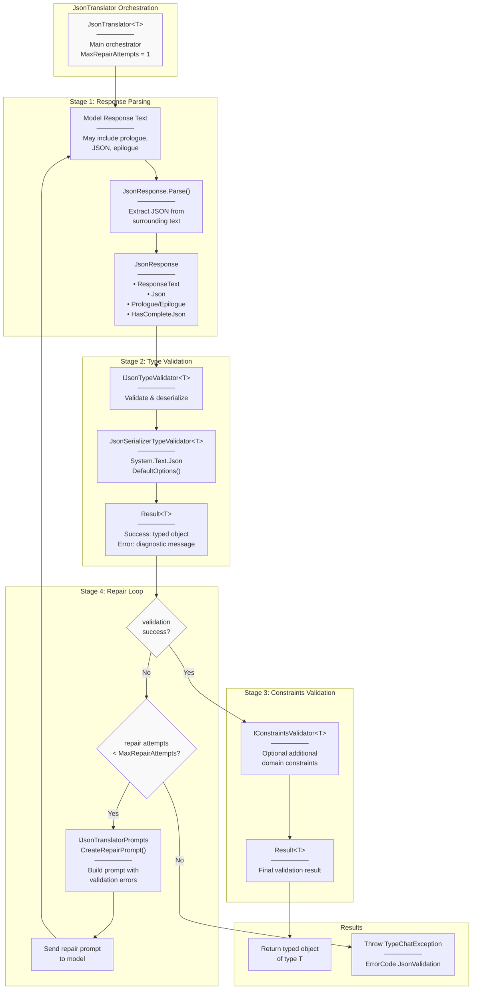
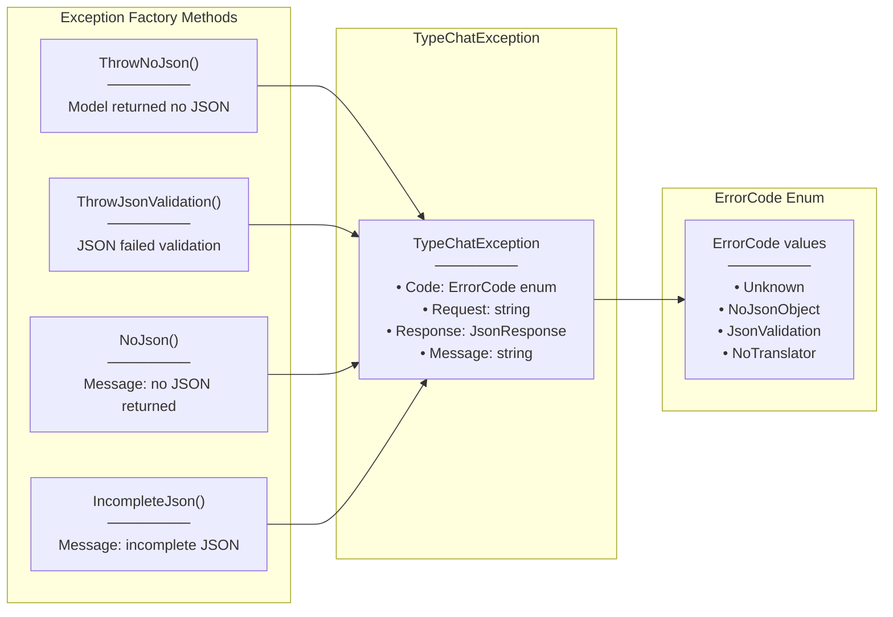
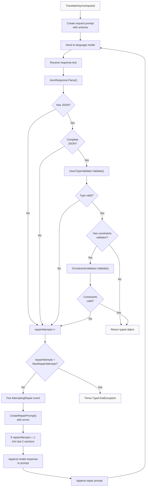

<!-- source: DeepWiki mcp.deepwiki.com · repo microsoft/typechat.net · page 3.3 Validation and Repair · fetched 2026-10-26 -->

# Validation and Repair

<details>
<summary>Relevant source files</summary>

The following files were used as context for generating this wiki page:

- [README.md](README.md)
- [examples/MultiSchema/Program.cs](examples/MultiSchema/Program.cs)
- [examples/Sentiment/Program.cs](examples/Sentiment/Program.cs)
- [examples/appSettings.json](examples/appSettings.json)
- [src/typechat/JsonResponse.cs](src/typechat/JsonResponse.cs)
- [src/typechat/JsonSerializerTypeValidator.cs](src/typechat/JsonSerializerTypeValidator.cs)
- [src/typechat/JsonTranslator.cs](src/typechat/JsonTranslator.cs)
- [src/typechat/ModelInfo.cs](src/typechat/ModelInfo.cs)
- [src/typechat/Prompt.cs](src/typechat/Prompt.cs)
- [src/typechat/TypeChatException.cs](src/typechat/TypeChatException.cs)

</details>


## Purpose and Scope

This document describes the validation and repair mechanism in TypeChat.NET, which ensures that JSON responses from language models conform to expected schemas and can be successfully deserialized into strongly-typed objects. Since language models are stochastic and may produce malformed or invalid JSON, TypeChat implements an automatic repair loop that feeds validation errors back to the model for correction.

For information about how schemas are generated, see [Schema Generation](#3.2). For details about the overall translation process, see [JsonTranslator](#3.1). For prompt engineering related to repair, see [Prompts and Prompt Engineering](#3.5).

---

## Overview

The validation and repair pipeline consists of four stages:

1. **Response Parsing**: Extract JSON from the model's text response, which may contain prologues, epilogues, or incomplete JSON
2. **Type Validation**: Validate the JSON against the TypeScript schema and deserialize it into a .NET object
3. **Constraints Validation**: Apply additional domain-specific constraints (optional)
4. **Repair Loop**: When validation fails, send errors back to the model for correction, up to a maximum number of attempts

The entire process is orchestrated by `JsonTranslator<T>` and executes within a retry loop until either validation succeeds or the maximum number of repair attempts is exceeded.

Sources: [src/typechat/JsonTranslator.cs:1-314](), [README.md:29-29]()

---

## Validation and Repair Architecture



**Validation and Repair Pipeline Architecture**

This diagram shows how `JsonTranslator<T>` orchestrates the four-stage validation pipeline, with the repair loop feeding errors back to the language model when validation fails.

Sources: [src/typechat/JsonTranslator.cs:199-252](), [src/typechat/JsonTranslator.cs:275-289]()

---

## Response Parsing with JsonResponse

The `JsonResponse` class handles the first validation stage by parsing the raw text response from the language model. Models often return JSON surrounded by explanatory text, markdown formatting, or incomplete JSON due to token limits.

### JsonResponse Structure

| Property | Type | Description |
|----------|------|-------------|
| `ResponseText` | `string` | Raw response text from the model |
| `Json` | `string?` | Text within outermost braces `{}` |
| `Prologue` | `string?` | Text before the JSON |
| `Epilogue` | `string?` | Text after the JSON |
| `HasCompleteJson` | `bool` | Whether JSON has matching outer braces |
| `HasJson` | `bool` | Whether any JSON was found |

### Parsing Algorithm

The `JsonResponse.Parse()` method [src/typechat/JsonResponse.cs:61-101]() uses the following logic:

1. **Locate JSON boundaries**: Find first `{` and last `}` in the response text
2. **Extract prologue**: If `{` is not at position 0, text before it is the prologue
3. **Extract JSON**: Text between first `{` and last `}` inclusive
4. **Extract epilogue**: Any text after the last `}`
5. **Set flags**: `HasCompleteJson` is true only if both `{` and `}` are found

### Example Parsing Scenarios

**Complete JSON with explanation:**
```
Response: "Here is the result:\n{\"sentiment\": \"positive\"}\nHope this helps!"
→ Prologue: "Here is the result:\n"
→ Json: "{\"sentiment\": \"positive\"}"
→ Epilogue: "\nHope this helps!"
→ HasCompleteJson: true
```

**Incomplete JSON (token limit exceeded):**
```
Response: "{\"items\": [{\"name\": \"latte\", \"size\":"
→ Prologue: null
→ Json: "{\"items\": [{\"name\": \"latte\", \"size\":"
→ Epilogue: null
→ HasCompleteJson: false
```

**No JSON:**
```
Response: "I apologize, I cannot process that request."
→ Prologue: "I apologize, I cannot process that request."
→ Json: null
→ HasCompleteJson: false
```

Sources: [src/typechat/JsonResponse.cs:1-103](), [src/typechat/JsonTranslator.cs:215-233]()

---

## Type Validation with IJsonTypeValidator

The `IJsonTypeValidator<T>` interface [src/typechat/IJsonTypeValidator.cs]() defines the contract for validating JSON against a schema and deserializing it into a typed object.

### IJsonTypeValidator<T> Interface

```
IJsonTypeValidator<T>
├── Schema: TypeSchema (get)
├── Validate(string json): Result<T>
```

The validator must:
1. Check that JSON conforms to the TypeScript schema for type `T`
2. Deserialize the JSON into an instance of `T`
3. Return a `Result<T>` with either the typed object or validation error messages

### Default Implementation: JsonSerializerTypeValidator<T>

The default validator [src/typechat/JsonSerializerTypeValidator.cs:98-151]() uses `System.Text.Json` with custom serialization options:

**DefaultOptions() configuration** [src/typechat/JsonSerializerTypeValidator.cs:16-28]():
- `IncludeFields = true`: Serialize public fields
- `AllowTrailingCommas = true`: Be lenient with JSON formatting
- `ReadCommentHandling = JsonCommentHandling.Skip`: Ignore comments
- `DefaultIgnoreCondition = JsonIgnoreCondition.WhenWritingNull`: Omit null values
- `JsonStringEnumConverter`: Parse enums from strings

### Validation Error Formatting

When validation fails, `JsonSerializerTypeValidator` formats detailed error messages [src/typechat/JsonSerializerTypeValidator.cs:68-84]():

```
### JSON ERROR:
<exception message>
Property with error: <property path>
### Errors here:
<line of JSON with error>
```

This error format is specifically designed to help the language model understand what went wrong and how to fix it. The error message is sent back to the model in the repair prompt.

### Custom Validators

You can provide custom validators when creating a `JsonTranslator<T>`:

```csharp
var customValidator = new MyCustomValidator<T>(schema);
var translator = new JsonTranslator<T>(model, customValidator);
```

Custom validators might implement additional validation logic beyond what `System.Text.Json` provides, such as cross-field validation or business rule checking.

Sources: [src/typechat/JsonSerializerTypeValidator.cs:1-152](), [src/typechat/JsonTranslator.cs:94-102]()

---

## The Repair Loop Mechanism

The repair loop is TypeChat's core innovation for achieving reliable outputs from stochastic language models. When validation fails, the system feeds error messages back to the model so it can generate corrected JSON.

### Repair Loop Sequence

```mermaid
sequenceDiagram
    participant JT as JsonTranslator&lt;T&gt;
    participant Model as ILanguageModel
    participant Parser as JsonResponse
    participant Validator as IJsonTypeValidator&lt;T&gt;
    participant Prompts as IJsonTranslatorPrompts
    
    Note over JT: Attempt 0: Initial Request
    JT->>Model: CompleteAsync(request prompt)
    Model-->>JT: response text
    JT->>Parser: Parse(response text)
    Parser-->>JT: JsonResponse
    JT->>Validator: Validate(jsonResponse.Json)
    Validator-->>JT: Result&lt;T&gt; [Error]
    
    Note over JT: repairAttempts = 1
    JT->>JT: Check: 1 &lt;= MaxRepairAttempts?<br/>Yes, continue
    JT->>JT: Fire AttemptingRepair event
    JT->>Prompts: CreateRepairPrompt(response, error)
    Prompts-->>JT: repair prompt section
    JT->>JT: Append response to prompt
    JT->>JT: Append repair prompt to prompt
    
    Note over JT: Repair Attempt 1
    JT->>Model: CompleteAsync(prompt with error)
    Model-->>JT: corrected response
    JT->>Parser: Parse(corrected response)
    Parser-->>JT: JsonResponse
    JT->>Validator: Validate(jsonResponse.Json)
    Validator-->>JT: Result&lt;T&gt; [Success]
    
    JT-->>JT: Return typed object
```

**Repair Loop Sequence Diagram**

This diagram shows how validation errors are fed back to the model for correction. The prompt accumulates the conversation history, with the model's previous response and the repair instructions.

Sources: [src/typechat/JsonTranslator.cs:199-252]()

### Repair Loop Implementation Details

The repair loop is implemented in `JsonTranslator<T>.TranslateAsync()` [src/typechat/JsonTranslator.cs:199-252]():

**Key variables:**
- `repairAttempts` [line 210]: Counter tracking repair attempts, initialized to 0
- `_maxRepairAttempts` [line 237]: Configuration property, default is 1

**Loop structure:**
```
while (true) {
    1. Get model response
    2. Parse JSON from response
    3. Validate JSON
    4. If valid → return object
    5. If invalid:
        - Increment repairAttempts
        - If repairAttempts > MaxRepairAttempts → throw exception
        - Create repair prompt with errors
        - Append to conversation history
        - Continue loop (retry with model)
}
```

**Prompt management during repair** [src/typechat/JsonTranslator.cs:244-251]():
- If `repairAttempts > 1`, trim the last 2 sections from the prompt (removes previous failed repair attempt)
- Append the model's response to the prompt (as an assistant message)
- Append the repair prompt (as a system/user message with error details)

This ensures the model sees:
1. The original request
2. Its previous attempt
3. The validation errors
4. Instructions to fix the errors

### Creating Repair Prompts

The `IJsonTranslatorPrompts` interface provides the `CreateRepairPrompt()` method [src/typechat/JsonTranslator.cs:267-270]() that constructs the repair instruction:

```csharp
protected virtual PromptSection CreateRepairPrompt(
    string responseText, 
    Result<T> validationResult)
{
    return _prompts.CreateRepairPrompt(
        _validator.Schema, 
        responseText, 
        validationResult.Message
    );
}
```

The default implementation constructs a prompt that includes:
- The TypeScript schema (so the model can reference it)
- The validation error message (detailed diagnostics)
- Instructions to fix the JSON

Sources: [src/typechat/JsonTranslator.cs:199-252](), [src/typechat/JsonTranslator.cs:267-270]()

---

## Constraints Validation

After type validation succeeds, `JsonTranslator<T>` optionally applies additional domain-specific validation through the `IConstraintsValidator<T>` interface [src/typechat/JsonTranslator.cs:107-111]().

### When to Use Constraints Validation

Type validation ensures structural correctness (correct types, required fields, etc.), but cannot enforce all business rules. Constraints validation is useful for:

- **Cross-field validation**: "endDate must be after startDate"
- **Business rules**: "cannot order more than 10 items"
- **External data checks**: "productId must exist in inventory"
- **Complex conditions**: "if type is X, then field Y is required"

### Integration with Repair Loop

Constraints validation is applied **after** successful type validation [src/typechat/JsonTranslator.cs:275-289]():

```csharp
private Result<T> ValidateJson(string json)
{
    var result = Validator.Validate(json);  // Type validation
    if (!OnValidationComplete(result))
    {
        return result;
    }
    if (result.Success)
    {
        // Apply constraints validation only on success
        result = (_constraintsValidator is not null) ?
                 _constraintsValidator.Validate(result.Value) :
                 result;
    }
    return result;
}
```

If constraints validation fails, the error message is sent back to the model in the repair prompt, just like type validation errors. This means the model can learn to satisfy domain-specific constraints.

### Example: Setting a Constraints Validator

```csharp
var translator = new JsonTranslator<CalendarActions>(model);
translator.ConstraintsValidator = new CalendarConstraintsValidator();
```

The `IConstraintsValidator<T>` interface requires a single method:
```csharp
Result<T> Validate(T value);
```

Sources: [src/typechat/JsonTranslator.cs:107-111](), [src/typechat/JsonTranslator.cs:275-289]()

---

## Configuration and Settings

The validation and repair process can be configured through several properties on `JsonTranslator<T>`.

### MaxRepairAttempts

Controls how many times the translator will attempt to repair invalid JSON [src/typechat/JsonTranslator.cs:135-146]():

| Setting | Behavior |
|---------|----------|
| `0` | No repair attempts; first validation failure throws exception |
| `1` | Default; allows one repair attempt |
| `> 1` | Multiple repair attempts before giving up |

**Example:**
```csharp
var translator = new JsonTranslator<T>(model);
translator.MaxRepairAttempts = 3; // Allow up to 3 repair attempts
```

**Default value** [src/typechat/JsonTranslator.cs:25]():
```csharp
public const int DefaultMaxRepairAttempts = 1;
```

### Validator Property

The validator can be replaced at runtime [src/typechat/JsonTranslator.cs:94-102]():

```csharp
translator.Validator = new CustomValidator<T>(schema);
```

This allows switching validation strategies without creating a new translator instance.

### Prompts Property

The prompts interface can be customized to change how repair prompts are generated [src/typechat/JsonTranslator.cs:116-124]():

```csharp
translator.Prompts = new CustomPrompts();
```

See [Prompts and Prompt Engineering](#3.5) for details on customizing prompts.

### TranslationSettings

The `TranslationSettings` property [src/typechat/JsonTranslator.cs:129]() controls request-level parameters like:
- `MaxTokens`: Maximum tokens in the response
- Temperature and other model parameters

These settings affect the model's output quality and can impact whether validation succeeds on the first attempt.

Sources: [src/typechat/JsonTranslator.cs:25-146]()

---

## Events and Diagnostics

`JsonTranslator<T>` provides events that allow monitoring the validation and repair process in real-time.

### Available Events

| Event | Type | When Fired |
|-------|------|------------|
| `SendingPrompt` | `Action<Prompt>` | Before sending any prompt to the model |
| `CompletionReceived` | `Action<string>` | After receiving model response |
| `AttemptingRepair` | `Action<string>` | When starting a repair attempt, includes validation error message |

### Event Subscription

Events are defined in [src/typechat/JsonTranslator.cs:150-165]():

```csharp
translator.SendingPrompt += (prompt) => {
    Console.WriteLine($"Sending prompt with {prompt.Count} sections");
};

translator.CompletionReceived += (response) => {
    Console.WriteLine($"Received {response.Length} characters");
};

translator.AttemptingRepair += (errorMessage) => {
    Console.WriteLine($"Repair attempt due to:\n{errorMessage}");
};
```

### Using Events for Debugging

These events are particularly useful for:

1. **Understanding failures**: See exactly what errors triggered repair attempts
2. **Prompt inspection**: Examine the full prompt sent to the model, including repair instructions
3. **Token usage tracking**: Count prompt and response sizes for cost estimation
4. **Performance monitoring**: Time the gap between `SendingPrompt` and `CompletionReceived`

### Event Notification Implementation

Events are fired using protected helper methods [src/typechat/JsonTranslator.cs:291-313]():

```csharp
protected void NotifyEvent(Action<Prompt> evt, Prompt prompt)
{
    if (evt is not null)
    {
        try
        {
            evt(prompt);
        }
        catch { }  // Swallow exceptions in event handlers
    }
}
```

Exception swallowing ensures that errors in event handlers don't disrupt the translation process.

Sources: [src/typechat/JsonTranslator.cs:150-313]()

---

## Error Handling and Exceptions

When validation fails after exhausting all repair attempts, `JsonTranslator<T>` throws a `TypeChatException` with detailed diagnostic information.

### TypeChatException Structure



**TypeChatException Class Structure**

Sources: [src/typechat/TypeChatException.cs:1-101]()

### Exception Scenarios

**No JSON returned** [src/typechat/JsonTranslator.cs:230-233]():
```csharp
if (!jsonResponse.HasJson)
{
    validationResult = Result<T>.Error(TypeChatException.NoJson(jsonResponse));
}
```

**Incomplete JSON** [src/typechat/JsonTranslator.cs:225-229]():
```csharp
if (jsonResponse.HasJson && !jsonResponse.HasCompleteJson)
{
    validationResult = Result<T>.Error(TypeChatException.IncompleteJson(jsonResponse));
}
```

**Validation failure after max attempts** [src/typechat/JsonTranslator.cs:237-240]():
```csharp
if (repairAttempts > _maxRepairAttempts)
{
    TypeChatException.ThrowJsonValidation(request, jsonResponse, validationResult.Message);
}
```

### Exception Information

The exception contains complete diagnostic information [src/typechat/TypeChatException.cs:39-64]():

| Property | Description |
|----------|-------------|
| `Code` | Specific error code (enum value) |
| `Request` | The original user request that failed |
| `Response` | The `JsonResponse` object with the model's output |
| `Message` | Detailed validation error message |

### ToString() Format

The exception's `ToString()` method [src/typechat/TypeChatException.cs:66-69]() provides a complete diagnostic dump:

```
Error: JsonValidation

<validation error message>

Request:
<original request text>

Response:
<model's response text>
```

This format makes it easy to diagnose failures by seeing exactly what was requested, what the model returned, and why it failed validation.

### Example Exception Handling

```csharp
try
{
    var result = await translator.TranslateAsync(userInput);
    // Use result
}
catch (TypeChatException ex) when (ex.Code == TypeChatException.ErrorCode.JsonValidation)
{
    Console.WriteLine($"Validation failed after {translator.MaxRepairAttempts} repair attempts");
    Console.WriteLine($"Error: {ex.Message}");
    Console.WriteLine($"Model response: {ex.Response?.ResponseText}");
}
```

Sources: [src/typechat/TypeChatException.cs:1-101](), [src/typechat/JsonTranslator.cs:225-240]()

---

## Validation Flow Summary

The complete validation and repair flow integrates all components discussed above:



**Complete Validation and Repair Flow Diagram**

This diagram shows the complete decision tree for validation and repair, including all error paths and the repair loop feedback mechanism.

Sources: [src/typechat/JsonTranslator.cs:199-252](), [src/typechat/JsonTranslator.cs:275-289]()

---

## Key Takeaways

| Concept | Key Points |
|---------|------------|
| **Response Parsing** | `JsonResponse.Parse()` extracts JSON from model output, handling prologues, epilogues, and incomplete JSON |
| **Type Validation** | `IJsonTypeValidator<T>` validates JSON structure and deserializes to typed objects using `System.Text.Json` by default |
| **Repair Loop** | Validation errors are fed back to the model up to `MaxRepairAttempts` times (default: 1) |
| **Constraints** | Optional `IConstraintsValidator<T>` enforces business rules after type validation |
| **Monitoring** | Events (`SendingPrompt`, `CompletionReceived`, `AttemptingRepair`) provide visibility into the process |
| **Error Handling** | `TypeChatException` with detailed diagnostics is thrown when all repair attempts fail |
| **Configurability** | Validators, prompts, and repair attempts can all be customized |

The validation and repair mechanism is fundamental to TypeChat's ability to reliably extract structured data from language models despite their stochastic nature.

Sources: [src/typechat/JsonTranslator.cs:1-314](), [README.md:29-29]()

---

