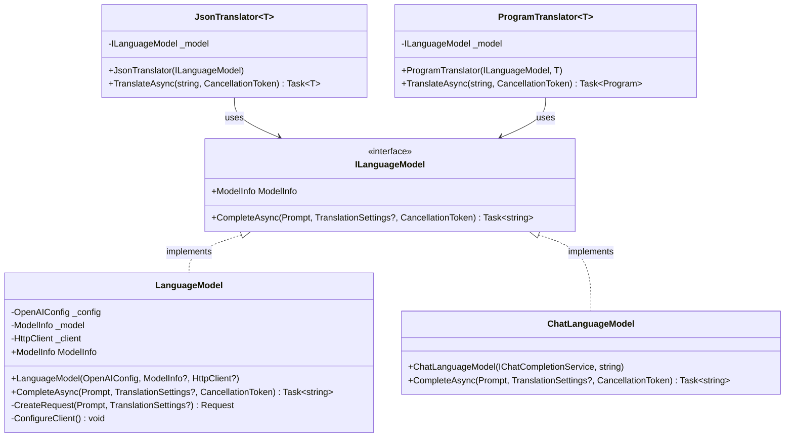
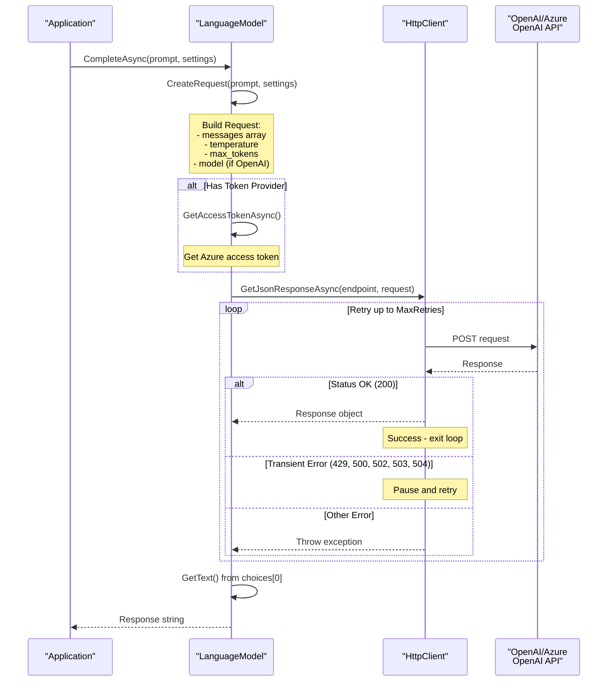
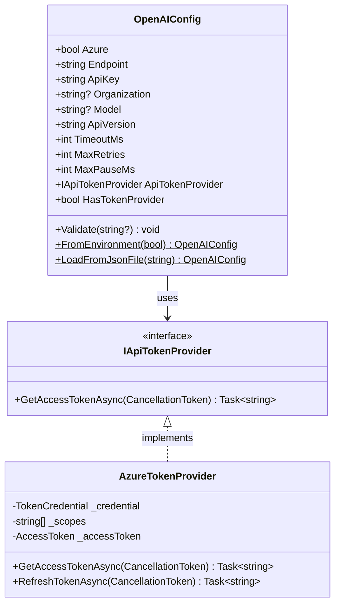
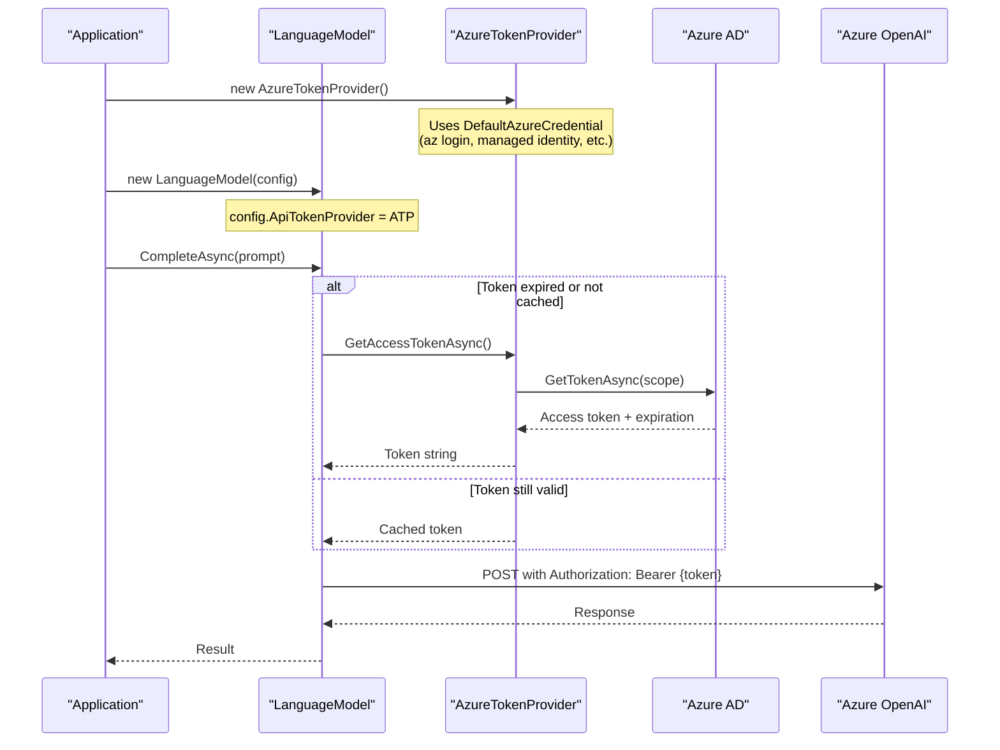
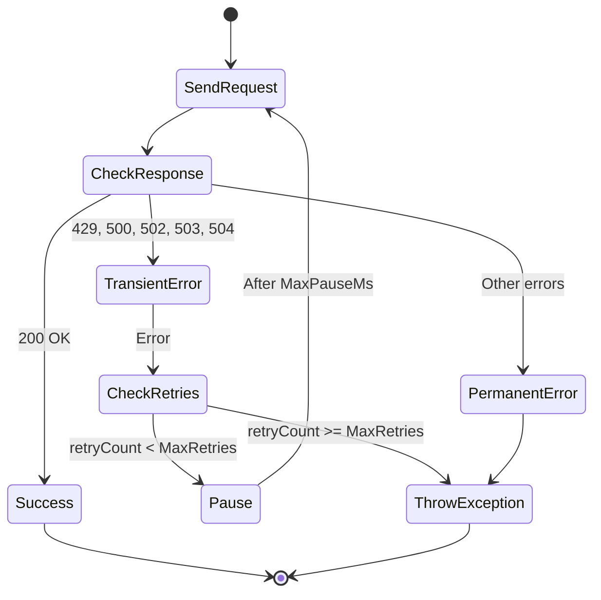

<!-- source: DeepWiki mcp.deepwiki.com · repo microsoft/typechat.net · page 3.4 Language Models · fetched 2026-10-26 -->

# Language Models

<details>
<summary>Relevant source files</summary>

The following files were used as context for generating this wiki page:

- [README.md](README.md)
- [examples/Sentiment/Program.cs](examples/Sentiment/Program.cs)
- [examples/appSettings.json](examples/appSettings.json)
- [examples/typechat.examplesLib/Auth.cs](examples/typechat.examplesLib/Auth.cs)
- [examples/typechat.examplesLib/Config.cs](examples/typechat.examplesLib/Config.cs)
- [src/typechat/HttpEx.cs](src/typechat/HttpEx.cs)
- [src/typechat/LanguageModel.cs](src/typechat/LanguageModel.cs)
- [src/typechat/OpenAIConfig.cs](src/typechat/OpenAIConfig.cs)

</details>


## Purpose and Scope

This page describes how TypeChat.NET interfaces with language models through the `ILanguageModel` abstraction. It covers the `LanguageModel` class (the default OpenAI/Azure OpenAI implementation), the `OpenAIConfig` configuration system, authentication methods, and HTTP client settings. 

For information about how prompts are constructed and sent to language models, see [Prompts and Prompt Engineering](#3.5). For integration with Semantic Kernel and Microsoft.Extensions.AI, see [Integration](#6).

**Sources:** [README.md:1-243](), [src/typechat/LanguageModel.cs:1-169]()

---

## ILanguageModel Interface

TypeChat.NET abstracts language model access through the `ILanguageModel` interface, enabling support for different model providers and custom implementations.



**Figure 1: ILanguageModel Interface and Implementations**

The interface defines two members:
- `CompleteAsync`: Sends a prompt to the model and returns the response text
- `ModelInfo`: Provides metadata about the model (name, token limits, etc.)

**Sources:** [README.md:217-219](), [src/typechat/LanguageModel.cs:8-55]()

---

## LanguageModel Class

The `LanguageModel` class is the default implementation of `ILanguageModel`, providing access to OpenAI and Azure OpenAI Chat Completion APIs.

### Constructor and Initialization

[src/typechat/LanguageModel.cs:24-33]()

```
Constructor parameters:
- config: OpenAIConfig with endpoint, API key, and settings
- model: Optional ModelInfo (defaults to config.Model)
- client: Optional HttpClient (creates new if not provided)
```

The constructor validates configuration and configures the HTTP client for the target service (Azure OpenAI or OpenAI).

### Request Flow



**Figure 2: LanguageModel Request/Response Flow**

**Sources:** [src/typechat/LanguageModel.cs:47-55](), [src/typechat/LanguageModel.cs:57-65](), [src/typechat/HttpEx.cs:11-51]()

### HTTP Client Configuration

The `ConfigureClient` method [src/typechat/LanguageModel.cs:67-98]() sets up the HTTP client differently based on the service type:

| Configuration | Azure OpenAI | OpenAI |
|---------------|--------------|--------|
| Endpoint Format | `{Endpoint}/openai/deployments/{Model}/chat/completions?api-version={ApiVersion}` | `{Endpoint}` (e.g., https://api.openai.com/v1/chat/completions) |
| Authentication | `api-key` header or Bearer token | `Authorization: Bearer {ApiKey}` |
| Model in Request | No (part of URL path) | Yes (`model` field in request body) |
| Organization Header | Not used | `OpenAI-Organization` header if configured |

**Sources:** [src/typechat/LanguageModel.cs:67-98]()

---

## OpenAIConfig Configuration

The `OpenAIConfig` class [src/typechat/OpenAIConfig.cs:1-171]() centralizes all configuration settings for accessing language models.

### Configuration Properties



**Figure 3: OpenAIConfig and Authentication**

| Property | Type | Default | Description |
|----------|------|---------|-------------|
| `Azure` | bool | true | Use Azure OpenAI service (vs OpenAI) |
| `Endpoint` | string | - | API endpoint URL |
| `ApiKey` | string | - | API key or "identity" for Azure credentials |
| `Organization` | string? | null | OpenAI organization (OpenAI service only) |
| `Model` | string? | null | Model name/deployment name |
| `ApiVersion` | string | "2023-05-15" | Azure OpenAI API version |
| `TimeoutMs` | int | 15000 | HTTP request timeout in milliseconds |
| `MaxRetries` | int | 3 | Maximum retry attempts for transient errors |
| `MaxPauseMs` | int | 1000 | Pause duration between retries |
| `ApiTokenProvider` | IApiTokenProvider | null | Provider for Azure access tokens |

**Sources:** [src/typechat/OpenAIConfig.cs:9-124](), [examples/appSettings.json:1-21]()

### Loading Configuration

TypeChat.NET supports three methods for loading configuration:

#### 1. From Configuration Files (Examples Library)

[examples/typechat.examplesLib/Config.cs:43-52]()

```csharp
// Load from appSettings.json and appSettings.Development.json
OpenAIConfig config = Config.LoadOpenAI();

// Automatically configures Azure identity if ApiKey = "identity"
var model = new LanguageModel(config);
```

**Configuration File Structure:**

[examples/appSettings.json:1-21]()

#### 2. From Environment Variables

[src/typechat/OpenAIConfig.cs:130-155]()

Supported environment variables [src/typechat/OpenAIConfig.cs:14-52]():

| Variable | Purpose |
|----------|---------|
| `OPENAI_API_KEY` | OpenAI service API key |
| `OPENAI_ENDPOINT` | OpenAI service endpoint |
| `OPENAI_ORGANIZATION` | OpenAI organization |
| `OPENAI_MODEL` | Model name for chat |
| `OPENAI_EMBEDDINGMODEL` | Model name for embeddings |
| `AZURE_OPENAI_API_KEY` | Azure OpenAI API key |
| `AZURE_OPENAI_ENDPOINT` | Azure OpenAI endpoint |

```csharp
// Load from environment variables
OpenAIConfig config = OpenAIConfig.FromEnvironment();

// For embedding models
OpenAIConfig embeddingConfig = OpenAIConfig.FromEnvironment(isEmbedding: true);
```

#### 3. From JSON File Directly

[src/typechat/OpenAIConfig.cs:162-170]()

```csharp
// Load from custom JSON file
OpenAIConfig config = OpenAIConfig.LoadFromJsonFile("myconfig.json");
```

**Sources:** [examples/typechat.examplesLib/Config.cs:8-105](), [src/typechat/OpenAIConfig.cs:130-170]()

---

## Authentication

TypeChat.NET supports two authentication mechanisms:

### API Key Authentication

The simplest method using a static API key:

```csharp
var config = new OpenAIConfig
{
    Azure = true,
    Endpoint = "https://your-resource.openai.azure.com",
    ApiKey = "your-api-key-here",
    Model = "gpt-35-turbo"
};
```

For Azure OpenAI, the key is added as an `api-key` header [src/typechat/LanguageModel.cs:82](). For OpenAI service, it's used in the `Authorization: Bearer` header [src/typechat/LanguageModel.cs:88]().

### Azure Identity Authentication

For Azure OpenAI, you can use Azure credentials instead of static keys by setting `ApiKey = "identity"` and providing an `IApiTokenProvider`:



**Figure 4: Azure Identity Token Flow**

[examples/typechat.examplesLib/Auth.cs:14-105]()

The `AzureTokenProvider` class:
- Uses `DefaultAzureCredential` to acquire tokens from various sources (az CLI, managed identity, etc.)
- Caches tokens and refreshes them before expiration
- Uses the Cognitive Services scope: `https://cognitiveservices.azure.com/.default`

**Configuration in appSettings.Development.json:**

```json
{
  "OpenAI": {
    "Azure": true,
    "ApiKey": "identity",
    "Endpoint": "https://your-resource.openai.azure.com",
    "Model": "gpt-35-turbo"
  }
}
```

**Sources:** [examples/typechat.examplesLib/Auth.cs:1-105](), [examples/typechat.examplesLib/Config.cs:47-50](), [README.md:150-158]()

---

## HTTP Settings and Retry Logic

TypeChat.NET includes built-in retry logic for transient errors to improve reliability.

### Retry Configuration

| Property | Default | Description |
|----------|---------|-------------|
| `MaxRetries` | 3 | Maximum number of retry attempts |
| `MaxPauseMs` | 1000 | Delay between retries in milliseconds |
| `TimeoutMs` | 15000 | HTTP request timeout |

**Example configuration:**

[examples/appSettings.json:9-13]()

### Transient Error Detection

[src/typechat/HttpEx.cs:53-69]()

The following HTTP status codes are considered transient and trigger retries:
- `429`: Too Many Requests (rate limiting)
- `500`: Internal Server Error
- `502`: Bad Gateway
- `503`: Service Unavailable
- `504`: Gateway Timeout



**Figure 5: HTTP Retry State Machine**

**Sources:** [src/typechat/HttpEx.cs:1-70](), [src/typechat/OpenAIConfig.cs:89-93]()

---

## Model Information

The `ModelInfo` class provides metadata about language models, including token limits and capabilities.

### Predefined Models

TypeChat.NET includes predefined `ModelInfo` instances for common models:

[examples/typechat.examplesLib/Config.cs:14-19]()

```csharp
public static class ModelNames
{
    public const string Gpt35Turbo = "gpt-35-turbo";
    public const string Gpt4 = "gpt-4";
    public const string Ad002 = "ada-002";  // Embedding model
}
```

### Supported Models

From [README.md:82-85]():

| Model | Type | Use Case |
|-------|------|----------|
| gpt-35-turbo | Chat | General purpose, faster, lower cost |
| gpt-4 | Chat | Complex reasoning, best quality |
| ada-002 | Embedding | Text embeddings for semantic search |

Some examples and scenarios work best with GPT-4 for higher quality results.

**Sources:** [README.md:80-85](), [examples/typechat.examplesLib/Config.cs:14-19](), [src/typechat/LanguageModel.cs:30-38]()

---

## Usage Patterns

### Basic Usage with JsonTranslator

[examples/Sentiment/Program.cs:1-42]()

```csharp
// Load configuration
OpenAIConfig config = Config.LoadOpenAI();

// Create language model
var model = new LanguageModel(config);

// Create translator
var translator = new JsonTranslator<SentimentResponse>(model);

// Translate
SentimentResponse response = await translator.TranslateAsync(input);
```

### Usage with ProgramTranslator

[README.md:58-67]()

```csharp
// Create language model
var model = new LanguageModel(Config.LoadOpenAI());

// Create API instance
var api = new MathAPI();

// Create program translator
var translator = new ProgramTranslator<IMathAPI>(model, api);

// Translate to program
Program program = await translator.TranslateAsync(requestText);

// Run the program
program.Run(api);
```

### Custom Configuration

```csharp
// Create custom configuration
var config = new OpenAIConfig
{
    Azure = true,
    Endpoint = "https://my-resource.openai.azure.com",
    ApiKey = "my-key",
    Model = "gpt-4",
    TimeoutMs = 30000,  // 30 second timeout
    MaxRetries = 5,      // More retries
    MaxPauseMs = 2000    // Longer pause between retries
};

var model = new LanguageModel(config);
```

**Sources:** [examples/Sentiment/Program.cs:1-42](), [README.md:8-15](), [README.md:58-67]()

---

## Alternative Implementations

While `LanguageModel` is the default implementation, TypeChat.NET supports alternative implementations through the `ILanguageModel` interface.

### Semantic Kernel Integration

[README.md:209-214]()

```csharp
// Use Semantic Kernel's chat completion service
const string modelName = "gpt-35-turbo";
var skModel = new ChatLanguageModel(
    _kernel.GetService<IChatCompletionService>(modelName), 
    modelName
);

var translator = new JsonTranslator<T>(skModel);
```

The `ChatLanguageModel` class wraps Semantic Kernel's `IChatCompletionService` and implements `ILanguageModel`.

### Microsoft.Extensions.AI Integration

TypeChat.NET also supports Microsoft.Extensions.AI abstractions, which provide standard interfaces for chat clients and embeddings.

For details on these integrations, see:
- [Semantic Kernel Integration](#6.1)
- [Microsoft.Extensions.AI Integration](#6.2)

### Custom Implementations

You can implement `ILanguageModel` to support other providers:

```csharp
public class CustomLanguageModel : ILanguageModel
{
    public ModelInfo ModelInfo { get; }
    
    public async Task<string> CompleteAsync(
        Prompt prompt, 
        TranslationSettings? settings = null, 
        CancellationToken cancelToken = default)
    {
        // Your implementation here
        // Call your custom model provider
        // Return the response text
    }
}
```

When implementing custom models, you may also need to provide custom prompts via `IJsonTranslatorPrompts` that work best with your model [README.md:219]().

**Sources:** [README.md:209-219](), [src/typechat/LanguageModel.cs:8]()

---

## Request and Response Structures

The internal request/response structures used by `LanguageModel` follow the OpenAI Chat Completion API format.

### Request Structure

[src/typechat/LanguageModel.cs:100-116]()

```
Request:
- model: string (only for OpenAI service)
- messages: Message[] (role + content pairs)
- temperature: number (0 for deterministic)
- max_tokens: number (optional token limit)
```

### Response Structure

[src/typechat/LanguageModel.cs:118-131]()

```
Response:
- choices: Choice[]
  - message:
    - role: string
    - content: string (extracted as result)
```

The `GetText()` method extracts the content from `choices[0].message.content`.

### Message Structure

[src/typechat/LanguageModel.cs:133-147]()

Messages are constructed from the `Prompt` object, which contains multiple sections (system, user, assistant). Each section is converted to a message with:
- `role`: "system", "user", or "assistant"
- `content`: The prompt text for that section

**Sources:** [src/typechat/LanguageModel.cs:100-147]()

---

## Summary

The language model system in TypeChat.NET provides:

1. **Abstraction**: `ILanguageModel` interface for provider independence
2. **Default Implementation**: `LanguageModel` class for OpenAI/Azure OpenAI
3. **Flexible Configuration**: Support for files, environment variables, and programmatic setup
4. **Multiple Authentication**: API keys or Azure Identity with token providers
5. **Reliability**: Built-in retry logic for transient errors
6. **Extensibility**: Custom implementations for other providers
7. **Integration**: Support for Semantic Kernel and Microsoft.Extensions.AI

The configuration and authentication system is designed to work seamlessly in development (with config files) and production (with environment variables or Azure managed identities).

**Sources:** [README.md:1-243](), [src/typechat/LanguageModel.cs:1-169](), [src/typechat/OpenAIConfig.cs:1-171]()

---

