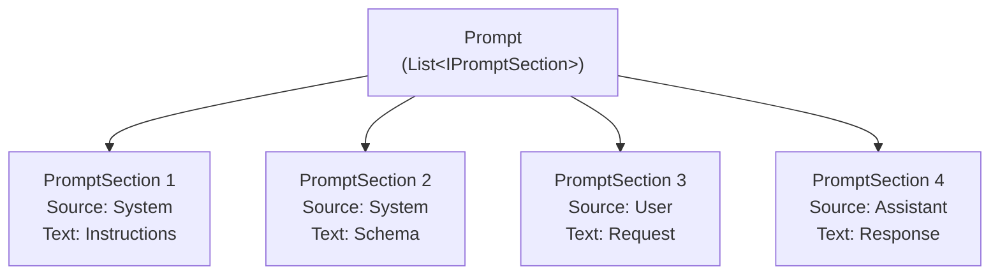
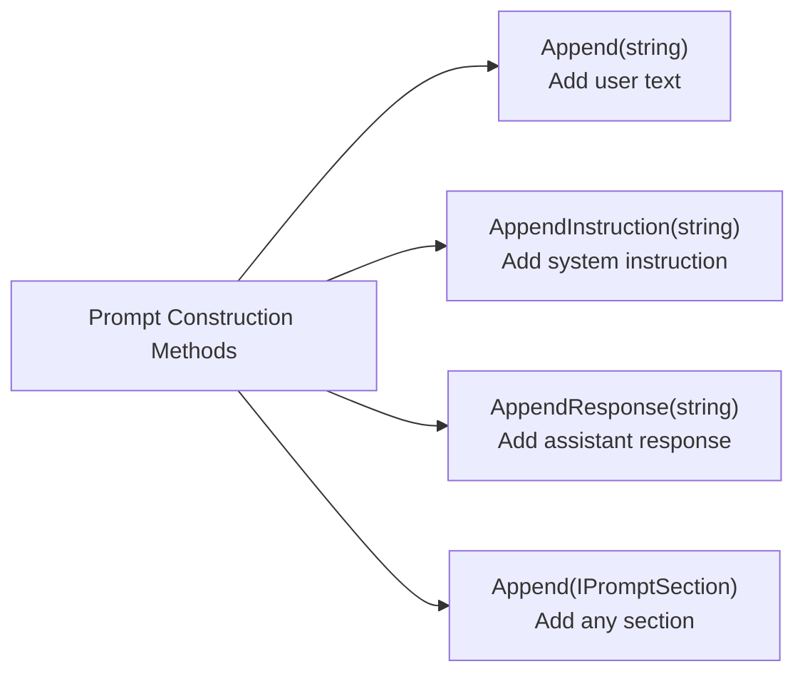
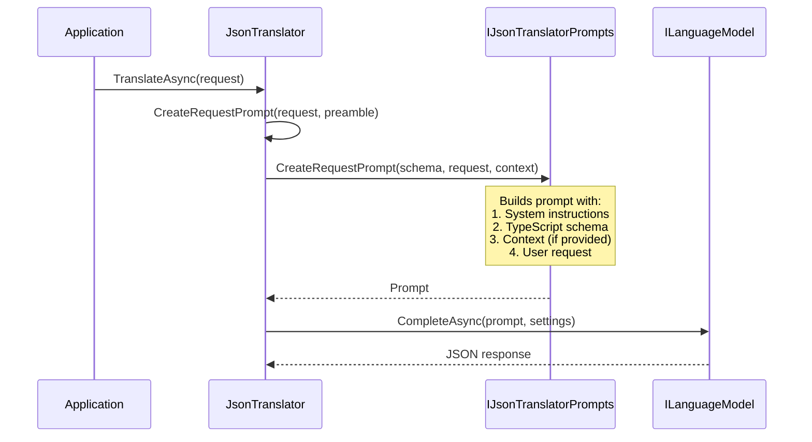
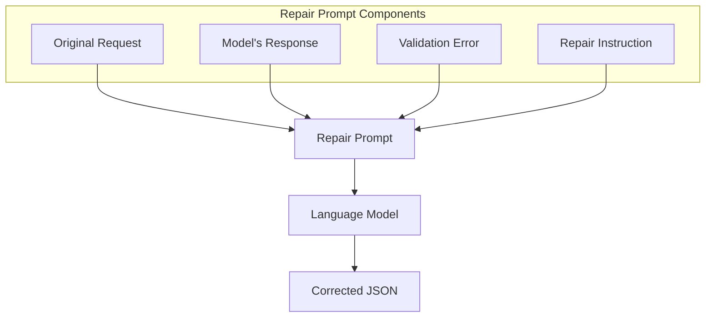
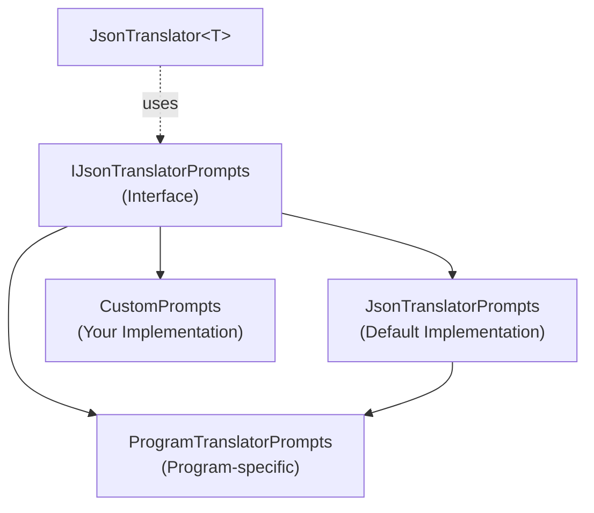
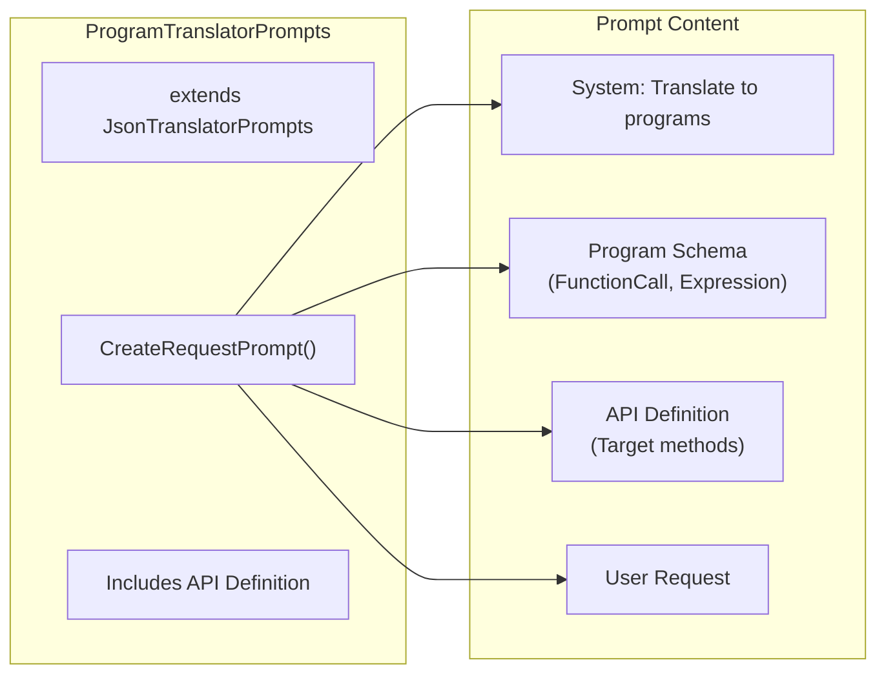
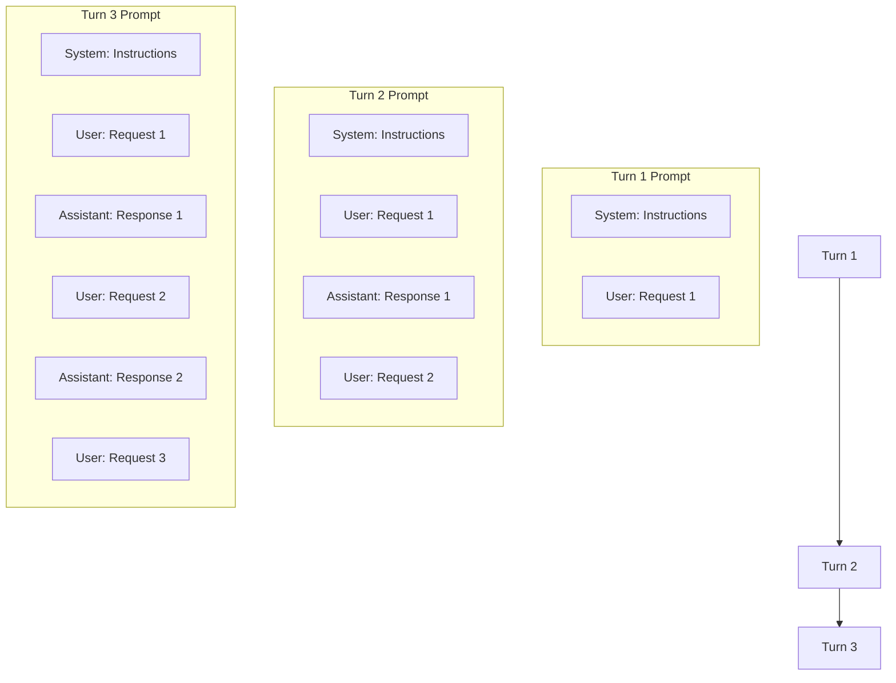
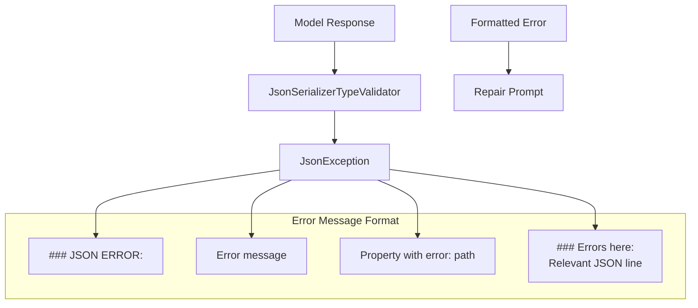

<!-- source: DeepWiki mcp.deepwiki.com · repo microsoft/typechat.net · page 3.5 Prompts and Prompt Engineering · fetched 2026-10-26 -->

# Prompts and Prompt Engineering

<details>
<summary>Relevant source files</summary>

The following files were used as context for generating this wiki page:

- [examples/MultiSchema/Program.cs](examples/MultiSchema/Program.cs)
- [src/typechat.program/JsonParser.cs](src/typechat.program/JsonParser.cs)
- [src/typechat.program/ProgramSchema.ts](src/typechat.program/ProgramSchema.ts)
- [src/typechat.program/ProgramTranslatorPrompts.cs](src/typechat.program/ProgramTranslatorPrompts.cs)
- [src/typechat/JsonResponse.cs](src/typechat/JsonResponse.cs)
- [src/typechat/JsonSerializerTypeValidator.cs](src/typechat/JsonSerializerTypeValidator.cs)
- [src/typechat/JsonTranslator.cs](src/typechat/JsonTranslator.cs)
- [src/typechat/ModelInfo.cs](src/typechat/ModelInfo.cs)
- [src/typechat/Prompt.cs](src/typechat/Prompt.cs)
- [src/typechat/TypeChatException.cs](src/typechat/TypeChatException.cs)

</details>


## Purpose and Scope

This document describes how prompts are constructed, structured, and sent to language models in TypeChat.NET. Prompts are the text instructions and context that tell language models what to generate. This page covers the `Prompt` class, prompt sections, default prompt templates, and customization strategies.

For information about how language models are configured and invoked, see [Language Models](#3.4). For details about schema generation that is included in prompts, see [Schema Generation](#3.2). For the overall translation workflow, see [JsonTranslator](#3.1).

---

## Prompt Structure

### The Prompt Class

TypeChat represents prompts as structured objects rather than simple strings. The [`Prompt`](src/typechat/Prompt.cs:1-193)() class is a list of `IPromptSection` objects, where each section has a source (System, User, or Assistant) and text content.



**Sources:** [src/typechat/Prompt.cs:1-193]()

### Prompt Sections

Each section in a prompt has two components:

| Component | Description | Type |
|-----------|-------------|------|
| **Source** | Origin of the section | `string` (System, User, or Assistant) |
| **Text** | Content of the section | `string` |

The standard sources are defined in [`PromptSection.Sources`](src/typechat/Prompt.cs:1-193)():

- **System**: Instructions and context from the application
- **User**: Requests from the end user
- **Assistant**: Previous responses from the language model

**Sources:** [src/typechat/Prompt.cs:1-193]()

### Building Prompts

The `Prompt` class provides multiple methods for constructing prompts:



Example usage from [src/typechat/Prompt.cs:68-95]():
- `Append(source, section)` - Add section with specified source
- `Append(section)` - Add section with User source (default)
- `AppendInstruction(section)` - Add section with System source
- `AppendResponse(section)` - Add section with Assistant source

**Sources:** [src/typechat/Prompt.cs:68-95]()

---

## Default Prompt Templates

### IJsonTranslatorPrompts Interface

TypeChat uses the `IJsonTranslatorPrompts` interface to abstract prompt construction. The interface defines two methods:

| Method | Purpose | Returns |
|--------|---------|---------|
| `CreateRequestPrompt` | Build initial translation prompt | `Prompt` |
| `CreateRepairPrompt` | Build repair prompt for invalid JSON | `PromptSection` |

**Sources:** [src/typechat/JsonTranslator.cs:30](), [src/typechat/JsonTranslator.cs:254-270]()

### JsonTranslatorPrompts

The default implementation is `JsonTranslatorPrompts`. It constructs standard prompts for JSON translation.

**Sources:** [src/typechat/JsonTranslator.cs:62-63](), [src/typechat/JsonTranslator.cs:80-81]()

### Request Prompt Structure

When [`JsonTranslator.TranslateAsync`](src/typechat/JsonTranslator.cs:185-252)() is called, it builds a request prompt with this structure:



The standard request prompt format includes:
1. **System Instructions**: "You are a service that translates user requests into JSON objects..."
2. **TypeScript Schema**: The schema generated from type `T`
3. **Context/Preamble** (optional): Additional instructions or examples
4. **User Request**: The actual natural language input

**Sources:** [src/typechat/JsonTranslator.cs:254-257](), [src/typechat/JsonTranslator.cs:209]()

### Repair Prompt Structure

When validation fails, TypeChat creates a repair prompt that includes:



The repair loop is controlled by [`MaxRepairAttempts`](src/typechat/JsonTranslator.cs:135-146)() (default: 1).

**Sources:** [src/typechat/JsonTranslator.cs:267-270](), [src/typechat/JsonTranslator.cs:236-251]()

---

## Customizing Prompts

### Custom Prompt Implementation

Applications can customize prompts by implementing `IJsonTranslatorPrompts` or extending `JsonTranslatorPrompts`:



**Sources:** [src/typechat/JsonTranslator.cs:116-124]()

### ProgramTranslatorPrompts Example

The [`ProgramTranslatorPrompts`](src/typechat.program/ProgramTranslatorPrompts.cs:1-39)() class demonstrates customization for program translation:



Key differences from standard JSON translation prompts:
- Includes the **Program Schema** ([src/typechat.program/ProgramSchema.ts:1-30]())
- Includes the **API Definition** (target methods the program can call)
- Instructs model to generate executable programs, not arbitrary JSON

From [src/typechat.program/ProgramTranslatorPrompts.cs:23-37]():
```
"You are a service that translates user requests into programs represented as JSON using the following TypeScript definitions:
```
{programSchema}
```
The programs can call functions from the API defined in the following TypeScript definitions:
```
{apiDef}
```
"
```

**Sources:** [src/typechat.program/ProgramTranslatorPrompts.cs:1-39](), [src/typechat.program/ProgramSchema.ts:1-30]()

### Setting Custom Prompts

Custom prompts are provided during `JsonTranslator` construction or via the [`Prompts`](src/typechat/JsonTranslator.cs:116-124)() property:

```csharp
// Constructor approach
var translator = new JsonTranslator<T>(model, validator, customPrompts);

// Property approach
translator.Prompts = customPrompts;
```

**Sources:** [src/typechat/JsonTranslator.cs:50-66](), [src/typechat/JsonTranslator.cs:74-84](), [src/typechat/JsonTranslator.cs:116-124]()

---

## Prompt Construction Workflow

### Translation Request Flow

The complete prompt construction and usage workflow:

```mermaid
sequenceDiagram
    participant App as Application Code
    participant Translator as JsonTranslator&lt;T&gt;
    participant Prompts as IJsonTranslatorPrompts
    participant Model as ILanguageModel
    
    Note over App,Model: Initial Request
    App->>Translator: TranslateAsync("user request")
    Translator->>Prompts: CreateRequestPrompt(schema, request, preamble)
    Prompts-->>Translator: Prompt with sections
    
    Translator->>Translator: NotifyEvent(SendingPrompt)
    Translator->>Model: CompleteAsync(prompt, settings)
    Model-->>Translator: Response text
    Translator->>Translator: NotifyEvent(CompletionReceived)
    
    Translator->>Translator: Parse JSON from response
    Translator->>Translator: ValidateJson(json)
    
    alt Validation Success
        Translator-->>App: Typed object T
    else Validation Failure (attempts < MaxRepairAttempts)
        Translator->>Translator: NotifyEvent(AttemptingRepair)
        Translator->>Prompts: CreateRepairPrompt(response, error)
        Prompts-->>Translator: Repair section
        Translator->>Translator: Append repair to prompt
        Note over Translator: Loop back to CompleteAsync
    else Max Attempts Exceeded
        Translator-->>App: TypeChatException
    end
```

**Sources:** [src/typechat/JsonTranslator.cs:199-252](), [src/typechat/JsonTranslator.cs:259-265]()

### Preamble and Context

Prompts can include optional preambles for additional context:

| Parameter | Type | Purpose | Used By |
|-----------|------|---------|---------|
| `request` | `Prompt` or `string` | User's request | Required |
| `preamble` | `IList<IPromptSection>` | Context sections added before request | Optional |
| `requestSettings` | `TranslationSettings` | Model configuration | Optional |

From [src/typechat/JsonTranslator.cs:199-204]():
```csharp
public async Task<T> TranslateAsync(
    Prompt request,
    IList<IPromptSection>? preamble,
    TranslationSettings? requestSettings = null,
    CancellationToken cancelToken = default)
```

**Sources:** [src/typechat/JsonTranslator.cs:199-204](), [src/typechat/Prompt.cs:28-50]()

### Multi-Turn Conversations

For conversational scenarios, prompts accumulate history by appending responses:



The repair loop demonstrates this pattern - previous responses are appended using [`AppendResponse`](src/typechat/JsonTranslator.cs:249)():

**Sources:** [src/typechat/JsonTranslator.cs:244-250](), [src/typechat/Prompt.cs:89]()

---

## Diagnostic Events

`JsonTranslator` exposes events for observing prompt construction and model interaction:

| Event | When Fired | Payload |
|-------|------------|---------|
| `SendingPrompt` | Before sending prompt to model | `Prompt` |
| `CompletionReceived` | After receiving model response | `string` |
| `AttemptingRepair` | Before repair attempt | `string` (error message) |

These events are useful for debugging, logging, and understanding what the model sees:

```csharp
translator.SendingPrompt += (prompt) => {
    Console.WriteLine("Sending prompt:");
    Console.WriteLine(prompt.ToString(includeSource: true));
};

translator.CompletionReceived += (response) => {
    Console.WriteLine("Received response:");
    Console.WriteLine(response);
};

translator.AttemptingRepair += (error) => {
    Console.WriteLine($"Repair needed: {error}");
};
```

**Sources:** [src/typechat/JsonTranslator.cs:155-165](), [src/typechat/JsonTranslator.cs:291-313]()

---

## Error Formatting in Repair Prompts

When validation fails, TypeChat formats errors to help the model understand what went wrong:



From [src/typechat/JsonSerializerTypeValidator.cs:68-84]():
- Error header: `### JSON ERROR:`
- Error message from exception
- Property path where error occurred
- Relevant JSON line with line number

**Sources:** [src/typechat/JsonSerializerTypeValidator.cs:68-84](), [src/typechat/JsonTranslator.cs:267-270]()

---

## Prompt Settings and Token Management

### TranslationSettings

The [`TranslationSettings`](src/typechat/JsonTranslator.cs:129)() class controls prompt-related model behavior:

| Setting | Purpose | Default |
|---------|---------|---------|
| `MaxTokens` | Maximum tokens in response | Model-dependent |
| `Temperature` | Randomness (0.0 = deterministic) | Model-dependent |
| `TopP` | Nucleus sampling threshold | Model-dependent |

**Sources:** [src/typechat/JsonTranslator.cs:129](), [src/typechat/JsonTranslator.cs:208-213]()

### Prompt Length Calculation

The [`Prompt.GetLength()`](src/typechat/Prompt.cs:162-170)() method calculates total character count:

```csharp
public int GetLength()
{
    int total = 0;
    foreach (var section in this)
    {
        total += section.GetText().Length;
    }
    return total;
}
```

This is useful for estimating token usage. [`ModelInfo`](src/typechat/ModelInfo.cs:1-61)() provides `MaxCharCount` and `TokenToCharMultiple` for rough token estimation.

**Sources:** [src/typechat/Prompt.cs:162-170](), [src/typechat/ModelInfo.cs:1-61]()

---

## Best Practices

### Schema-Driven Prompting

TypeChat's approach is schema-driven rather than example-driven:

**✅ Do:**
- Include complete TypeScript schema in prompts
- Use clear type names and property names
- Add documentation comments to types (included in schema)
- Let schema guide the model's structure

**❌ Avoid:**
- Relying solely on examples without schema
- Overly complex nested schemas (harder for models to follow)
- Ambiguous property names

**Sources:** [src/typechat/JsonTranslator.cs:9-12]()

### Repair Strategy

Configure repair attempts based on your needs:

| Scenario | Recommended MaxRepairAttempts |
|----------|------------------------------|
| Production with tight latency | 0-1 |
| Development/testing | 2-3 |
| High-accuracy requirements | 2-3 |
| Simple schemas | 0-1 |
| Complex schemas | 2-3 |

From [src/typechat/JsonTranslator.cs:25](), default is 1 attempt.

**Sources:** [src/typechat/JsonTranslator.cs:25](), [src/typechat/JsonTranslator.cs:135-146]()

### Context Management

When providing preambles:
- Keep context focused and relevant
- Use consistent section sources (System for instructions)
- Avoid redundancy with schema
- Consider token limits

**Sources:** [src/typechat/JsonTranslator.cs:254-257](), [src/typechat/Prompt.cs:28-50]()

### Observability

Always wire up diagnostic events during development:
- `SendingPrompt` - Inspect what the model sees
- `CompletionReceived` - Monitor model outputs
- `AttemptingRepair` - Track validation issues

**Sources:** [src/typechat/JsonTranslator.cs:155-165]()

---

## Related Examples

Real-world prompt customization can be seen in:

- **MultiSchema** ([examples/MultiSchema/Program.cs:1-100]()) - Dynamic routing uses classification prompts
- **ProgramTranslator** - Custom prompts for code generation (covered above)
- **CoffeeShop** - Standard prompts with complex schema
- **SchemaHierarchy** - Semantic routing with embedding-based selection

For conversational prompt management, see [Conversational Agents](#7.1).

**Sources:** [examples/MultiSchema/Program.cs:1-100](), [src/typechat.program/ProgramTranslatorPrompts.cs:1-39]()

---

