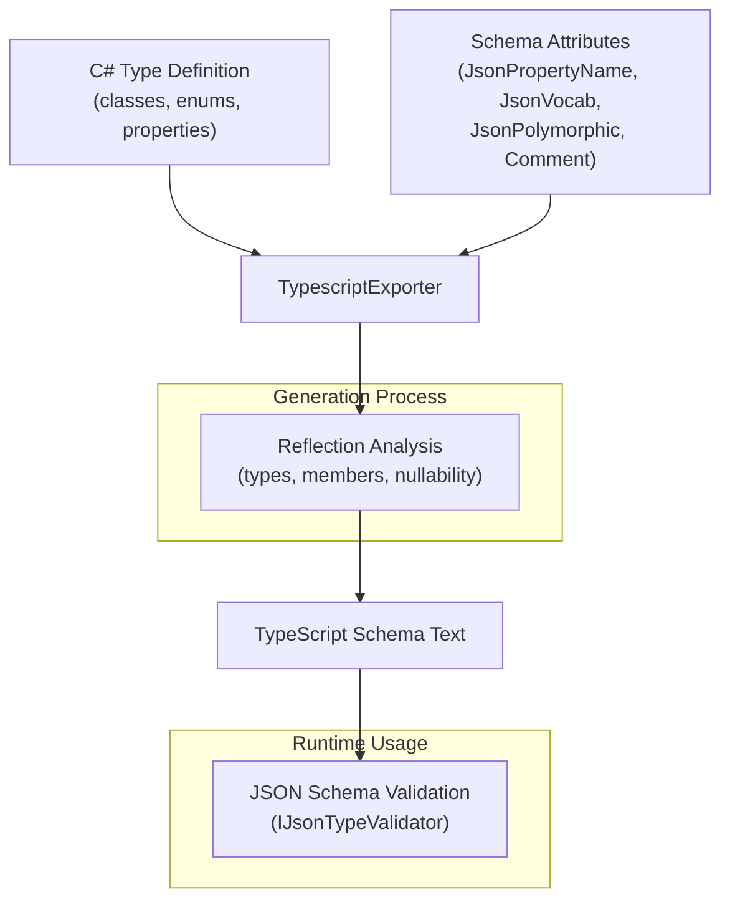
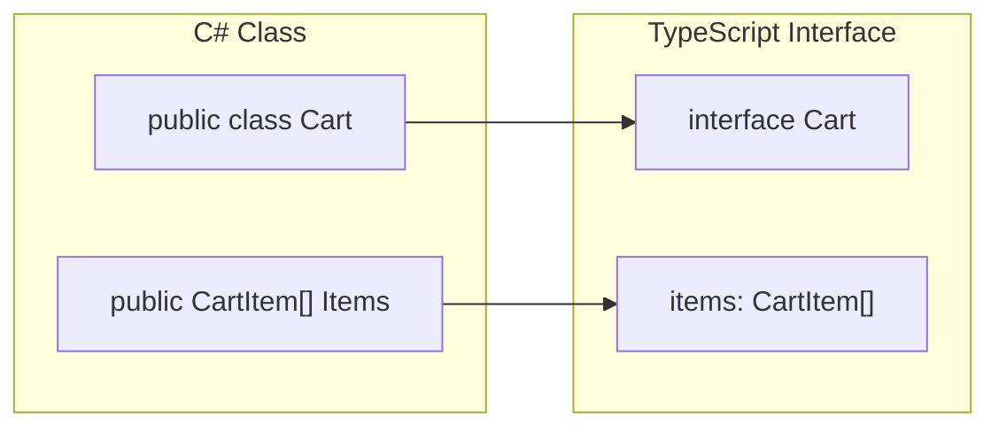
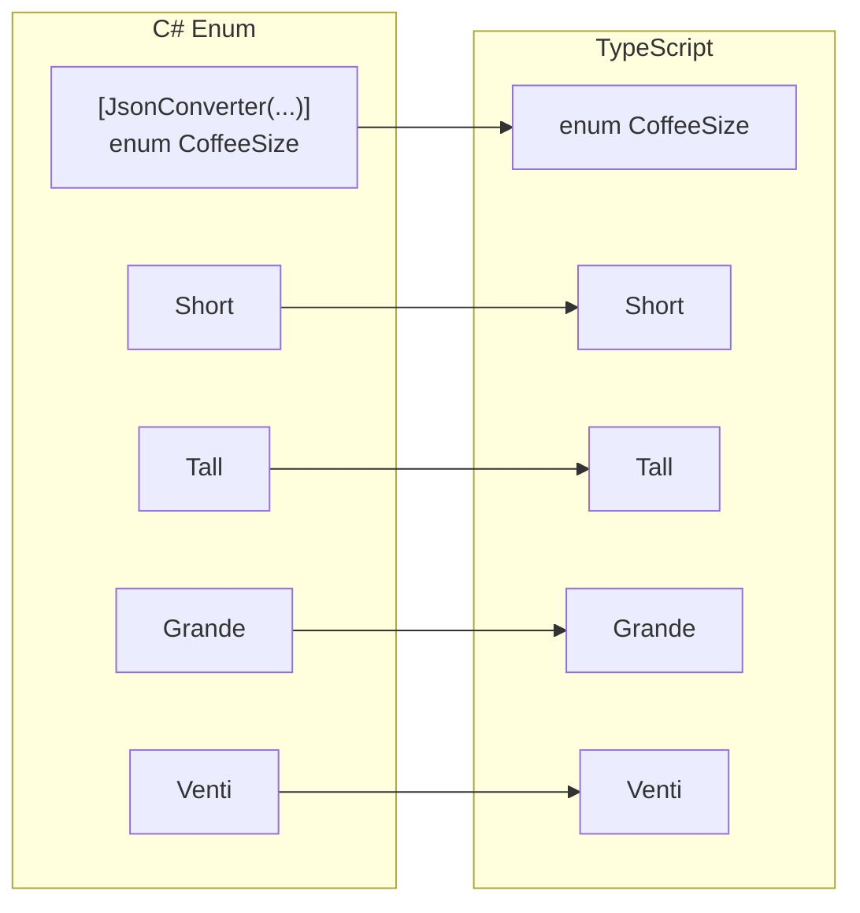
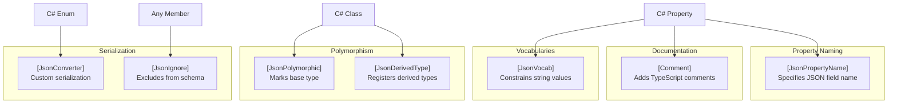
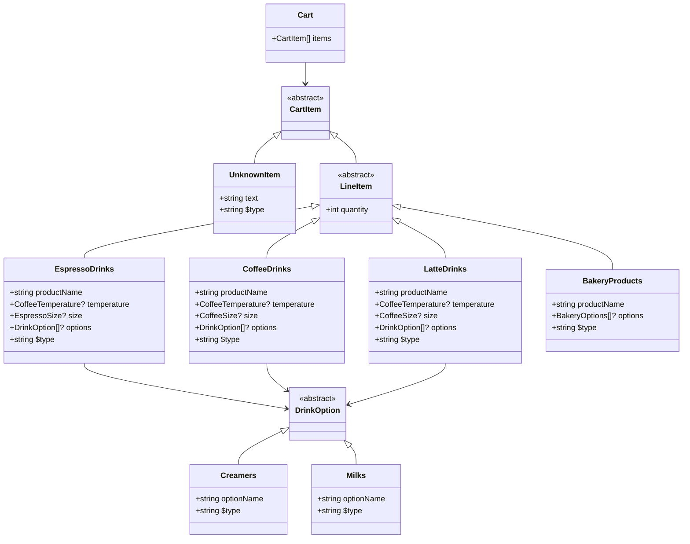

<!-- source: DeepWiki mcp.deepwiki.com · repo microsoft/typechat.net · page 4 Schema Definition · fetched 2026-10-26 -->

# Schema Definition

<details>
<summary>Relevant source files</summary>

The following files were used as context for generating this wiki page:

- [examples/CoffeeShop/CoffeeShopSchema.cs](examples/CoffeeShop/CoffeeShopSchema.cs)
- [examples/CoffeeShop/Program.cs](examples/CoffeeShop/Program.cs)
- [examples/CoffeeShop/input.txt](examples/CoffeeShop/input.txt)
- [examples/SchemaHierarchy/Program.cs](examples/SchemaHierarchy/Program.cs)
- [src/typechat.schema/TypescriptExporter.cs](src/typechat.schema/TypescriptExporter.cs)
- [tests/TypeChat.UnitTests/TestSchema.cs](tests/TypeChat.UnitTests/TestSchema.cs)

</details>


## Purpose and Scope

This page explains how to define schemas in TypeChat.NET by creating C# types that represent the structure of JSON objects. Schemas serve as the contract between natural language inputs and structured data outputs, enabling language models to understand what format to produce.

Schema Definition covers:
- How C# classes, enums, and properties map to TypeScript schemas
- Schema attributes that control generation and validation
- Basic schema design patterns and organization
- The `TypescriptExporter` class that performs schema generation

For detailed information on specific schema features, see:
- [Type Mapping](#4.1) - Comprehensive guide to C# to TypeScript type mappings
- [Vocabularies](#4.2) - Using `JsonVocab` to constrain string values
- [Polymorphic Types](#4.3) - Working with inheritance hierarchies and discriminators
- [Unknown Items Pattern](#4.4) - Handling partial understanding with `UnknownItem` types

For the overall translation workflow that uses schemas, see [JsonTranslator](#3.1).

---

## Schema Generation Overview

TypeChat.NET uses the `TypescriptExporter` class to automatically convert C# types into TypeScript schemas. The `JsonTranslator<T>` invokes this exporter during initialization to produce the schema that will guide the language model's JSON generation.

### Schema Generation Flow



**Sources:** [src/typechat.schema/TypescriptExporter.cs:1-767]()

### Key Components

| Component | Purpose | Code Location |
|-----------|---------|---------------|
| `TypescriptExporter` | Converts C# types to TypeScript schemas | [src/typechat.schema/TypescriptExporter.cs:28-767]() |
| `TypescriptExporter.GenerateSchema()` | Static method to generate schema from a type | [src/typechat.schema/TypescriptExporter.cs:36-47]() |
| `TypeSchema` | Encapsulates generated schema text and metadata | Referenced in schema generation |
| `IVocabCollection` | Provides vocabulary definitions for schema | [src/typechat.schema/TypescriptExporter.cs:40-43]() |
| `JsonTranslator<T>` | Uses generated schema for validation | [examples/CoffeeShop/Program.cs:16-18]() |

**Sources:** [src/typechat.schema/TypescriptExporter.cs:28-96](), [examples/CoffeeShop/Program.cs:10-22]()

---

## Core Schema Concepts

### Classes as Schema Types

C# classes define the structure of JSON objects. Each public property or field becomes a field in the TypeScript interface:



**Example from CoffeeShop:**
- C# class `Cart` at [examples/CoffeeShop/CoffeeShopSchema.cs:18-22]() becomes TypeScript `interface Cart`
- Property `Items` becomes field `items` (lowercase per JSON convention)

**Sources:** [examples/CoffeeShop/CoffeeShopSchema.cs:18-22](), [src/typechat.schema/TypescriptExporter.cs:195-241]()

### Enums as Literal Types

C# enums map to TypeScript enums or string literal unions. The `JsonConverter(typeof(JsonStringEnumConverter))` attribute controls how enums serialize:



**Example:** [examples/CoffeeShop/CoffeeShopSchema.cs:109-116]() defines `CoffeeSize` enum values.

**Sources:** [examples/CoffeeShop/CoffeeShopSchema.cs:109-134](), [src/typechat.schema/TypescriptExporter.cs:243-267]()

### Properties and Fields

Both properties and fields are exported if they are public and not marked with `[JsonIgnore]`:

| C# Member Type | Exported? | Notes |
|----------------|-----------|-------|
| Public property with getter/setter | ✓ | Most common pattern |
| Public field | ✓ | Also supported |
| Private member | ✗ | Not exported |
| Property with `[JsonIgnore]` | ✗ | Explicitly excluded |
| Abstract property | ✗ | Skipped during export |

**Sources:** [src/typechat.schema/TypescriptExporter.cs:376-437]()

---

## Schema Attributes

Schema attributes control how C# types are converted to TypeScript and how JSON is validated. These are standard `System.Text.Json` attributes plus TypeChat-specific extensions.

### Attribute Reference Diagram



**Sources:** [examples/CoffeeShop/CoffeeShopSchema.cs:1-290](), [src/typechat.schema/TypescriptExporter.cs:418-437]()

### JsonPropertyName

Specifies the JSON property name, overriding C# naming conventions:

```csharp
// From CoffeeShopSchema.cs
[JsonPropertyName("items")]
public CartItem[] Items { get; set; }
```

This ensures the JSON field is `"items"` even though the C# property is `Items`.

**Sources:** [examples/CoffeeShop/CoffeeShopSchema.cs:20-21]()

### Comment Attribute

Adds TypeScript comments that guide the language model:

```csharp
// From CoffeeShopSchema.cs
[Comment("Use this type for Cart Items that match nothing else")]
public partial class UnknownItem : CartItem
{
    [Comment("The text that wasn't understood")]
    [JsonPropertyName("text")]
    public string Text { get; set; }
}
```

These comments appear in the generated TypeScript schema and help the model understand intent.

**Sources:** [examples/CoffeeShop/CoffeeShopSchema.cs:34-40](), [src/typechat.schema/TypescriptExporter.cs:465-479]()

### JsonVocab Attribute

Constrains string properties to a specific vocabulary (see [Vocabularies](#4.2) for details):

```csharp
// From CoffeeShopSchema.cs
[JsonVocab(CoffeeShopVocabs.EspressoDrinks, PropertyName = "productName")]
[JsonPropertyName("productName")]
public string Name { get; set; }
```

The vocabulary `"espresso | lungo | ristretto | macchiato"` is embedded in the schema.

**Sources:** [examples/CoffeeShop/CoffeeShopSchema.cs:50-52](), [src/typechat.schema/TypescriptExporter.cs:544-601]()

### JsonPolymorphic and JsonDerivedType

Enable inheritance hierarchies with type discriminators (see [Polymorphic Types](#4.3) for details):

```csharp
// From CoffeeShopSchema.cs
[JsonPolymorphic]
[JsonDerivedType(typeof(UnknownItem), typeDiscriminator: nameof(UnknownItem))]
[JsonDerivedType(typeof(EspressoDrinks), typeDiscriminator: nameof(EspressoDrinks))]
[JsonDerivedType(typeof(CoffeeDrinks), typeDiscriminator: nameof(CoffeeDrinks))]
public abstract partial class CartItem { }
```

**Sources:** [examples/CoffeeShop/CoffeeShopSchema.cs:24-32]()

---

## Schema Generation Process

The TypeScript schema generation process follows these steps:

```mermaid
sequenceDiagram
    participant App as "Application Code"
    participant JT as "JsonTranslator&lt;Cart&gt;"
    participant TE as "TypescriptExporter"
    participant TW as "TypescriptWriter"
    participant Refl as "Reflection APIs"
    
    App->>JT: new JsonTranslator&lt;Cart&gt;(model)
    JT->>TE: GenerateSchema(typeof(Cart))
    
    TE->>Refl: Analyze Cart type
    Refl-->>TE: Type metadata
    
    TE->>TE: Export Cart interface
    TE->>TW: BeginInterface("Cart")
    TE->>TW: Variable("items", "CartItem[]")
    TE->>TW: EndInterface()
    
    TE->>TE: Discover CartItem type
    TE->>TE: Add to pending types
    
    TE->>TE: ExportPending()
    
    loop For each CartItem subclass
        TE->>TE: ExportClass(UnknownItem)
        TE->>TE: ExportClass(EspressoDrinks)
        TE->>TE: ExportClass(CoffeeDrinks)
    end
    
    TE-->>JT: TypescriptSchema
    JT->>JT: Create validator with schema
```

**Sources:** [src/typechat.schema/TypescriptExporter.cs:36-47](), [src/typechat.schema/TypescriptExporter.cs:195-241]()

### Step-by-Step Breakdown

1. **Type Analysis** [src/typechat.schema/TypescriptExporter.cs:176-193]()
   - Inspect root type (e.g., `Cart`)
   - Identify properties, fields, base classes
   - Collect nullability information

2. **Interface Generation** [src/typechat.schema/TypescriptExporter.cs:195-241]()
   - Export base class first (if any)
   - Begin interface declaration
   - Export discriminator (for polymorphic types)
   - Export all members

3. **Member Export** [src/typechat.schema/TypescriptExporter.cs:376-437]()
   - Export properties with `ExportProperty()`
   - Export fields with `ExportField()`
   - Handle vocabularies with `ExportJsonVocab()`
   - Respect `JsonIgnore` and abstract properties

4. **Pending Type Export** [src/typechat.schema/TypescriptExporter.cs:170-174]()
   - Referenced types added to pending queue
   - Process until queue is empty
   - Automatically export subclasses if `IncludeSubclasses = true`

5. **Vocabulary Export** [src/typechat.schema/TypescriptExporter.cs:544-631]()
   - Inline vocabularies as string literal unions
   - Or export as named type aliases
   - Track used vocabularies for validation

**Sources:** [src/typechat.schema/TypescriptExporter.cs:159-174](), [src/typechat.schema/TypescriptExporter.cs:195-299]()

---

## Complete Schema Example: CoffeeShop

The CoffeeShop example demonstrates a comprehensive schema with multiple features.

### CoffeeShop Schema Structure



**Sources:** [examples/CoffeeShop/CoffeeShopSchema.cs:18-250]()

### Key Schema Features in CoffeeShop

| Feature | Location | Purpose |
|---------|----------|---------|
| Root type | `Cart` at [examples/CoffeeShop/CoffeeShopSchema.cs:18-22]() | Top-level container for orders |
| Polymorphism | `CartItem` base class [examples/CoffeeShop/CoffeeShopSchema.cs:24-32]() | Multiple product types |
| Vocabularies | Multiple vocab constants [examples/CoffeeShop/CoffeeShopSchema.cs:258-289]() | Constrain product names, options |
| Unknown items | `UnknownItem` class [examples/CoffeeShop/CoffeeShopSchema.cs:34-40]() | Handle unrecognized requests |
| Nested polymorphism | `DrinkOption` hierarchy [examples/CoffeeShop/CoffeeShopSchema.cs:136-211]() | Options within options |
| Nullable properties | `Temperature?`, `Size?` | Optional attributes |
| Default values | `Size = EspressoSize.Doppio` [examples/CoffeeShop/CoffeeShopSchema.cs:59]() | Provide defaults |
| Enums | `CoffeeSize`, `CoffeeTemperature` [examples/CoffeeShop/CoffeeShopSchema.cs:109-134]() | Fixed value sets |

**Sources:** [examples/CoffeeShop/CoffeeShopSchema.cs:1-290]()

### Vocabulary Definitions

CoffeeShop defines vocabularies as string constants:

```csharp
// From CoffeeShopSchema.cs:258-289
public static class CoffeeShopVocabs
{
    public const string EspressoDrinks = "espresso | lungo | ristretto | macchiato";
    public const string CoffeeDrinks = "americano | coffee";
    public const string LatteDrinks = "cappuccino | flat white | latte | latte macchiato| mocha | chai latte";
    // ... more vocabularies
}
```

These vocabularies are referenced by `JsonVocab` attributes throughout the schema. See [Vocabularies](#4.2) for more details.

**Sources:** [examples/CoffeeShop/CoffeeShopSchema.cs:258-289]()

---

## Schema Design Patterns

### Pattern: Abstract Base Class with Polymorphic Derivatives

Use an abstract base class with `[JsonPolymorphic]` to model type hierarchies:

```
Base Class (abstract)
  ├─ UnknownItem (fallback)
  ├─ ConcreteType1
  ├─ ConcreteType2
  └─ ConcreteType3
```

**Example:** `CartItem` at [examples/CoffeeShop/CoffeeShopSchema.cs:24-32]()

**When to use:** 
- Multiple distinct entity types that share common structure
- Need to handle unrecognized inputs gracefully with `UnknownItem`

**Sources:** [examples/CoffeeShop/CoffeeShopSchema.cs:24-32](), [examples/CoffeeShop/CoffeeShopSchema.cs:136-145]()

### Pattern: Vocabulary-Constrained Strings

Use `[JsonVocab]` instead of enums when:
- Product catalogs are dynamic and may change
- Values are loaded from external sources
- Need natural language flexibility while maintaining constraints

**Example:** `EspressoDrinks.Name` at [examples/CoffeeShop/CoffeeShopSchema.cs:50-52]()

**Sources:** [examples/CoffeeShop/CoffeeShopSchema.cs:50-52](), [examples/CoffeeShop/CoffeeShopSchema.cs:258-289]()

### Pattern: Collection Properties

Arrays and lists represent multiple items:

```csharp
public CartItem[] Items { get; set; }  // Array of items
public DrinkOption[]? Options { get; set; }  // Optional array
```

**Sources:** [examples/CoffeeShop/CoffeeShopSchema.cs:21](), [examples/CoffeeShop/CoffeeShopSchema.cs:62]()

### Pattern: Nullable Optional Properties

Use nullable types for optional attributes:

```csharp
public CoffeeTemperature? Temperature { get; set; }  // Optional
public CoffeeSize? Size { get; set; } = CoffeeSize.Grande;  // Optional with default
```

**Sources:** [examples/CoffeeShop/CoffeeShopSchema.cs:54-59]()

---

## Schema Initialization and Usage

### In JsonTranslator

The `JsonTranslator<T>` automatically generates the schema during construction:

```csharp
// From CoffeeShop/Program.cs:16-18
_translator = new JsonTranslator<Cart>(
    new LanguageModel(Config.LoadOpenAI())
);
```

The translator:
1. Calls `TypescriptExporter.GenerateSchema(typeof(Cart))`
2. Stores the schema in the validator
3. Uses the schema in prompts to the language model
4. Validates responses against the schema

**Sources:** [examples/CoffeeShop/Program.cs:14-22]()

### Accessing Generated Schema

The schema can be accessed for debugging or logging:

```csharp
// From CoffeeShop/Program.cs:24
public TypeSchema Schema => _translator.Validator.Schema;

// Print schema (commented out in example):
// Console.WriteLine(app.Schema.Schema.Text);
```

**Sources:** [examples/CoffeeShop/Program.cs:24](), [examples/CoffeeShop/Program.cs:63]()

### Schema with Vocabularies

Vocabularies can be provided during schema generation:

```csharp
// From TestSchema.cs:14
schema = TypescriptExporter.GenerateSchema(typeof(Order), TestVocabs.All());
```

This enables dynamic vocabulary loading from databases or external sources.

**Sources:** [tests/TypeChat.UnitTests/TestSchema.cs:14]()

---

## Exporter Configuration Options

The `TypescriptExporter` class provides several configuration properties:

| Property | Default | Purpose |
|----------|---------|---------|
| `IncludeSubclasses` | `true` | Automatically export derived types |
| `IncludeComments` | `true` | Include `[Comment]` attributes in schema |
| `EnumsAsLiterals` | `false` | Export enums as string literals vs enum types |
| `TypeNameMapper` | `null` | Custom function to map type names |
| `PolymorphismSettings` | default | Configure discriminator generation |
| `TypesToIgnore` | built-in set | Skip specific types during export |

**Sources:** [src/typechat.schema/TypescriptExporter.cs:115-136]()

### Example: Custom Type Name Mapping

```csharp
exporter.TypeNameMapper = (type) => {
    // Custom logic to generate TypeScript names
    return type.Name.Replace("DTO", "");
};
```

**Sources:** [src/typechat.schema/TypescriptExporter.cs:107]()

---

## Best Practices

### Schema Design Guidelines

1. **Use descriptive property names** - Language models respond better to semantic names like `productName` vs `name`
   - See comment at [examples/CoffeeShop/CoffeeShopSchema.cs:15](): "The model can be VERY sensitive to property names"

2. **Add comments for guidance** - Use `[Comment]` to explain intent, especially for `UnknownItem` types
   - Example: [examples/CoffeeShop/CoffeeShopSchema.cs:34]()

3. **Provide defaults for optional properties** - Helps the model make reasonable choices
   - Example: [examples/CoffeeShop/CoffeeShopSchema.cs:59]()

4. **Use vocabularies for constrained strings** - More flexible than enums for dynamic catalogs
   - Pattern used throughout [examples/CoffeeShop/CoffeeShopSchema.cs]()

5. **Always include an UnknownItem type** - Enables graceful handling of unrecognized inputs
   - Example: [examples/CoffeeShop/CoffeeShopSchema.cs:34-40]()

6. **Keep hierarchies shallow** - Deep inheritance makes schemas complex
   - CoffeeShop uses max 2 levels: `CartItem` → `LineItem` → concrete types

7. **Test schema with print statements** - Uncomment schema printing during development
   - Example: [examples/CoffeeShop/Program.cs:63]()

**Sources:** [examples/CoffeeShop/CoffeeShopSchema.cs:8-16](), [examples/CoffeeShop/CoffeeShopSchema.cs:34-40]()

---

## Testing Schema Generation

The test infrastructure validates schema generation:

```csharp
// From TestSchema.cs:8-21
[Fact]
public void ExportBasic()
{
    TypeSchema schema = TypescriptExporter.GenerateSchema(typeof(SentimentResponse));
    ValidateBasic(typeof(SentimentResponse), schema);
    Assert.True(schema.Schema.Text.Contains("sentiment"));
    
    schema = TypescriptExporter.GenerateSchema(typeof(Order), TestVocabs.All());
    ValidateBasic(typeof(Order), schema);
    
    var lines = schema.Schema.Text.Lines();
    Assert.True(lines.ContainsSubstring("coffee", "CoffeeOrder[]"));
}
```

**Sources:** [tests/TypeChat.UnitTests/TestSchema.cs:5-98]()

---

## Related Topics

- **[Type Mapping](#4.1)** - Detailed rules for how C# types map to TypeScript
- **[Vocabularies](#4.2)** - Deep dive on vocabulary constraints and `JsonVocab`
- **[Polymorphic Types](#4.3)** - Working with inheritance, discriminators, and derived types
- **[Unknown Items Pattern](#4.4)** - Handling partial understanding and unknown inputs
- **[Schema Generation](#3.2)** - Technical details of the TypeScript export process
- **[JsonTranslator](#3.1)** - How schemas are used in the translation workflow
- **[Validation and Repair](#3.3)** - How schemas enable JSON validation

**Sources:** Table of contents structure

---

