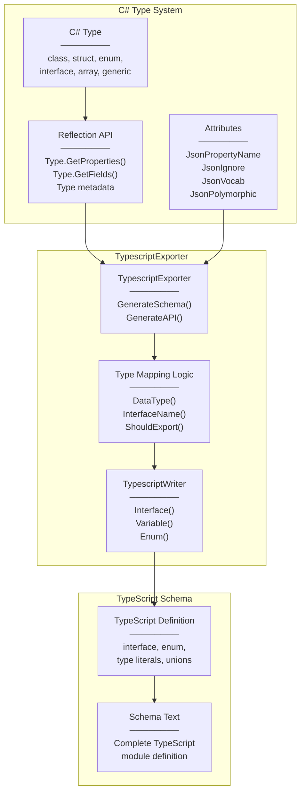
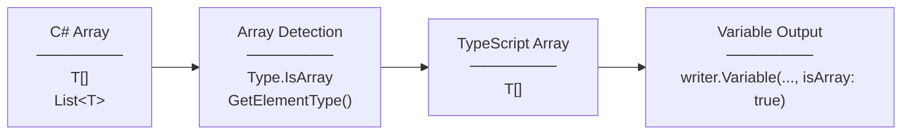
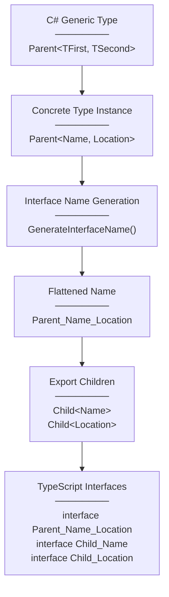
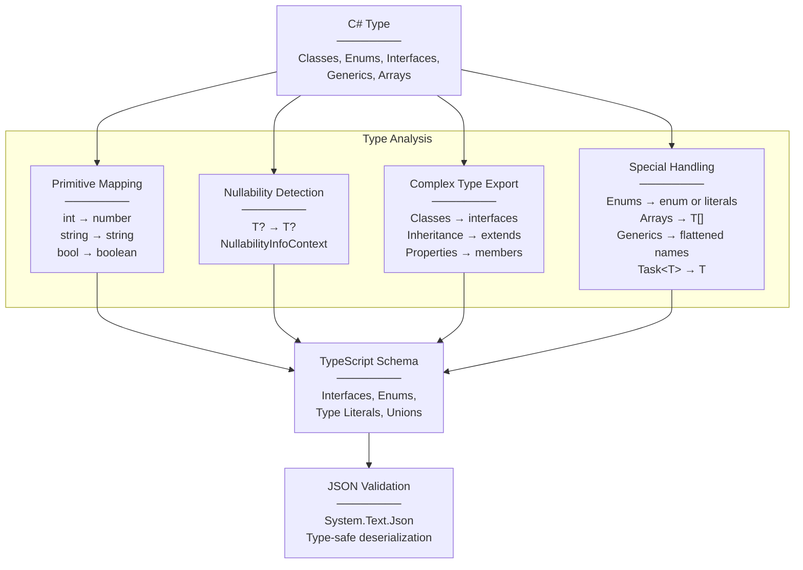

<!-- source: DeepWiki mcp.deepwiki.com · repo microsoft/typechat.net · page 4.1 Type Mapping · fetched 2026-10-26 -->

# Type Mapping

<details>
<summary>Relevant source files</summary>

The following files were used as context for generating this wiki page:

- [examples/CoffeeShop/CoffeeShopSchema.cs](examples/CoffeeShop/CoffeeShopSchema.cs)
- [examples/CoffeeShop/Program.cs](examples/CoffeeShop/Program.cs)
- [examples/CoffeeShop/input.txt](examples/CoffeeShop/input.txt)
- [examples/SchemaHierarchy/Program.cs](examples/SchemaHierarchy/Program.cs)
- [src/typechat.schema/TypescriptExporter.cs](src/typechat.schema/TypescriptExporter.cs)
- [tests/TypeChat.UnitTests/TestSchema.cs](tests/TypeChat.UnitTests/TestSchema.cs)

</details>


This page documents how C# types are automatically mapped to TypeScript types during schema generation. TypeChat.NET's `TypescriptExporter` analyzes .NET type metadata and produces TypeScript schemas that language models can understand while maintaining compatibility with System.Text.Json serialization.

For information about the overall schema generation process, see [Schema Generation](#3.2). For type-specific features like vocabularies and polymorphism, see [Vocabularies](#4.2) and [Polymorphic Types](#4.3).

---

## Type Mapping Overview

The `TypescriptExporter` class performs automatic type conversion by inspecting .NET types using reflection and generating equivalent TypeScript definitions. This process preserves type semantics, nullability annotations, and serialization attributes.



**Diagram: Type Mapping Process Flow**

Sources: [src/typechat.schema/TypescriptExporter.cs:1-767]()

---

## Primitive Type Mapping

Primitive C# types are mapped to their TypeScript equivalents using the `Typescript.Types.ToPrimitive()` method. The mapping preserves semantic meaning across type systems.

| C# Type | TypeScript Type | Notes |
|---------|----------------|-------|
| `bool` | `boolean` | Direct mapping |
| `byte`, `sbyte`, `short`, `ushort`, `int`, `uint`, `long`, `ulong` | `number` | All integer types map to number |
| `float`, `double`, `decimal` | `number` | All floating-point types map to number |
| `string` | `string` | Direct mapping |
| `char` | `string` | Character represented as single-character string |
| `DateTime`, `DateTimeOffset` | `string` | ISO 8601 string format |
| `Guid` | `string` | String representation |
| `object` | `any` | Top type |
| `void` | `void` | Used for method return types |

The type mapping logic is implemented in the `DataType()` method:

[src/typechat.schema/TypescriptExporter.cs:654-681]()

**Example: Primitive Type Mapping**

```csharp
// C# Definition
public class PrimitiveExample
{
    public int Count { get; set; }
    public string Name { get; set; }
    public bool IsActive { get; set; }
    public double Price { get; set; }
}
```

Maps to:

```typescript
// Generated TypeScript
interface PrimitiveExample {
    Count: number;
    Name: string;
    IsActive: boolean;
    Price: number;
}
```

Sources: [src/typechat.schema/TypescriptExporter.cs:654-681]()

---

## Nullable Types

TypeChat.NET handles both nullable value types (`Nullable<T>` or `T?`) and nullable reference types (C# 8.0+). The nullability is expressed using TypeScript's optional property syntax (`?`).

### Nullable Value Types

Nullable value types like `int?` are detected by inspecting if the type is `Nullable<T>`:

[src/typechat.schema/TypescriptExporter.cs:481-514]()

### Nullable Reference Types

For .NET 6.0 and later, nullable reference types are detected using `NullabilityInfoContext`:

[src/typechat.schema/TypescriptExporter.cs:712-721]()

For earlier frameworks, only nullable value types are supported:

[src/typechat.schema/TypescriptExporter.cs:717-720]()

**Example: Nullable Type Mapping**

```csharp
// C# Definition
public class NullableExample
{
    public int RequiredCount { get; set; }
    public int? OptionalCount { get; set; }
    public string RequiredText { get; set; }
    public string? OptionalText { get; set; }  // Requires C# 8.0+ and nullable reference types enabled
}
```

Maps to:

```typescript
// Generated TypeScript
interface NullableExample {
    RequiredCount: number;
    OptionalCount?: number;
    RequiredText: string;
    OptionalText?: string;
}
```

The test case demonstrates this behavior:

[tests/TypeChat.UnitTests/TestSchema.cs:23-38]()

Sources: [src/typechat.schema/TypescriptExporter.cs:481-514](), [src/typechat.schema/TypescriptExporter.cs:712-743](), [tests/TypeChat.UnitTests/TestSchema.cs:23-38]()

---

## Arrays and Collections

C# arrays are mapped to TypeScript array syntax. The exporter detects arrays using `Type.IsArray` and generates the appropriate TypeScript notation.



**Diagram: Array Type Mapping**

The array handling logic extracts the element type and marks the variable as an array:

[src/typechat.schema/TypescriptExporter.cs:178-181]()

[src/typechat.schema/TypescriptExporter.cs:481-514]()

**Example: Array Mapping**

```csharp
// C# Definition
public class Cart
{
    [JsonPropertyName("items")]
    public CartItem[] Items { get; set; }
}
```

Maps to:

```typescript
// Generated TypeScript
interface Cart {
    items: CartItem[];
}
```

This is demonstrated in the CoffeeShop example:

[examples/CoffeeShop/CoffeeShopSchema.cs:18-22]()

Sources: [src/typechat.schema/TypescriptExporter.cs:178-181](), [src/typechat.schema/TypescriptExporter.cs:481-514](), [examples/CoffeeShop/CoffeeShopSchema.cs:18-22]()

---

## Enum Mapping

Enums can be exported in two different formats: as TypeScript enums or as string literal unions. The format is controlled by the `EnumsAsLiterals` property.

### TypeScript Enum Format (Default)

By default, enums are exported as TypeScript `enum` declarations:

[src/typechat.schema/TypescriptExporter.cs:301-313]()

### String Literal Union Format

When `EnumsAsLiterals` is true, enums are exported as type aliases with string literal unions:

[src/typechat.schema/TypescriptExporter.cs:315-325]()

**Example: Enum Mapping**

```csharp
// C# Definition
[JsonConverter(typeof(JsonStringEnumConverter))]
public enum CoffeeSize
{
    Short,
    Tall,
    Grande,
    Venti
}
```

Maps to (default format):

```typescript
// Generated TypeScript (EnumsAsLiterals = false)
enum CoffeeSize {
    Short,
    Tall,
    Grande,
    Venti
}
```

Or (literal format):

```typescript
// Generated TypeScript (EnumsAsLiterals = true)
type CoffeeSize = 
    "Short" | 
    "Tall" | 
    "Grande" | 
    "Venti";
```

Example from CoffeeShop:

[examples/CoffeeShop/CoffeeShopSchema.cs:109-116]()

The `JsonConverter(typeof(JsonStringEnumConverter))` attribute ensures System.Text.Json serializes the enum as strings rather than integers.

Sources: [src/typechat.schema/TypescriptExporter.cs:243-267](), [src/typechat.schema/TypescriptExporter.cs:301-325](), [examples/CoffeeShop/CoffeeShopSchema.cs:109-126]()

---

## Complex Types (Classes and Interfaces)

Classes and interfaces are exported as TypeScript interfaces. The exporter processes inheritance hierarchies, properties, and fields.

### Class Mapping

Classes are exported using `ExportClass()`:

[src/typechat.schema/TypescriptExporter.cs:195-241]()

The process includes:
1. Export base class first (if any)
2. Generate interface declaration with optional base class
3. Export discriminator (for polymorphic types)
4. Export properties and fields
5. Recursively export subclasses and implementors

### Property and Field Export

Properties and fields are exported based on their visibility and attributes:

[src/typechat.schema/TypescriptExporter.cs:376-416]()

Properties marked with `[JsonIgnore]` are excluded:

[src/typechat.schema/TypescriptExporter.cs:418-427]()

### Interface Naming

The exporter generates interface names using the C# type name. Generic types receive special treatment (see Generics section):

[src/typechat.schema/TypescriptExporter.cs:683-697]()

**Example: Complex Type Mapping**

```csharp
// C# Definition
public abstract class LineItem : CartItem
{
    [JsonPropertyName("quantity")]
    public int Quantity { get; set; } = 1;
}

public partial class EspressoDrinks : LineItem
{
    [JsonVocab(CoffeeShopVocabs.EspressoDrinks, PropertyName = "productName")]
    [JsonPropertyName("productName")]
    public string Name { get; set; }
    
    [JsonPropertyName("temperature")]
    public CoffeeTemperature? Temperature { get; set; }
    
    [JsonPropertyName("size")]
    public EspressoSize? Size { get; set; } = EspressoSize.Doppio;
}
```

Maps to:

```typescript
// Generated TypeScript
interface LineItem extends CartItem {
    quantity: number;
}

interface EspressoDrinks extends LineItem {
    productName: EspressoDrinkType; // Vocabulary type
    temperature?: CoffeeTemperature;
    size?: EspressoSize;
}
```

From CoffeeShop example:

[examples/CoffeeShop/CoffeeShopSchema.cs:42-63]()

Sources: [src/typechat.schema/TypescriptExporter.cs:195-241](), [src/typechat.schema/TypescriptExporter.cs:376-437](), [examples/CoffeeShop/CoffeeShopSchema.cs:42-63]()

---

## Generic Types

Generic types are mapped to TypeScript by instantiating the type parameters and generating a flattened interface name that includes all type arguments.



**Diagram: Generic Type Mapping**

The naming is handled by `GenerateInterfaceName()` which constructs a name by concatenating the base type name with all type parameter names separated by underscores.

**Example: Generic Type Mapping**

```csharp
// C# Definition
public class Parent<TFirst, TSecond>
{
    public Child<TFirst>[] FirstChildren { get; set; }
    public Child<TSecond>[] SecondChildren { get; set; }
}

public class Child<T>
{
    public T Value { get; set; }
}
```

When instantiated as `Parent<Name, Location>`, this maps to:

```typescript
// Generated TypeScript
interface Parent_Name_Location {
    FirstChildren: Child_Name[];
    SecondChildren: Child_Location[];
}

interface Child_Name {
    Value: Name;
}

interface Child_Location {
    Value: Location;
}

interface Name { /* ... */ }
interface Location { /* ... */ }
```

Test demonstrating generic mapping:

[tests/TypeChat.UnitTests/TestSchema.cs:87-97]()

**Note:** TypeScript generics are not currently used in the generated schema. Each concrete instantiation of a generic type results in a separate interface with a flattened name. This ensures language models receive concrete, unambiguous type definitions.

Sources: [tests/TypeChat.UnitTests/TestSchema.cs:87-97](), [src/typechat.schema/TypescriptExporter.cs:683-697]()

---

## Task and Async Types

For API schema generation (used by ProgramTranslator), `Task` and `Task<T>` return types are unwrapped to their underlying type. This is because the TypeScript schema represents the API contract, not the C# execution semantics.

[src/typechat.schema/TypescriptExporter.cs:656-659]()

[src/typechat.schema/TypescriptExporter.cs:747-751]()

**Example: Async API Mapping**

```csharp
// C# Definition
public interface IAsyncService
{
    Task DoWork();
    Task<Name> GetNameOf(int id);
}
```

Maps to:

```typescript
// Generated TypeScript
interface IAsyncService {
    DoWork(): void;
    GetNameOf(id: number): Name;
}
```

Test demonstrating async unwrapping:

[tests/TypeChat.UnitTests/TestSchema.cs:74-85]()

Sources: [src/typechat.schema/TypescriptExporter.cs:656-659](), [src/typechart.schema/TypescriptExporter.cs:747-751](), [tests/TypeChat.UnitTests/TestSchema.cs:74-85]()

---

## Polymorphic Types

Polymorphic types (inheritance hierarchies) require special handling to ensure the language model generates the correct discriminator. This is covered in detail in [Polymorphic Types](#4.3). 

In brief, the type mapper:
1. Detects base classes and generates inheritance relationships
2. Exports discriminator fields for derived types
3. Automatically exports all subclasses when `IncludeSubclasses` is true

[src/typechat.schema/TypescriptExporter.cs:208-238]()

Discriminator export:

[src/typechat.schema/TypescriptExporter.cs:632-652]()

**Example: Polymorphic Hierarchy**

```csharp
// C# Definition
[JsonPolymorphic]
[JsonDerivedType(typeof(UnknownItem), typeDiscriminator: nameof(UnknownItem))]
[JsonDerivedType(typeof(EspressoDrinks), typeDiscriminator: nameof(EspressoDrinks))]
[JsonDerivedType(typeof(CoffeeDrinks), typeDiscriminator: nameof(CoffeeDrinks))]
public abstract partial class CartItem { }

public partial class UnknownItem : CartItem
{
    public string Text { get; set; }
}
```

Maps to:

```typescript
// Generated TypeScript
interface CartItem { }

interface UnknownItem extends CartItem {
    $type: "UnknownItem";  // Always emit first
    Text: string;
}
```

From CoffeeShop example:

[examples/CoffeeShop/CoffeeShopSchema.cs:24-32]()

Sources: [src/typechat.schema/TypescriptExporter.cs:208-238](), [src/typechat.schema/TypescriptExporter.cs:632-652](), [examples/CoffeeShop/CoffeeShopSchema.cs:24-40]()

---

## JsonPropertyName and Serialization Attributes

The exporter respects System.Text.Json serialization attributes to ensure the TypeScript schema matches the actual JSON structure.

### JsonPropertyName

The `[JsonPropertyName]` attribute customizes the property name in the generated schema:

[src/typechat.schema/TypescriptExporter.cs:504-510]()

The `PropertyName()` extension method extracts the JSON property name:

```csharp
// Usage in CoffeeShop
[JsonPropertyName("items")]
public CartItem[] Items { get; set; }
```

Maps to:

```typescript
interface Cart {
    items: CartItem[];  // Uses "items" not "Items"
}
```

### JsonIgnore

Properties marked with `[JsonIgnore]` are excluded from the schema:

[src/typechat.schema/TypescriptExporter.cs:420-421]()

Sources: [src/typechat.schema/TypescriptExporter.cs:420-427](), [src/typechat.schema/TypescriptExporter.cs:504-510](), [examples/CoffeeShop/CoffeeShopSchema.cs:18-22]()

---

## Type Mapping Configuration

The `TypescriptExporter` provides several configuration options:

| Property | Type | Default | Description |
|----------|------|---------|-------------|
| `TypeNameMapper` | `Func<Type, string?>` | `null` | Custom function to override type name mapping |
| `IncludeSubclasses` | `bool` | `true` | Automatically export subclasses and implementors |
| `IncludeComments` | `bool` | `true` | Include comments from `[Comment]` attributes |
| `EnumsAsLiterals` | `bool` | `false` | Export enums as string literal unions instead of enums |
| `TypesToIgnore` | `HashSet<Type>` | Pre-populated | Types to skip during export |
| `PolymorphismSettings` | `JsonPolymorphismSettings` | Default | Configure discriminator generation |

Configuration example:

```csharp
// Custom exporter configuration
var exporter = new TypescriptExporter(writer);
exporter.EnumsAsLiterals = true;
exporter.IncludeComments = true;
exporter.TypeNameMapper = type => 
{
    // Custom name mapping logic
    if (type == typeof(MySpecialType))
        return "CustomTypeName";
    return null; // Use default
};
exporter.Export(typeof(MyType));
```

Configuration properties:

[src/typechat.schema/TypescriptExporter.cs:107-156]()

Sources: [src/typechat.schema/TypescriptExporter.cs:74-156]()

---

## Type Export Decision Logic

Not all types are exported. The `ShouldExport()` method determines which types require explicit interface definitions:

[src/typechart.schema/TypescriptExporter.cs:745-766]()

Types that are NOT exported:
- Primitive types (int, string, bool, etc.)
- `System.Object`
- `System.String` 
- `System.Array`
- `Nullable<T>`
- `Task` and `Task<T>`
- Types in the `TypesToIgnore` collection

The non-exported types are initialized in the constructor:

[src/typechat.schema/TypescriptExporter.cs:84-91]()

Sources: [src/typechat.schema/TypescriptExporter.cs:745-766](), [src/typechat.schema/TypescriptExporter.cs:84-91]()

---

## Summary

The type mapping system provides automatic conversion between C# and TypeScript type systems:



**Diagram: Complete Type Mapping System**

The type mapping process ensures:
- **Type Safety**: Generated schemas match C# type constraints
- **Serialization Compatibility**: Respects System.Text.Json attributes
- **Nullability Preservation**: Maintains optional/required semantics
- **Language Model Clarity**: Produces clear, unambiguous TypeScript definitions

For vocabulary constraints on string types, see [Vocabularies](#4.2). For inheritance and polymorphic type handling, see [Polymorphic Types](#4.3). For the complete schema generation workflow, see [Schema Generation](#3.2).

Sources: [src/typechat.schema/TypescriptExporter.cs:1-767](), [examples/CoffeeShop/CoffeeShopSchema.cs:1-290](), [tests/TypeChat.UnitTests/TestSchema.cs:1-99]()

---

