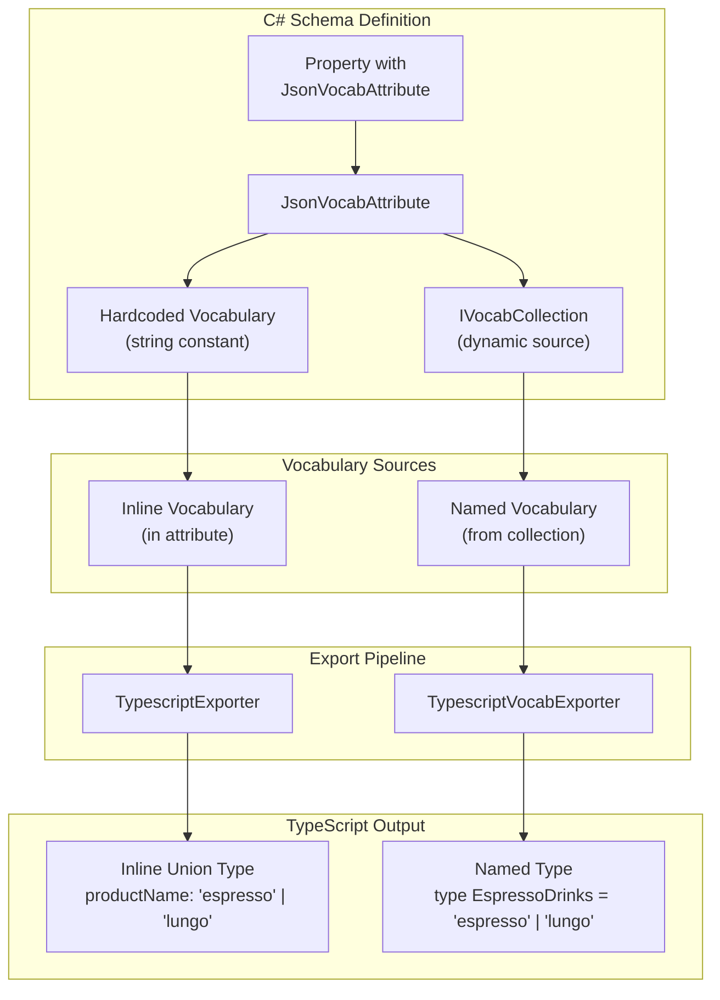
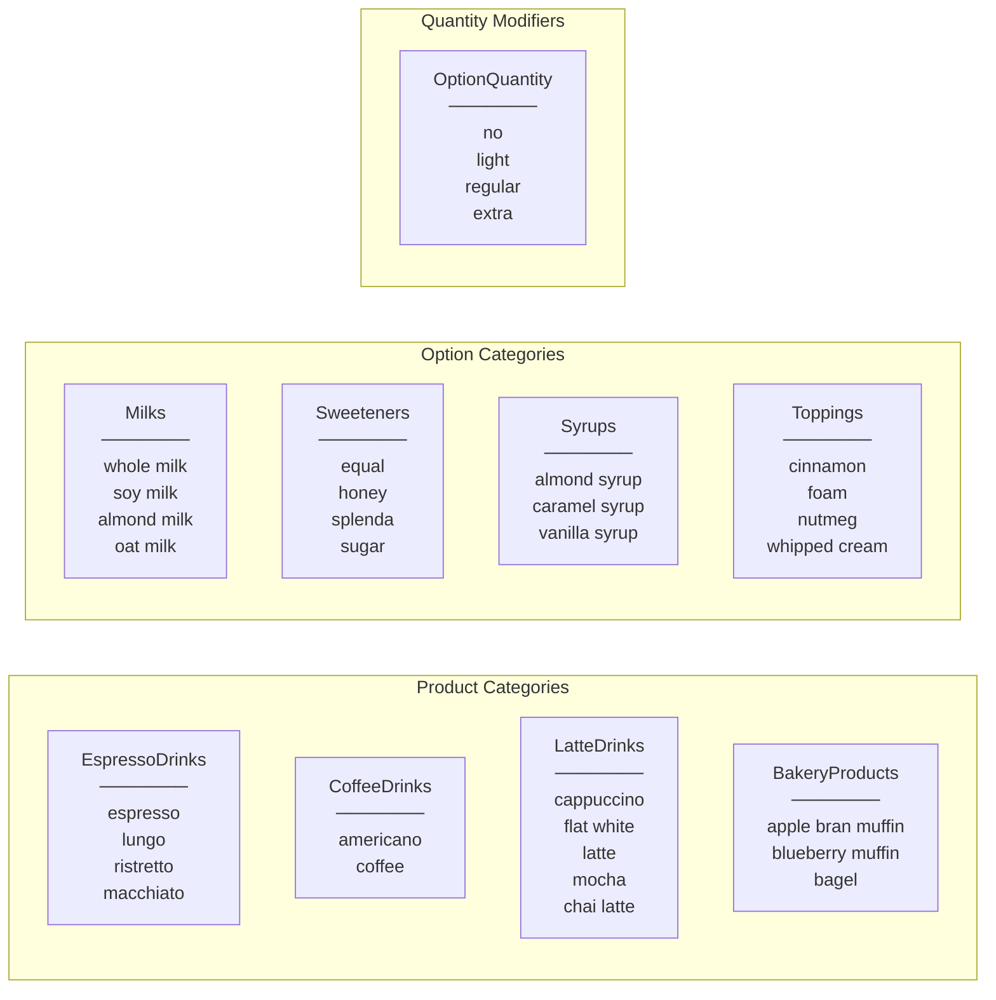
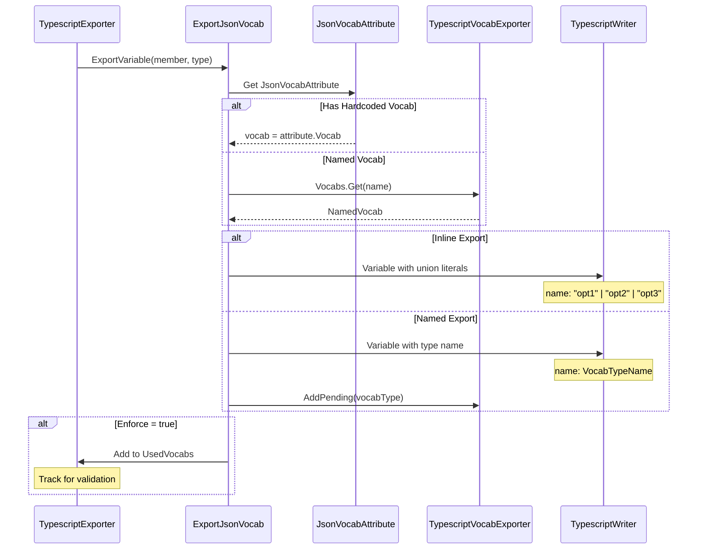
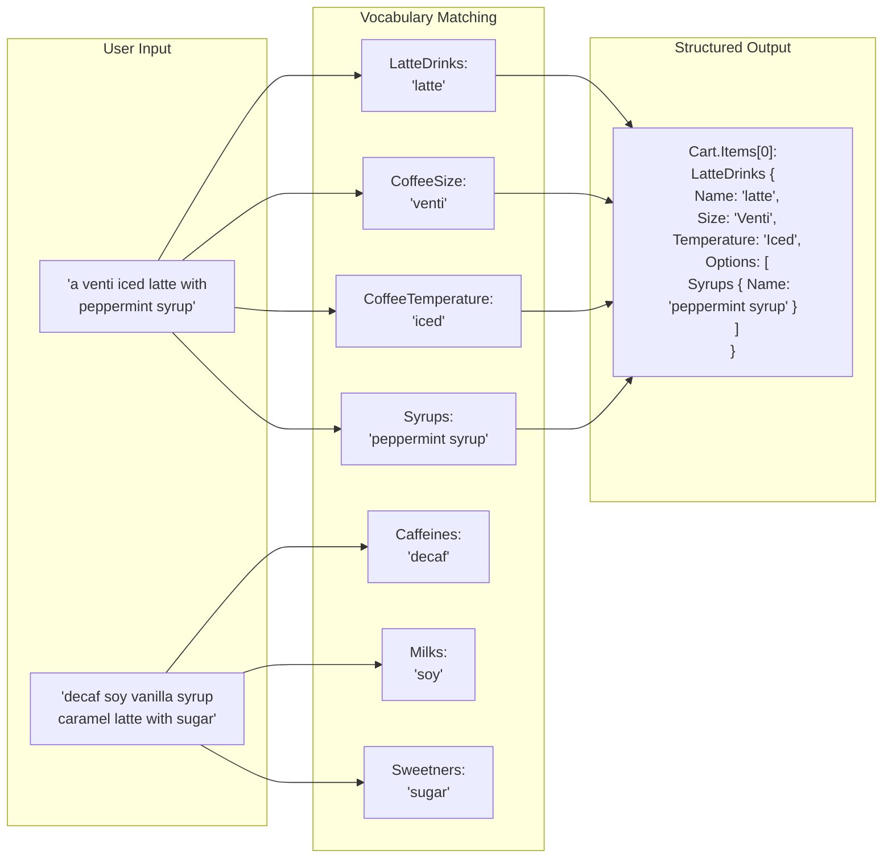

<!-- source: DeepWiki mcp.deepwiki.com · repo microsoft/typechat.net · page 4.2 Vocabularies · fetched 2026-10-26 -->

# Vocabularies

<details>
<summary>Relevant source files</summary>

The following files were used as context for generating this wiki page:

- [examples/CoffeeShop/CoffeeShopSchema.cs](examples/CoffeeShop/CoffeeShopSchema.cs)
- [examples/CoffeeShop/Program.cs](examples/CoffeeShop/Program.cs)
- [examples/CoffeeShop/input.txt](examples/CoffeeShop/input.txt)
- [examples/SchemaHierarchy/Program.cs](examples/SchemaHierarchy/Program.cs)
- [src/typechat.schema/TypescriptExporter.cs](src/typechat.schema/TypescriptExporter.cs)
- [tests/TypeChat.UnitTests/TestSchema.cs](tests/TypeChat.UnitTests/TestSchema.cs)

</details>


This page describes vocabularies in TypeChat.NET, a mechanism for constraining string property values to a specific set of allowed values. Vocabularies improve translation accuracy by guiding language models to select from predefined options rather than generating arbitrary strings.

For information about defining schemas more broadly, see [Schema Definition](#4). For type mapping details, see [Type Mapping](#4.1). For handling polymorphic types with vocabularies, see [Polymorphic Types](#4.3).

## Overview

Vocabularies allow schema authors to constrain string properties to a limited set of acceptable values, similar to enums but with more flexibility. When a property has a vocabulary, the TypeScript schema exports these constraints, helping the language model understand which values are valid. This significantly improves translation accuracy for domain-specific terminology.

**Sources:** [examples/CoffeeShop/CoffeeShopSchema.cs:258-289](), [src/typechat.schema/TypescriptExporter.cs:1-27]()

## Vocabulary Definition Architecture

The following diagram shows how vocabularies are defined and flow from C# attributes to TypeScript schemas:



**Sources:** [examples/CoffeeShop/CoffeeShopSchema.cs:50-52](), [src/typechat.schema/TypescriptExporter.cs:544-601]()

## The JsonVocabAttribute

The `JsonVocabAttribute` is applied to string properties to associate them with vocabularies. The attribute supports multiple configuration options:

| Property | Type | Purpose |
|----------|------|---------|
| `Name` | `string` | Name of the vocabulary (for named vocabularies) |
| `Vocab` | `string` or `IVocab` | Inline vocabulary definition (pipe-delimited strings) |
| `Inline` | `bool` | Export as inline union type vs. named type |
| `Enforce` | `bool` | Validate at runtime that values match vocabulary |
| `PropertyName` | `string` | Override the property name in validation messages |

**Sources:** [examples/CoffeeShop/CoffeeShopSchema.cs:50-52, 67-69, 84-86]()

## Hardcoded Vocabularies

Vocabularies can be defined directly in the attribute using pipe-delimited strings. This is the simplest approach for static vocabularies:

```csharp
public partial class EspressoDrinks : LineItem
{
    [JsonVocab(CoffeeShopVocabs.EspressoDrinks, PropertyName = "productName")]
    [JsonPropertyName("productName")]
    public string Name { get; set; }
}
```

The vocabulary constant is defined separately:

```csharp
public static class CoffeeShopVocabs
{
    public const string EspressoDrinks = "espresso | lungo | ristretto | macchiato";
    public const string CoffeeDrinks = "americano | coffee";
    public const string LatteDrinks = "cappuccino | flat white | latte | latte macchiato| mocha | chai latte";
}
```

**Sources:** [examples/CoffeeShop/CoffeeShopSchema.cs:48-52, 258-264]()

## CoffeeShop Vocabulary Mapping

The CoffeeShop example demonstrates a comprehensive vocabulary system mapping drink types, options, and preparation methods:



**Sources:** [examples/CoffeeShop/CoffeeShopSchema.cs:258-289]()

## Inline vs. Named Vocabularies

Vocabularies can be exported in two forms:

### Inline Vocabularies

When `Inline = true`, the vocabulary is exported directly in the property definition:

```typescript
interface Milks {
    optionName: "whole milk" | "two percent milk" | "nonfat milk" | "coconut milk" | "soy milk" | "almond milk" | "oat milk";
}
```

### Named Vocabularies

When `Inline = false` (default), a named type is created and reused:

```typescript
type EspressoDrinks = "espresso" | "lungo" | "ristretto" | "macchiato";

interface EspressoDrinks {
    productName: EspressoDrinks;
}
```

Named vocabularies are preferred as they create more readable schemas and avoid duplication when the same vocabulary is used multiple times.

**Sources:** [src/typechat.schema/TypescriptExporter.cs:570-630]()

## Vocabulary Export Process

The following diagram shows how vocabularies are processed during schema generation:



**Sources:** [src/typechat.schema/TypescriptExporter.cs:544-630]()

## Dynamic Vocabularies with IVocabCollection

For scenarios where vocabularies change dynamically (e.g., loading from a database), use `IVocabCollection`:

```csharp
// Create translator with dynamic vocabularies
var translator = new JsonTranslator<Cart>(
    new LanguageModel(config),
    knownVocabs: myDatabaseVocabs
);
```

The schema generator retrieves vocabularies from the collection when referenced by name:

```csharp
[JsonVocab("ProductNames")]  // Looks up "ProductNames" in collection
public string Name { get; set; }
```

The `IVocabCollection` interface allows vocabularies to be:
- Loaded from databases
- Customized per user
- Updated without code changes
- Shared across multiple schemas

**Sources:** [examples/CoffeeShop/CoffeeShopSchema.cs:251-257](), [src/typechat.schema/TypescriptExporter.cs:36-47]()

## Vocabulary Enforcement

The `Enforce` property determines whether vocabulary constraints are validated at runtime:

```csharp
[JsonVocab(CoffeeShopVocabs.EspressoDrinks, Enforce = true)]
public string Name { get; set; }
```

When `Enforce = true`:
- The vocabulary is added to `TypescriptSchema.UsedVocabs`
- Runtime validation can check values against the vocabulary
- Provides stronger guarantees about data validity

The `UsedVocabs` collection is accessible via `translator.Validator.Schema.UsedVocabs` and can be used for post-translation validation.

**Sources:** [src/typechat.schema/TypescriptExporter.cs:594-598]()

## Complete CoffeeShop Vocabulary Example

The following table shows all vocabularies used in the CoffeeShop example:

| Vocabulary Name | Applied To | Values |
|----------------|------------|---------|
| `EspressoDrinks` | `EspressoDrinks.Name` | espresso, lungo, ristretto, macchiato |
| `CoffeeDrinks` | `CoffeeDrinks.Name` | americano, coffee |
| `LatteDrinks` | `LatteDrinks.Name` | cappuccino, flat white, latte, latte macchiato, mocha, chai latte |
| `BakeryProducts` | `BakeryProducts.Name` | apple bran muffin, blueberry muffin, lemon poppyseed muffin, bagel |
| `Milks` | `Milks.Name` | whole milk, two percent milk, nonfat milk, coconut milk, soy milk, almond milk, oat milk |
| `Creamers` | `Creamers.Name` | whole milk creamer, two percent milk creamer, nonfat milk creamer, etc. |
| `Caffeines` | `Caffeines.Name` | regular, two thirds caf, half caf, one third caf, decaf |
| `Sweetners` | `Sweetners.Name` | equal, honey, splenda, sugar, sugar in the raw, sweet n low |
| `Syrups` | `Syrups.Name` | almond syrup, caramel syrup, vanilla syrup, etc. |
| `Toppings` | `Toppings.Name` | cinnamon, foam, ice, nutmeg, whipped cream, water |
| `LattePreparations` | `LattePreparations.Name` | for here cup, lid, with room, to go, dry, wet |
| `BakeryToppings` | `BakeryToppings.Name` | butter, strawberry jam, cream cheese |
| `BakeryPreparations` | `BakeryPreparations.Name` | warmed, cut in half |
| `OptionQuantity` | `StringQuantity.Amount` | no, light, regular, extra |

**Sources:** [examples/CoffeeShop/CoffeeShopSchema.cs:260-289]()

## Natural Language Translation with Vocabularies

Vocabularies enable accurate translation of natural language to structured data:



Test inputs demonstrating vocabulary matching:

From [examples/CoffeeShop/input.txt]():
- Line 7: `"i'd like a venti iced latte"` → Matches `LatteDrinks`, `CoffeeSize.Venti`, `CoffeeTemperature.Iced`
- Line 13: `"decaf soy vanilla syrup caramel latte with sugar and foam"` → Matches multiple vocabularies including `Caffeines.decaf`, `Milks.soy`, `Syrups.vanilla`, `Sweetners.sugar`, `Toppings.foam`
- Line 20: `"light whipped no foam mocha with extra hazelnut and cinnamon"` → Uses `OptionQuantity` vocab for modifiers

**Sources:** [examples/CoffeeShop/input.txt:7-13, 20](), [examples/CoffeeShop/Program.cs:28-38]()

## Best Practices

1. **Use Pipe-Delimited Syntax**: Separate values with ` | ` (space-pipe-space) for readability in TypeScript output
2. **Prefer Named Vocabularies**: Use `Inline = false` (default) to create reusable type definitions
3. **Group Related Values**: Organize vocabularies by category (e.g., `Milks`, `Syrups`, `Toppings`)
4. **Include Variations**: Add common variations of terms (e.g., "latte macchiato" in addition to "macchiato")
5. **Document Constants**: Store vocabularies in a dedicated class like `CoffeeShopVocabs` for maintainability
6. **Use Dynamic Vocabularies**: For production systems, load vocabularies from configuration or databases using `IVocabCollection`
7. **Enable Enforcement**: Set `Enforce = true` for critical properties that must match vocabulary values
8. **Match Domain Language**: Use terminology that matches how users naturally express requests

**Sources:** [examples/CoffeeShop/CoffeeShopSchema.cs:251-289]()

---

