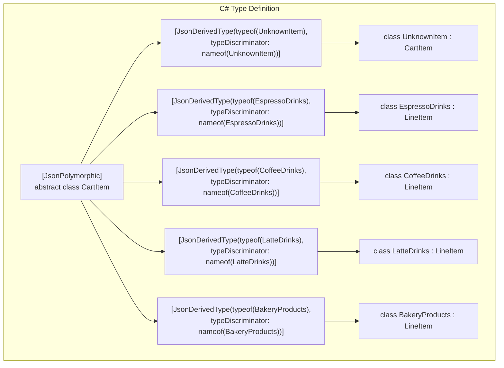
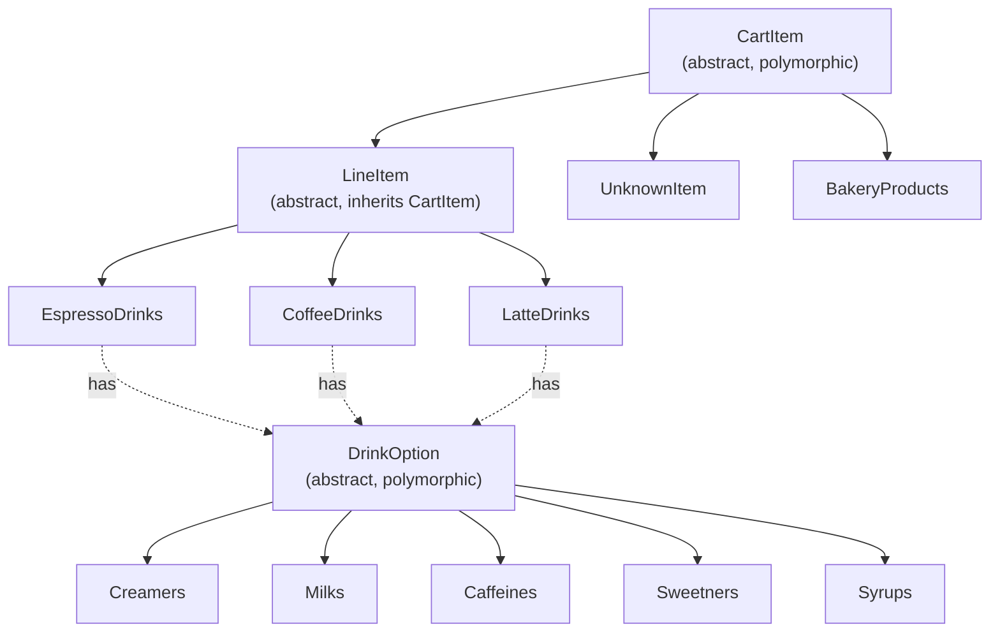
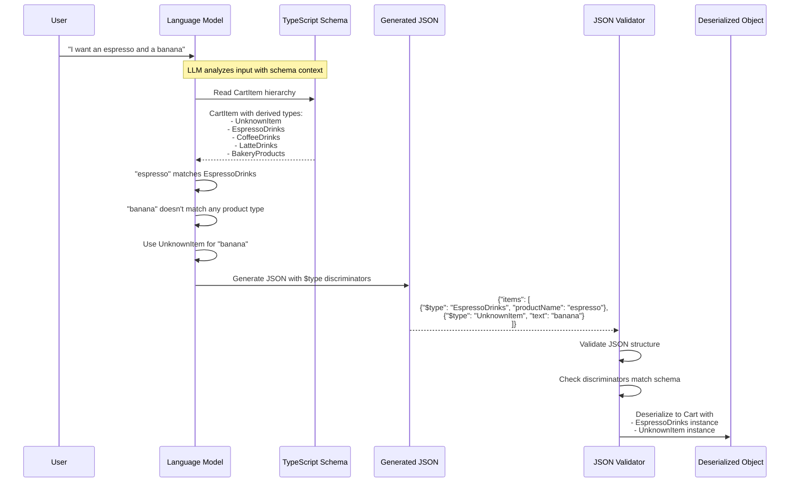
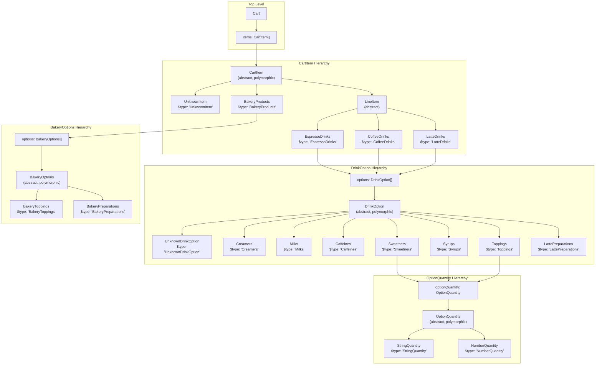

<!-- source: DeepWiki mcp.deepwiki.com · repo microsoft/typechat.net · page 4.3 Polymorphic Types · fetched 2026-10-26 -->

# Polymorphic Types

<details>
<summary>Relevant source files</summary>

The following files were used as context for generating this wiki page:

- [examples/CoffeeShop/CoffeeShopSchema.cs](examples/CoffeeShop/CoffeeShopSchema.cs)
- [examples/CoffeeShop/Program.cs](examples/CoffeeShop/Program.cs)
- [examples/CoffeeShop/input.txt](examples/CoffeeShop/input.txt)
- [examples/SchemaHierarchy/Program.cs](examples/SchemaHierarchy/Program.cs)
- [src/typechat.schema/TypescriptExporter.cs](src/typechat.schema/TypescriptExporter.cs)
- [tests/TypeChat.UnitTests/TestSchema.cs](tests/TypeChat.UnitTests/TestSchema.cs)

</details>


## Purpose and Scope

This page explains how TypeChat.NET handles polymorphic types using C# inheritance hierarchies and System.Text.Json's polymorphic serialization attributes. It covers defining type hierarchies, discriminator configuration, TypeScript schema generation, and how language models use discriminators to select appropriate derived types during translation.

For information about the overall schema definition process, see [Schema Definition](#4). For details on how types are mapped from C# to TypeScript, see [Type Mapping](#4.1).

---

## Overview

TypeChat.NET uses System.Text.Json's polymorphic serialization features to represent inheritance hierarchies in JSON schemas. When a schema contains abstract base classes or interfaces with multiple concrete implementations, the language model must choose which derived type to instantiate based on the natural language input.

The framework automatically generates TypeScript schemas with discriminator properties (typically `$type`) that identify the concrete type. This allows language models to:
- Understand the available subtypes in a hierarchy
- Select the appropriate concrete type based on user intent
- Generate valid JSON with proper type discrimination

**Key Components:**

| Component | Location | Purpose |
|-----------|----------|---------|
| `[JsonPolymorphic]` | System.Text.Json.Serialization | Marks a base class as polymorphic |
| `[JsonDerivedType]` | System.Text.Json.Serialization | Declares derived types and discriminators |
| `JsonPolymorphismSettings` | [src/typechat.schema/TypescriptExporter.cs:72]() | Controls discriminator generation |
| `TypescriptExporter.ExportDiscriminator` | [src/typechat.schema/TypescriptExporter.cs:632-652]() | Generates TypeScript discriminators |

Sources: [examples/CoffeeShop/CoffeeShopSchema.cs](), [src/typechat.schema/TypescriptExporter.cs:1-767]()

---

## Defining Polymorphic Hierarchies

### Basic Polymorphic Type Definition

To define a polymorphic hierarchy, mark the base class with `[JsonPolymorphic]` and declare each derived type with `[JsonDerivedType]`:



**Example from CoffeeShop:**

```csharp
[JsonPolymorphic]
[JsonDerivedType(typeof(UnknownItem), typeDiscriminator: nameof(UnknownItem))]
[JsonDerivedType(typeof(EspressoDrinks), typeDiscriminator: nameof(EspressoDrinks))]
[JsonDerivedType(typeof(CoffeeDrinks), typeDiscriminator: nameof(CoffeeDrinks))]
[JsonDerivedType(typeof(LatteDrinks), typeDiscriminator: nameof(LatteDrinks))]
[JsonDerivedType(typeof(BakeryProducts), typeDiscriminator: nameof(BakeryProducts))]
public abstract partial class CartItem
{
}

public partial class UnknownItem : CartItem
{
    [JsonPropertyName("text")]
    public string Text { get; set; }
}

public partial class EspressoDrinks : LineItem
{
    [JsonPropertyName("productName")]
    public string Name { get; set; }
    
    [JsonPropertyName("temperature")]
    public CoffeeTemperature? Temperature { get; set; }
}
```

Sources: [examples/CoffeeShop/CoffeeShopSchema.cs:24-63]()

### Nested Polymorphic Hierarchies

Polymorphic types can be nested within other polymorphic hierarchies:



**DrinkOption Hierarchy Example:**

The `DrinkOption` type demonstrates a second level of polymorphism:

```csharp
[JsonPolymorphic]
[JsonDerivedType(typeof(UnknownDrinkOption), typeDiscriminator: nameof(UnknownDrinkOption))]
[JsonDerivedType(typeof(Creamers), typeDiscriminator: nameof(Creamers))]
[JsonDerivedType(typeof(Milks), typeDiscriminator: nameof(Milks))]
[JsonDerivedType(typeof(Caffeines), typeDiscriminator: nameof(Caffeines))]
[JsonDerivedType(typeof(Sweetners), typeDiscriminator: nameof(Sweetners))]
[JsonDerivedType(typeof(Syrups), typeDiscriminator: nameof(Syrups))]
[JsonDerivedType(typeof(Toppings), typeDiscriminator: nameof(Toppings))]
[JsonDerivedType(typeof(LattePreparations), typeDiscriminator: nameof(LattePreparations))]
public abstract partial class DrinkOption { }
```

Sources: [examples/CoffeeShop/CoffeeShopSchema.cs:136-145](), [examples/CoffeeShop/CoffeeShopSchema.cs:42-97]()

---

## Discriminators and Type Identification

### Discriminator Property

The discriminator is a special property that identifies the concrete type in JSON. By default, TypeChat.NET uses `$type` as the discriminator property name.

**Generated TypeScript Schema:**

```typescript
interface CartItem {
}

interface UnknownItem extends CartItem {
  $type: 'UnknownItem'; // Always emit first
  text: string;
}

interface EspressoDrinks extends LineItem {
  $type: 'EspressoDrinks'; // Always emit first
  productName: string;
  temperature?: CoffeeTemperature;
  size?: EspressoSize;
  options?: DrinkOption[];
}
```

**Generated JSON Example:**

```json
{
  "items": [
    {
      "$type": "EspressoDrinks",
      "productName": "espresso",
      "temperature": "Hot",
      "size": "Doppio",
      "quantity": 1
    },
    {
      "$type": "UnknownItem",
      "text": "banana"
    }
  ]
}
```

Sources: [src/typechat.schema/TypescriptExporter.cs:632-652]()

### Discriminator Generation Process

```mermaid
sequenceDiagram
    participant TE as TypescriptExporter
    participant PS as JsonPolymorphismSettings
    participant TW as TypescriptWriter
    participant Schema as TypeScript Schema
    
    Note over TE,Schema: Schema Generation Phase
    
    TE->>TE: ExportClass(DerivedType)
    TE->>TE: Check if baseClass is not null
    
    alt Has Base Class
        TE->>PS: Check IncludeDiscriminator
        
        alt IncludeDiscriminator == true
            TE->>TE: ExportDiscriminator(type)
            TE->>PS: Get DiscriminatorGenerator
            
            alt Custom Generator Exists
                PS-->>TE: discriminator = DiscriminatorGenerator(type)
            else Default Generator
                PS-->>TE: discriminator = type.Name
            end
            
            TE->>TW: Variable("$type", discriminator)
            
            alt IncludeComment == true
                TW->>Schema: $type: 'TypeName'; // Always emit first
            else No Comment
                TW->>Schema: $type: 'TypeName';
            end
        end
    end
    
    TE->>TE: ExportMembers(type)
```

**JsonPolymorphismSettings Configuration:**

| Property | Type | Default | Purpose |
|----------|------|---------|---------|
| `IncludeDiscriminator` | `bool` | `true` | Whether to include discriminator in schema |
| `IncludeComment` | `bool` | `true` | Whether to add "Always emit first" comment |
| `DiscriminatorGenerator` | `Func<Type, string>` | `null` | Custom discriminator value generator |

Sources: [src/typechat.schema/TypescriptExporter.cs:72](), [src/typechat.schema/TypescriptExporter.cs:112](), [src/typechat.schema/TypescriptExporter.cs:632-652]()

---

## TypeScript Schema Generation

### Inheritance Export Process

The `TypescriptExporter` automatically exports type hierarchies when `IncludeSubclasses` is enabled:

```mermaid
graph TB
    subgraph "TypescriptExporter Export Flow"
        Start["Export(CartItem)"]
        CheckPolymorphic["Is JsonPolymorphic?"]
        ExportBase["ExportClass(CartItem)"]
        CheckSubclasses["IncludeSubclasses?"]
        FindDerived["Find all types with<br/>[JsonDerivedType]"]
        ExportDerived["ExportClass for each<br/>derived type"]
        ExportMembers["ExportMembers for<br/>each type"]
        AddDiscriminator["ExportDiscriminator<br/>if has base class"]
        Done["Complete Schema"]
        
        Start --> CheckPolymorphic
        CheckPolymorphic -->|Yes| ExportBase
        ExportBase --> AddDiscriminator
        AddDiscriminator --> ExportMembers
        ExportMembers --> CheckSubclasses
        CheckSubclasses -->|true| FindDerived
        FindDerived --> ExportDerived
        ExportDerived --> Done
        CheckSubclasses -->|false| Done
    end
```



**Key Methods:**

| Method | Location | Purpose |
|--------|----------|---------|
| `ExportClass` | [src/typechat.schema/TypescriptExporter.cs:195-241]() | Exports class as TypeScript interface |
| `ExportDiscriminator` | [src/typechat.schema/TypescriptExporter.cs:632-652]() | Adds `$type` discriminator property |
| `IncludeSubclasses` | [src/typechat.schema/TypescriptExporter.cs:118]() | Controls automatic subclass export |

Sources: [src/typechat.schema/TypescriptExporter.cs:195-241](), [src/typechat.schema/TypescriptExporter.cs:234-238]()

### Complete Schema Example

For the `CartItem` hierarchy, the generated TypeScript schema includes:

```typescript
// Base interface (abstract class becomes interface)
interface CartItem {
}

// Derived types with discriminators
interface UnknownItem extends CartItem {
  $type: 'UnknownItem'; // Always emit first
  text: string;
}

interface LineItem extends CartItem {
  quantity: number;
}

interface EspressoDrinks extends LineItem {
  $type: 'EspressoDrinks'; // Always emit first
  productName: string;
  temperature?: CoffeeTemperature;
  size?: EspressoSize;
  options?: DrinkOption[];
}

interface CoffeeDrinks extends LineItem {
  $type: 'CoffeeDrinks'; // Always emit first
  productName: string;
  temperature?: CoffeeTemperature;
  size?: CoffeeSize;
  options?: DrinkOption[];
}

// ... other derived types
```

Sources: [src/typechat.schema/TypescriptExporter.cs:195-241]()

---

## Using Polymorphic Types in Translation

### Language Model Type Selection

When translating natural language to JSON, the language model uses the TypeScript schema to understand available types and selects the appropriate derived type based on context:



Sources: [examples/CoffeeShop/Program.cs:26-38]()

### Handling Unknown Items Pattern

A common pattern in polymorphic hierarchies is including an "Unknown" type to handle inputs that don't match any specific derived type:

```csharp
[Comment("Use this type for Cart Items that match nothing else")]
public partial class UnknownItem : CartItem
{
    [Comment("The text that wasn't understood")]
    [JsonPropertyName("text")]
    public string Text { get; set; }
}

[Comment("Use this type for DrinkOptions that match nothing else OR if you are NOT SURE.")]
public class UnknownDrinkOption : DrinkOption
{
    [Comment("The text that wasn't understood")]
    [JsonPropertyName("text")]
    public string Text { get; set; }
}
```

This pattern:
- Provides a fallback for unrecognized inputs
- Enables partial understanding (some items recognized, some not)
- Allows applications to report what wasn't understood
- Prevents translation failure due to unknown elements

For more details on this pattern, see [Unknown Items Pattern](#4.4).

Sources: [examples/CoffeeShop/CoffeeShopSchema.cs:34-40](), [examples/CoffeeShop/CoffeeShopSchema.cs:147-153]()

---

## Customizing Polymorphism Behavior

### JsonPolymorphismSettings Configuration

The `TypescriptExporter` provides `JsonPolymorphismSettings` to customize discriminator behavior:

```csharp
var exporter = new TypescriptExporter(writer);
exporter.PolymorphismSettings = new JsonPolymorphismSettings
{
    IncludeDiscriminator = true,  // Include $type property
    IncludeComment = true,        // Add "Always emit first" comment
    DiscriminatorGenerator = (type) => $"'{type.Name}'"  // Custom discriminator format
};
```

**Custom Discriminator Generator:**

```csharp
// Use lowercase discriminators
exporter.PolymorphismSettings.DiscriminatorGenerator = (type) => $"'{type.Name.ToLower()}'";

// Use full type names
exporter.PolymorphismSettings.DiscriminatorGenerator = (type) => $"'{type.FullName}'";

// Use custom mapping
exporter.PolymorphismSettings.DiscriminatorGenerator = (type) => 
    type.Name switch
    {
        "EspressoDrinks" => "'espresso'",
        "CoffeeDrinks" => "'coffee'",
        _ => $"'{type.Name}'"
    };
```

Sources: [src/typechat.schema/TypescriptExporter.cs:112](), [src/typechat.schema/TypescriptExporter.cs:632-652]()

### Controlling Subclass Export

Control whether derived types are automatically exported:

```csharp
var exporter = new TypescriptExporter(writer);
exporter.IncludeSubclasses = true;   // Default: automatically export all derived types
exporter.IncludeSubclasses = false;  // Only export explicitly requested types
```

When `IncludeSubclasses` is `true`, the exporter automatically:
1. Finds all types with `[JsonDerivedType]` attributes
2. Exports each derived type as a TypeScript interface
3. Includes discriminators for each concrete type
4. Recursively exports nested polymorphic hierarchies

Sources: [src/typechat.schema/TypescriptExporter.cs:118](), [src/typechat.schema/TypescriptExporter.cs:234-238]()

---

## Real-World Example: CoffeeShop Schema

### Complete Polymorphic Type Structure

The CoffeeShop example demonstrates a complex multi-level polymorphic schema:



### Translation Examples

**Input:** "I want an espresso and a banana"

**Generated JSON:**
```json
{
  "items": [
    {
      "$type": "EspressoDrinks",
      "productName": "espresso",
      "quantity": 1,
      "size": "Doppio"
    },
    {
      "$type": "UnknownItem",
      "text": "banana"
    }
  ]
}
```

**Input:** "A latte with soy milk and two pumps of vanilla syrup"

**Generated JSON:**
```json
{
  "items": [
    {
      "$type": "LatteDrinks",
      "productName": "latte",
      "quantity": 1,
      "size": "Grande",
      "options": [
        {
          "$type": "Milks",
          "optionName": "soy milk"
        },
        {
          "$type": "Syrups",
          "optionName": "vanilla syrup",
          "optionQuantity": {
            "$type": "NumberQuantity",
            "amount": 2
          }
        }
      ]
    }
  ]
}
```

Sources: [examples/CoffeeShop/CoffeeShopSchema.cs:18-249](), [examples/CoffeeShop/input.txt:1-72]()

---

## Best Practices

### Schema Design Guidelines

| Practice | Rationale | Example |
|----------|-----------|---------|
| Include "Unknown" types | Enables partial understanding | `UnknownItem`, `UnknownDrinkOption` |
| Use meaningful discriminator names | Matches type name for clarity | `nameof(EspressoDrinks)` |
| Keep hierarchies shallow | Simpler for language models | Max 2-3 levels deep |
| Provide clear property names | Helps language model selection | `productName` vs `name` |
| Add comments to guide LLM | Explicit instructions for edge cases | "Use this type for items that match nothing else" |

### Common Patterns

**1. Product Hierarchy Pattern**
```csharp
[JsonPolymorphic]
[JsonDerivedType(typeof(UnknownProduct), typeDiscriminator: nameof(UnknownProduct))]
[JsonDerivedType(typeof(ConcreteProduct1), typeDiscriminator: nameof(ConcreteProduct1))]
[JsonDerivedType(typeof(ConcreteProduct2), typeDiscriminator: nameof(ConcreteProduct2))]
public abstract class Product { }
```

**2. Options/Modifiers Pattern**
```csharp
[JsonPolymorphic]
[JsonDerivedType(typeof(UnknownOption), typeDiscriminator: nameof(UnknownOption))]
[JsonDerivedType(typeof(Option1), typeDiscriminator: nameof(Option1))]
[JsonDerivedType(typeof(Option2), typeDiscriminator: nameof(Option2))]
public abstract class Option { }
```

**3. Action/Command Pattern**
```csharp
[JsonPolymorphic]
[JsonDerivedType(typeof(CreateAction), typeDiscriminator: nameof(CreateAction))]
[JsonDerivedType(typeof(UpdateAction), typeDiscriminator: nameof(UpdateAction))]
[JsonDerivedType(typeof(DeleteAction), typeDiscriminator: nameof(DeleteAction))]
public abstract class Action { }
```

### Troubleshooting

**Issue:** Language model selects wrong derived type

**Solution:** Add more specific properties to derived types or add clarifying comments using `[Comment]` attribute

**Issue:** Discriminators not appearing in schema

**Solution:** Verify `JsonPolymorphismSettings.IncludeDiscriminator` is `true` and base class relationship is correct

**Issue:** Deserialization fails with unknown discriminator

**Solution:** Ensure all `[JsonDerivedType]` attributes are present and discriminator values match exactly

Sources: [examples/CoffeeShop/CoffeeShopSchema.cs:1-289](), [src/typechat.schema/TypescriptExporter.cs:195-241]()

---

## Related Examples

The following examples demonstrate polymorphic types in practice:

- **CoffeeShop** ([examples/CoffeeShop/Program.cs]()): Complex multi-level polymorphic schema with product types and options
- **SchemaHierarchy** ([examples/SchemaHierarchy/Program.cs]()): Dynamic routing across multiple polymorphic schemas
- **Restaurant** (referenced in [examples/SchemaHierarchy/Program.cs:45]()): Pizza orders with polymorphic toppings and options

Sources: [examples/CoffeeShop/Program.cs:1-77](), [examples/SchemaHierarchy/Program.cs:1-66]()

---

