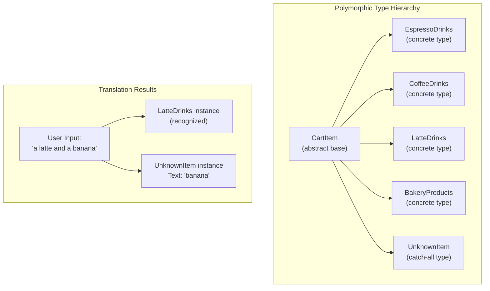
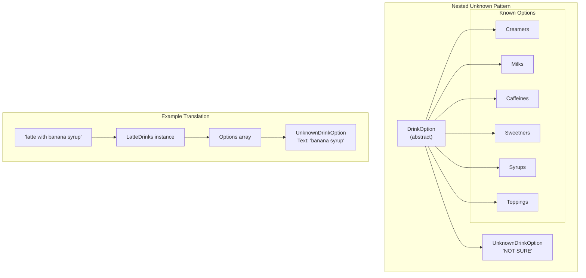
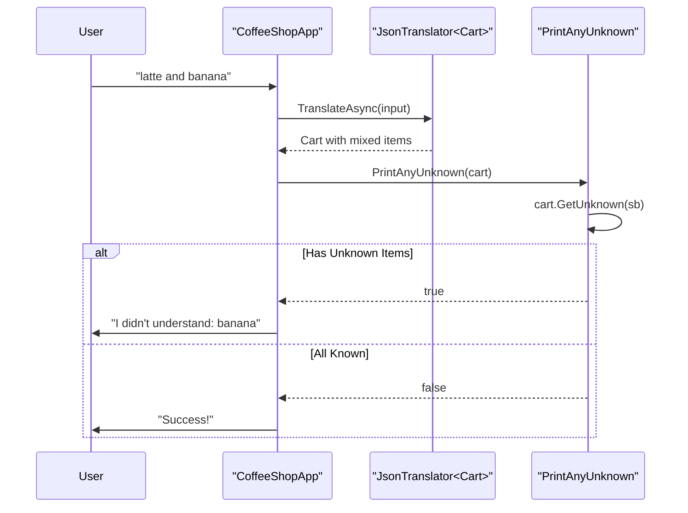
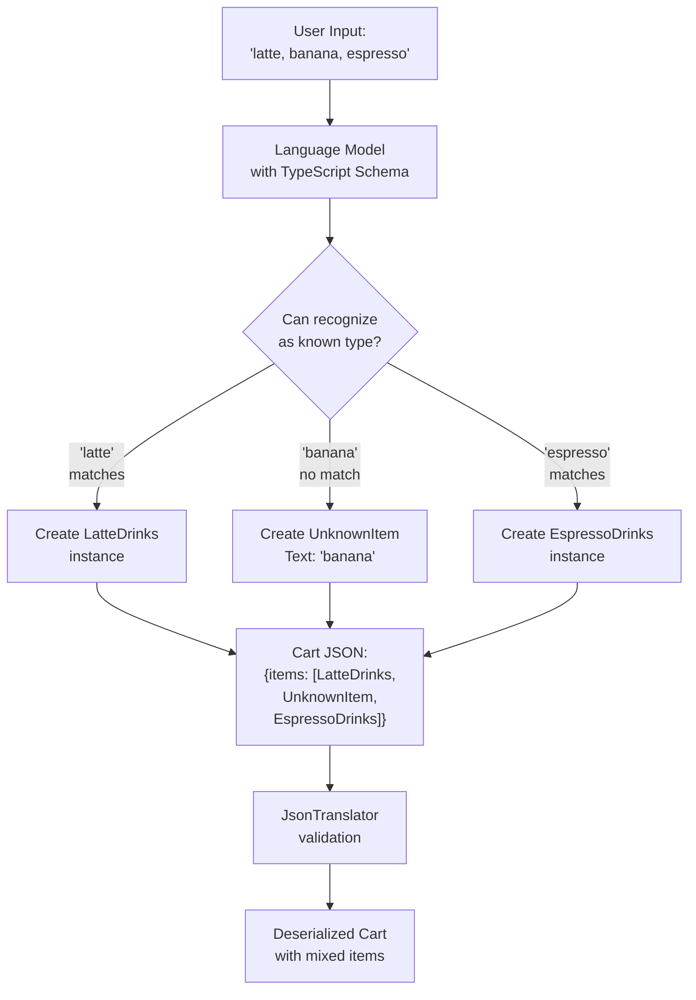
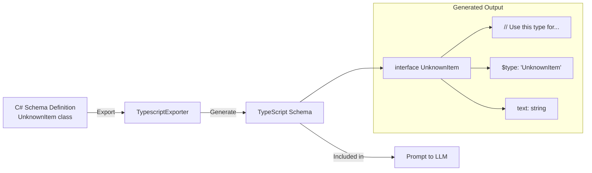

<!-- source: DeepWiki mcp.deepwiki.com · repo microsoft/typechat.net · page 4.4 Unknown Items Pattern · fetched 2026-10-26 -->

# Unknown Items Pattern

<details>
<summary>Relevant source files</summary>

The following files were used as context for generating this wiki page:

- [README.md](README.md)
- [examples/CoffeeShop/CoffeeShopSchema.cs](examples/CoffeeShop/CoffeeShopSchema.cs)
- [examples/CoffeeShop/Program.cs](examples/CoffeeShop/Program.cs)
- [examples/CoffeeShop/input.txt](examples/CoffeeShop/input.txt)
- [examples/Sentiment/Program.cs](examples/Sentiment/Program.cs)
- [examples/appSettings.json](examples/appSettings.json)
- [src/typechat.schema/TypescriptExporter.cs](src/typechat.schema/TypescriptExporter.cs)

</details>


## Purpose and Scope

This page describes the Unknown Items Pattern, a schema design pattern in TypeChat.NET that enables graceful degradation when language models encounter input they cannot fully translate into known types. This pattern allows applications to process partially understood requests rather than failing completely.

For information about polymorphic type hierarchies that enable this pattern, see [Polymorphic Types](#4.3). For general schema design guidance, see [Schema Definition](#4).

**Sources:** [README.md:1-243](), [examples/CoffeeShop/CoffeeShopSchema.cs:1-290]()

---

## Pattern Overview

The Unknown Items Pattern addresses a fundamental challenge in natural language interfaces: users may request items or specify options that are not in the application's domain model. Rather than rejecting the entire request, this pattern allows the language model to:

1. Translate recognized elements into their appropriate strongly-typed representations
2. Capture unrecognized elements in special "unknown" types
3. Allow the application to process what was understood and handle the unknowns appropriately

This enables a "best effort" translation strategy where partial understanding is better than complete failure.

**Sources:** [examples/CoffeeShop/CoffeeShopSchema.cs:24-40](), [examples/CoffeeShop/input.txt:63-69]()

---

## Pattern Implementation

### Type Hierarchy with Unknown Types

The Unknown Items Pattern is implemented through polymorphic type hierarchies where one or more derived types serve as "catch-all" containers for unrecognized input.



**Sources:** [examples/CoffeeShop/CoffeeShopSchema.cs:24-40]()

---

## Schema Definition

### Basic Unknown Type Structure

An unknown type typically contains a single `Text` property that captures the unrecognized input verbatim:

```csharp
// From CoffeeShopSchema.cs
[Comment("Use this type for Cart Items that match nothing else")]
public partial class UnknownItem : CartItem
{
    [Comment("The text that wasn't understood")]
    [JsonPropertyName("text")]
    public string Text { get; set; }
}
```

| Element | Purpose |
|---------|---------|
| Comment attribute | Instructs the LLM when to use this type |
| Text property | Preserves the unrecognized input for application handling |
| Inheritance | Integrates into polymorphic hierarchy |

**Sources:** [examples/CoffeeShop/CoffeeShopSchema.cs:34-40]()

### Polymorphic Integration

Unknown types must be registered in the polymorphic type hierarchy using `JsonDerivedType`:

```csharp
[JsonPolymorphic]
[JsonDerivedType(typeof(UnknownItem), typeDiscriminator: nameof(UnknownItem))]
[JsonDerivedType(typeof(EspressoDrinks), typeDiscriminator: nameof(EspressoDrinks))]
[JsonDerivedType(typeof(CoffeeDrinks), typeDiscriminator: nameof(CoffeeDrinks))]
[JsonDerivedType(typeof(LatteDrinks), typeDiscriminator: nameof(LatteDrinks))]
[JsonDerivedType(typeof(BakeryProducts), typeDiscriminator: nameof(BakeryProducts))]
public abstract partial class CartItem
{
}
```

**Sources:** [examples/CoffeeShop/CoffeeShopSchema.cs:24-32]()

---

## Multiple Unknown Types

Complex schemas may require unknown types at multiple levels of the type hierarchy. The CoffeeShop example demonstrates this with drink options:



The `UnknownDrinkOption` type includes explicit guidance for uncertainty:

```csharp
[Comment("Use this type for DrinkOptions that match nothing else OR if you are NOT SURE.")]
public class UnknownDrinkOption : DrinkOption
{
    [Comment("The text that wasn't understood")]
    [JsonPropertyName("text")]
    public string Text { get; set; }
}
```

**Sources:** [examples/CoffeeShop/CoffeeShopSchema.cs:136-153]()

---

## Generated TypeScript Schema

The TypeScript schema generated from unknown types provides explicit instructions to the language model:

```typescript
// Use this type for Cart Items that match nothing else
interface UnknownItem extends CartItem {
    $type: 'UnknownItem';
    // The text that wasn't understood
    text: string;
}

// Use this type for DrinkOptions that match nothing else OR if you are NOT SURE.
interface UnknownDrinkOption extends DrinkOption {
    $type: 'UnknownDrinkOption';
    // The text that wasn't understood
    text: string;
}
```

The comment attributes become TypeScript comments that guide the LLM's decision-making process during translation.

**Sources:** [src/typechat.schema/TypescriptExporter.cs:465-479](), [examples/CoffeeShop/CoffeeShopSchema.cs:34-40,147-153]()

---

## Handling Unknown Items in Application Code

### Detection Pattern

Applications should check for and report unknown items to users:



**Sources:** [examples/CoffeeShop/Program.cs:26-55]()

### Implementation Example

The CoffeeShop example demonstrates unknown item handling:

```csharp
private bool PrintAnyUnknown(Cart cart)
{
    if (cart.Items is not null)
    {
        StringBuilder sb = new StringBuilder();
        cart.GetUnknown(sb);
        if (sb.Length > 0)
        {
            Console.WriteLine();
            Console.WriteLine("I didn't understand the following:");
            Console.WriteLine(sb.ToString());
            return true;
        }
    }
    return false;
}
```

The `GetUnknown` extension method (referenced at line 45) traverses the object graph to collect all `UnknownItem` instances and their text.

**Sources:** [examples/CoffeeShop/Program.cs:40-55]()

---

## Test Cases for Unknown Items

The CoffeeShop example includes test inputs designed to produce unknown items:

| Input | Expected Behavior |
|-------|-------------------|
| `"roses are red"` | All items unknown (not coffee-related) |
| `"two lawnmowers, a grande latte and a tall tree"` | Latte recognized, lawnmowers and tree unknown |
| `"i want a banana, a bran muffin and 2 tall coffees"` | Coffees and muffin recognized, banana unknown |
| `"2 chocolate cakes, a t-shirt and a coffee"` | Coffee recognized, cakes and t-shirt unknown |

**Sources:** [examples/CoffeeShop/input.txt:63-69]()

---

## Translation Flow with Unknown Items



**Sources:** [examples/CoffeeShop/CoffeeShopSchema.cs:18-40](), [examples/CoffeeShop/Program.cs:26-38]()

---

## Best Practices

### When to Use Unknown Types

| Scenario | Recommendation |
|----------|----------------|
| Open-ended user input | Include unknown types to handle unexpected requests |
| Fixed domain model | Include unknown types to capture items outside the model |
| Evolving vocabulary | Use to identify commonly requested but unsupported items |
| Strict validation | May omit if all input must match known types exactly |

### Instruction Clarity

The comment on unknown types is critical for LLM behavior. Compare these approaches:

**Less Effective:**
```csharp
[Comment("Unknown item")]
public class UnknownItem : CartItem
```

**More Effective:**
```csharp
[Comment("Use this type for Cart Items that match nothing else")]
public class UnknownItem : CartItem
```

**Most Effective (when appropriate):**
```csharp
[Comment("Use this type for DrinkOptions that match nothing else OR if you are NOT SURE.")]
public class UnknownDrinkOption : DrinkOption
```

The phrase "OR if you are NOT SURE" explicitly encourages conservative behavior when the LLM has low confidence.

**Sources:** [examples/CoffeeShop/CoffeeShopSchema.cs:34,147]()

### Application Response Strategies

| Strategy | Use Case | Implementation |
|----------|----------|----------------|
| Inform and proceed | Non-critical unknowns | Display unknowns but process recognized items |
| Request clarification | Critical information missing | Ask user to rephrase or select from options |
| Suggest alternatives | Known similar items exist | "Did you mean X instead of Y?" |
| Learn and expand | Frequent unknowns | Log unknowns for vocabulary expansion |

**Sources:** [examples/CoffeeShop/Program.cs:40-55]()

---

## Integration with Schema Generation

The TypeScript exporter automatically handles unknown types like any other type in the polymorphic hierarchy:



The `Comment` attribute at [examples/CoffeeShop/CoffeeShopSchema.cs:34]() becomes a TypeScript comment through the exporter's `ExportComments` method at [src/typechat.schema/TypescriptExporter.cs:465-479]().

**Sources:** [src/typechat.schema/TypescriptExporter.cs:465-479,196-241](), [examples/CoffeeShop/CoffeeShopSchema.cs:34-40]()

---

## Relationship to NotTranslated Pattern

While not present in the current codebase, the README mentions a "NotTranslated" pattern alongside UnknownItem. These serve different purposes:

| Pattern | Purpose | Typical Use |
|---------|---------|-------------|
| UnknownItem | Capture unrecognized items | Items outside domain model |
| NotTranslated | Flag translation failures | When LLM explicitly cannot translate |

The unknown item pattern is more common and handles the majority of partial understanding scenarios.

**Sources:** [README.md:37]()

---

## Summary

The Unknown Items Pattern enables robust natural language interfaces by:

1. **Defining catch-all types** in polymorphic hierarchies using clear comments
2. **Preserving unrecognized input** in `Text` properties for application handling  
3. **Allowing partial translation** rather than complete failure
4. **Providing user feedback** about what wasn't understood
5. **Supporting iterative improvement** by identifying gaps in the domain model

This pattern is essential for production applications where user input cannot be fully constrained.

**Sources:** [examples/CoffeeShop/CoffeeShopSchema.cs:18-153](), [examples/CoffeeShop/Program.cs:26-55](), [README.md:1-243]()

---

