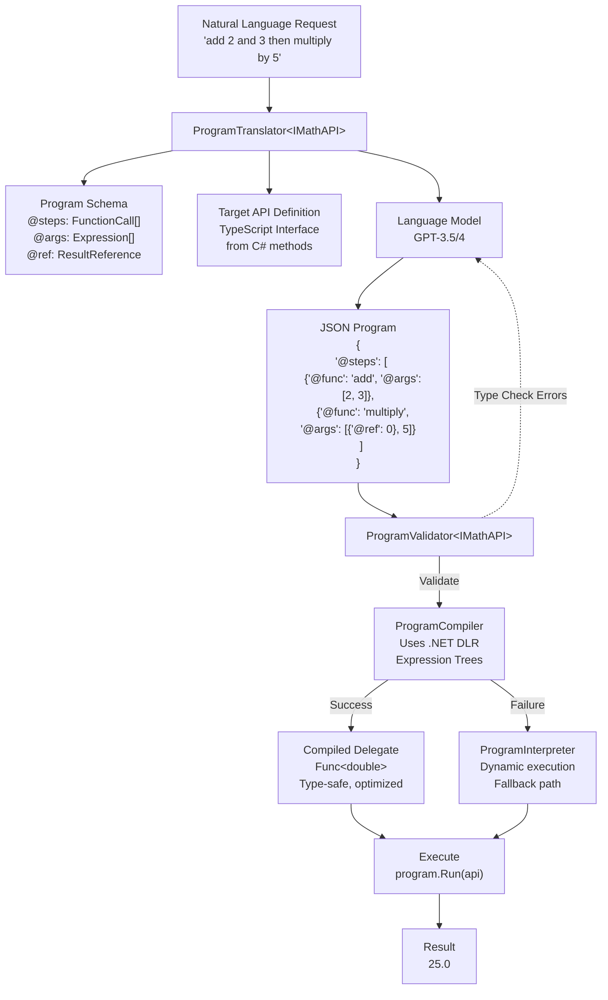
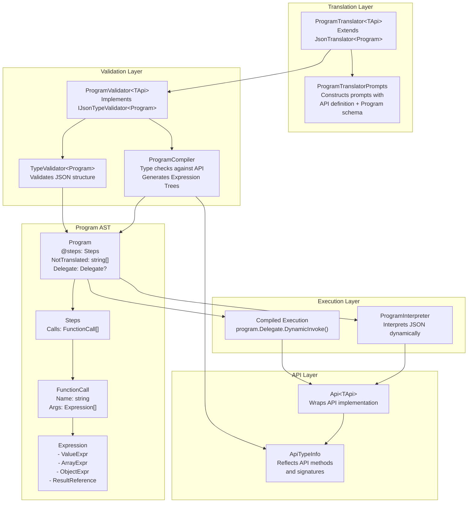
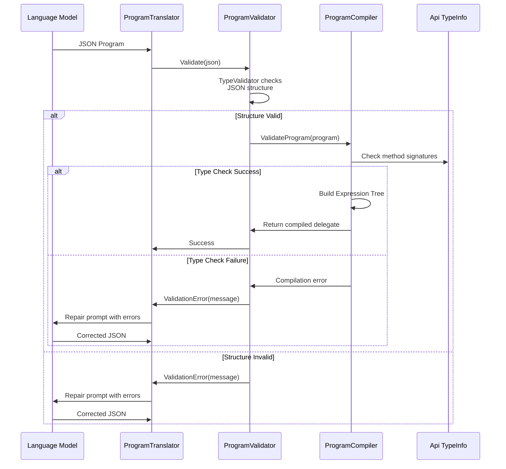

<!-- source: DeepWiki mcp.deepwiki.com · repo microsoft/typechat.net · page 5 Program Translation · fetched 2026-10-26 -->

# Program Translation

<details>
<summary>Relevant source files</summary>

The following files were used as context for generating this wiki page:

- [README.md](README.md)
- [examples/Math/Program.cs](examples/Math/Program.cs)
- [examples/Sentiment/Program.cs](examples/Sentiment/Program.cs)
- [examples/appSettings.json](examples/appSettings.json)
- [src/typechat.program/ProgramCompiler.cs](src/typechat.program/ProgramCompiler.cs)
- [src/typechat.program/ProgramSchemaImpl.cs](src/typechat.program/ProgramSchemaImpl.cs)
- [src/typechat.program/ProgramTranslator.cs](src/typechat.program/ProgramTranslator.cs)
- [src/typechat.program/ProgramValidator.cs](src/typechat.program/ProgramValidator.cs)

</details>


Program Translation extends TypeChat's JSON translation capabilities to generate executable programs from natural language. Instead of translating user intent into simple data structures, Program Translation creates JSON-based programs that consist of sequences of function calls targeting a specific API. These programs are type-checked, validated, and can be executed via interpretation or compiled into optimized .NET delegates.

This page provides a conceptual overview of Program Translation. For detailed information about specific components, see:
- [ProgramTranslator](#5.1) - translating natural language to programs
- [Program Structure](#5.2) - the program AST and expression types
- [Program Compilation](#5.3) - compiling programs to .NET delegates
- [Program Interpretation](#5.4) - interpreting programs dynamically
- [API Definition](#5.5) - defining target APIs

## What is Program Translation?

Program Translation converts natural language requests into structured JSON programs that call methods on a target API. Unlike basic JSON translation (see [JsonTranslator](#3.1)), which produces passive data structures, Program Translation generates executable code represented as JSON.

A program consists of:
- **Steps**: A sequence of function calls executed in order
- **Function Calls**: Invocations of API methods with typed arguments
- **Expressions**: Values, nested function calls, or references to previous results
- **Result References**: Pointers to the output of earlier steps in the program

**Key Benefits:**
- **Type Safety**: Programs are validated against API signatures before execution
- **Repair Loop**: Compilation errors are sent back to the language model for correction
- **Performance**: Programs can be compiled to optimized .NET delegates using the Dynamic Language Runtime (DLR)
- **Flexibility**: Fallback interpretation path for dynamic scenarios

Sources: [README.md:47-56](), [src/typechat.program/ProgramTranslator.cs:5-11]()

## Translation and Execution Flow

The following diagram illustrates how natural language is transformed into an executable program:



Sources: [src/typechat.program/ProgramTranslator.cs:1-122](), [src/typechat.program/ProgramCompiler.cs:1-82](), [README.md:47-67]()

## Basic Usage Example

The following example demonstrates Program Translation with a simple calculator API:

```csharp
// Define the target API
public interface IMathAPI
{
    double Add(double x, double y);
    double Multiply(double x, double y);
    double Divide(double x, double y);
}

// Create an implementation
var api = new MathAPI(); // implements IMathAPI

// Create a program translator
var model = new LanguageModel(Config.LoadOpenAI());
var translator = new ProgramTranslator<IMathAPI>(model, api);

// Translate natural language to a program
Program program = await translator.TranslateAsync("add 2 and 3, then multiply the result by 5");

// Execute the program
dynamic result = program.Run(api);
Console.WriteLine($"Result: {result}"); // Output: Result: 25
```

The language model generates a program like:

```json
{
  "@steps": [
    {
      "@func": "Add",
      "@args": [2, 3]
    },
    {
      "@func": "Multiply",
      "@args": [
        { "@ref": 0 },
        5
      ]
    }
  ]
}
```

Sources: [examples/Math/Program.cs:1-81](), [README.md:57-67]()

## Core Components

### Component Architecture



Sources: [src/typechat.program/ProgramTranslator.cs:1-122](), [src/typechat.program/ProgramValidator.cs:1-92](), [src/typechat.program/ProgramSchemaImpl.cs:1-273]()

### ProgramTranslator

`ProgramTranslator<TApi>` is the entry point for Program Translation. It extends `JsonTranslator<Program>` and configures translation to produce programs conforming to the Program Schema that target a specific API.

**Key Responsibilities:**
- Generates TypeScript schema for the target API
- Combines Program Schema with API definition in prompts
- Validates generated programs via `ProgramValidator<TApi>`
- Handles repair loop when compilation fails

**File Location:** [src/typechat.program/ProgramTranslator.cs:105-122]()

### Program

The `Program` class represents the root of the program AST. It contains:
- `Steps`: Sequence of function calls to execute
- `NotTranslated`: Parts of the request the model couldn't translate
- `Delegate`: Optional compiled delegate for fast execution
- `IsComplete`: Property indicating whether the program has steps and nothing was left untranslated

**File Location:** [src/typechat.program/ProgramSchemaImpl.cs:9-110]()

### ProgramValidator

`ProgramValidator<TApi>` validates programs in two phases:
1. **Structural Validation**: Ensures JSON conforms to Program Schema
2. **Type Checking**: Compiles the program against the API to verify type safety

Compilation errors are returned as validation failures, triggering the repair loop.

**File Location:** [src/typechat.program/ProgramValidator.cs:64-92]()

### ProgramCompiler

`ProgramCompiler` transforms validated JSON programs into .NET Expression Trees using the Dynamic Language Runtime. The compiler:
- Type-checks function calls against API method signatures
- Generates optimized `LambdaExpression` trees
- Handles result references between steps
- Converts async methods to synchronous execution
- Produces a `Delegate` that can be invoked directly

**File Location:** [src/typechat.program/ProgramCompiler.cs:9-459]()

### ProgramInterpreter

`ProgramInterpreter` provides a fallback execution path that interprets JSON programs dynamically. It is used when compilation fails or for scenarios requiring maximum flexibility. The interpreter walks the program AST at runtime and invokes API methods via reflection.

**Related Documentation:** See [Program Interpretation](#5.4) for details.

Sources: [src/typechat.program/ProgramSchemaImpl.cs:72-99]()

## Program Schema

Programs conform to a fixed grammar defined in TypeScript. This schema is embedded in `ProgramTranslator`:

```typescript
// A program consists of a sequence of function calls that are evaluated in order.
export type Program = {
    "@steps": FunctionCall[];
    "@cannot_translate"?: string[];
}

// A function call specifies a function name and a list of argument expressions.
export type FunctionCall = {
    "@func": string;
    "@args"?: Expression[];
};

// An expression is a JSON value, a function call, or a reference to a preceding result.
export type Expression = JsonValue | FunctionCall | ResultReference;

// A result reference represents the value of an expression from a preceding step.
export type ResultReference = {
    "@ref": number;
};
```

**Special Property Names:**
- `@steps`: Denotes the array of function calls
- `@func`: Function name
- `@args`: Function arguments
- `@ref`: Reference to result of step N
- `@cannot_translate`: Parts of the request that couldn't be translated

Sources: [src/typechat.program/ProgramTranslator.cs:14-45]()

## Code Entity Reference Table

The following table maps conceptual elements to code entities:

| Concept | Primary Type | File Location |
|---------|--------------|---------------|
| Program Translator | `ProgramTranslator<TApi>` | [src/typechat.program/ProgramTranslator.cs:105-122]() |
| Program AST Root | `Program` | [src/typechat.program/ProgramSchemaImpl.cs:9-110]() |
| Function Call | `FunctionCall` | [src/typechat.program/ProgramSchemaImpl.cs:147-165]() |
| Expression Base | `Expression` | [src/typechat.program/ProgramSchemaImpl.cs:112-133]() |
| Result Reference | `ResultReference` | [src/typechat.program/ProgramSchemaImpl.cs:167-179]() |
| Validator | `ProgramValidator<TApi>` | [src/typechat.program/ProgramValidator.cs:64-92]() |
| Compiler | `ProgramCompiler` | [src/typechat.program/ProgramCompiler.cs:13-459]() |
| Interpreter | `ProgramInterpreter` | Referenced in [src/typechat.program/ProgramSchemaImpl.cs:84-85]() |
| API Wrapper | `Api<TApi>` | Referenced in [src/typechat.program/ProgramTranslator.cs:113]() |

## Execution Paths

Programs can be executed via two paths:

### Compiled Execution (Preferred)

When `ProgramValidator<TApi>` successfully compiles a program, the resulting `Delegate` is stored in `program.Delegate`. Calling `program.Run(api)` invokes this delegate:

```csharp
if (Delegate is not null)
{
    return Delegate.DynamicInvoke();
}
```

**Advantages:**
- Type-safe: verified at compile time
- Fast: optimized .NET IL code
- No reflection overhead

**File Location:** [src/typechat.program/ProgramSchemaImpl.cs:79-82]()

### Interpreted Execution (Fallback)

If compilation fails or `Delegate` is null, the interpreter is used:

```csharp
ProgramInterpreter interpreter = new ProgramInterpreter();
return interpreter.Run(this, api.Call);
```

**Advantages:**
- Flexible: handles edge cases
- Debugging: easier to step through
- Fallback: ensures execution always possible

**File Location:** [src/typechat.program/ProgramSchemaImpl.cs:84-86]()

Sources: [src/typechat.program/ProgramSchemaImpl.cs:72-99]()

## Type Safety and Repair

### Type Checking Flow



Sources: [src/typechat.program/ProgramValidator.cs:49-91](), [src/typechat.program/ProgramCompiler.cs:46-82]()

### Validation Phases

**Phase 1: Structural Validation**
- Validates JSON conforms to Program Schema
- Checks `@steps`, `@func`, `@args`, `@ref` properties
- Ensures result references are valid (non-negative indices)

**Phase 2: Type Checking**
- Verifies function names exist in API
- Checks argument counts match method signatures
- Validates argument types are compatible
- Handles type conversions and coercions

**Phase 3: Compilation**
- Builds Expression Tree representation
- Generates optimized IL code
- Stores compiled delegate in `program.Delegate`

If any phase fails, errors are formatted and sent back to the language model for repair, up to `MaxRepairAttempts` times.

Sources: [src/typechat.program/ProgramValidator.cs:34-57](), [src/typechat.program/ProgramCompiler.cs:46-82]()

## API Definition

Programs target a specific API defined by a C# interface or class. The API surface consists of all public methods, which are exported to TypeScript and included in the translation prompt.

Example API definition:

```csharp
public interface IMathAPI
{
    double Add(double x, double y);
    double Subtract(double x, double y);
    double Multiply(double x, double y);
    double Divide(double x, double y);
}
```

This is converted to TypeScript:

```typescript
interface IMathAPI {
    Add(x: number, y: number): number;
    Subtract(x: number, y: number): number;
    Multiply(x: number, y: number): number;
    Divide(x: number, y: number): number;
}
```

The language model uses this TypeScript interface to understand available functions and their signatures when generating programs.

For detailed information on defining APIs, see [API Definition](#5.5).

Sources: [README.md:57-67](), [src/typechat.program/ProgramTranslator.cs:66-81]()

## Partial Translation

Programs may contain a `@cannot_translate` property listing parts of the user request that couldn't be translated:

```json
{
  "@steps": [
    {
      "@func": "Add",
      "@args": [2, 3]
    }
  ],
  "@cannot_translate": ["make it faster"]
}
```

The `Program.IsComplete` property is false when `NotTranslated` is non-empty. The `ProgramTranslator` checks this condition and continues the repair loop even if structural validation succeeds:

```csharp
protected override bool OnValidationComplete(Result<Program> validationResult)
{
    Program? program = validationResult.Value;
    return (program is not null) ? program.HasNotTranslated : true;
}
```

This allows the system to prompt the model to complete the translation or explain what couldn't be translated.

Sources: [src/typechat.program/ProgramTranslator.cs:88-95](), [src/typechat.program/ProgramSchemaImpl.cs:19-21,52-56]()

## Next Steps

- **[ProgramTranslator](#5.1)**: Learn how to create and configure program translators
- **[Program Structure](#5.2)**: Understand the program AST in detail
- **[Program Compilation](#5.3)**: Explore how programs are compiled to .NET delegates
- **[Program Interpretation](#5.4)**: Use the interpreter for dynamic execution
- **[API Definition](#5.5)**: Design APIs for program translation
- **[Math Calculator Example](#8.3)**: See a complete working example

---

