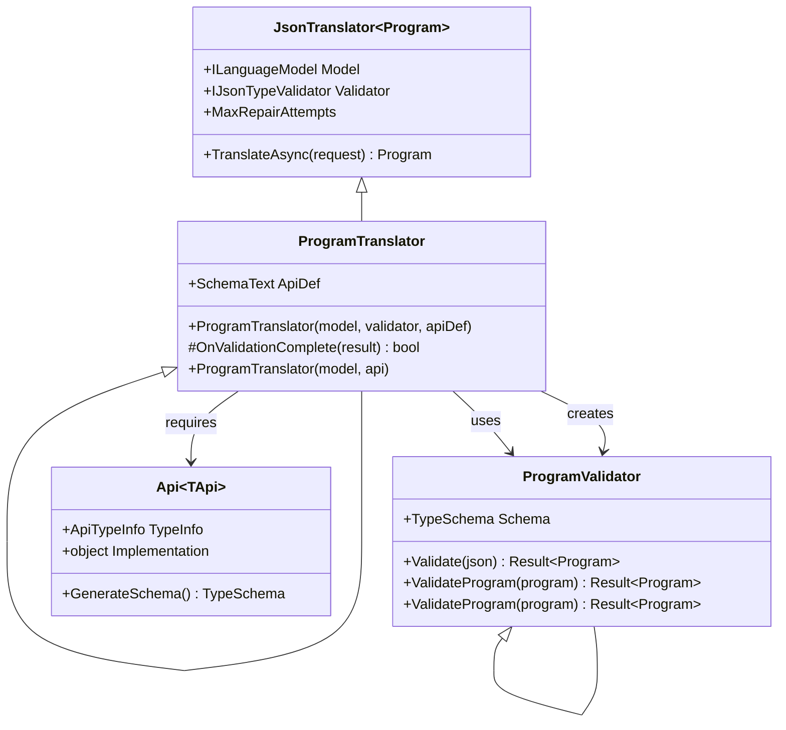
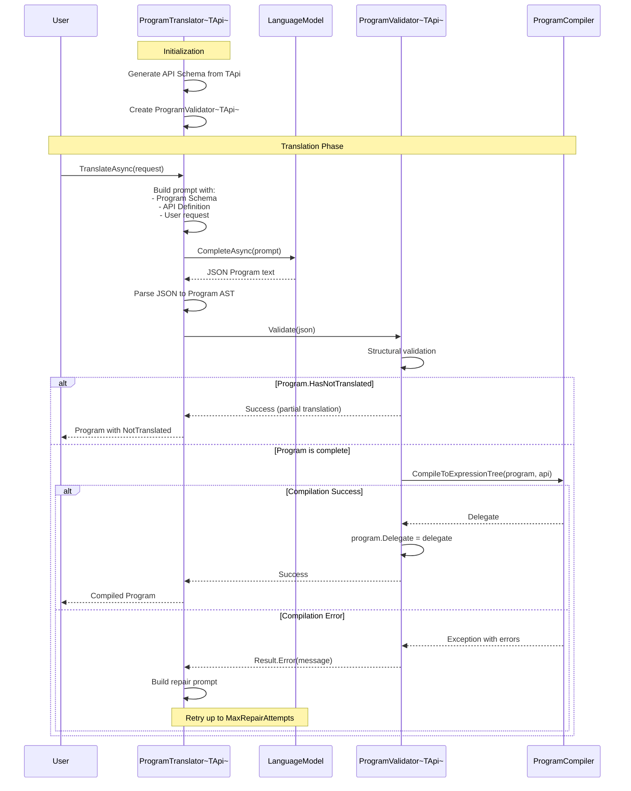
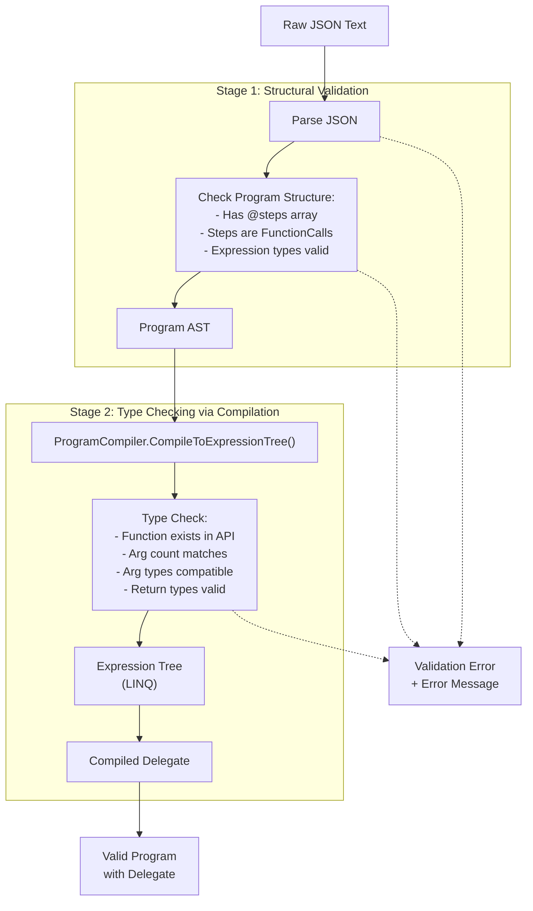
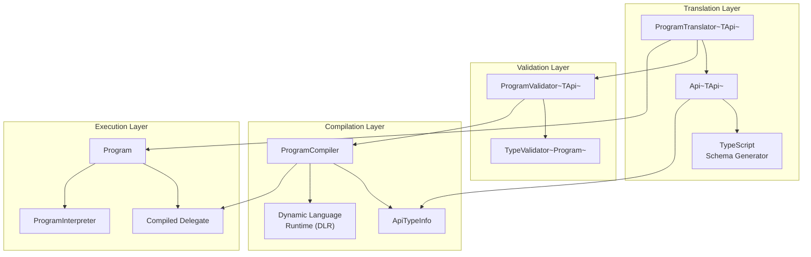

<!-- source: DeepWiki mcp.deepwiki.com · repo microsoft/typechat.net · page 5.1 ProgramTranslator · fetched 2026-10-26 -->

# ProgramTranslator

<details>
<summary>Relevant source files</summary>

The following files were used as context for generating this wiki page:

- [README.md](README.md)
- [examples/Math/Program.cs](examples/Math/Program.cs)
- [examples/Sentiment/Program.cs](examples/Sentiment/Program.cs)
- [examples/appSettings.json](examples/appSettings.json)
- [src/typechat.program/ProgramCompiler.cs](src/typechat.program/ProgramCompiler.cs)
- [src/typechat.program/ProgramSchemaImpl.cs](src/typechat.program/ProgramSchemaImpl.cs)
- [src/typechat.program/ProgramTranslator.cs](src/typechat.program/ProgramTranslator.cs)
- [src/typechat.program/ProgramValidator.cs](src/typechat.program/ProgramValidator.cs)

</details>


## Purpose and Scope

This document describes the `ProgramTranslator` and `ProgramTranslator<TApi>` classes, which translate natural language requests into structured, type-safe programs that call methods on a target API. A program is a JSON representation of a sequence of function calls that can be validated, compiled, and executed.

This page focuses on how to create and configure a `ProgramTranslator`, define target APIs, and translate natural language into programs. For details on the structure of generated programs, see [Program Structure](#5.2). For program compilation, see [Program Compilation](#5.3). For program execution, see [Program Interpretation](#5.4).

Sources: [src/typechat.program/ProgramTranslator.cs:1-122](), [README.md:47-67]()

---

## Overview

`ProgramTranslator` extends `JsonTranslator<Program>` to translate natural language into JSON programs. Unlike basic JSON translation which produces data structures, program translation produces executable code represented as JSON that follows a formal grammar (the Program Schema).

### Key Characteristics

| Aspect | Description |
|--------|-------------|
| **Base Class** | Extends `JsonTranslator<Program>` |
| **Output Type** | `Program` - a structured AST of function calls |
| **Schema** | Fixed Program Schema + Dynamic API Definition |
| **Validation** | Structural validation + Type checking via compilation |
| **Execution** | Programs can be compiled or interpreted |
| **Type Safety** | Function calls are type-checked against target API |

The generic version `ProgramTranslator<TApi>` targets a specific API type, automatically generating the API schema from the type's public methods and performing type checking during validation.

Sources: [src/typechat.program/ProgramTranslator.cs:5-11](), [src/typechat.program/ProgramTranslator.cs:98-121]()

---

## Class Hierarchy



**Class Hierarchy Diagram**: Shows how `ProgramTranslator` extends `JsonTranslator<Program>` and its relationship with validators and API definitions.

Sources: [src/typechat.program/ProgramTranslator.cs:12-95](), [src/typechat.program/ProgramTranslator.cs:105-121]()

---

## Basic Usage

### Creating a ProgramTranslator

The typical usage pattern uses the generic `ProgramTranslator<TApi>` which requires a language model and an `Api<TApi>` instance:

```csharp
// Define your API interface
public interface IMathAPI
{
    double Add(double x, double y);
    double Multiply(double x, double y);
}

// Create API instance
var api = new Api<IMathAPI>(new MathAPI());

// Create translator
var model = new LanguageModel(Config.LoadOpenAI());
var translator = new ProgramTranslator<IMathAPI>(model, api);

// Translate natural language to program
Program program = await translator.TranslateAsync("add 5 and 3, then multiply by 2");

// Execute the program
dynamic result = program.Run(api);
```

The `ProgramTranslator<TApi>` constructor automatically:
1. Generates a TypeScript schema for the API from the type's public methods
2. Creates a `ProgramValidator<TApi>` that compiles and type-checks programs
3. Configures prompts with both the Program Schema and API Definition

Sources: [examples/Math/Program.cs:13-19](), [src/typechat.program/ProgramTranslator.cs:105-121]()

### Configuration Options

`ProgramTranslator` inherits all configuration from `JsonTranslator<Program>`:

| Property | Type | Description | Default |
|----------|------|-------------|---------|
| `MaxRepairAttempts` | `int` | Maximum validation/repair cycles | 3 |
| `StripJsonMarkdown` | `bool` | Remove markdown code blocks from response | `true` |
| `AttemptJsonRepair` | `bool` | Enable automatic JSON repair loop | `true` |

Example configuration:

```csharp
var translator = new ProgramTranslator<IMathAPI>(model, api);
translator.MaxRepairAttempts = 5;  // Allow more repair attempts
```

Sources: [examples/Math/Program.cs:20]()

---

## Translation Workflow



**Translation Workflow Diagram**: Shows the complete flow from natural language request to validated, compiled program.

Sources: [src/typechat.program/ProgramTranslator.cs:73-81](), [src/typechat.program/ProgramValidator.cs:77-90]()

---

## Program Schema

`ProgramTranslator` uses a fixed Program Schema that defines the grammar for all programs. This schema is embedded as a TypeScript definition:

### Program Grammar

The Program Schema defines the structure of executable programs:

| Type | Description |
|------|-------------|
| `Program` | Root object with `@steps` array and optional `@cannot_translate` |
| `FunctionCall` | Function invocation with `@func` name and `@args` array |
| `Expression` | JSON value, FunctionCall, or ResultReference |
| `ResultReference` | Reference to result of previous step via `@ref` index |
| `JsonValue` | String, number, boolean, null, object, or array |

Example program structure:

```json
{
  "@steps": [
    {
      "@func": "Add",
      "@args": [5, 3]
    },
    {
      "@func": "Multiply",
      "@args": [{ "@ref": 0 }, 2]
    }
  ]
}
```

The schema text is defined at [src/typechat.program/ProgramTranslator.cs:14-45]() and accessed via the static `ProgramSchema` property.

Sources: [src/typechat.program/ProgramTranslator.cs:14-61]()

---

## API Definition

### Generating API Schema

The `Api<TApi>` class generates a TypeScript schema describing the available functions:

```csharp
public interface IMathAPI
{
    double Add(double x, double y);
    double Subtract(double x, double y);
    double Multiply(double x, double y);
    double Divide(double x, double y);
}
```

This generates TypeScript schema like:

```typescript
interface IMathAPI {
    Add(x: number, y: number): number;
    Subtract(x: number, y: number): number;
    Multiply(x: number, y: number): number;
    Divide(x: number, y: number): number;
}
```

The schema is included in the prompt sent to the language model, informing it which functions are available and their signatures.

Sources: [src/typechat.program/ProgramTranslator.cs:66-73](), [src/typechat.program/ProgramTranslator.cs:113-118]()

### Accessing API Definition

The API definition can be accessed via the `ApiDef` property:

```csharp
var translator = new ProgramTranslator<IMathAPI>(model, api);
SchemaText apiDef = translator.ApiDef;
Console.WriteLine(apiDef);  // Prints TypeScript interface
```

Sources: [src/typechat.program/ProgramTranslator.cs:86](), [examples/Math/Program.cs:69]()

---

## Validation and Type Checking

### Validation Pipeline

`ProgramTranslator` uses `ProgramValidator<TApi>` which performs validation in two stages:



**Validation Pipeline Diagram**: Shows how programs are validated structurally then type-checked via compilation.

Sources: [src/typechat.program/ProgramValidator.cs:34-46](), [src/typechat.program/ProgramValidator.cs:77-90]()

### Compilation-Based Type Checking

The `ProgramValidator<TApi>` uses `ProgramCompiler` to validate programs by compiling them to Expression Trees. This provides strong type checking:

1. **Function Existence**: Verifies function name exists in API
2. **Argument Count**: Checks argument count matches method signature
3. **Type Compatibility**: Verifies argument types are compatible with parameters
4. **Return Type**: Validates return values can be used in subsequent steps

If compilation fails, the error message is sent back to the language model for repair.

Example compilation errors:

- "Function 'Foo' not found in API"
- "Function 'Add' expects 2 arguments but got 3"
- "Cannot convert argument of type 'string' to parameter of type 'double'"

Sources: [src/typechat.program/ProgramValidator.cs:77-90](), [src/typechat.program/ProgramCompiler.cs:46-59]()

---

## Handling Partial Translation

`ProgramTranslator` has special logic for handling cases where the language model cannot fully translate the user's request:

### NotTranslated Pattern

Programs include a `@cannot_translate` field for parts of the request that couldn't be translated:

```json
{
  "@steps": [
    { "@func": "Add", "@args": [2, 3] }
  ],
  "@cannot_translate": [
    "calculate the quantum flux capacitance"
  ]
}
```

### Validation Behavior

The `OnValidationComplete` method checks if translation is complete:

```csharp
protected override bool OnValidationComplete(Result<Program> validationResult)
{
    Program? program = validationResult.Value;
    return (program is not null) ? program.HasNotTranslated : true;
}
```

- If `program.HasNotTranslated` is `true`, validation stops and the partial program is returned
- If `program.HasNotTranslated` is `false`, validation continues with compilation

This prevents infinite repair loops when the API genuinely cannot satisfy the request.

Sources: [src/typechat.program/ProgramTranslator.cs:88-94](), [src/typechat.program/ProgramSchemaImpl.cs:52-56]()

---

## Component Relationships



**Component Relationships Diagram**: Shows how ProgramTranslator connects to validators, compilers, and execution components.

Sources: [src/typechat.program/ProgramTranslator.cs:105-121](), [src/typechat.program/ProgramValidator.cs:64-91]()

---

## Events and Observability

`ProgramTranslator` inherits all events from `JsonTranslator<Program>`:

| Event | Purpose |
|-------|---------|
| `TranslationAttempt` | Fired before sending prompt to model |
| `TranslationSuccess` | Fired after successful validation |
| `TranslationRepairAttempt` | Fired before repair attempt |
| `ValidationFailed` | Fired when validation fails |

Example event subscription:

```csharp
var translator = new ProgramTranslator<IMathAPI>(model, api);
translator.ValidationFailed += (sender, args) => {
    Console.WriteLine($"Validation failed: {args.Error}");
};
```

For observing program execution, subscribe to the `Api<TApi>.CallCompleted` event:

```csharp
api.CallCompleted += (functionName, args, result) => {
    Console.WriteLine($"{functionName}({string.Join(", ", args)}) => {result}");
};
```

Sources: [examples/Math/Program.cs:21-23](), [examples/Math/Program.cs:57-61]()

---

## Usage Patterns

### Pattern 1: Execute Compiled Program

The recommended pattern for production use:

```csharp
var translator = new ProgramTranslator<IMathAPI>(model, api);
Program program = await translator.TranslateAsync(request);

if (program.IsComplete && program.Delegate != null)
{
    dynamic result = program.Delegate.DynamicInvoke();
    Console.WriteLine($"Result: {result}");
}
```

The compiled delegate provides:
- Type safety at runtime
- Optimal performance
- Exception handling

Sources: [examples/Math/Program.cs:44-55](), [src/typechat.program/ProgramSchemaImpl.cs:72-86]()

### Pattern 2: Handle Partial Translation

Handle cases where translation is incomplete:

```csharp
Program program = await translator.TranslateAsync(request);

if (!program.IsComplete)
{
    Console.WriteLine("Could not fully translate request:");
    foreach (string item in program.NotTranslated)
    {
        Console.WriteLine($"  - {item}");
    }
}
```

Sources: [src/typechat.program/ProgramSchemaImpl.cs:40-56]()

### Pattern 3: Display Generated Program

Inspect the generated program for debugging:

```csharp
Program program = await translator.TranslateAsync(request);
program.Print(api.Type.Name);  // Prints formatted program
```

Sources: [examples/Math/Program.cs:33-34]()

---

## Example: Math Calculator

Complete example showing `ProgramTranslator<IMathAPI>` usage:

### API Definition

```csharp
public interface IMathAPI
{
    double Add(double x, double y);
    double Subtract(double x, double y);
    double Multiply(double x, double y);
    double Divide(double x, double y);
}

public class MathAPI : IMathAPI
{
    public double Add(double x, double y) => x + y;
    public double Subtract(double x, double y) => x - y;
    public double Multiply(double x, double y) => x * y;
    public double Divide(double x, double y) => x / y;
}
```

### Translator Setup and Usage

```csharp
var api = new Api<IMathAPI>(new MathAPI());
var translator = new ProgramTranslator<IMathAPI>(
    new LanguageModel(Config.LoadOpenAI()),
    api
);

// Translate: "add 2 and 3, then multiply by 5"
Program program = await translator.TranslateAsync("add 2 and 3, then multiply by 5");

// Generated program:
// {
//   "@steps": [
//     { "@func": "Add", "@args": [2, 3] },
//     { "@func": "Multiply", "@args": [{ "@ref": 0 }, 5] }
//   ]
// }

dynamic result = program.Run(api);
Console.WriteLine($"Result: {result}");  // Output: Result: 25
```

Sources: [examples/Math/Program.cs:8-41]()

---

## Advanced: Custom Validators

For advanced scenarios, create a custom `IProgramValidator`:

```csharp
public class CustomValidator : IProgramValidator
{
    public Result<Program> ValidateProgram(Program program)
    {
        // Custom validation logic
        // e.g., check resource limits, security constraints
        return new Result<Program>(program);
    }
}

var translator = new ProgramTranslator(
    model,
    new ProgramValidator(new CustomValidator()),
    apiDefinition
);
```

Sources: [src/typechat.program/ProgramValidator.cs:5-12](), [src/typechat.program/ProgramTranslator.cs:73-81]()

---

## Key Classes Reference

| Class | Purpose | Location |
|-------|---------|----------|
| `ProgramTranslator` | Base translator for programs | [src/typechat.program/ProgramTranslator.cs:12-95]() |
| `ProgramTranslator<TApi>` | Generic translator targeting specific API | [src/typechat.program/ProgramTranslator.cs:105-121]() |
| `Program` | AST representation of a program | [src/typechat.program/ProgramSchemaImpl.cs:9-110]() |
| `ProgramValidator` | Validates program structure | [src/typechat.program/ProgramValidator.cs:17-57]() |
| `ProgramValidator<TApi>` | Validates and compiles programs | [src/typechat.program/ProgramValidator.cs:64-91]() |
| `Api<TApi>` | Wraps API implementation and type info | Referenced in [src/typechat.program/ProgramTranslator.cs:113-118]() |
| `ProgramCompiler` | Compiles programs to delegates | [src/typechat.program/ProgramCompiler.cs:13-459]() |

Sources: [src/typechat.program/ProgramTranslator.cs:1-122](), [src/typechat.program/ProgramValidator.cs:1-92](), [src/typechat.program/ProgramCompiler.cs:1-459]()

---

