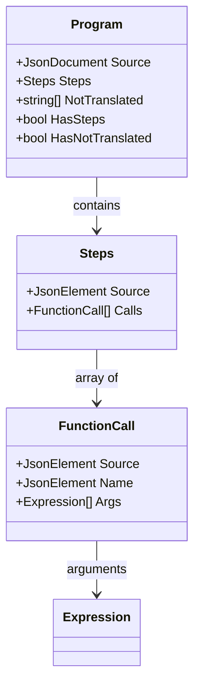
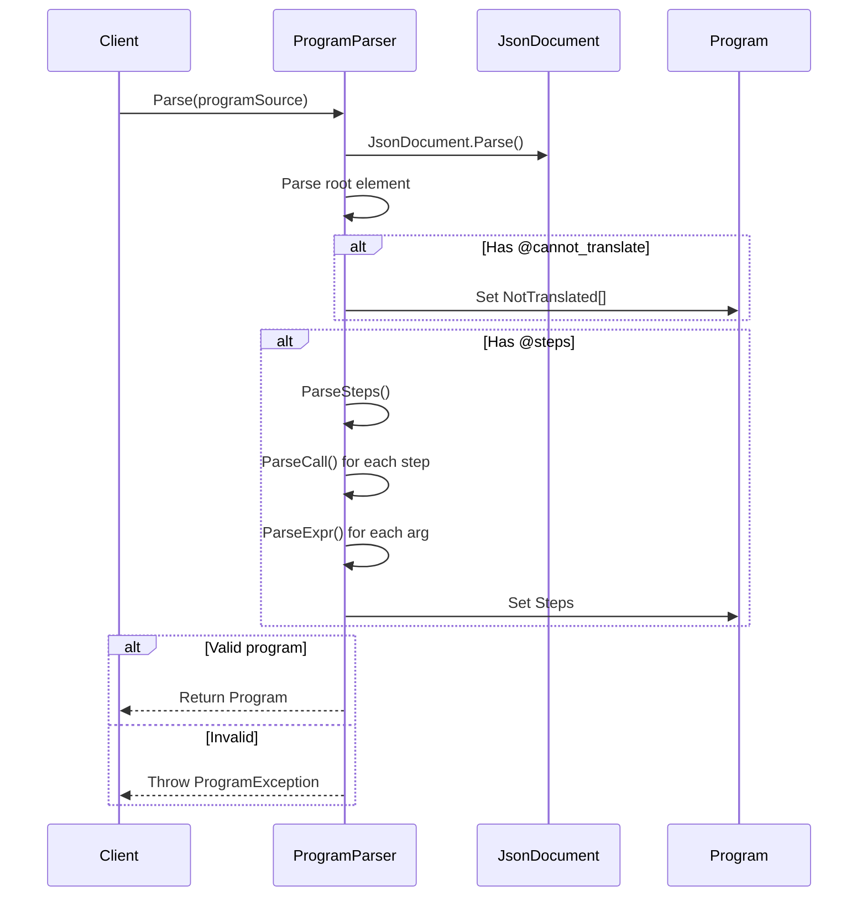
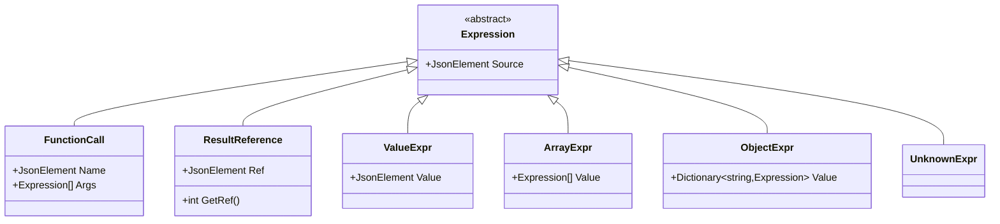
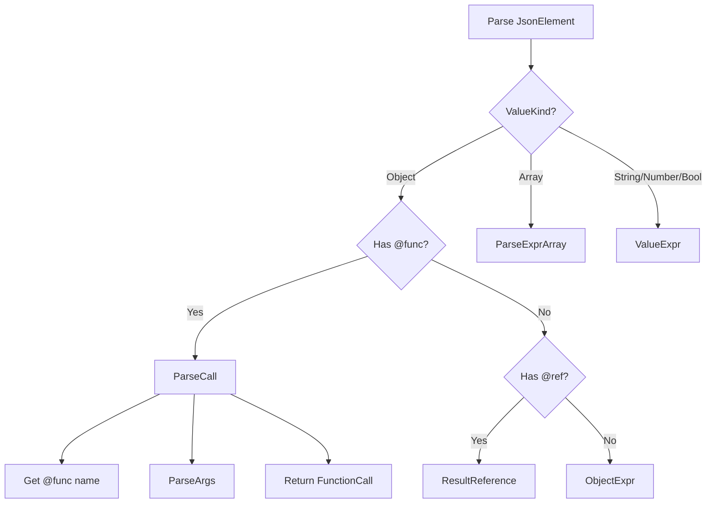
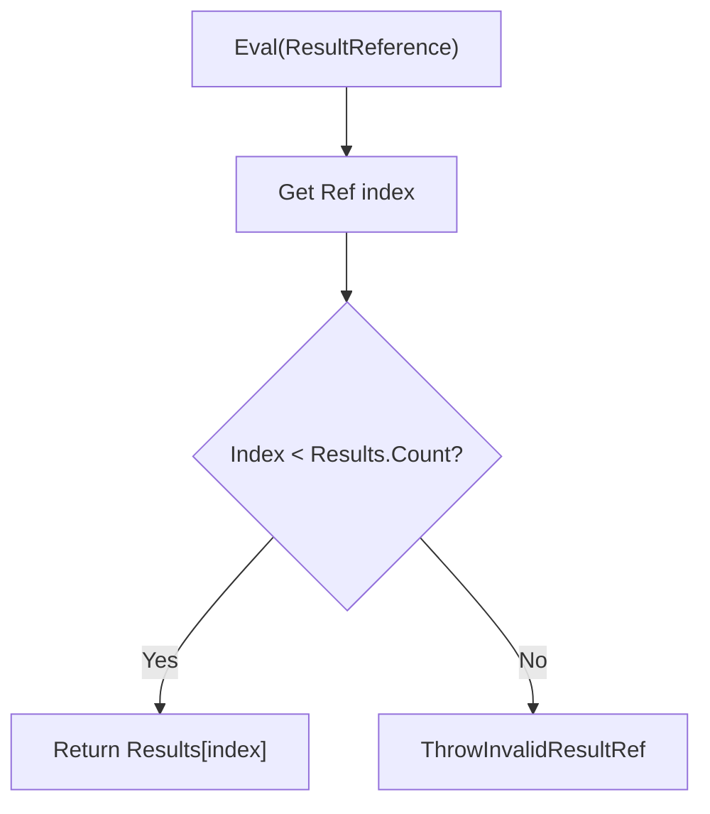
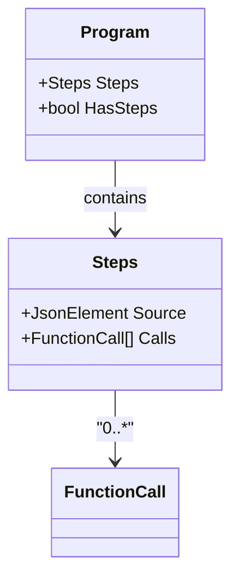

<!-- source: DeepWiki mcp.deepwiki.com · repo microsoft/typechat.net · page 5.2 Program Structure · fetched 2026-10-26 -->

# Program Structure

<details>
<summary>Relevant source files</summary>

The following files were used as context for generating this wiki page:

- [src/typechat.program/JsonParser.cs](src/typechat.program/JsonParser.cs)
- [src/typechat.program/ProgramException.cs](src/typechat.program/ProgramException.cs)
- [src/typechat.program/ProgramInterpreter.cs](src/typechat.program/ProgramInterpreter.cs)
- [src/typechat.program/ProgramParser.cs](src/typechat.program/ProgramParser.cs)
- [src/typechat.program/ProgramSchema.ts](src/typechat.program/ProgramSchema.ts)
- [src/typechat.program/ProgramTranslatorPrompts.cs](src/typechat.program/ProgramTranslatorPrompts.cs)

</details>


## Purpose and Scope

This page describes the structure of the Program Abstract Syntax Tree (AST) that represents executable programs generated by TypeChat. The Program AST defines a JSON-based intermediate representation that language models produce and that can be compiled or interpreted for execution.

For information about translating natural language into programs, see [ProgramTranslator](#5.1). For details on compiling programs into optimized delegates, see [Program Compilation](#5.3). For interpreting programs dynamically, see [Program Interpretation](#5.4).

---

## Overview

Programs in TypeChat are structured JSON documents that conform to a formal grammar defined in [src/typechat.program/ProgramSchema.ts](). The Program AST consists of a sequence of function calls (`@steps`) that are evaluated in order, with support for nested expressions, result references, and explicit handling of untranslatable input (`@cannot_translate`).

The Program structure serves as a bridge between natural language and executable code:
- Language models generate JSON conforming to this structure
- The `ProgramParser` converts JSON into strongly-typed Program objects
- The `ProgramCompiler` or `ProgramInterpreter` executes the resulting program

**Key Design Principles:**
- **Sequential Execution**: Steps execute in order, building on previous results
- **Result References**: Later steps can reference results from earlier steps using `@ref`
- **Type Safety**: Expression types map to .NET types during compilation/interpretation
- **Partial Translation**: Untranslatable portions are explicitly captured in `@cannot_translate`

Sources: [src/typechat.program/ProgramSchema.ts:1-30]()

---

## Program Type

### Structure

The `Program` type is the root container for an executable program.



Sources: [src/typechat.program/ProgramSchema.ts:2-7](), [src/typechat.program/ProgramParser.cs:40-77]()

### JSON Schema

From the TypeScript definition:

| Property | Type | Required | Description |
|----------|------|----------|-------------|
| `@steps` | `FunctionCall[]` | Yes | Sequence of function calls to execute |
| `@cannot_translate` | `string[]` | No | Parts of user request that could not be translated |

**Example Program JSON:**

```json
{
  "@steps": [
    {
      "@func": "add",
      "@args": [5, 3]
    },
    {
      "@func": "multiply",
      "@args": [
        { "@ref": 0 },
        2
      ]
    }
  ]
}
```

This program:
1. Calls `add(5, 3)` → result stored at index 0
2. Calls `multiply(@ref:0, 2)` → multiplies the first result by 2

Sources: [src/typechat.program/ProgramSchema.ts:2-7]()

### Parsing Programs

The `ProgramParser` class converts JSON into `Program` objects:



Sources: [src/typechat.program/ProgramParser.cs:29-77]()

---

## Expression Types

Expressions form the core of the Program AST. The `Expression` type is a discriminated union that can represent function calls, result references, values, arrays, or objects.

### Expression Hierarchy



Sources: [src/typechat.program/ProgramParser.cs:172-194](), [src/typechat.program/ProgramInterpreter.cs:103-127]()

### TypeScript Definition

From `ProgramSchema.ts`:

```typescript
export type Expression = JsonValue | FunctionCall | ResultReference;

export type JsonValue = string | number | boolean | null | 
    { [x: string]: Expression } | Expression[];
```

Sources: [src/typechat.program/ProgramSchema.ts:18-23]()

---

## FunctionCall

A `FunctionCall` represents an invocation of a function from the target API.

### Structure

| Property | Type | Description |
|----------|------|-------------|
| `Source` | `JsonElement` | Original JSON element |
| `Name` | `JsonElement` | Function name as string element |
| `Args` | `Expression[]` | Argument expressions (may be empty) |

### JSON Representation

```json
{
  "@func": "functionName",
  "@args": [
    "literal value",
    { "@ref": 0 },
    { "@func": "nestedCall", "@args": [] }
  ]
}
```

### Parsing Logic

The parser identifies function calls by the presence of the `@func` property:



Sources: [src/typechat.program/ProgramParser.cs:106-116](), [src/typechat.program/ProgramParser.cs:139-158]()

### Evaluation

During interpretation, function calls are evaluated by:
1. Evaluating all argument expressions recursively
2. Passing the function name and evaluated arguments to a callback handler
3. Returning the result for use by subsequent steps

Sources: [src/typechat.program/ProgramInterpreter.cs:90-101]()

---

## ResultReference

A `ResultReference` allows later steps to reference the results of earlier steps by index.

### Structure

| Property | Type | Description |
|----------|------|-------------|
| `Source` | `JsonElement` | Original JSON element |
| `Ref` | `JsonElement` | Numeric element containing the step index |

### JSON Representation

```json
{
  "@ref": 0
}
```

This references the result of the function call at index 0 in the `@steps` array.

### Validation

Result references must:
- Reference a valid step index (0 to current step - 1)
- Only reference steps that have already executed

Invalid references throw `ProgramException` with error code `InvalidResultRef`:

Sources: [src/typechat.program/ProgramException.cs:64-71]()

### Evaluation

During interpretation:



Sources: [src/typechat.program/ProgramInterpreter.cs:236-243]()

---

## Value Expressions

### ValueExpr

Represents literal JSON values: strings, numbers, booleans, or null.

**JSON Examples:**
```json
42
"hello"
true
false
null
```

**Evaluation:** Values are extracted based on `JsonValueKind`:

| JsonValueKind | Return Type | Method |
|---------------|-------------|--------|
| `True` | `bool` | Returns `true` |
| `False` | `bool` | Returns `false` |
| `String` | `string` | `GetString()` |
| `Number` | `double` | `GetDouble()` |

Sources: [src/typechat.program/ProgramInterpreter.cs:185-200]()

### ArrayExpr

Represents JSON arrays containing expressions.

**JSON Example:**
```json
[1, 2, { "@ref": 0 }, { "@func": "add", "@args": [3, 4] }]
```

**Structure:**
- `Value`: `Expression[]` - Array of child expressions

**Evaluation:** Each element expression is evaluated recursively and returned as `dynamic[]`.

Sources: [src/typechat.program/ProgramInterpreter.cs:202-210]()

### ObjectExpr

Represents JSON objects with expression values.

**JSON Example:**
```json
{
  "name": "John",
  "age": 30,
  "salary": { "@ref": 0 }
}
```

**Structure:**
- `Value`: `Dictionary<string, Expression>` - Map of property names to expressions

**Evaluation:** Each property value is evaluated and assembled into a `JsonObject`.

Sources: [src/typechat.program/ProgramInterpreter.cs:212-234]()

---

## Steps Collection

The `Steps` class wraps the array of function calls that comprise the program's execution sequence.

### Structure



### Properties

| Property | Type | Description |
|----------|------|-------------|
| `Source` | `JsonElement` | Original JSON array element |
| `Calls` | `FunctionCall[]` | Ordered array of function calls |

### Execution Semantics

Steps execute sequentially:
1. Step 0 executes first, result stored at index 0
2. Step 1 executes next, can reference result 0 via `@ref`, result stored at index 1
3. Continue for all steps
4. Final result is the result of the last step

Sources: [src/typechat.program/ProgramParser.cs:79-88](), [src/typechat.program/ProgramInterpreter.cs:42-50]()

---

## JSON-to-AST Mapping

The following table shows how JSON structures map to Program AST types:

| JSON Pattern | AST Type | Example |
|--------------|----------|---------|
| `{ "@func": "name", "@args": [...] }` | `FunctionCall` | Function invocation |
| `{ "@ref": 0 }` | `ResultReference` | Reference to previous result |
| `"text"` | `ValueExpr` | String literal |
| `42` | `ValueExpr` | Number literal |
| `true` / `false` | `ValueExpr` | Boolean literal |
| `null` | `ValueExpr` | Null value |
| `[...]` | `ArrayExpr` | Array of expressions |
| `{ "key": value, ... }` | `ObjectExpr` | Object with expression properties |
| Other | `UnknownExpr` | Unrecognized structure |

### Complete Parsing Flow

```mermaid
flowchart TB
    Start["JSON String"] --> Parse["JsonDocument.Parse()"]
    Parse --> Root["Root Element"]
    
    Root --> CheckSteps{Has @steps?}
    CheckSteps -->|Yes| ParseSteps["ParseSteps()"]
    CheckSteps -->|No| CheckTranslate
    
    ParseSteps --> StepLoop["For each step"]
    StepLoop --> ParseCall["ParseCall()"]
    ParseCall --> GetFunc["Get @func name"]
    ParseCall --> ParseArgs["ParseArgs()"]
    ParseArgs --> ArgLoop["For each arg"]
    ArgLoop --> ParseExpr["ParseExpr()"]
    
    ParseExpr --> TypeCheck{Element type?}
    TypeCheck -->|Object| ObjCheck{Has special prop?}
    TypeCheck -->|Array| ArrExpr["ArrayExpr"]
    TypeCheck -->|String/Number/Bool/Null| ValExpr["ValueExpr"]
    
    ObjCheck -->|@func| FuncExpr["FunctionCall"]
    ObjCheck -->|@ref| RefExpr["ResultReference"]
    ObjCheck -->|Neither| ObjExpr["ObjectExpr"]
    
    Root --> CheckTranslate{Has @cannot_translate?}
    CheckTranslate -->|Yes| ParseNotTranslated["Parse string array"]
    CheckTranslate -->|No| End
    
    ParseNotTranslated --> End
    StepLoop --> End["Return Program"]
    
    style ParseExpr fill:#f9f9f9
    style TypeCheck fill:#f9f9f9
```

Sources: [src/typechat.program/ProgramParser.cs:29-77](), [src/typechat.program/ProgramParser.cs:172-194]()

---

## Partial Translation Support

Programs can indicate portions of the user request that could not be translated via the `@cannot_translate` property.

### Structure

```json
{
  "@cannot_translate": [
    "the part about quantum computing",
    "requests for weather data"
  ],
  "@steps": [
    // ... successfully translated function calls
  ]
}
```

### Use Cases

1. **No Suitable API**: Language model determines no API functions match the request
2. **Ambiguous Requests**: Parts of the request are unclear or contradictory
3. **Out of Scope**: User asks for capabilities not in the API definition

### Error Handling

When `@cannot_translate` is present:
- The parser returns a valid `Program` object
- `Program.HasNotTranslated` returns `true`
- `Program.NotTranslated` contains the array of untranslatable strings
- Parsing errors in `@steps` are ignored (since translation was partial)
- Client code can inspect `NotTranslated` and prompt user for clarification

Sources: [src/typechat.program/ProgramParser.cs:47-67](), [src/typechat.program/ProgramSchema.ts:4-6]()

---

## Expression Constants

The `ProgramParser.ExprNames` class defines the JSON property names used in the Program schema:

| Constant | Value | Usage |
|----------|-------|-------|
| `Steps` | `"@steps"` | Root-level array of function calls |
| `Func` | `"@func"` | Function name in FunctionCall |
| `Args` | `"@args"` | Arguments array in FunctionCall |
| `Ref` | `"@ref"` | Step index in ResultReference |
| `CannotTranslate` | `"@cannot_translate"` | Array of untranslatable strings |

These constants are prefixed with `@` to:
- Distinguish them from user-defined property names
- Prevent naming conflicts in ObjectExpr
- Make the JSON structure self-documenting

Sources: [src/typechat.program/ProgramParser.cs:10-17]()

---

## Example: Complete Program Structure

### Natural Language
"Add 5 and 3, then multiply the result by 2, then format it as currency"

### Generated JSON Program

```json
{
  "@steps": [
    {
      "@func": "add",
      "@args": [5, 3]
    },
    {
      "@func": "multiply",
      "@args": [
        { "@ref": 0 },
        2
      ]
    },
    {
      "@func": "formatCurrency",
      "@args": [
        { "@ref": 1 },
        "USD"
      ]
    }
  ]
}
```

### AST Structure

```mermaid
graph TB
    Program["Program"]
    Steps["Steps"]
    Call0["FunctionCall: add"]
    Call1["FunctionCall: multiply"]
    Call2["FunctionCall: formatCurrency"]
    
    Args0["Args[0]: ValueExpr(5)<br/>Args[1]: ValueExpr(3)"]
    Args1["Args[0]: ResultReference(0)<br/>Args[1]: ValueExpr(2)"]
    Args2["Args[0]: ResultReference(1)<br/>Args[1]: ValueExpr(\"USD\")"]
    
    Program --> Steps
    Steps --> Call0
    Steps --> Call1
    Steps --> Call2
    
    Call0 --> Args0
    Call1 --> Args1
    Call2 --> Args2
    
    style Program fill:#f9f9f9
    style Steps fill:#f9f9f9
```

### Execution Flow

| Step | Call | Arguments | Result | Index |
|------|------|-----------|--------|-------|
| 0 | `add` | `[5, 3]` | `8` | 0 |
| 1 | `multiply` | `[8, 2]` (resolved from @ref:0) | `16` | 1 |
| 2 | `formatCurrency` | `[16, "USD"]` (resolved from @ref:1) | `"$16.00"` | 2 |

Final program result: `"$16.00"`

Sources: [src/typechat.program/ProgramInterpreter.cs:34-50]()

---

## Error Handling

### ProgramException Error Codes

The `ProgramException` class defines specific error codes for program-related failures:

| Error Code | Description | Thrown When |
|------------|-------------|-------------|
| `InvalidProgramJson` | JSON does not contain a valid program | Missing both `@steps` and `@cannot_translate` |
| `JsonValueTypeNotSupported` | Unsupported JSON value type | Unknown JsonValueKind during evaluation |
| `TypeMismatch` | Argument type doesn't match parameter | Type checking fails during compilation |
| `InvalidResultRef` | Invalid result reference | Referencing non-existent or future step |
| `ArgCountMismatch` | Wrong number of arguments | Arguments don't match function signature |
| `FunctionNotFound` | Function not in API | `@func` name not found in target API |
| `UnknownExpression` | Unrecognized expression type | Parser encounters unexpected structure |

Sources: [src/typechat.program/ProgramException.cs:8-76]()

### Common Validation Errors

**Invalid Result Reference:**
```json
{
  "@steps": [
    {
      "@func": "add",
      "@args": [
        { "@ref": 1 }  // ERROR: Step 1 hasn't executed yet
      ]
    }
  ]
}
```

**Missing Function Name:**
```json
{
  "@steps": [
    {
      "@args": [1, 2]  // ERROR: Missing @func property
    }
  ]
}
```

**Type Mismatch in Arguments:**
```json
{
  "@func": "getUserById",
  "@args": ["not-a-number"]  // ERROR: Expected int, got string
}
```

Sources: [src/typechat.program/ProgramException.cs:35-75]()

---

