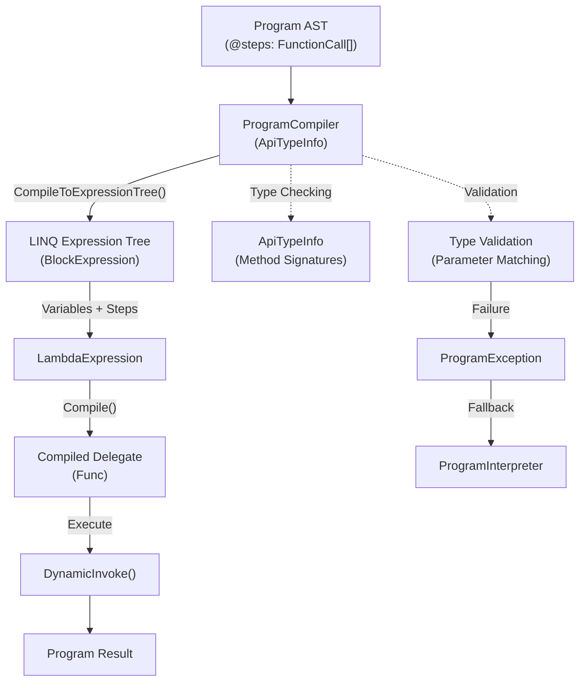
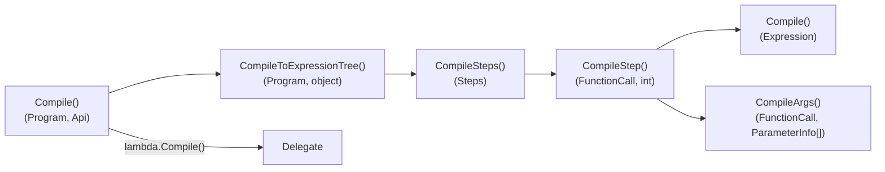
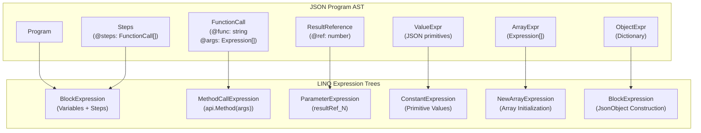
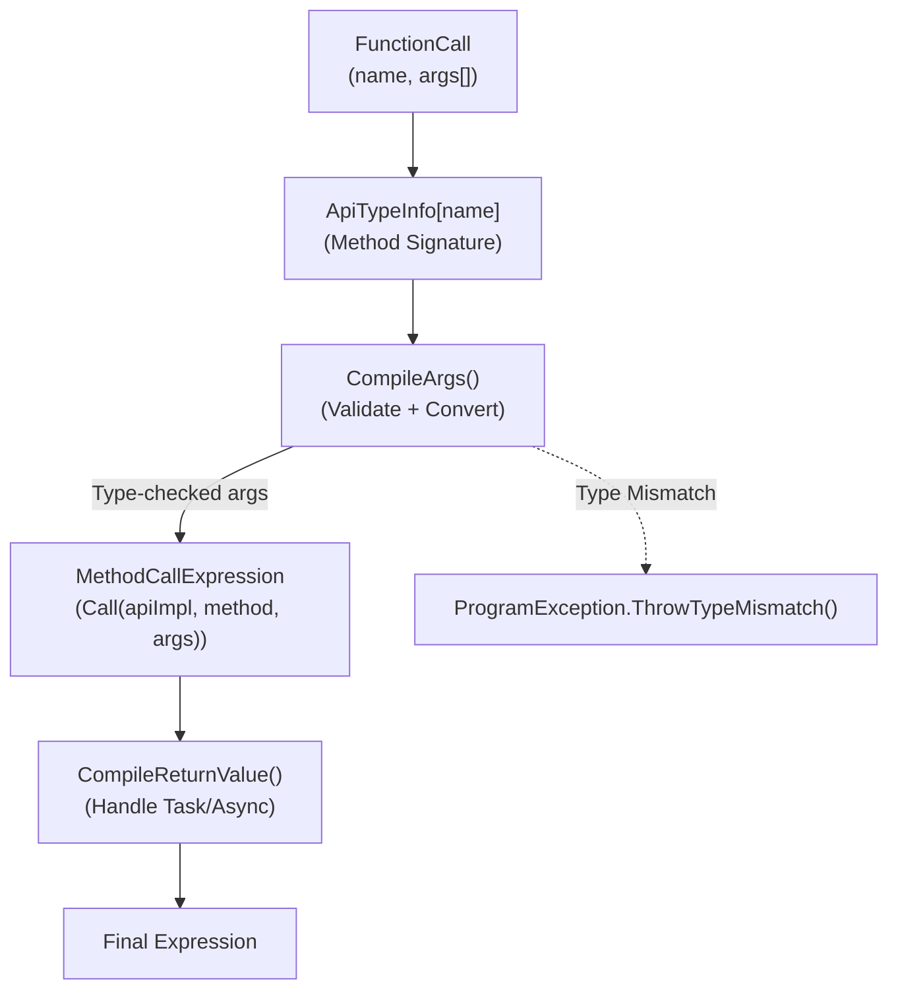
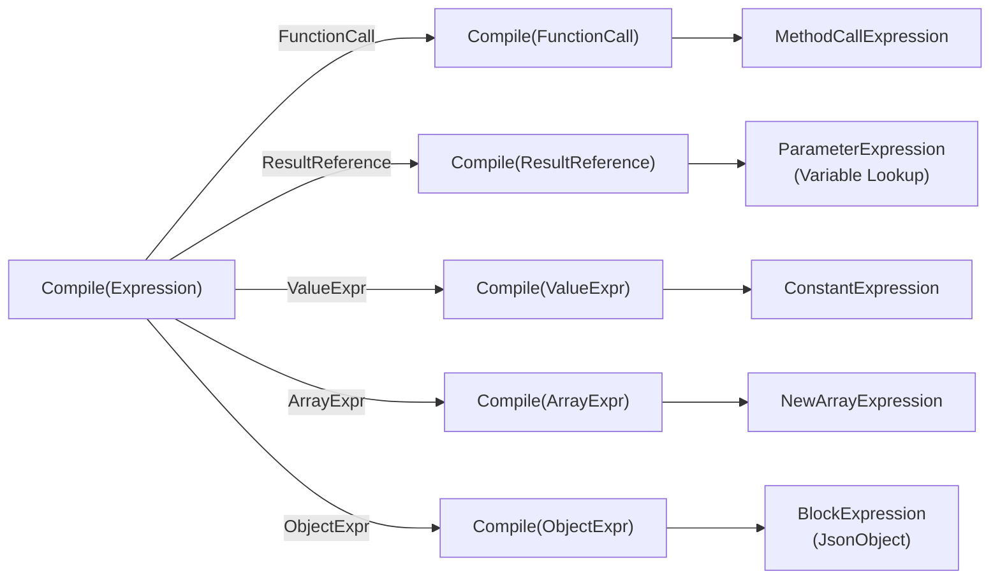
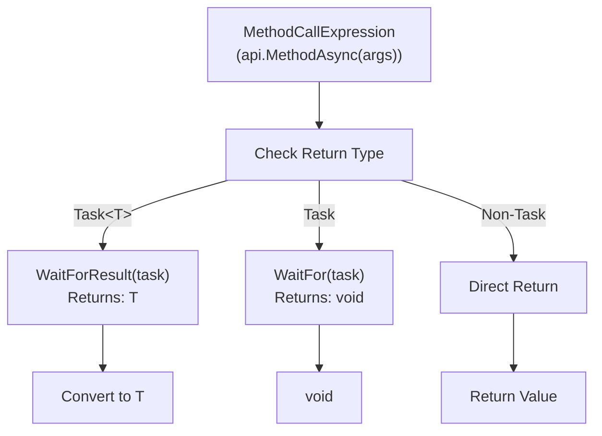
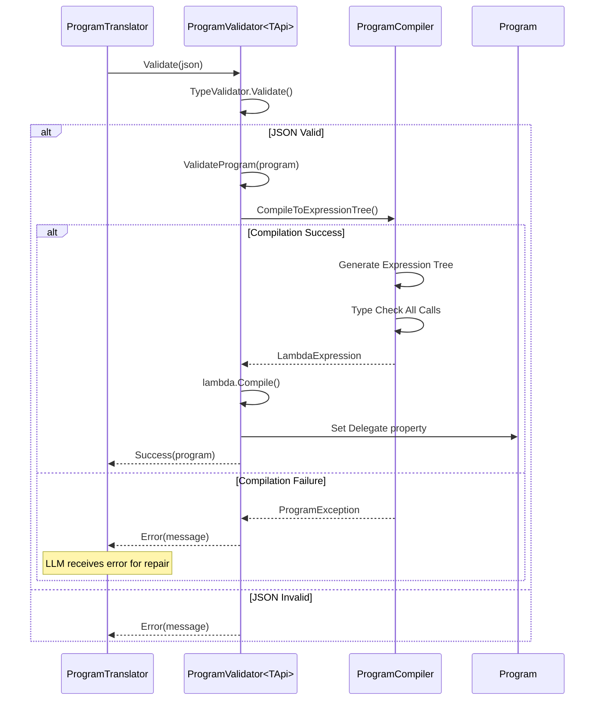
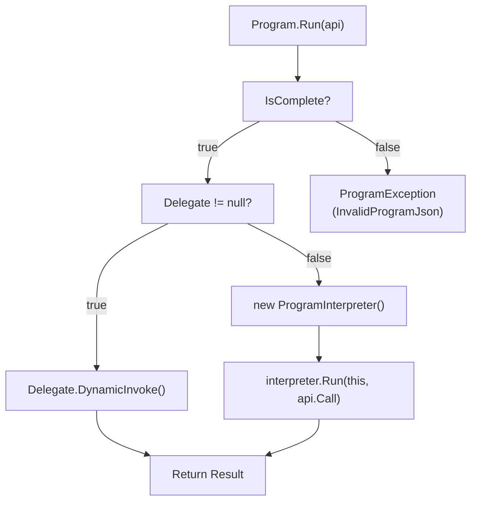
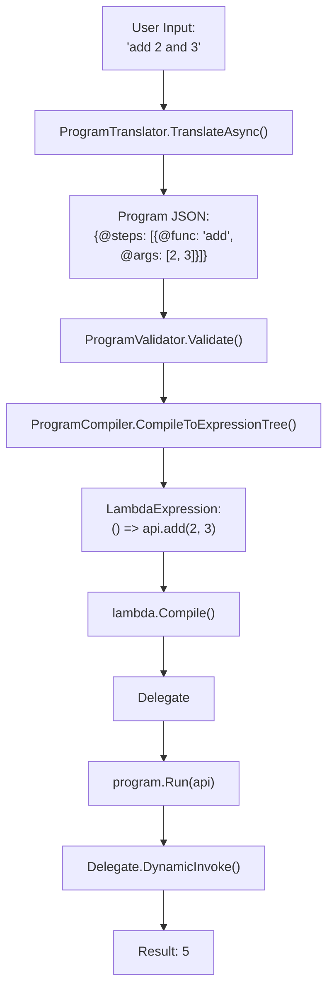
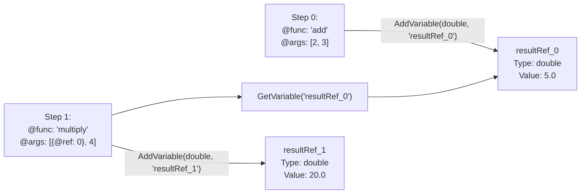

<!-- source: DeepWiki mcp.deepwiki.com · repo microsoft/typechat.net · page 5.3 Program Compilation · fetched 2026-10-26 -->

# Program Compilation

Relevant source files

The following files were used as context for generating this wiki page:

- [examples/Math/Program.cs](examples/Math/Program.cs)
- [src/typechat.program/ProgramCompiler.cs](src/typechat.program/ProgramCompiler.cs)
- [src/typechat.program/ProgramException.cs](src/typechat.program/ProgramException.cs)
- [src/typechat.program/ProgramInterpreter.cs](src/typechat.program/ProgramInterpreter.cs)
- [src/typechat.program/ProgramParser.cs](src/typechat.program/ProgramParser.cs)
- [src/typechat.program/ProgramSchemaImpl.cs](src/typechat.program/ProgramSchemaImpl.cs)
- [src/typechat.program/ProgramTranslator.cs](src/typechat.program/ProgramTranslator.cs)
- [src/typechat.program/ProgramValidator.cs](src/typechat.program/ProgramValidator.cs)

This page describes how the `ProgramCompiler` class transforms validated JSON programs into type-safe, executable .NET delegates using the Dynamic Language Runtime (DLR) and LINQ Expression Trees. The compilation process provides type safety, performance optimization, and early error detection.

For information about generating programs from natural language, see [ProgramTranslator](#5.1). For understanding the JSON program structure, see [Program Structure](#5.2). For the fallback execution path, see [Program Interpretation](#5.4).

## Compilation Overview

The `ProgramCompiler` converts a `Program` Abstract Syntax Tree (AST) into an optimized .NET delegate through a multi-stage process. The compiler validates function signatures, performs type checking, and generates LINQ Expression Trees that are compiled into executable IL code. If compilation fails, the program falls back to interpreted execution.

**Compilation Pipeline**

Sources: [src/typechat.program/ProgramCompiler.cs:1-460](), [src/typechat.program/ProgramValidator.cs:59-91]()

## ProgramCompiler Class

The `ProgramCompiler` class is the central component responsible for transforming JSON programs into executable code. It maintains API type information and manages variable scoping during compilation.

| Component | Type | Purpose |
|-----------|------|---------|
| `_apiTypeInfo` | `ApiTypeInfo` | Contains method signatures and type information for the target API |
| `_apiImpl` | `ConstantExpression` | Reference to the actual API implementation instance |
| `_variables` | `Dictionary<string, ParameterExpression>` | Maps result variables to their Expression representations |

**Key Methods**

Sources: [src/typechat.program/ProgramCompiler.cs:13-88]()

## Compilation Process

The compilation process transforms each element of the Program AST into corresponding LINQ Expression Tree nodes. The compiler walks the AST recursively, building up a block expression that represents the entire program.

**AST to Expression Tree Mapping**

Sources: [src/typechat.program/ProgramCompiler.cs:90-152]()

### Step-by-Step Compilation

The `CompileSteps` method processes each function call in the program sequentially:

1. **Begin Block**: Creates a `BlockExpression` to hold all statements [src/typechat.program/ProgramCompiler.cs:90-101]()
2. **Compile Each Step**: For each `FunctionCall` in `@steps`:
   - Look up the method signature from `ApiTypeInfo` [src/typechat.program/ProgramCompiler.cs:106]()
   - Compile the function call expression [src/typechat.program/ProgramCompiler.cs:107]()
   - If the method returns a value, create a result variable and assign the result [src/typechat.program/ProgramCompiler.cs:108-113]()
3. **End Block**: Complete the block expression and return [src/typechat.program/ProgramCompiler.cs:101]()

**Function Call Compilation**

When compiling a `FunctionCall` node:

Sources: [src/typechat.program/ProgramCompiler.cs:116-126](), [src/typechat.program/ProgramCompiler.cs:154-207]()

## Type Safety and Validation

The compiler enforces type safety by validating argument types against method parameter signatures. This happens during argument compilation and prevents runtime type errors.

**Type Checking Process**

| Expression Type | Validation | Conversion |
|----------------|------------|------------|
| `ValueExpr` | Check if type is convertible to parameter type | Insert `Convert()` expression if types differ |
| `ArrayExpr` | Validate element types match array parameter | Cast elements to required type |
| `ObjectExpr` | Verify parameter can accept JSON deserialization | Generate `Deserialize()` call |
| `FunctionCall` | Recursive compilation with return type checking | Automatic type propagation |
| `ResultReference` | Reference must point to valid previous step | Use stored `ParameterExpression` |

**Type Conversion Logic**

The compiler handles type conversions at [src/typechat.program/ProgramCompiler.cs:163-205]():

1. **Primitive Types**: Direct conversion with `Expression.Convert()` [src/typechat.program/ProgramCompiler.cs:179-183]()
2. **Arrays**: Cast individual elements to target element type [src/typechat.program/ProgramCompiler.cs:186-192]()
3. **Objects**: Deserialize `JsonObject` to target type using `CompilerApi.Deserialize()` [src/typechat.program/ProgramCompiler.cs:194-203]()

Sources: [src/typechat.program/ProgramCompiler.cs:154-207](), [src/typechat.program/ProgramException.cs:51-62]()

## Expression Types

The compiler handles different program expression types by generating corresponding LINQ expressions:

**Expression Compilation Methods**

Sources: [src/typechat.program/ProgramCompiler.cs:128-152]()

### Value Expression Compilation

`ValueExpr` nodes (primitives) are compiled to `ConstantExpression` [src/typechat.program/ProgramCompiler.cs:227-242]():

- `JsonValueKind.True` → `Expression.Constant(true)`
- `JsonValueKind.False` → `Expression.Constant(false)`
- `JsonValueKind.String` → `Expression.Constant(string)`
- `JsonValueKind.Number` → `Expression.Constant(double)`

### Result Reference Compilation

`ResultReference` nodes reference the result of previous steps. The compiler maintains result variables in `_variables` dictionary with names like `"resultRef_0"`, `"resultRef_1"`, etc. [src/typechat.program/ProgramCompiler.cs:251-254](), [src/typechat.program/ProgramCompiler.cs:392-395]()

### Object Expression Compilation

`ObjectExpr` nodes generate complex block expressions that construct `JsonObject` instances dynamically [src/typechat.program/ProgramCompiler.cs:256-306]():

1. Create a constant `JsonObject` instance
2. For each property:
   - If value is constant: Add directly to `JsonObject` at compile time
   - If value is dynamic: Generate method call to `CompilerApi.AddNode()`
3. Return the constructed `JsonObject`

Sources: [src/typechat.program/ProgramCompiler.cs:256-306]()

## Asynchronous Method Support

The compiler automatically handles asynchronous API methods by detecting `Task` return types and generating appropriate await expressions.

**Async Handling**

The `CompileReturnValue` method [src/typechat.program/ProgramCompiler.cs:374-390]() generates calls to helper methods:
- `CompilerApi.WaitForResult()` for `Task<T>` [src/typechat.program/ProgramCompiler.cs:382-383]()
- `CompilerApi.WaitFor()` for `Task` [src/typechat.program/ProgramCompiler.cs:386]()

Sources: [src/typechat.program/ProgramCompiler.cs:374-390](), [src/typechat.program/ProgramCompiler.cs:448-457]()

## CompilerApi Helper Methods

The `ProgramCompiler` uses a private `CompilerApi` class containing static helper methods that are invoked from generated expression trees. These methods handle runtime operations that cannot be expressed directly in LINQ expressions.

**Helper Methods**

| Method | Purpose | Signature |
|--------|---------|-----------|
| `Deserialize` | Convert `JsonObject` to typed object | `object? Deserialize(JsonObject obj, Type type)` |
| `Serialize` | Convert object to `JsonNode` | `JsonNode Serialize(object obj)` |
| `AddNode` | Add property to `JsonObject` | `JsonObject AddNode(JsonObject obj, string name, JsonNode node)` |
| `WaitFor` | Wait for `Task` completion | `void WaitFor(Task task)` |
| `WaitForResult` | Wait for `Task<T>` and extract result | `dynamic WaitForResult(Task task)` |

Sources: [src/typechat.program/ProgramCompiler.cs:409-458]()

## Program Validation and Compilation

The `ProgramValidator<TApi>` class integrates compilation into the validation process. When a program is validated, it is automatically compiled if possible.

**Validation Flow with Compilation**

Sources: [src/typechat.program/ProgramValidator.cs:64-91]()

## Execution: Compiled vs Interpreted

When a program is executed via `Program.Run()`, it first checks if a compiled delegate exists. If so, it executes the delegate; otherwise, it falls back to interpretation.

**Execution Decision Tree**

Sources: [src/typechat.program/ProgramSchemaImpl.cs:72-86]()

**Performance Comparison**

| Execution Mode | Type Safety | Performance | Use Case |
|---------------|-------------|-------------|----------|
| **Compiled Delegate** | Compile-time checking | Fast (native IL code) | Production execution of validated programs |
| **Interpreted** | Runtime checking | Slower (dynamic dispatch) | Debugging, compilation failures, dynamic scenarios |

The compiled path is preferred because:
1. **Type Safety**: All type checking happens at compile time [src/typechat.program/ProgramCompiler.cs:154-207]()
2. **Performance**: IL code execution is significantly faster than dynamic interpretation
3. **Optimization**: The .NET JIT compiler can optimize the compiled delegate
4. **Early Error Detection**: Compilation failures are caught before execution

Sources: [src/typechat.program/ProgramSchemaImpl.cs:72-99]()

## Example: Math Program Compilation

The Math example demonstrates the complete compilation and execution flow.

**Math Program Execution Flow**

In the Math example [examples/Math/Program.cs:44-55](), when `program.Run(_api)` is called:
1. The program checks if `Delegate` is set (it is, from validation)
2. Executes `Delegate.DynamicInvoke()` which runs the compiled code
3. The compiled delegate calls `api.add(2, 3)` directly
4. Returns the result `5.0`

Sources: [examples/Math/Program.cs:1-81](), [src/typechat.program/ProgramSchemaImpl.cs:72-86]()

## Error Handling

Compilation errors are captured and returned as validation failures, which can be sent back to the language model for program repair.

**Common Compilation Errors**

| Error Type | ErrorCode | Cause | Example |
|------------|-----------|-------|---------|
| Function Not Found | `FunctionNotFound` | API doesn't have the requested method | `@func "multiply"` when only `add` exists |
| Type Mismatch | `TypeMismatch` | Argument type doesn't match parameter | Passing string to numeric parameter |
| Arg Count Mismatch | `ArgCountMismatch` | Wrong number of arguments | `add(2)` when signature is `add(a, b)` |
| Invalid Result Ref | `InvalidResultRef` | `@ref` points to non-existent step | `@ref: 5` when only 2 steps executed |

**Error Reporting**

When compilation fails [src/typechat.program/ProgramValidator.cs:86-89]():
1. The exception message is captured
2. Returned as `Result<Program>.Error(message)`
3. `ProgramTranslator` receives the error [src/typechat.program/ProgramTranslator.cs:89-94]()
4. Error is included in the repair prompt sent to the LLM
5. LLM generates a corrected program
6. Process repeats up to `MaxRepairAttempts`

Sources: [src/typechat.program/ProgramValidator.cs:77-90](), [src/typechat.program/ProgramException.cs:1-76]()

## Variable Management

The compiler maintains a dictionary of variables to store intermediate results from each program step.

**Variable Lifecycle**

The variable management methods [src/typechat.program/ProgramCompiler.cs:308-325]():
- `AddVariable()`: Creates a new `ParameterExpression` and adds to `_variables`
- `GetVariable()`: Retrieves a previously created variable by name
- Variable names follow the pattern `"resultRef_N"` where N is the step index [src/typechat.program/ProgramCompiler.cs:392-395]()

Sources: [src/typechat.program/ProgramCompiler.cs:308-325](), [src/typechat.program/ProgramCompiler.cs:392-395]()

## Summary

The `ProgramCompiler` provides:

1. **Type Safety**: Compile-time validation of function calls and arguments
2. **Performance**: Optimized IL code generation through LINQ Expression Trees
3. **Flexibility**: Automatic fallback to interpretation if compilation fails
4. **Error Detection**: Early detection of type mismatches and invalid programs
5. **Async Support**: Automatic handling of asynchronous API methods
6. **Integration**: Seamless integration with validation and repair loops

The compilation process transforms natural language requests (via JSON programs) into type-safe, optimized executable code, enabling TypeChat programs to call real APIs with the same performance characteristics as hand-written code.

---

