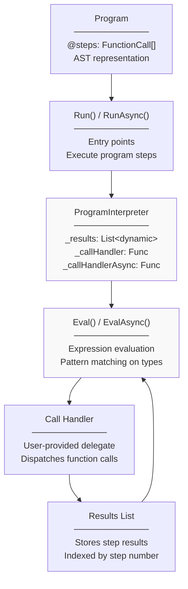
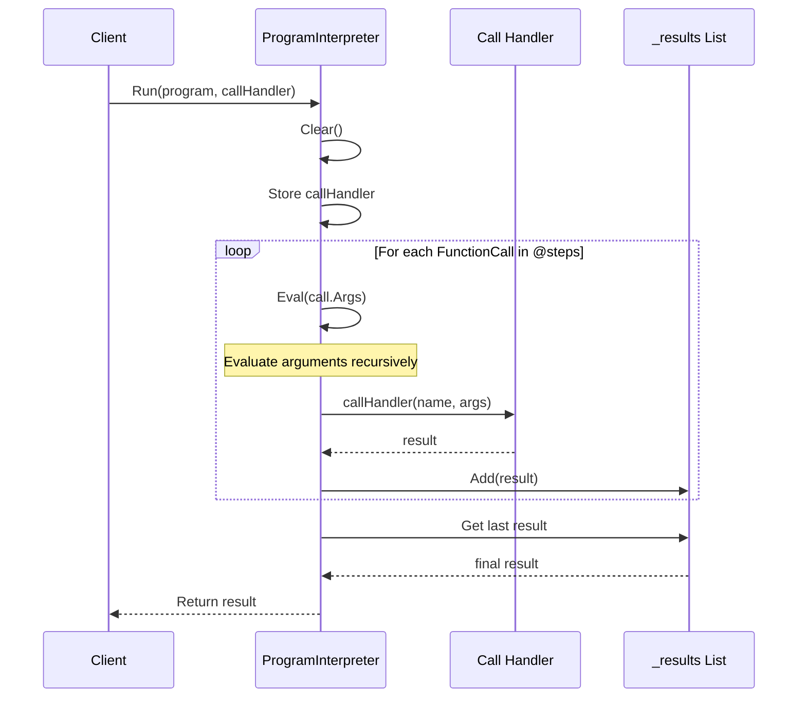
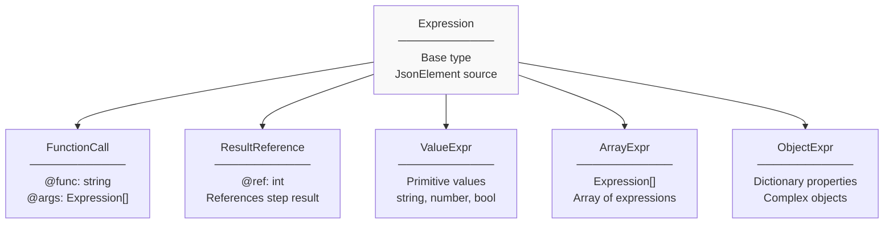
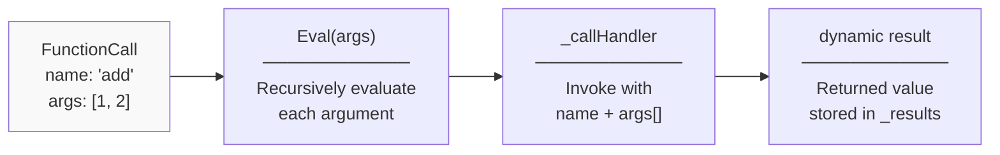
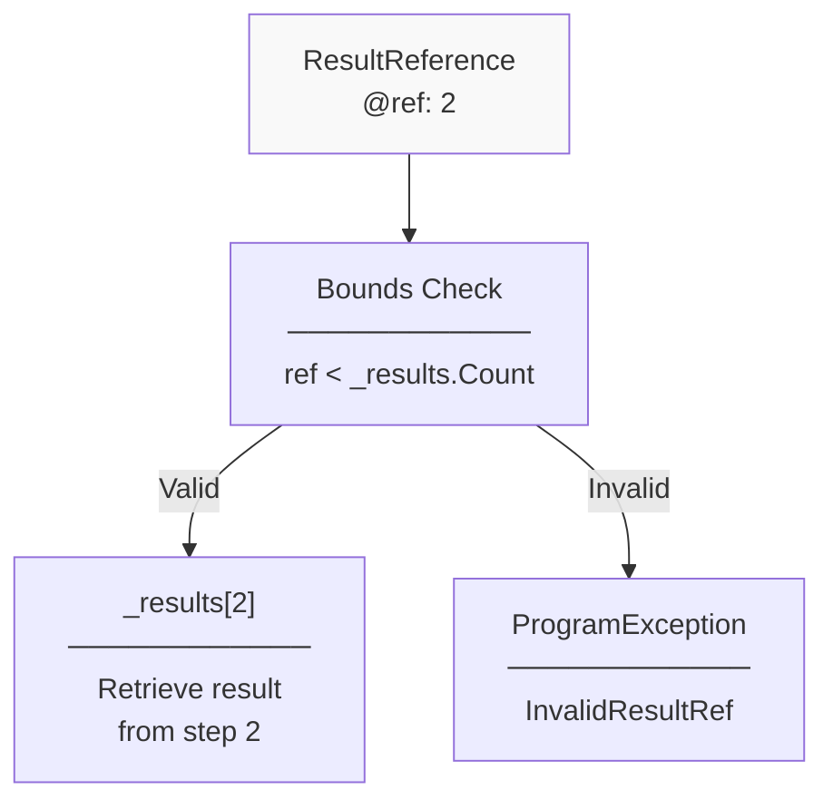
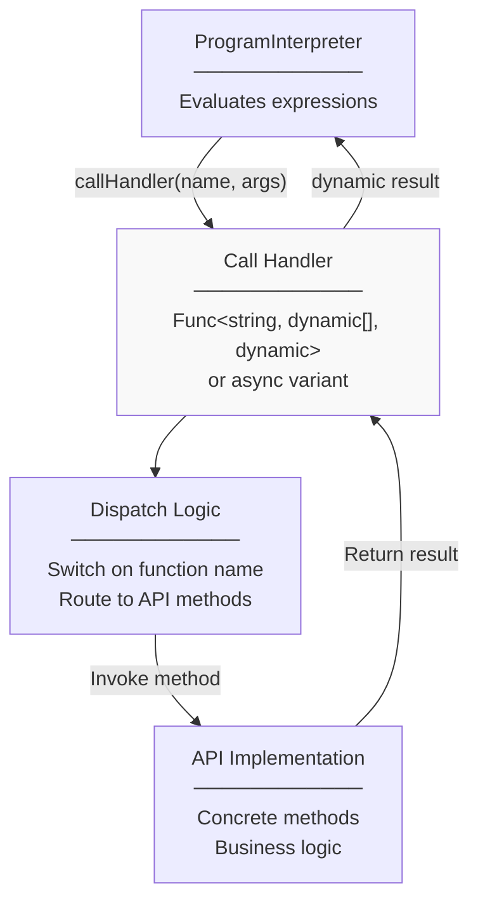
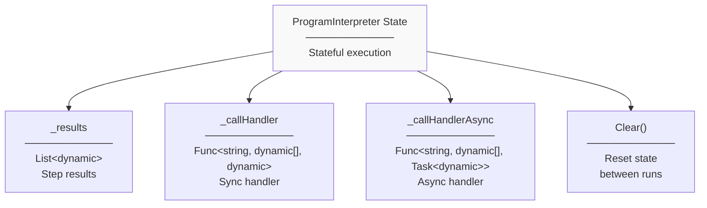
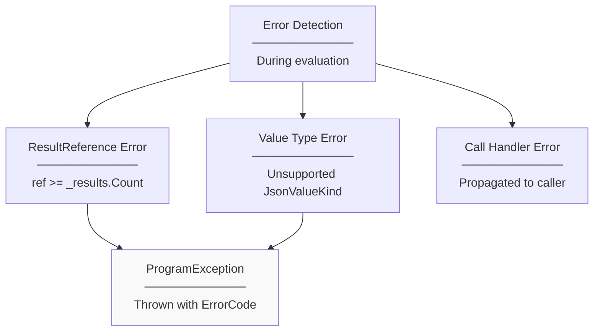
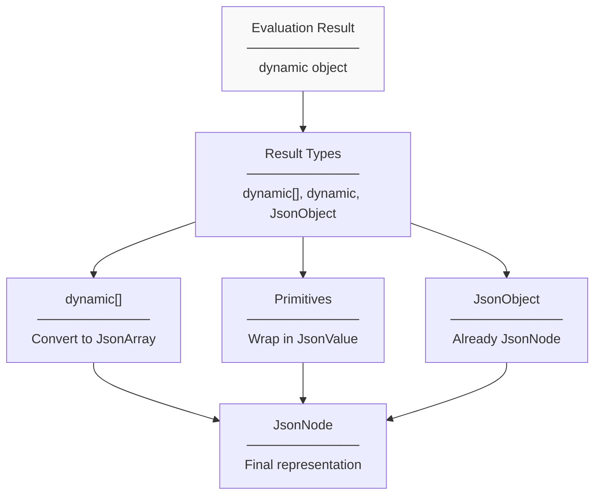
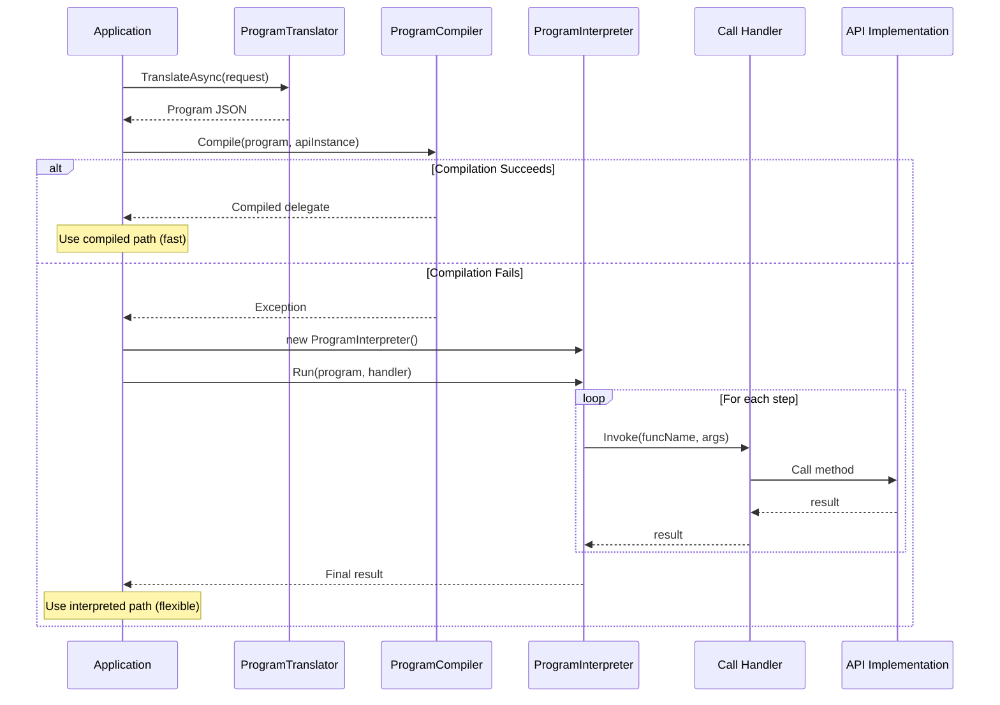

<!-- source: DeepWiki mcp.deepwiki.com · repo microsoft/typechat.net · page 5.4 Program Interpretation · fetched 2026-10-26 -->

# Program Interpretation

Relevant source files

The following files were used as context for generating this wiki page:

- [src/typechat.program/Include.cs](src/typechat.program/Include.cs)
- [src/typechat.program/ProgramException.cs](src/typechat.program/ProgramException.cs)
- [src/typechat.program/ProgramInterpreter.cs](src/typechat.program/ProgramInterpreter.cs)
- [src/typechat.program/ProgramParser.cs](src/typechat.program/ProgramParser.cs)

## Purpose and Scope

This page documents the `ProgramInterpreter` class, which provides dynamic execution of JSON programs generated by `ProgramTranslator`. The interpreter evaluates programs using a lightweight, stateful execution model that does not require compilation.

The interpreter serves as a fallback execution path when `ProgramCompiler` cannot compile a program to a .NET delegate, and is also useful for debugging and scenarios requiring maximum flexibility. For information about the compiled execution path, see [Program Compilation](#5.3). For the structure of programs being executed, see [Program Structure](#5.2).

**Sources:** [src/typechat.program/ProgramInterpreter.cs:1-256]()

---

## ProgramInterpreter Overview

The `ProgramInterpreter` class provides stateful evaluation of JSON programs through simple tree-walking interpretation. The interpreter is extremely lightweight and thread-unsafe by design—each thread should use its own interpreter instance.

### Core Architecture

**Sources:** [src/typechat.program/ProgramInterpreter.cs:11-25](), [src/typechat.program/ProgramInterpreter.cs:34-50]()

---

## Execution Model

### Synchronous Execution

The `Run` method executes a program synchronously by iterating through each `FunctionCall` in the program's `@steps` array and evaluating it:

The interpreter maintains a `List<dynamic>` that stores the result of each step. The final result is the value from the last step.

**Sources:** [src/typechat.program/ProgramInterpreter.cs:34-50](), [src/typechat.program/ProgramInterpreter.cs:84-88]()

### Asynchronous Execution

The `RunAsync` method provides asynchronous execution with the same logic but using async/await patterns:

| Method | Signature | Purpose |
|--------|-----------|---------|
| `Run` | `dynamic? Run(Program, Func<string, dynamic[], dynamic>)` | Synchronous execution |
| `RunAsync` | `Task<dynamic?> RunAsync(Program, Func<string, dynamic[], Task<dynamic>>)` | Asynchronous execution |

Both methods follow identical evaluation logic but differ in how the call handler is invoked.

**Sources:** [src/typechat.program/ProgramInterpreter.cs:59-75]()

---

## Expression Evaluation

The interpreter evaluates different expression types through pattern matching in the `Eval` and `EvalAsync` methods:

### Expression Type Hierarchy

**Sources:** [src/typechat.program/ProgramInterpreter.cs:103-127]()

### Evaluation Logic

Each expression type has specific evaluation logic:

| Expression Type | Evaluation Method | Returns |
|----------------|-------------------|---------|
| `FunctionCall` | Evaluate args, invoke call handler | `dynamic` result from handler |
| `ResultReference` | Lookup in `_results[ref]` | Previously computed result |
| `ValueExpr` | Extract from `JsonElement` | Primitive value (bool, string, double) |
| `ArrayExpr` | Recursively evaluate elements | `dynamic[]` array |
| `ObjectExpr` | Recursively evaluate properties | `JsonObject` |

**Sources:** [src/typechat.program/ProgramInterpreter.cs:103-153](), [src/typechat.program/ProgramInterpreter.cs:185-243]()

### FunctionCall Evaluation

**Sources:** [src/typechat.program/ProgramInterpreter.cs:90-101]()

### ResultReference Evaluation

Result references (`@ref: N`) retrieve previously computed results by index:

**Sources:** [src/typechat.program/ProgramInterpreter.cs:236-243]()

---

## Call Handler Pattern

The call handler is the bridge between the interpreter and the actual API implementation. The caller provides a delegate that dispatches function calls to concrete implementations.

### Call Handler Contract

The interpreter does not know about the target API—it delegates all function execution to the provided handler. This separation enables the interpreter to work with any API interface.

**Sources:** [src/typechat.program/ProgramInterpreter.cs:16-17](), [src/typechat.program/ProgramInterpreter.cs:90-101]()

### Handler Responsibilities

| Responsibility | Description |
|----------------|-------------|
| **Dispatch** | Map function name to concrete method |
| **Type Conversion** | Convert `dynamic[]` args to expected types |
| **Error Handling** | Handle invalid function names or argument counts |
| **Execution** | Invoke the actual API method |

**Sources:** [src/typechat.program/ProgramInterpreter.cs:34-50]()

---

## State Management

The interpreter maintains state during execution:

### State Components

**Key Points:**
- The interpreter is **stateful** and **not thread-safe**
- State is cleared at the start of each `Run` or `RunAsync` call
- For concurrent execution, use separate interpreter instances
- Each interpreter instance is extremely lightweight

**Sources:** [src/typechat.program/ProgramInterpreter.cs:15-25](), [src/typechat.program/ProgramInterpreter.cs:77-82]()

---

## Error Handling

The interpreter throws `ProgramException` for various error conditions:

### Error Categories

| Error Code | Condition | Example |
|------------|-----------|---------|
| `InvalidResultRef` | `@ref` value exceeds available results | `@ref: 5` when only 3 steps executed |
| `JsonValueTypeNotSupported` | Unsupported `JsonValueKind` | `Undefined` or `Null` in unexpected context |

**Sources:** [src/typechat.program/ProgramInterpreter.cs:236-243](), [src/typechat.program/ProgramInterpreter.cs:185-200](), [src/typechat.program/ProgramException.cs:1-76]()

### Exception Details

The `ProgramException` class provides specific error codes and messages:

**Common Exceptions:**

1. **InvalidResultRef**: Thrown when a `ResultReference` points to a step that hasn't been executed yet
   - Example: `@ref: 3` in step 2 (only 2 results available)
   - [src/typechat.program/ProgramException.cs:64-71]()

2. **JsonValueTypeNotSupported**: Thrown when `ValueExpr` contains unsupported JSON value kind
   - Supported: `True`, `False`, `String`, `Number`
   - [src/typechat.program/ProgramInterpreter.cs:185-200]()

3. **Handler Errors**: Any exceptions thrown by the call handler propagate to the caller
   - Function not found, argument type mismatches, etc.

**Sources:** [src/typechat.program/ProgramException.cs:8-76]()

---

## JSON Conversion

The interpreter converts evaluation results to `JsonNode` for object properties:

### Conversion Logic

The `ToJsonNode` static method handles conversion from dynamic evaluation results to JSON nodes, particularly when evaluating `ObjectExpr` properties.

**Sources:** [src/typechat.program/ProgramInterpreter.cs:212-234](), [src/typechat.program/ProgramInterpreter.cs:245-255]()

---

## Comparison with Compilation

The interpreter provides an alternative execution path to the compiled path:

| Aspect | ProgramInterpreter | ProgramCompiler |
|--------|-------------------|-----------------|
| **Execution** | Tree-walking interpretation | Compiled .NET delegate |
| **Performance** | Slower (repeated evaluation) | Fast (optimized code) |
| **Type Safety** | Runtime type checking | Compile-time type checking |
| **Flexibility** | Works with any valid program | May fail to compile edge cases |
| **Usage** | Fallback, debugging | Primary execution path |
| **Thread Safety** | Not thread-safe (stateful) | Thread-safe (immutable delegate) |
| **Memory** | Lightweight instances | Single compiled delegate |

### When to Use Interpreter

1. **Fallback**: When `ProgramCompiler` throws an exception
2. **Debugging**: Easier to inspect intermediate results
3. **Dynamic Scenarios**: When program structure varies significantly
4. **Testing**: Simpler to mock call handlers for unit tests

**Sources:** [src/typechat.program/ProgramInterpreter.cs:1-11]()

---

## Usage Example Flow

**Sources:** [src/typechat.program/ProgramInterpreter.cs:1-256]()

---

## Key Takeaways

| Concept | Summary |
|---------|---------|
| **Purpose** | Lightweight fallback execution for programs that cannot be compiled |
| **State** | Stateful, not thread-safe—use one instance per thread |
| **Handler** | Caller provides dispatch logic via `Func<string, dynamic[], dynamic>` |
| **Results** | Each step result stored in `_results` for `@ref` lookups |
| **Evaluation** | Pattern matching on expression types with recursive evaluation |
| **Async** | Separate `RunAsync` with async handler for asynchronous APIs |
| **Errors** | `ProgramException` for invalid refs and unsupported types |

**Sources:** [src/typechat.program/ProgramInterpreter.cs:1-256](), [src/typechat.program/ProgramException.cs:1-76]()

---

