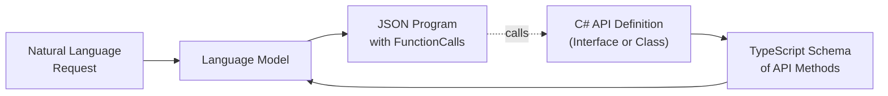
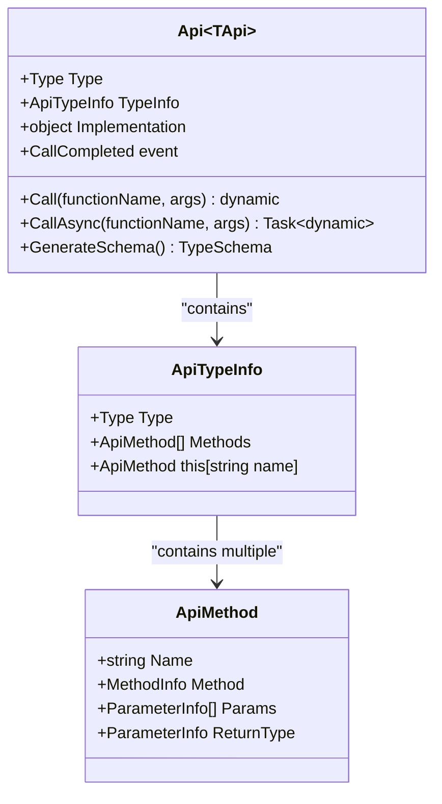
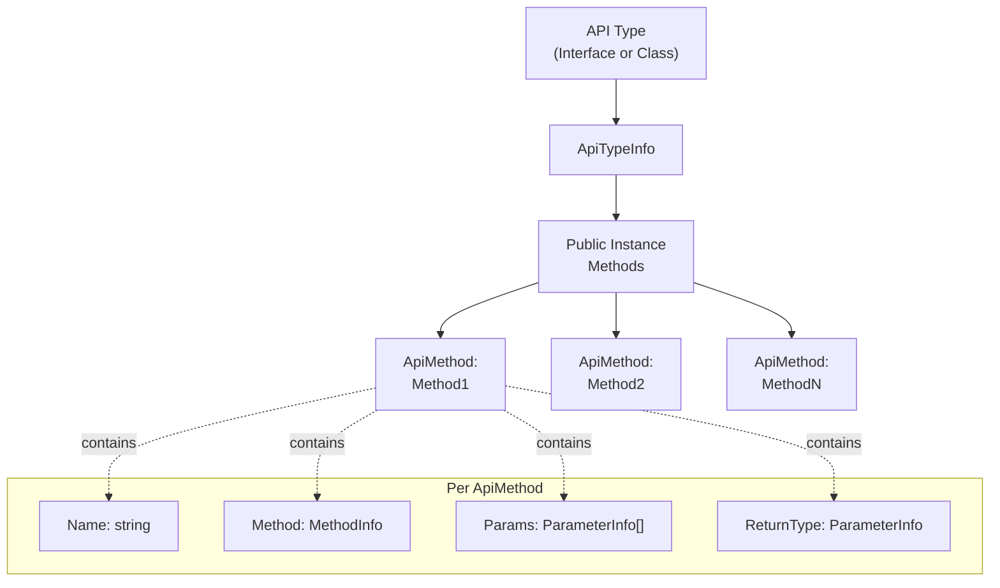
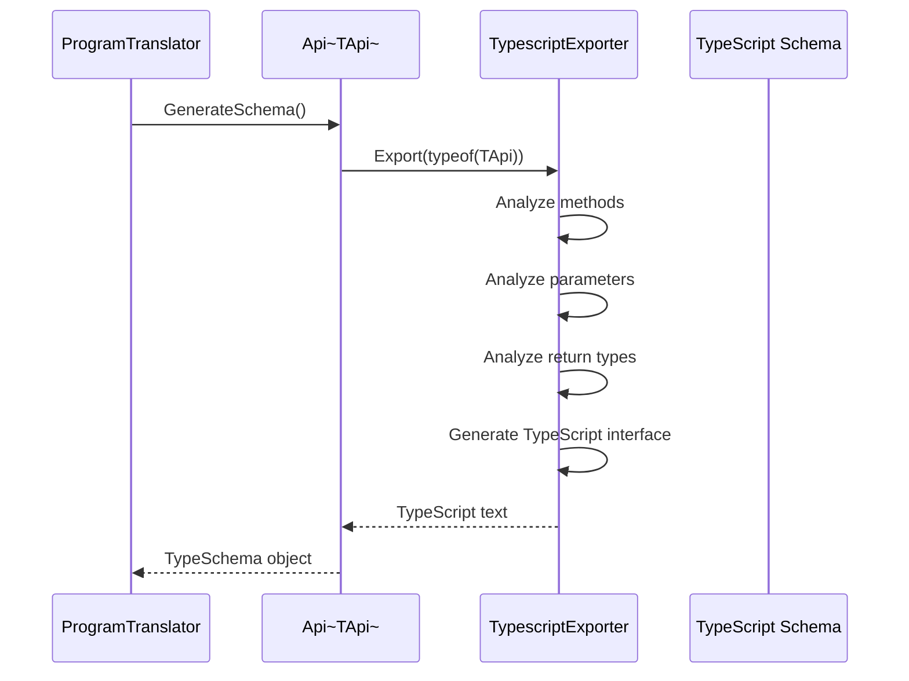
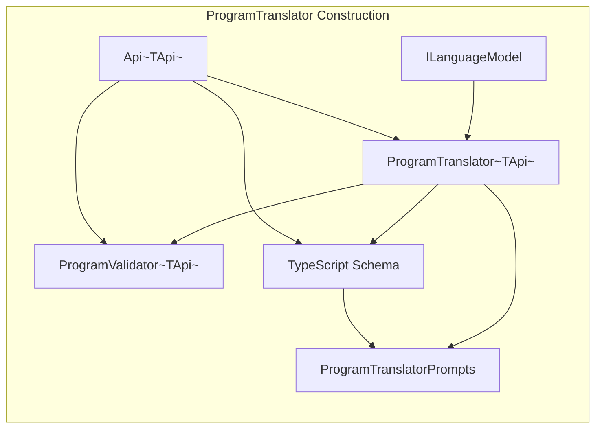
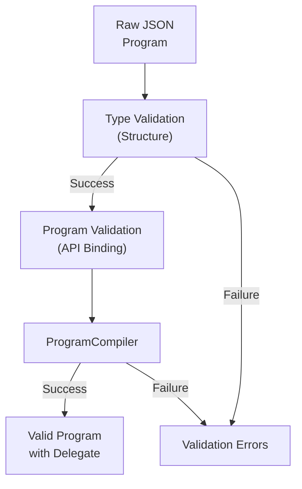

<!-- source: DeepWiki mcp.deepwiki.com · repo microsoft/typechat.net · page 5.5 API Definition · fetched 2026-10-26 -->

# API Definition

<details>
<summary>Relevant source files</summary>

The following files were used as context for generating this wiki page:

- [examples/Math/Program.cs](examples/Math/Program.cs)
- [src/typechat.program/Include.cs](src/typechat.program/Include.cs)
- [src/typechat.program/ProgramCompiler.cs](src/typechat.program/ProgramCompiler.cs)
- [src/typechat.program/ProgramSchemaImpl.cs](src/typechat.program/ProgramSchemaImpl.cs)
- [src/typechat.program/ProgramTranslator.cs](src/typechat.program/ProgramTranslator.cs)
- [src/typechat.program/ProgramValidator.cs](src/typechat.program/ProgramValidator.cs)

</details>


## Purpose and Scope

This page describes how to define target APIs for program translation. An API definition specifies the methods that generated programs can call, establishing the vocabulary and operations available to the language model when translating natural language into executable code.

For information about using `ProgramTranslator` with APIs, see [ProgramTranslator](#5.1). For details on how APIs are compiled and executed, see [Program Compilation](#5.3) and [Program Interpretation](#5.4).

## API Definition Fundamentals

An API definition in TypeChat.Program is a C# interface or class whose public methods define the operations available to generated programs. The language model translates natural language requests into JSON programs containing function calls to these methods.



**Diagram: API Definition Role in Program Translation**

The API serves dual purposes:
1. **Schema source** - Methods are exported to TypeScript to inform the language model
2. **Execution target** - Programs invoke the actual C# methods at runtime

Sources: [src/typechat.program/ProgramTranslator.cs:1-122]()

## The Api and Api<TApi> Classes

### Api<TApi> Generic Class

The `Api<TApi>` class wraps an API definition and provides type information for program translation and validation:



**Diagram: Api Class Structure**

The generic `Api<TApi>` provides:
- **Type**: The `Type` object representing `TApi`
- **TypeInfo**: Extracted method and parameter information
- **Implementation**: The actual instance to invoke methods on
- **CallCompleted**: Event fired when a method completes
- **GenerateSchema()**: Creates TypeScript schema from the API

Sources: [src/typechat.program/ProgramTranslator.cs:105-121](), [examples/Math/Program.cs:1-82]()

### Creating an Api Instance

APIs can be created with an explicit implementation or let the constructor create an instance:

```csharp
// With explicit implementation
IMathAPI mathImpl = new MathAPI();
Api<IMathAPI> api = new Api<IMathAPI>(mathImpl);

// Auto-instantiate (requires parameterless constructor)
Api<IMathAPI> api = new MathAPI(); // implicit conversion
```

Sources: [examples/Math/Program.cs:14-19]()

## Method Requirements and Constraints

### Eligible Methods

Only **public instance methods** of the API type are included in the generated schema and available for program execution:

| Requirement | Description |
|-------------|-------------|
| Accessibility | Must be `public` |
| Member Type | Must be instance methods (not static, not properties) |
| Inheritance | Includes inherited methods from base types/interfaces |
| Overloads | Method overloading is supported |

### Supported Parameter Types

Parameters must be serializable types:

| Type Category | Examples | Notes |
|---------------|----------|-------|
| Primitives | `int`, `double`, `string`, `bool` | Direct mapping |
| Nullable primitives | `int?`, `string?` | Handled automatically |
| Arrays | `int[]`, `string[]` | Maps to TypeScript arrays |
| Complex types | Custom classes/records | Serialized via `JsonObject` |
| Enums | Any enum type | Exported as union types |

### Supported Return Types

Methods can return:
- **Value types**: Primitives, structs, enums
- **Reference types**: Classes, records, strings
- **void**: For side-effect operations
- **Task**: Asynchronous operations (automatically awaited during compilation)
- **Task<T>**: Asynchronous operations returning values

Sources: [src/typechat.program/ProgramCompiler.cs:1-460]()

## API Type Information Extraction

### ApiTypeInfo Class

`ApiTypeInfo` extracts and indexes method information from the API type:



**Diagram: API Type Information Extraction**

`ApiTypeInfo` provides:
- **Indexer access**: `apiTypeInfo["methodName"]` returns `ApiMethod`
- **Method enumeration**: Iterate all available methods
- **Parameter details**: Type, name, and position for each parameter

The `ProgramCompiler` uses `ApiTypeInfo` to validate function calls and generate type-safe code:

```csharp
// Lookup method by name during compilation
ApiMethod method = _apiTypeInfo[call.Name];

// Access parameter information for type checking
ParameterInfo param = method.Params[i];
```

Sources: [src/typechat.program/ProgramCompiler.cs:14-37](), [src/typechat.program/ProgramCompiler.cs:104-126]()

## Schema Generation from API

### TypeScript Schema Export

The API definition is converted to TypeScript to inform the language model. The `GenerateSchema()` method uses `TypescriptExporter` to create an interface matching the API:



**Diagram: API to TypeScript Schema Generation**

Example TypeScript output for a math API:

```typescript
export interface IMathAPI {
    add(x: number, y: number): number;
    subtract(x: number, y: number): number;
    multiply(x: number, y: number): number;
    divide(x: number, y: number): number;
}
```

The generated TypeScript schema is included in prompts to the language model, enabling it to understand available functions and their signatures.

Sources: [src/typechat.program/ProgramTranslator.cs:63-86]()

## Complete API Definition Example

### IMathAPI Interface

The Math example demonstrates a complete API definition:

```csharp
// File: examples/Math/MathAPI.cs
public interface IMathAPI
{
    double Add(double x, double y);
    double Subtract(double x, double y);
    double Multiply(double x, double y);
    double Divide(double x, double y);
    double Negate(double x);
    double Power(double x, double exponent);
    double SquareRoot(double x);
}

public class MathAPI : Api<IMathAPI>, IMathAPI
{
    public double Add(double x, double y) => x + y;
    public double Subtract(double x, double y) => x - y;
    public double Multiply(double x, double y) => x * y;
    public double Divide(double x, double y) => x / y;
    public double Negate(double x) => -x;
    public double Power(double x, double exponent) => Math.Pow(x, exponent);
    public double SquareRoot(double x) => Math.Sqrt(x);
}
```

### Usage in ProgramTranslator

```csharp
// Create API instance
Api<IMathAPI> api = new MathAPI();

// Create translator targeting this API
var translator = new ProgramTranslator<IMathAPI>(
    languageModel,
    api
);

// Subscribe to call events
api.CallCompleted += (name, args, result) => {
    Console.WriteLine($"{name}({string.Join(", ", args)}) => {result}");
};

// Translate natural language to program
Program program = await translator.TranslateAsync(
    "What is the square root of 144 times 3?"
);

// Execute program
dynamic result = program.Run(api);
```

Sources: [examples/Math/Program.cs:8-82]()

## API Definition in ProgramTranslator

### Constructor Parameters

`ProgramTranslator<TApi>` requires:

| Parameter | Type | Purpose |
|-----------|------|---------|
| `model` | `ILanguageModel` | Language model for translation |
| `api` | `Api<TApi>` | API definition and implementation |

The constructor internally creates:
- `ProgramValidator<TApi>` - Validates programs against the API
- TypeScript schema via `api.GenerateSchema()` - Used in prompts



**Diagram: ProgramTranslator Construction with API**

Sources: [src/typechat.program/ProgramTranslator.cs:105-121]()

### ApiDef Property

The `ProgramTranslator` exposes the API schema through the `ApiDef` property:

```csharp
public SchemaText ApiDef { get; }
```

This provides access to the raw TypeScript schema text, useful for debugging or logging:

```csharp
Console.WriteLine(translator.ApiDef);
// Output: TypeScript interface definition of the API
```

Sources: [src/typechat.program/ProgramTranslator.cs:84-86](), [examples/Math/Program.cs:69]()

## API Validation

### ProgramValidator<TApi>

The `ProgramValidator<TApi>` validates that generated programs can bind to the API:



**Diagram: Two-Phase Validation Process**

Phase 1: **Type Validation** - Ensures JSON matches Program schema structure
Phase 2: **Program Validation** - Ensures function calls match API methods

```csharp
public override Result<Program> ValidateProgram(Program program)
{
    ProgramCompiler compiler = new ProgramCompiler(_api.TypeInfo);
    try
    {
        var lambdaExpr = compiler.CompileToExpressionTree(
            program, 
            _api.Implementation
        );
        program.Delegate = lambdaExpr.Compile();
        return new Result<Program>(program);
    }
    catch (Exception ex)
    {
        return Result<Program>.Error(ex.Message);
    }
}
```

Validation failures include:
- **Unknown function**: Function name not found in API
- **Argument count mismatch**: Wrong number of arguments
- **Type mismatch**: Argument type incompatible with parameter
- **Invalid result reference**: Reference to non-existent step

Sources: [src/typechat.program/ProgramValidator.cs:59-92]()

## API Method Invocation

### Direct Invocation

The `Api` class provides methods to invoke API functions by name:

```csharp
// Synchronous call
dynamic result = api.Call("add", new object[] { 2, 3 });

// Asynchronous call
dynamic result = await api.CallAsync("add", new object[] { 2, 3 });
```

### CallCompleted Event

Subscribe to track method invocations:

```csharp
api.CallCompleted += (functionName, args, result) => {
    Console.WriteLine($"Called: {functionName}");
    Console.WriteLine($"Args: {string.Join(", ", args)}");
    Console.WriteLine($"Result: {result}");
};
```

This event fires whenever the API executes a function, whether through compiled delegates or interpreter.

Sources: [examples/Math/Program.cs:21](), [examples/Math/Program.cs:57-61]()

## Best Practices for API Design

### Method Naming

Use clear, descriptive names that map naturally to natural language:

| Good | Poor | Reason |
|------|------|--------|
| `Add(x, y)` | `A(x, y)` | Clear intent |
| `GetWeather(city)` | `Get(city)` | Specific operation |
| `ConvertTemperature(value, from, to)` | `Cvt(v, f, t)` | Descriptive |

### Parameter Design

Keep parameter lists focused and ordered logically:

```csharp
// Good: Clear parameter purpose
double ConvertTemperature(double value, string fromUnit, string toUnit);

// Poor: Ambiguous ordering
double ConvertTemperature(string fromUnit, string toUnit, double value);
```

### Return Value Clarity

Return specific types rather than generic objects:

```csharp
// Good: Explicit return type
WeatherData GetWeather(string city);

// Poor: Ambiguous return
object GetData(string city);
```

### API Granularity

Design APIs at the appropriate level of abstraction:

```csharp
// Good: Single-purpose methods
double Add(double x, double y);
double Multiply(double x, double y);

// Poor: Overloaded generic method
dynamic Calculate(string operation, params object[] args);
```

The language model performs better with explicit, well-named methods than with generic "do anything" methods.

### Handling Async Operations

Async methods are automatically supported - just return `Task` or `Task<T>`:

```csharp
public interface IWeatherAPI
{
    Task<WeatherData> GetCurrentWeatherAsync(string city);
    Task<Forecast[]> GetForecastAsync(string city, int days);
}
```

The `ProgramCompiler` automatically awaits Task results during execution.

Sources: [src/typechat.program/ProgramCompiler.cs:374-390]()

## Type Constraints

### Supported Types

| Category | C# Type | TypeScript Type | Notes |
|----------|---------|-----------------|-------|
| Numbers | `int`, `long`, `double`, `float` | `number` | All numeric types map to `number` |
| Strings | `string` | `string` | Direct mapping |
| Booleans | `bool` | `boolean` | Direct mapping |
| Null | `null` | `null` | Supported in nullable contexts |
| Arrays | `T[]` | `T[]` | Element type must be supported |
| Objects | Custom classes | `object` | Serialized as JSON |
| Enums | Any enum | Union type | `"Value1" \| "Value2"` |
| Void | `void` | `void` | For side-effect methods |

### Unsupported Types

- `ref` or `out` parameters
- Pointer types
- Generic method parameters (use concrete types)
- Non-serializable types

Sources: [src/typechat.program/ProgramCompiler.cs:154-207]()

## Summary

An API definition in TypeChat.Program serves as both a schema for the language model and an execution target for generated programs. Key points:

1. Define APIs as C# interfaces or classes with public methods
2. Wrap definitions in `Api<TApi>` for type information extraction
3. Methods are automatically converted to TypeScript schemas
4. The `ProgramValidator<TApi>` ensures programs bind correctly to the API
5. Design APIs with clear naming and appropriate granularity
6. Async methods are fully supported via `Task` returns

The API definition bridges natural language and executable code, enabling type-safe program generation and execution.

Sources: [src/typechat.program/ProgramTranslator.cs:1-122](), [src/typechat.program/ProgramCompiler.cs:1-460](), [src/typechat.program/ProgramValidator.cs:1-92](), [examples/Math/Program.cs:1-82]()

---

