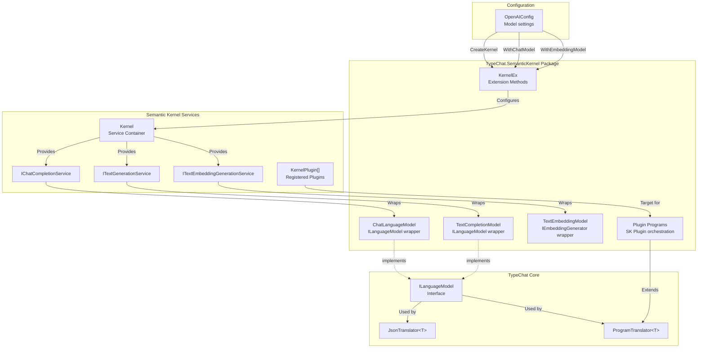
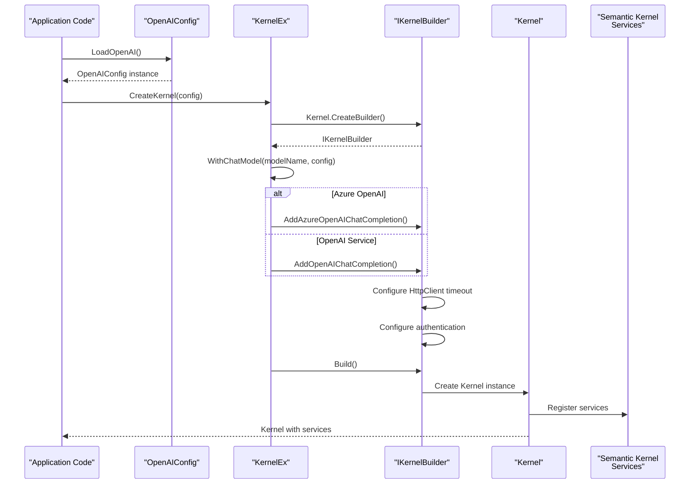
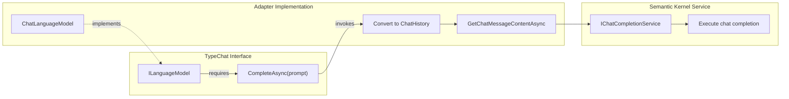
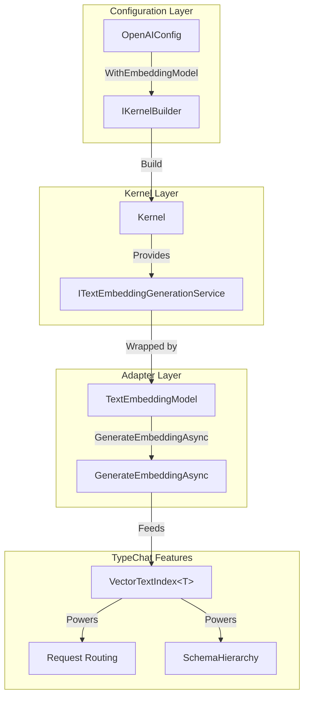
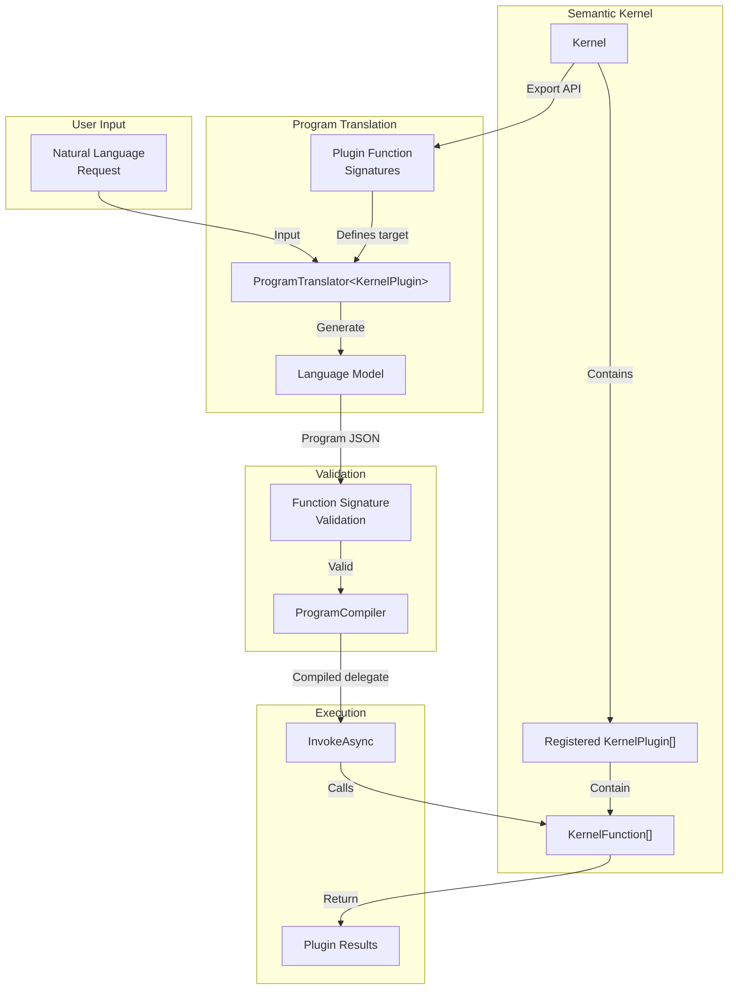

<!-- source: DeepWiki mcp.deepwiki.com · repo microsoft/typechat.net · page 6.1 Semantic Kernel Integration · fetched 2026-10-26 -->

# Semantic Kernel Integration

<details>
<summary>Relevant source files</summary>

The following files were used as context for generating this wiki page:

- [README.md](README.md)
- [examples/Sentiment/Program.cs](examples/Sentiment/Program.cs)
- [examples/appSettings.json](examples/appSettings.json)
- [src/typechat.program/TypeChat.Program.csproj](src/typechat.program/TypeChat.Program.csproj)
- [src/typechat.schema/TypeChat.Schema.csproj](src/typechat.schema/TypeChat.Schema.csproj)
- [src/typechat.sk/KernelEx.cs](src/typechat.sk/KernelEx.cs)
- [src/typechat.sk/TypeChat.SemanticKernel.csproj](src/typechat.sk/TypeChat.SemanticKernel.csproj)
- [src/typechat/TypeChat.csproj](src/typechat/TypeChat.csproj)

</details>


## Purpose and Scope

This document describes how TypeChat.NET integrates with Microsoft Semantic Kernel to provide language model access, embedding generation, and plugin orchestration. The `Microsoft.TypeChat.SemanticKernel` package enables TypeChat applications to leverage Semantic Kernel's services and abstractions.

For information about the core TypeChat translation workflow without Semantic Kernel, see [JsonTranslator](#3.1). For program translation and execution, see [Program Translation](#5). For integration using Microsoft.Extensions.AI abstractions instead, see [Microsoft.Extensions.AI Integration](#6.2).

---

## Integration Architecture

The Semantic Kernel integration provides a bridge between TypeChat's `ILanguageModel` interface and Semantic Kernel's chat completion and text generation services. The integration consists of three primary components: kernel configuration extensions, model adapter implementations, and plugin program support.

**Architecture Diagram: Semantic Kernel Integration Components**



**Sources:** [src/typechat.sk/KernelEx.cs](), [src/typechat.sk/TypeChat.SemanticKernel.csproj](), [README.md:69-75]()

---

## Kernel Creation and Configuration

The `KernelEx` class provides extension methods to create and configure Semantic Kernel instances with chat models and embedding generators.

### Creating a Kernel

The `CreateKernel` extension method creates a fully configured `Kernel` instance from an `OpenAIConfig`:

| Method | Purpose | Returns |
|--------|---------|---------|
| `CreateKernel(OpenAIConfig)` | Creates a kernel with chat completion service | `Kernel` |
| `WithChatModel(IKernelBuilder, string, OpenAIConfig)` | Adds a chat completion service | `IKernelBuilder` |
| `WithChatModels(IKernelBuilder, OpenAIConfig, params string[])` | Adds multiple chat models | `IKernelBuilder` |
| `WithEmbeddingModel(IKernelBuilder, string, OpenAIConfig)` | Adds embedding generation service | `IKernelBuilder` |

**Configuration Flow Diagram**



**Sources:** [src/typechat.sk/KernelEx.cs:16-24](), [src/typechat.sk/KernelEx.cs:52-78]()

### Configuration Options

The `WithChatModel` method automatically handles:

- **Azure OpenAI vs OpenAI Service selection** based on `config.Azure` flag [src/typechat.sk/KernelEx.cs:62-76]()
- **Authentication methods**: API key or Azure token credentials [src/typechat.sk/KernelEx.cs:64-66]()
- **HTTP timeout configuration** from `config.TimeoutMs` [src/typechat.sk/KernelEx.cs:56-61]()
- **Service naming** for multi-model scenarios [src/typechat.sk/KernelEx.cs:52]()

**Sources:** [src/typechat.sk/KernelEx.cs:52-78](), [examples/appSettings.json:1-21]()

---

## Model Adapters

TypeChat's Semantic Kernel integration provides adapter classes that wrap Semantic Kernel services to implement TypeChat's `ILanguageModel` interface.

### ChatLanguageModel

The `ChatLanguageModel` class wraps Semantic Kernel's `IChatCompletionService` to provide chat-based language model access:

**Adapter Pattern Diagram**



**Creating Model Adapters:**

The `KernelEx` class provides factory methods to create model adapters from a configured kernel:

| Factory Method | Service Type | Returns |
|----------------|--------------|---------|
| `ChatLanguageModel(Kernel, ModelInfo)` | `IChatCompletionService` | `ChatLanguageModel` |
| `TextCompletionModel(Kernel, ModelInfo)` | `ITextGenerationService` | `TextCompletionModel` |

**Sources:** [src/typechat.sk/KernelEx.cs:115-120](), [src/typechat.sk/KernelEx.cs:128-133]()

### Usage Example

The following table shows how to use Semantic Kernel services with TypeChat:

| Step | Code Pattern | Purpose |
|------|-------------|---------|
| 1. Configure | `var config = Config.LoadOpenAI();` | Load model configuration |
| 2. Create Kernel | `var kernel = config.CreateKernel();` | Initialize Semantic Kernel |
| 3. Create Adapter | `var model = kernel.ChatLanguageModel(new ModelInfo(config.Model));` | Wrap SK service |
| 4. Create Translator | `var translator = new JsonTranslator<T>(model);` | Use with TypeChat |

**Sources:** [README.md:210-214](), [src/typechat.sk/KernelEx.cs:16-24](), [src/typechat.sk/KernelEx.cs:115-120]()

---

## Embedding Model Integration

The Semantic Kernel integration provides embedding generation support through the `TextEmbeddingModel` class and kernel configuration extensions.

**Embedding Integration Architecture**



**Embedding Model Configuration:**

The `WithEmbeddingModel` extension configures the kernel with embedding generation services:

```
WithEmbeddingModel(builder, modelName, config)
  ↓
  if config.Azure:
    AddAzureOpenAIEmbeddingGenerator(modelName, endpoint, credential)
  else:
    AddOpenAIEmbeddingGenerator(modelName, apiKey, organization)
```

**Sources:** [src/typechat.sk/KernelEx.cs:87-107](), [examples/appSettings.json:15-20]()

---

## Plugin Program Integration

The Semantic Kernel integration enables TypeChat to translate natural language into programs that invoke Semantic Kernel plugins. This allows dynamic orchestration of plugin functions based on user intent.

**Plugin Program Architecture**



**Plugin Translation Workflow:**

1. **API Export**: Plugin functions are exported as API definitions for the language model
2. **Translation**: Natural language is translated into JSON programs targeting plugin functions
3. **Validation**: Generated programs are validated against plugin signatures
4. **Execution**: Valid programs are compiled and executed against the kernel

The plugin integration allows applications to:

- Dynamically compose plugin invocations from natural language
- Type-check generated programs against plugin signatures
- Execute plugin orchestrations with strong type safety
- Leverage Semantic Kernel's plugin ecosystem

**Sources:** [README.md:71-73](), [README.md:142]()

---

## Authentication and Security

The Semantic Kernel integration supports multiple authentication mechanisms for Azure OpenAI services:

| Authentication Method | Configuration | Use Case |
|-----------------------|---------------|----------|
| **API Key** | `config.ApiKey = "your-key"` | Development, simple scenarios |
| **Azure Token Credentials** | `config.ApiKey = "identity"` | Production, managed identity |
| **Custom TokenProvider** | `config.ApiTokenProvider` | Custom auth implementations |

**Azure Identity Flow:**

When `config.ApiKey == "identity"`, the integration uses Azure's `DefaultAzureCredential`:

```
config.HasTokenProvider
  ↓
TokenCredential credential = config.ApiTokenProvider.GetCredential()
  ↓
AddAzureOpenAIChatCompletion(modelName, endpoint, credential, ...)
```

The `DefaultAzureCredential` attempts authentication in this order:
1. Environment variables
2. Managed identity
3. Azure CLI credentials
4. Visual Studio credentials
5. Azure PowerShell credentials

**Sources:** [src/typechat.sk/KernelEx.cs:64-66](), [src/typechat.sk/KernelEx.cs:92-94](), [README.md:158]()

---

## HTTP Configuration

The integration provides control over HTTP client behavior for language model requests:

**HTTP Client Configuration Table:**

| Setting | Property | Default | Purpose |
|---------|----------|---------|---------|
| Timeout | `config.TimeoutMs` | - | Maximum request duration (milliseconds) |
| Retries | `config.MaxRetries` | 2 | Number of retry attempts |

**Timeout Configuration:**

When `config.TimeoutMs > 0`, a dedicated `HttpClient` is created with the specified timeout:

```
if config.TimeoutMs > 0:
  HttpClient client = new HttpClient()
  client.Timeout = TimeSpan.FromMilliseconds(config.TimeoutMs)
  
  AddAzureOpenAIChatCompletion(..., httpClient: client)
```

**Sources:** [src/typechat.sk/KernelEx.cs:57-61](), [examples/appSettings.json:9-13]()

---

## Package Dependencies

The `Microsoft.TypeChat.SemanticKernel` package has the following key dependencies:

| Package | Version | Purpose |
|---------|---------|---------|
| Microsoft.SemanticKernel | 1.67.1 | Core Semantic Kernel functionality |
| Azure.Identity | 1.17.0 | Azure authentication support |
| Microsoft.TypeChat | (project ref) | Core TypeChat library |
| System.Numerics.Tensors | 10.0.0 | Tensor operations for embeddings |

**Target Framework:** netstandard2.0 for maximum compatibility

**Sources:** [src/typechat.sk/TypeChat.SemanticKernel.csproj:18-23](), [src/typechat.sk/TypeChat.SemanticKernel.csproj:4]()

---

## Extension Method Reference

The following table summarizes all extension methods provided by the `KernelEx` class:

| Method Signature | Return Type | Purpose |
|------------------|-------------|---------|
| `CreateKernel(OpenAIConfig)` | `Kernel` | Create configured kernel instance |
| `WithChatModel(IKernelBuilder, string, OpenAIConfig)` | `IKernelBuilder` | Add single chat model |
| `WithChatModels(IKernelBuilder, OpenAIConfig, string[])` | `IKernelBuilder` | Add multiple chat models |
| `WithEmbeddingModel(IKernelBuilder, string, OpenAIConfig)` | `IKernelBuilder` | Add embedding generator |
| `ChatLanguageModel(Kernel, ModelInfo)` | `ChatLanguageModel` | Create chat model adapter |
| `TextCompletionModel(Kernel, ModelInfo)` | `TextCompletionModel` | Create text completion adapter |
| `GenerateMessageAsync(IChatCompletionService, ChatHistory, OpenAIPromptExecutionSettings, CancellationToken)` | `Task<string>` | Helper for message generation |

**Sources:** [src/typechat.sk/KernelEx.cs:8-141]()

---

## Comparison with Extensions.AI

The Semantic Kernel integration and Microsoft.Extensions.AI integration provide different approaches to language model access:

| Aspect | Semantic Kernel | Extensions.AI |
|--------|-----------------|---------------|
| **Abstraction** | Semantic Kernel services | Standard AI abstractions |
| **Plugin Support** | Native plugin orchestration | Not included |
| **Kernel Services** | Full kernel ecosystem access | Focused on model access |
| **Target Scenarios** | SK-based applications | Portable AI applications |
| **Package** | Microsoft.TypeChat.SemanticKernel | TypeChat.Extensions.AI |

For applications already using Semantic Kernel, the SK integration provides seamless access to kernel services and plugins. For new applications or those requiring portability, the Extensions.AI integration may be more appropriate.

**Sources:** [README.md:69-76](), [src/typechat.sk/TypeChat.SemanticKernel.csproj]()

---

