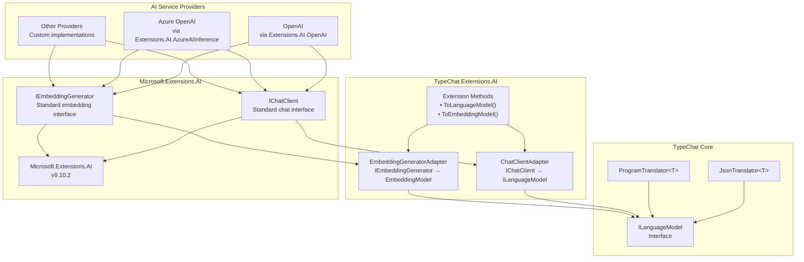
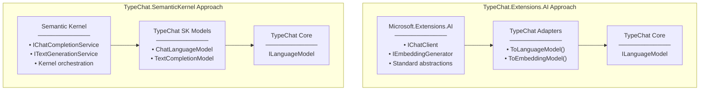
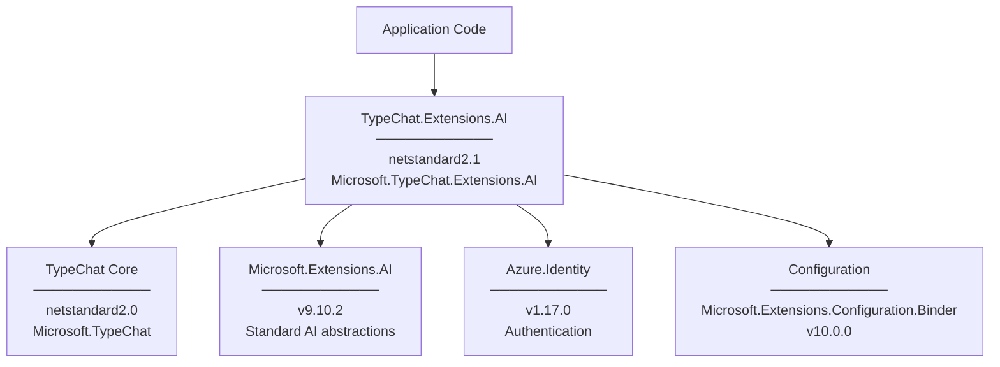
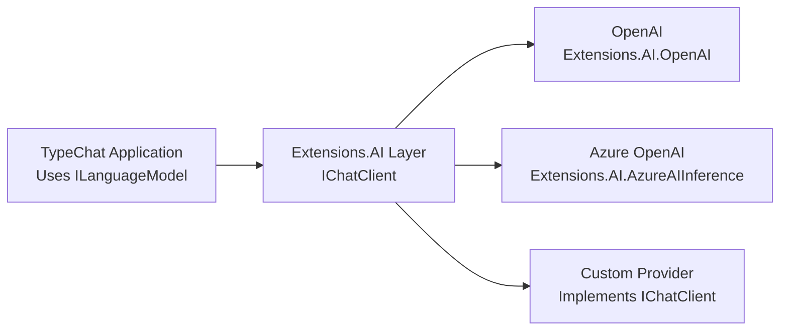

<!-- source: DeepWiki mcp.deepwiki.com · repo microsoft/typechat.net · page 6.2 Microsoft.Extensions.AI Integration · fetched 2026-10-26 -->

# Microsoft.Extensions.AI Integration

<details>
<summary>Relevant source files</summary>

The following files were used as context for generating this wiki page:

- [examples/typechat.examplesLib/TypeChat.ExamplesLib.csproj](examples/typechat.examplesLib/TypeChat.ExamplesLib.csproj)
- [src/typechat.meai/TypeChat.Extensions.AI.csproj](src/typechat.meai/TypeChat.Extensions.AI.csproj)
- [src/typechat.program/TypeChat.Program.csproj](src/typechat.program/TypeChat.Program.csproj)
- [src/typechat.schema/TypeChat.Schema.csproj](src/typechat.schema/TypeChat.Schema.csproj)
- [src/typechat.sk/KernelEx.cs](src/typechat.sk/KernelEx.cs)
- [src/typechat.sk/TypeChat.SemanticKernel.csproj](src/typechat.sk/TypeChat.SemanticKernel.csproj)
- [src/typechat/TypeChat.csproj](src/typechat/TypeChat.csproj)

</details>


## Purpose and Scope

This document describes the TypeChat.Extensions.AI library, which provides integration between TypeChat.NET and the Microsoft.Extensions.AI abstractions. This integration enables TypeChat to work with the standard `IChatClient` and `IEmbeddingGenerator` interfaces, offering a vendor-neutral approach to AI service integration.

For integration with Microsoft Semantic Kernel, see [Semantic Kernel Integration](#6.1). For core language model concepts, see [Language Models](#3.4).

**Sources:** [src/typechat.meai/TypeChat.Extensions.AI.csproj:1-40]()

---

## Overview

The TypeChat.Extensions.AI library bridges TypeChat's `ILanguageModel` interface with the Microsoft.Extensions.AI abstractions. This integration provides:

- Adapter implementations that convert `IChatClient` instances to TypeChat `ILanguageModel` implementations
- Adapter implementations for `IEmbeddingGenerator<string, Embedding<float>>` to TypeChat embedding models
- Extension methods for seamless integration with Microsoft.Extensions.AI patterns
- Support for multiple AI providers through the standard abstractions layer

### Architecture



**Sources:** [src/typechat.meai/TypeChat.Extensions.AI.csproj:1-40]()

---

## Package Configuration

The TypeChat.Extensions.AI package targets `.NET Standard 2.1` and includes the following key dependencies:

| Package | Version | Purpose |
|---------|---------|---------|
| Microsoft.Extensions.AI | 9.10.2 | Core AI abstractions |
| Microsoft.TypeChat | (project ref) | TypeChat core functionality |
| Azure.Identity | 1.17.0 | Azure authentication support |
| Microsoft.Extensions.Configuration.Binder | 10.0.0 | Configuration binding |

The package provides bindings for language models and embeddings to TypeChat.NET using standard AI abstractions.

**Sources:** [src/typechat.meai/TypeChat.Extensions.AI.csproj:17-26]()

---

## Integration Patterns

### Converting IChatClient to ILanguageModel

The primary integration pattern involves converting `IChatClient` instances from Microsoft.Extensions.AI into TypeChat's `ILanguageModel` interface. This is typically done through extension methods:

```csharp
// Conceptual usage pattern
IChatClient chatClient = /* obtain from provider */;
ILanguageModel languageModel = chatClient.ToLanguageModel(modelInfo);

var translator = new JsonTranslator<MySchema>(languageModel);
var result = await translator.TranslateAsync("user request");
```

The adapter handles:
- Message format conversion between Extensions.AI and TypeChat conventions
- Prompt construction and response parsing
- Error handling and retry logic
- Model-specific configuration (temperature, max tokens, etc.)

### Converting IEmbeddingGenerator to Embedding Model

For embedding and vectorization scenarios, the integration provides adapters for `IEmbeddingGenerator`:

```csharp
// Conceptual usage pattern
IEmbeddingGenerator<string, Embedding<float>> embeddingGen = /* obtain from provider */;
var embeddingModel = embeddingGen.ToEmbeddingModel();

// Use with TypeChat's vectorization features
var index = new VectorTextIndex<MyData>(embeddingModel);
```

**Sources:** [src/typechat.meai/TypeChat.Extensions.AI.csproj:1-40](), [src/typechat.sk/KernelEx.cs:109-133]()

---

## Comparison with Semantic Kernel Integration

### Architectural Differences



### When to Use Each Integration

| Scenario | Microsoft.Extensions.AI | Semantic Kernel |
|----------|------------------------|-----------------|
| **Vendor neutrality** | ✓ Better - designed for provider independence | Semantic Kernel specific |
| **Simple TypeChat usage** | ✓ Recommended - lighter weight | More features than needed |
| **SK plugins required** | Limited support | ✓ Full native support |
| **Kernel orchestration** | Not available | ✓ Available |
| **Multiple AI providers** | ✓ Standard abstraction layer | Provider-specific implementations |
| **Future-proofing** | ✓ Industry standard direction | Microsoft ecosystem focus |
| **Existing SK investment** | Migration required | ✓ Direct integration |

**Sources:** [src/typechat.meai/TypeChat.Extensions.AI.csproj:1-40](), [src/typechat.sk/TypeChat.SemanticKernel.csproj:1-41]()

---

## Project Structure and Dependencies

### Dependency Graph



The TypeChat.Extensions.AI assembly is named `Microsoft.TypeChat.Extensions.AI` and uses the `Microsoft.TypeChat` root namespace, maintaining consistency with the broader TypeChat.NET library structure.

**Sources:** [src/typechat.meai/TypeChat.Extensions.AI.csproj:1-40]()

---

## Integration with TypeChat Features

### JsonTranslator Integration

The Extensions.AI integration works seamlessly with `JsonTranslator<T>` for schema-based translation:

```csharp
// Using Extensions.AI chat client
IChatClient chatClient = /* configured client */;
ILanguageModel model = chatClient.ToLanguageModel(modelInfo);

var translator = new JsonTranslator<OrderSchema>(model);
translator.MaxRepairAttempts = 3;

var order = await translator.TranslateAsync(
    "I'd like a large coffee with milk"
);
```

The adapter ensures that:
- Prompts are properly formatted for the underlying provider
- System messages and user messages are correctly structured
- Response parsing handles provider-specific formatting
- Validation errors are properly communicated for repair loops

### ProgramTranslator Integration

For program translation scenarios, the same adapter pattern applies:

```csharp
// Using Extensions.AI for program generation
var programTranslator = new ProgramTranslator<ICalendarAPI>(model);
var program = await programTranslator.TranslateAsync(
    "Show me meetings on Friday with John"
);

var result = await program.RunAsync(calendarApi);
```

### Embedding and Vectorization

The embedding adapter enables semantic search and vector operations:

```csharp
IEmbeddingGenerator<string, Embedding<float>> embeddingGen = /* configured */;
var embeddingModel = embeddingGen.ToEmbeddingModel();

// Use with VectorTextIndex for semantic routing
var index = new VectorTextIndex<SchemaDescriptor>(embeddingModel);
await index.AddAsync(schemaDescriptors);

var nearest = await index.FindNearestAsync(userQuery, topK: 5);
```

**Sources:** [src/typechat.meai/TypeChat.Extensions.AI.csproj:1-40](), [src/typechat/TypeChat.csproj:1-24]()

---

## Configuration and Authentication

### Azure Identity Support

The integration includes Azure.Identity support for token-based authentication with Azure OpenAI and other Azure AI services:

```csharp
// Using Azure identity with Extensions.AI
var credential = new DefaultAzureCredential();

// Extensions.AI client configuration with Azure identity
var chatClient = /* configure with credential */;
var model = chatClient.ToLanguageModel(modelInfo);
```

### Configuration Binding

The package supports `Microsoft.Extensions.Configuration.Binder` for reading model settings from configuration files:

```json
{
  "AI": {
    "ChatModel": "gpt-4",
    "Temperature": 0.0,
    "MaxTokens": 2000
  }
}
```

**Sources:** [src/typechat.meai/TypeChat.Extensions.AI.csproj:18-22]()

---

## Target Framework and Compatibility

The TypeChat.Extensions.AI library targets `.NET Standard 2.1`, requiring:

| Requirement | Minimum Version |
|-------------|----------------|
| .NET Standard | 2.1 |
| .NET Core | 3.0 or higher |
| .NET | 5.0 or higher |

This is a higher requirement than TypeChat Core (which targets `.NET Standard 2.0`) due to the Microsoft.Extensions.AI package requirements. Applications using this integration must target a compatible framework.

**Sources:** [src/typechat.meai/TypeChat.Extensions.AI.csproj:4](), [src/typechat/TypeChat.csproj:4]()

---

## Advantages of Standard Abstractions

### Provider Flexibility

The Microsoft.Extensions.AI abstractions enable switching between providers without changing TypeChat code:



### Industry Alignment

Microsoft.Extensions.AI represents the .NET ecosystem's direction for AI abstractions, similar to how `Microsoft.Extensions.DependencyInjection` became the standard for DI. Using this integration aligns TypeChat applications with emerging .NET AI standards.

### Ecosystem Integration

The Extensions.AI abstractions integrate with:
- ASP.NET Core middleware and services
- Dependency injection containers
- Configuration systems
- Logging and telemetry
- Middleware pipelines

**Sources:** [src/typechat.meai/TypeChat.Extensions.AI.csproj:1-40]()

---

## Summary

The TypeChat.Extensions.AI integration provides a standards-based approach to using TypeChat with AI services through Microsoft.Extensions.AI abstractions. Key characteristics include:

- **Standard Abstractions**: Uses `IChatClient` and `IEmbeddingGenerator` interfaces
- **Provider Independence**: Supports multiple AI providers through unified interface
- **Seamless Integration**: Works with all TypeChat features (translation, programs, agents)
- **Azure Support**: Includes Azure.Identity for managed identity authentication
- **Future Direction**: Aligns with .NET ecosystem standards for AI services

For applications that need Semantic Kernel's orchestration capabilities or extensive plugin support, see [Semantic Kernel Integration](#6.1). For basic TypeChat usage with maximum flexibility, the Extensions.AI integration provides a lightweight, standards-based approach.

**Sources:** [src/typechat.meai/TypeChat.Extensions.AI.csproj:1-40](), [src/typechat.sk/TypeChat.SemanticKernel.csproj:1-41]()

---

