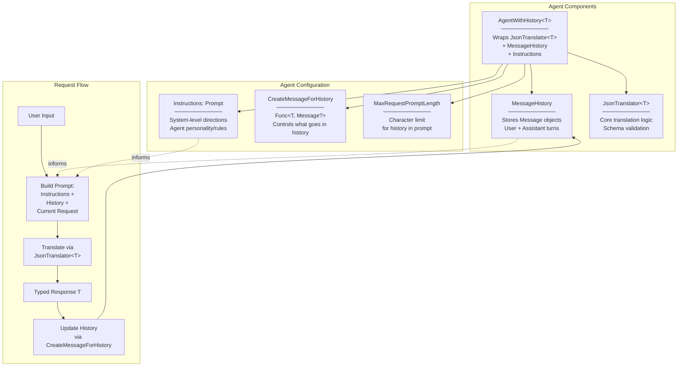
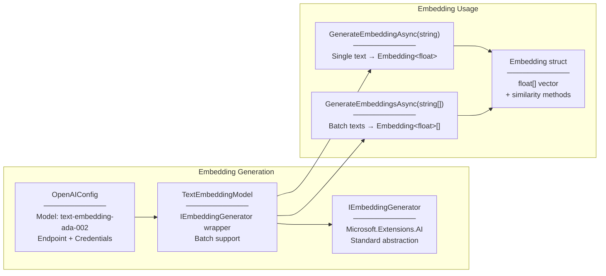
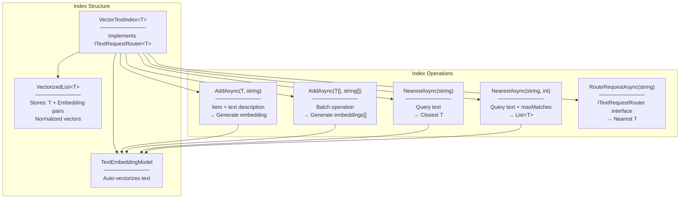
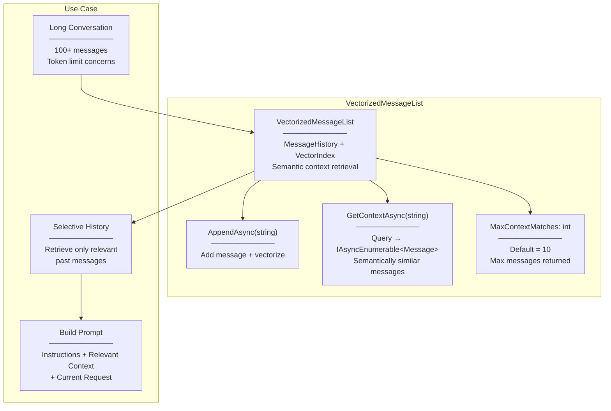
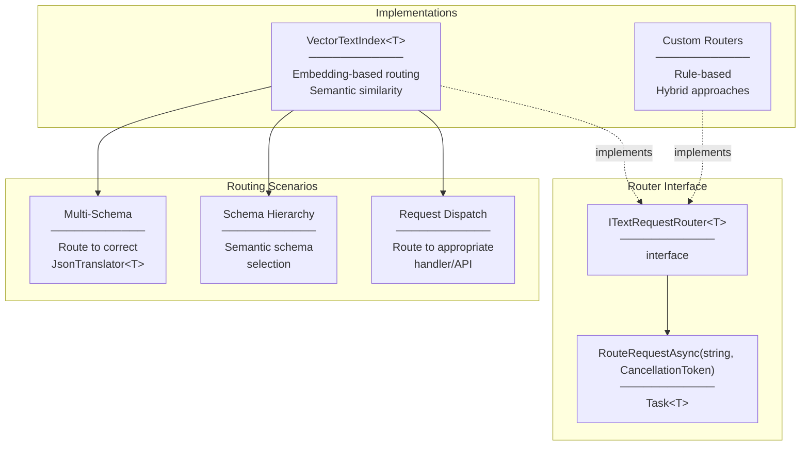
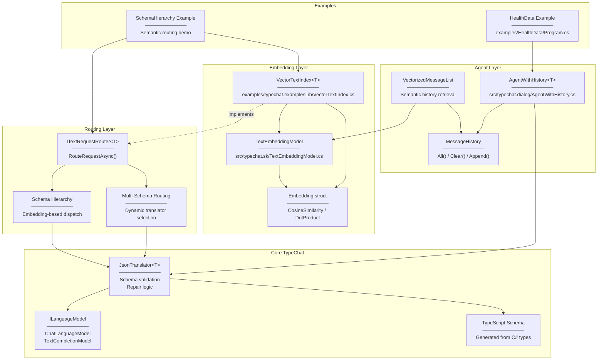

<!-- source: DeepWiki mcp.deepwiki.com · repo microsoft/typechat.net · page 7 Advanced Features · fetched 2026-10-26 -->

# Advanced Features

<details>
<summary>Relevant source files</summary>

The following files were used as context for generating this wiki page:

- [examples/HealthData/HealthSchema.cs](examples/HealthData/HealthSchema.cs)
- [examples/HealthData/Program.cs](examples/HealthData/Program.cs)
- [examples/typechat.examplesLib/ConsoleApp.cs](examples/typechat.examplesLib/ConsoleApp.cs)
- [examples/typechat.examplesLib/VectorTextIndex.cs](examples/typechat.examplesLib/VectorTextIndex.cs)
- [src/typechat.sk/Embeddings/Embedding.cs](src/typechat.sk/Embeddings/Embedding.cs)
- [src/typechat.sk/Embeddings/EmbeddingsEx.cs](src/typechat.sk/Embeddings/EmbeddingsEx.cs)
- [src/typechat.sk/TextEmbeddingModel.cs](src/typechat.sk/TextEmbeddingModel.cs)
- [tests/TypeChat.IntegrationTests/TestVectorized_EndToEnd.cs](tests/TypeChat.IntegrationTests/TestVectorized_EndToEnd.cs)

</details>


This document provides an overview of TypeChat.NET's advanced capabilities that extend beyond basic JSON translation. These features enable sophisticated AI applications including multi-turn conversations, semantic search, and intelligent request routing.

**Scope**: This page introduces three major advanced feature areas:
- **Conversational Agents**: Building stateful, multi-turn dialogs using `AgentWithHistory<T>`
- **Embeddings and Vectorization**: Using `TextEmbeddingModel` and `VectorTextIndex<T>` for semantic search
- **Request Routing**: Dynamic schema selection based on semantic similarity or classification

For step-by-step guides on each feature, see [Conversational Agents](#7.1), [Multi-Schema Routing](#7.2), [Embeddings and Vectorization](#7.3), and [Request Routing](#7.4). For basic translation capabilities, see [Core Concepts](#3).

## Feature Overview

TypeChat.NET provides three primary advanced capabilities that build upon the core `JsonTranslator<T>`:

| Feature | Primary Types | Use Cases |
|---------|--------------|-----------|
| Conversational Agents | `AgentWithHistory<T>`, `MessageHistory`, `Message` | Multi-turn dialogs, data collection, interactive assistants |
| Embeddings | `TextEmbeddingModel`, `Embedding`, `VectorizedList<T>` | Semantic similarity, text classification, clustering |
| Request Routing | `VectorTextIndex<T>`, `ITextRequestRouter<T>`, `VectorizedMessageList` | Multi-schema selection, context retrieval, intelligent dispatching |

These features work together to enable sophisticated AI applications that maintain conversation context, understand semantic relationships, and dynamically adapt to user requests.

Sources: [examples/HealthData/Program.cs:1-127](), [examples/typechat.examplesLib/VectorTextIndex.cs:1-156](), [src/typechat.sk/TextEmbeddingModel.cs:1-80]()

## Conversational Agents with History Management

### AgentWithHistory Architecture

The `AgentWithHistory<T>` class extends `JsonTranslator<T>` with conversation history management, enabling multi-turn dialogs where the language model maintains context across requests.



**Key Agent Methods and Properties**:

| Member | Type | Purpose |
|--------|------|---------|
| `GetResponseAsync(string, CancellationToken)` | Method | Main entry point: translates user input with history context |
| `Instructions` | `Prompt` | System-level instructions prepended to all requests |
| `History` | `MessageHistory` | Conversation history storage |
| `CreateMessageForHistory` | `Func<T, Message?>` | Determines what response data to store in history |
| `MaxRequestPromptLength` | `int` | Limits total character count to avoid token limits |
| `Translator` | `JsonTranslator<T>` | Underlying translator with schema and validation |

Sources: [examples/HealthData/Program.cs:11-31](), [examples/HealthData/Program.cs:44-57]()

### HealthData Agent Example

The HealthData example demonstrates a conversational agent that collects structured health data through natural dialog:

```mermaid
sequenceDiagram
    participant User
    participant Agent as "AgentWithHistory&lt;HealthDataResponse&gt;"
    participant History as "MessageHistory"
    participant LM as "Language Model"
    
    Note over Agent: Initialize with Instructions<br/>Set CreateMessageForHistory
    
    User->>Agent: "Taking aspirin"
    Agent->>Agent: Build Prompt:<br/>Instructions + History + Request
    Agent->>LM: Translate request
    LM-->>Agent: HealthDataResponse:<br/>Message = "What dose?"
    Agent->>History: Store: Message.FromAssistant("What dose?")
    Agent-->>User: "📝: What dose?"
    
    User->>Agent: "81 mg daily"
    Agent->>Agent: Build Prompt with History
    Agent->>LM: Translate with context
    LM-->>Agent: HealthDataResponse:<br/>Data = Medication object
    Agent->>History: Store: Message.FromAssistant(...)
    Agent-->>User: Display structured data
```

**Key Implementation Details**:

The HealthData agent uses several configuration options in [examples/HealthData/Program.cs:14-31]():
- `CreateMessageForHistory = (r) => (r.HasMessage) ? Message.FromAssistant(r.Message) : null` - Only stores questions in history, not full data
- `ConstraintsValidator = new ConstraintsValidator<HealthDataResponse>()` - Enforces `System.ComponentModel.DataAnnotations` attributes
- `MaxRequestPromptLength = 2048` - Limits prompt size
- `Translator.MaxRepairAttempts = 2` - Reduces retry attempts

The `HealthDataResponse` schema in [examples/HealthData/HealthSchema.cs:91-107]() uses three optional properties to enable flexible agent responses:
- `Data`: Returned when all required information is collected
- `Message`: Used to ask clarifying questions
- `NotTranslated`: Captures off-topic or unclear input

For detailed agent implementation patterns, see [Conversational Agents](#7.1).

Sources: [examples/HealthData/Program.cs:9-58](), [examples/HealthData/HealthSchema.cs:91-107]()

## Embeddings and Vectorization

### Text Embedding Model

The `TextEmbeddingModel` class wraps embedding generation services from OpenAI or other providers, generating vector representations of text for semantic similarity calculations.



**Embedding Methods**:

The `Embedding` struct in [src/typechat.sk/Embeddings/Embedding.cs:11-159]() provides similarity calculations:

| Method | Parameters | Returns | Purpose |
|--------|-----------|---------|---------|
| `CosineSimilarity(Embedding)` | other embedding | `double` | Measures similarity between -1 and 1 |
| `DotProduct(Embedding)` | other embedding | `double` | Fast similarity for normalized vectors |
| `Similarity(Embedding, EmbeddingDistance)` | other, distance type | `double` | Generic similarity using specified measure |
| `NormalizeInPlace()` | - | `void` | Converts to unit vector for efficient comparisons |

**EmbeddingDistance Enum**: `Dot` (dot product) or `Cosine` (cosine similarity)

Sources: [src/typechat.sk/TextEmbeddingModel.cs:8-79](), [src/typechat.sk/Embeddings/Embedding.cs:11-159]()

### VectorTextIndex for Semantic Search

`VectorTextIndex<T>` provides an in-memory semantic search index that automatically vectorizes items and enables nearest-neighbor search:



**Index Usage Pattern**:

```
// Create index
var model = new TextEmbeddingModel(config);
var index = new VectorTextIndex<string>(model);

// Add items
await index.AddAsync("bookstore", "Books about science fiction, mystery, and biographies");
await index.AddAsync("bakery", "Fresh bread, pastries, donuts, and cakes");

// Semantic search
string match = await index.NearestAsync("Where can I buy a novel?");
// Returns: "bookstore"
```

The index automatically:
1. Generates embeddings for added items via `TextEmbeddingModel`
2. Normalizes embeddings for efficient comparison
3. Uses dot product similarity for normalized vectors
4. Supports batch operations for performance

Sources: [examples/typechat.examplesLib/VectorTextIndex.cs:7-155](), [tests/TypeChat.IntegrationTests/TestVectorized_EndToEnd.cs:51-89]()

### Vectorized Message Lists

`VectorizedMessageList` extends message history with semantic search capabilities:



**Context Retrieval**: Instead of including entire conversation history, `GetContextAsync` retrieves only the most semantically relevant past messages for the current query.

Example from [tests/TypeChat.IntegrationTests/TestVectorized_EndToEnd.cs:106-140]():
- Messages about "desserts" and "books" are added
- Query "Chocolate Cake" retrieves only dessert-related messages
- Query "Literary fiction" retrieves only book-related messages
- Reduces token usage while maintaining relevant context

Sources: [tests/TypeChat.IntegrationTests/TestVectorized_EndToEnd.cs:106-140]()

## Request Routing with Embeddings

Request routing uses semantic similarity to select the appropriate schema or handler for an incoming request. The `ITextRequestRouter<T>` interface defines the routing contract:



### Routing Example

From [tests/TypeChat.IntegrationTests/TestVectorized_EndToEnd.cs:92-103](), routing to different shop types:

```
var index = new VectorTextIndex<string>(embeddingModel);

// Add shop descriptions
await index.AddAsync("bookstore", "Books, magazines, textbooks, literature");
await index.AddAsync("bakery", "Bread, pastries, cakes, desserts");
await index.AddAsync("hardware", "Tools, nails, lumber, paint");

// Route request semantically
string shop = await index.RouteRequestAsync("Want to buy a book about artificial intelligence");
// Returns: "bookstore"
```

The routing process:
1. Request text is converted to an embedding
2. Similarity scores computed against all indexed items
3. Highest-scoring item is returned
4. Application uses result to select appropriate translator or handler

For advanced routing patterns including multi-schema selection, see [Multi-Schema Routing](#7.2) and [Request Routing](#7.4).

Sources: [tests/TypeChat.IntegrationTests/TestVectorized_EndToEnd.cs:92-103](), [examples/typechat.examplesLib/VectorTextIndex.cs:48-58]()

## Integration: Agents, Embeddings, and Routing

The following diagram shows how advanced features integrate with core TypeChat components and with each other:



**Feature Combinations**:

| Combination | Use Case | Example |
|------------|----------|---------|
| Agent + Embeddings | Selective history retrieval for long conversations | Using `VectorizedMessageList` with `AgentWithHistory<T>` |
| Routing + Multiple Translators | Dynamic schema selection based on request semantics | `VectorTextIndex<JsonTranslator<T>>` routing requests to appropriate translator |
| Agent + Routing | Conversational assistant that switches contexts | Agent that routes between different capability domains |
| Embeddings + Schema Search | Finding most relevant schema for ambiguous requests | Pre-computing schema embeddings for fast matching |

Sources: [examples/HealthData/Program.cs:11-31](), [examples/typechat.examplesLib/VectorTextIndex.cs:15-155](), [tests/TypeChat.IntegrationTests/TestVectorized_EndToEnd.cs:1-146]()

## Configuration and Best Practices

### Embedding Model Configuration

Configure embedding models via `OpenAIConfig`:

| Property | Default | Purpose |
|----------|---------|---------|
| `Model.Name` | "text-embedding-ada-002" | OpenAI embedding model identifier |
| `Endpoint` | - | API endpoint URL |
| `Key` or `Credentials` | - | Authentication |

From [src/typechat.sk/TextEmbeddingModel.cs:20-32](), models support:
- Direct instantiation from `OpenAIConfig`
- Custom `IEmbeddingGenerator<string, Embedding<float>>` services
- Optional `ModelInfo` for model metadata

### Performance Considerations

**Batch Operations**: Use array overloads when adding multiple items to `VectorTextIndex<T>`:
```
// Slower: N individual API calls
for (int i = 0; i < items.Length; i++) {
    await index.AddAsync(items[i], descriptions[i]);
}

// Faster: 1 batch API call
await index.AddAsync(items, descriptions);
```

From [examples/typechat.examplesLib/VectorTextIndex.cs:84-104](), batch operations generate all embeddings in a single API request.

**Vector Normalization**: Embeddings are automatically normalized in `VectorTextIndex<T>` ([examples/typechat.examplesLib/VectorTextIndex.cs:133-154]()). Normalized vectors enable using dot product instead of cosine similarity, improving performance.

**History Length Management**: Set `MaxRequestPromptLength` on `AgentWithHistory<T>` to prevent exceeding token limits:
```csharp
_agent.MaxRequestPromptLength = 2048; // Limit character count
```

From [examples/HealthData/Program.cs:26](), this truncates history when building prompts.

### Error Handling

Embedding operations can fail due to:
- API rate limits
- Network timeouts
- Invalid input text (empty strings, excessive length)

Wrap embedding calls in try-catch blocks and implement retry logic for transient failures.

Sources: [examples/typechat.examplesLib/VectorTextIndex.cs:66-104](), [src/typechat.sk/TextEmbeddingModel.cs:20-78](), [examples/HealthData/Program.cs:26-27]()

## Next Steps

- **[Conversational Agents](#7.1)**: Detailed guide to building multi-turn dialog systems with `AgentWithHistory<T>`
- **[Multi-Schema Routing](#7.2)**: Implementing dynamic schema selection using `VectorTextIndex<T>` and other routing strategies
- **[Embeddings and Vectorization](#7.3)**: Deep dive into embedding generation, similarity calculations, and vectorized data structures
- **[Request Routing](#7.4)**: Advanced routing patterns including hybrid rule-based and semantic approaches
- **[HealthData Agent Example](#8.4)**: Complete walkthrough of a conversational health data collection agent
- **[SchemaHierarchy Example](#8.5)**: Demonstration of semantic schema routing with embeddings

---

