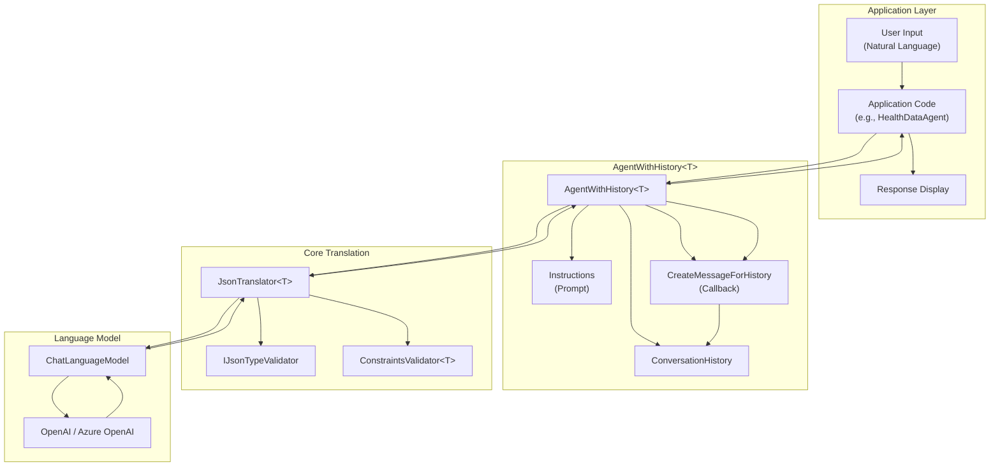
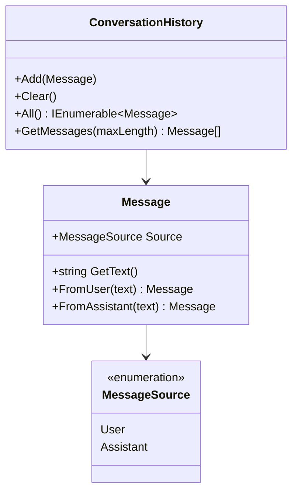
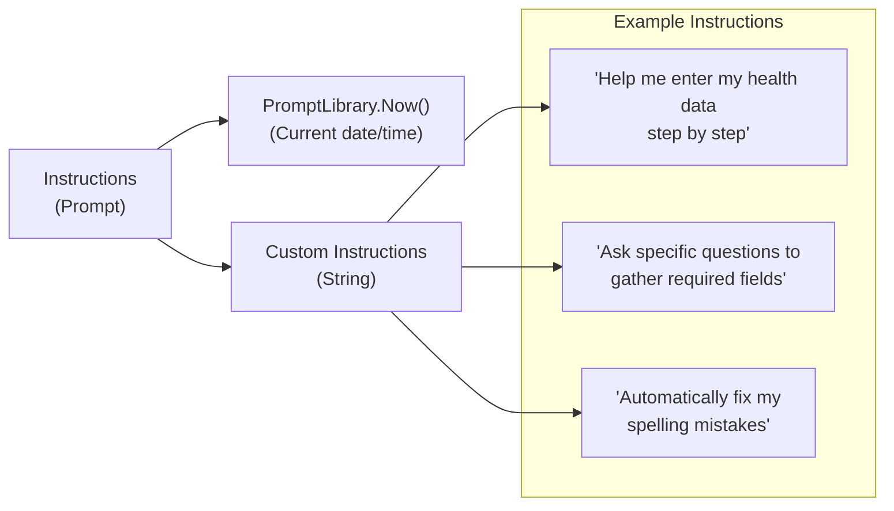
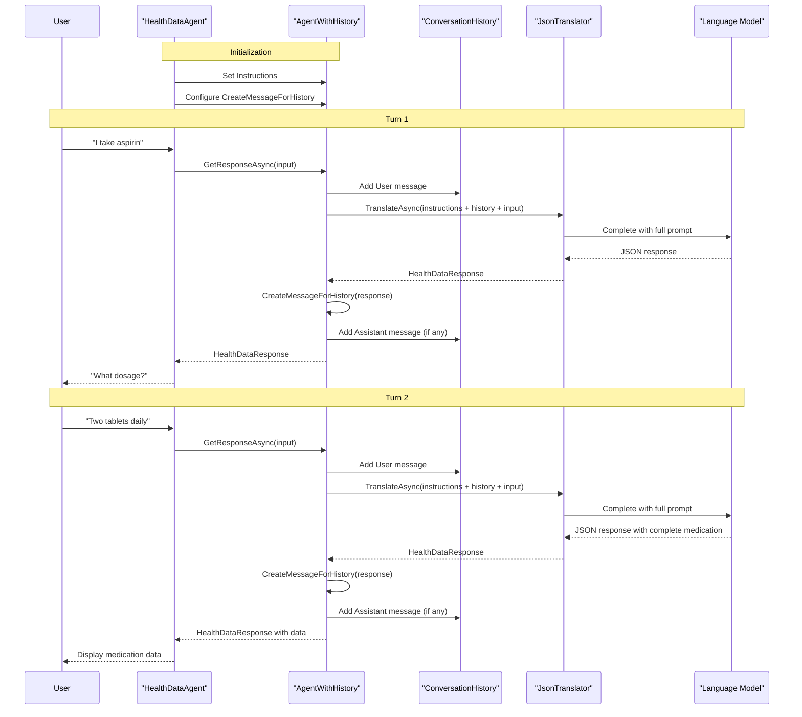
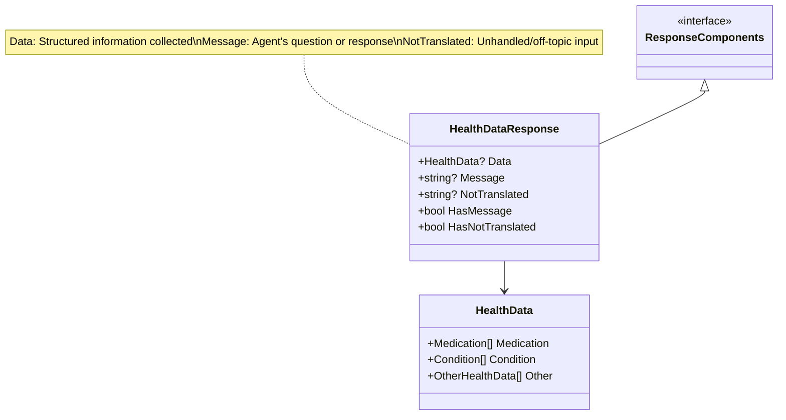
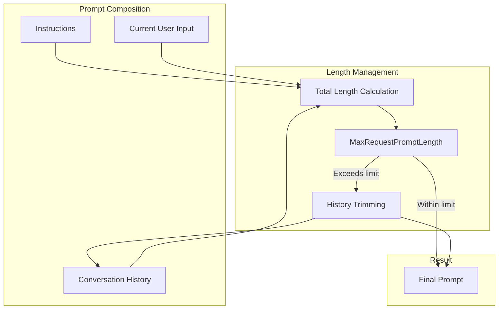
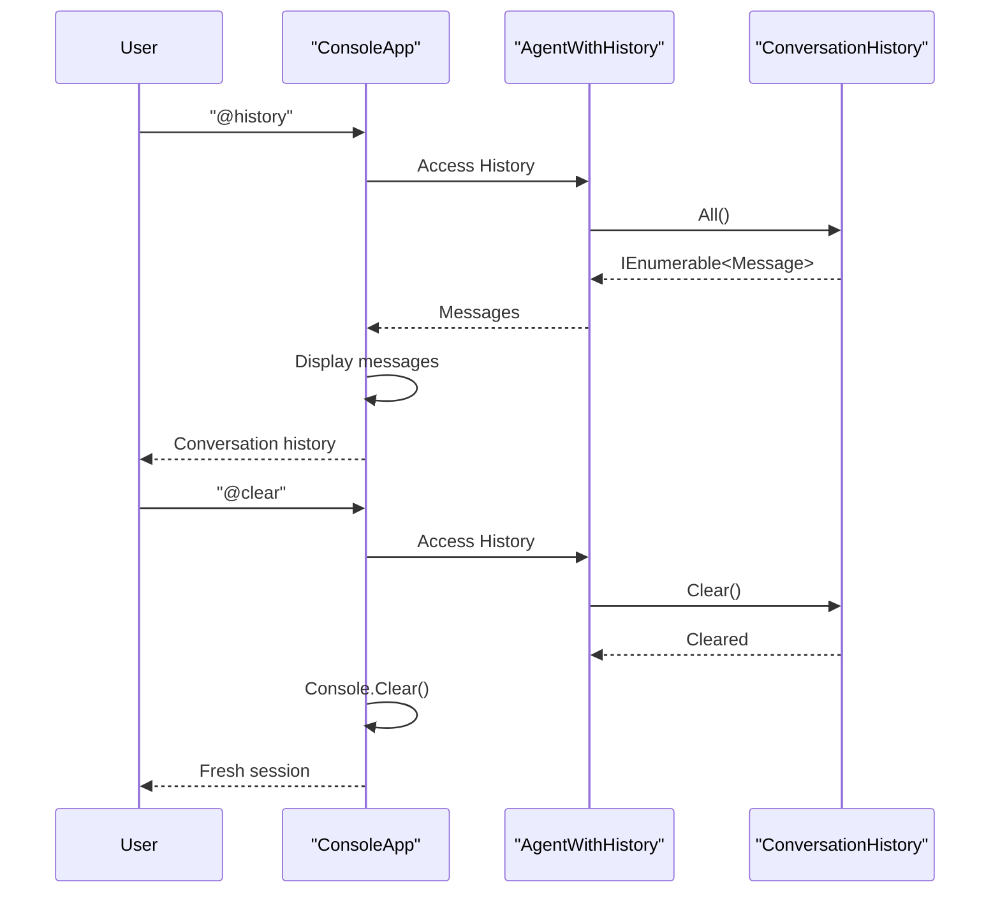
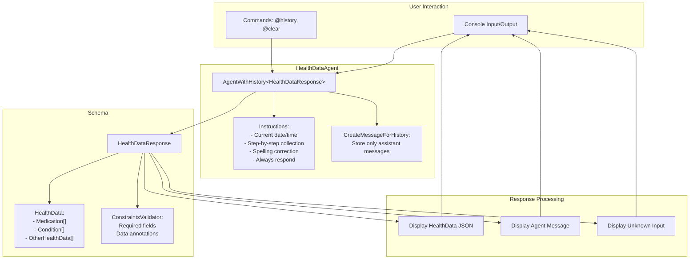

<!-- source: DeepWiki mcp.deepwiki.com · repo microsoft/typechat.net · page 7.1 Conversational Agents · fetched 2026-10-26 -->

# Conversational Agents

<details>
<summary>Relevant source files</summary>

The following files were used as context for generating this wiki page:

- [README.md](README.md)
- [examples/HealthData/HealthSchema.cs](examples/HealthData/HealthSchema.cs)
- [examples/HealthData/Program.cs](examples/HealthData/Program.cs)
- [examples/Sentiment/Program.cs](examples/Sentiment/Program.cs)
- [examples/appSettings.json](examples/appSettings.json)

</details>


## Purpose and Scope

This document covers the conversational agent capabilities in TypeChat.NET, specifically the `AgentWithHistory<T>` class and its supporting infrastructure. Conversational agents enable multi-turn dialogs with language models while maintaining conversation history and context. These agents extend TypeChat's JSON translation capabilities with memory and state management, allowing for interactive data collection and complex user interactions.

For basic single-turn JSON translation without conversation history, see [JsonTranslator](#3.1). For program-based interactions, see [Program Translation](#5).

**Sources:** [README.md:144-146](), [examples/HealthData/Program.cs:1-125]()

## Overview

Conversational agents in TypeChat.NET provide structured, multi-turn interactions with language models. Unlike single-turn translation where each request is independent, conversational agents maintain context across multiple exchanges, enabling:

- **Incremental data collection**: Gathering complex structured data through a series of questions
- **Context awareness**: Referencing previous exchanges in the conversation
- **State management**: Maintaining conversation history and managing prompt length
- **Guided interactions**: Providing instructions that persist across turns

The primary implementation is `AgentWithHistory<T>`, which wraps a `JsonTranslator<T>` and adds conversation history management.

**Sources:** [README.md:144-146](), [examples/HealthData/Program.cs:11-31]()

## Architecture



**AgentWithHistory<T> Component Architecture**

**Sources:** [examples/HealthData/Program.cs:11-31](), [examples/HealthData/HealthSchema.cs:91-107]()

## AgentWithHistory&lt;T&gt; Class

The `AgentWithHistory<T>` class is located in the `Microsoft.TypeChat.Dialog` namespace and provides the core conversational agent functionality. It maintains a `JsonTranslator<T>` internally and adds conversation history management on top of it.

### Key Components

| Component | Type | Purpose |
|-----------|------|---------|
| `Translator` | `JsonTranslator<T>` | Underlying translator for JSON conversion |
| `Instructions` | `Prompt` | Persistent instructions prepended to each request |
| `History` | `ConversationHistory` | Stores messages from previous turns |
| `CreateMessageForHistory` | `Func<T, Message>` | Callback to extract history-relevant messages from responses |
| `MaxRequestPromptLength` | `int` | Maximum prompt length to avoid token limits |

### Initialization

```mermaid
sequenceDiagram
    participant App as "Application"
    participant Agent as "AgentWithHistory&lt;T&gt;"
    participant Translator as "JsonTranslator&lt;T&gt;"
    participant Model as "ChatLanguageModel"
    
    App->>Model: Create ChatLanguageModel(config)
    App->>Agent: new AgentWithHistory&lt;T&gt;(model)
    Agent->>Translator: Create internal JsonTranslator&lt;T&gt;
    App->>Agent: Set Instructions
    App->>Agent: Configure CreateMessageForHistory
    App->>Agent: Configure MaxRequestPromptLength
    App->>Agent: Set ConstraintsValidator
```

**Agent Initialization Sequence**

**Sources:** [examples/HealthData/Program.cs:13-31]()

## Message History Management

The `ConversationHistory` component stores messages from previous conversation turns. Each message has a source (User or Assistant) and content.

### Message Structure



**Message and History Class Structure**

### History Lifecycle

1. **User Input Added**: When `GetResponseAsync()` is called, user input is added to history
2. **Translation Occurs**: Request is sent to language model with history context
3. **Response Processed**: Response is translated to `T`
4. **Selective History Update**: `CreateMessageForHistory` callback determines what to store
5. **Length Management**: `MaxRequestPromptLength` controls prompt size

**Sources:** [examples/HealthData/Program.cs:20-21](), [examples/HealthData/Program.cs:67-72]()

## Instructions and Context

Instructions provide persistent context that applies to every turn in the conversation. They are prepended to each request along with the conversation history.

### Setting Instructions

The `Instructions` property is a `Prompt` object that can be built incrementally:



**Instruction Composition Pattern**

### Instruction Example

The HealthData example demonstrates comprehensive instruction setting:

| Instruction | Purpose |
|-------------|---------|
| `PromptLibrary.Now()` | Provides current date/time context for date-related fields |
| Step-by-step guidance | Tells agent to collect data incrementally |
| Question specificity | Instructs agent to ask specific questions for missing fields |
| Spelling correction | Enables automatic phonetic spelling fixes |
| Data completeness | Ensures all complex nested data is recorded |
| Always respond | Prevents empty responses; agent asks clarifying questions or confirms |

**Sources:** [examples/HealthData/Program.cs:44-57]()

## Multi-Turn Conversation Flow



**Multi-Turn Conversation Sequence**

**Sources:** [examples/HealthData/Program.cs:35-39](), [examples/HealthData/Program.cs:83-97]()

## CreateMessageForHistory Callback

The `CreateMessageForHistory` callback controls what information from each response is stored in conversation history. This is critical for managing prompt length and relevance.

### Callback Signature

```
Func<T, Message> CreateMessageForHistory
```

Where:
- **Input**: The translated response object of type `T`
- **Output**: A `Message` to add to history, or `null` to skip adding to history

### Strategy Patterns

| Pattern | Implementation | Use Case |
|---------|---------------|----------|
| **Selective Storage** | Store only assistant questions | Preserve conversation flow without duplicating data |
| **Full Storage** | Store complete responses | Maximum context retention |
| **Conditional Storage** | Store based on response properties | Balance between context and prompt length |
| **No Storage** | Return `null` | Stateless or validation-only responses |

### HealthData Example

```
_agent.CreateMessageForHistory = (r) => 
    (r.HasMessage) ? Message.FromAssistant(r.Message) : null;
```

This implementation:
1. Checks if response has a `Message` property (assistant's question or confirmation)
2. If present, stores it as an Assistant message in history
3. If not present (e.g., data-only response), skips history storage
4. Prevents data duplication while preserving conversation questions

**Sources:** [examples/HealthData/Program.cs:20-21](), [examples/HealthData/HealthSchema.cs:96-97]()

## Response Schema Pattern

Conversational agent response schemas typically include three components:



**Conversational Response Schema Pattern**

### Component Purposes

| Component | Type | Purpose | When Populated |
|-----------|------|---------|---------------|
| `Data` | Domain object | Structured data collected | When all required fields are gathered |
| `Message` | `string` | Agent's question or acknowledgment | To ask for missing information or confirm |
| `NotTranslated` | `string` | Unprocessed input | When user provides off-topic or unclear input |

This pattern enables:
- **Incremental collection**: Agent can gather data across multiple turns
- **Guidance**: Agent asks specific questions via `Message`
- **Error handling**: Unprocessed input captured in `NotTranslated`

**Sources:** [examples/HealthData/HealthSchema.cs:91-107]()

## Integration with JsonTranslator

`AgentWithHistory<T>` extends `JsonTranslator<T>` capabilities by wrapping it and adding conversation management:

### Exposed Translator Properties

| Property | Type | Purpose |
|----------|------|---------|
| `Translator` | `JsonTranslator<T>` | Direct access to underlying translator |
| `Translator.MaxRepairAttempts` | `int` | Configure validation repair attempts |
| `Translator.ConstraintsValidator` | `IJsonConstraintsValidator<T>` | Add data annotation validation |
| `Translator.Validator.Schema` | `TypeSchema` | Access generated schema |

### Configuration Example

```
// Configure validation
_agent.Translator.ConstraintsValidator = new ConstraintsValidator<HealthDataResponse>();

// Set repair attempts
_agent.Translator.MaxRepairAttempts = 2;

// Access schema
TypeSchema schema = _agent.Translator.Validator.Schema;
```

**Sources:** [examples/HealthData/Program.cs:22-28](), [examples/HealthData/Program.cs:33]()

## Prompt Length Management

`MaxRequestPromptLength` limits the total character count of prompts sent to the language model, preventing token limit errors.



**Prompt Length Management Flow**

### Trimming Strategy

When total prompt length exceeds `MaxRequestPromptLength`:
1. Instructions are always preserved (highest priority)
2. Current user input is always preserved (required for current turn)
3. History is trimmed from oldest to newest to fit within limit
4. Most recent history messages are retained for context

**Configuration:**
```
_agent.MaxRequestPromptLength = 2048;
```

**Sources:** [examples/HealthData/Program.cs:26]()

## Commands and History Management

Applications using conversational agents typically implement commands for history inspection and management:

### Common Commands

| Command | Implementation | Purpose |
|---------|---------------|---------|
| `@history` | `_agent.History.All()` | Display all conversation messages |
| `@clear` | `_agent.History.Clear()` | Reset conversation state |

### Implementation Pattern



**History Management Command Flow**

**Sources:** [examples/HealthData/Program.cs:59-81]()

## Complete Example: HealthData Agent

The HealthData example demonstrates a complete conversational agent implementation for collecting structured health information.

### System Overview



**HealthData Agent Architecture**

### Initialization Steps

1. **Create Agent** with `ChatLanguageModel`
2. **Configure Instructions** with date/time context and guidance
3. **Set History Callback** to store only assistant questions
4. **Enable Constraints Validation** for data annotations
5. **Set Prompt Limits** to avoid token overruns
6. **Configure Repair Attempts** for validation failures

### Conversation Flow Example

| Turn | User Input | Agent Response Type | Result |
|------|-----------|-------------------|--------|
| 1 | "I take aspirin" | Message | "What dosage do you take?" |
| 2 | "Two tablets daily" | Message | "What strength are the tablets?" |
| 3 | "50 mg" | Data + Message | Medication data + "Anything else?" |
| 4 | "I have diabetes" | Message | "When did it start?" |
| 5 | "About 5 years ago" | Message | "What is the current status?" |
| 6 | "active" | Data | Complete HealthData with medication and condition |

### Response Handling

```
private void PrintResponse(HealthDataResponse response)
{
    // Display structured data
    if (response.Data is not null)
        Console.WriteLine(Json.Stringify(response.Data));
    
    // Display agent message
    if (response.HasMessage)
        Console.WriteLine($"📝: {response.Message}");
    
    // Display unprocessed input
    if (response.HasNotTranslated)
        Console.WriteLine($"🤔: I did not understand\n {response.NotTranslated}");
}
```

**Sources:** [examples/HealthData/Program.cs:1-125](), [examples/HealthData/HealthSchema.cs:1-108]()

## Key Configuration Properties

| Property | Location | Type | Default | Purpose |
|----------|----------|------|---------|---------|
| `Instructions` | `AgentWithHistory<T>` | `Prompt` | Empty | Persistent context prepended to all requests |
| `CreateMessageForHistory` | `AgentWithHistory<T>` | `Func<T, Message>` | Store all | Controls what enters conversation history |
| `MaxRequestPromptLength` | `AgentWithHistory<T>` | `int` | Unlimited | Caps total prompt character count |
| `MaxRepairAttempts` | `Translator` | `int` | 3 | Validation repair retry limit |
| `ConstraintsValidator` | `Translator` | `IJsonConstraintsValidator<T>` | `null` | Additional validation beyond schema |

**Sources:** [examples/HealthData/Program.cs:20-28]()

## Best Practices

### Instruction Design
- Include current date/time context when relevant (use `PromptLibrary.Now()`)
- Specify step-by-step behavior for complex data collection
- Tell the agent to always respond (never return empty)
- Enable spelling correction for user-friendly input
- Emphasize data completeness for nested structures

### History Management
- Store only conversation-relevant messages (questions, not data)
- Set `MaxRequestPromptLength` to avoid token limits (typically 2048-4096)
- Implement `@history` and `@clear` commands for user control
- Use `CreateMessageForHistory` callback to filter history content

### Schema Design
- Include optional `Message` field for agent questions
- Include optional `NotTranslated` field for error handling
- Add helper properties (`HasMessage`, `HasNotTranslated`) for convenient checks
- Use nullable data properties to indicate incomplete collection

### Validation
- Use `ConstraintsValidator<T>` for data annotation enforcement
- Set `MaxRepairAttempts` to balance accuracy and performance (typically 2-3)
- Provide clear comments in schema to guide language model
- Use `[Required]` and other data annotations on critical fields

**Sources:** [examples/HealthData/Program.cs:44-57](), [examples/HealthData/HealthSchema.cs:91-107]()

---

