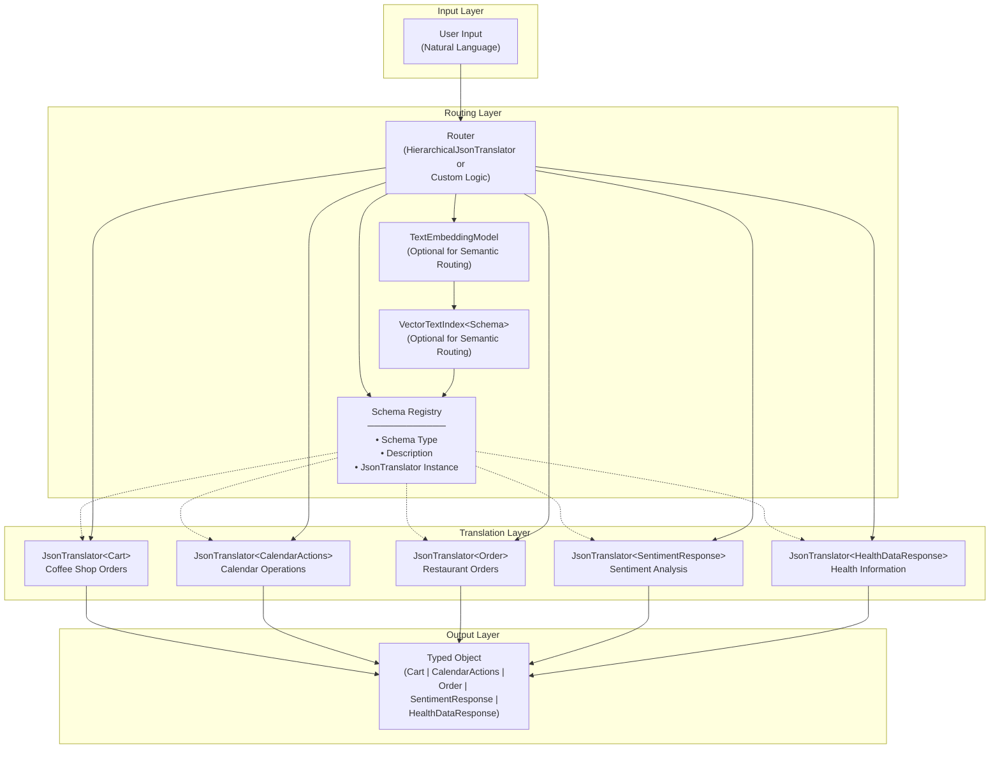
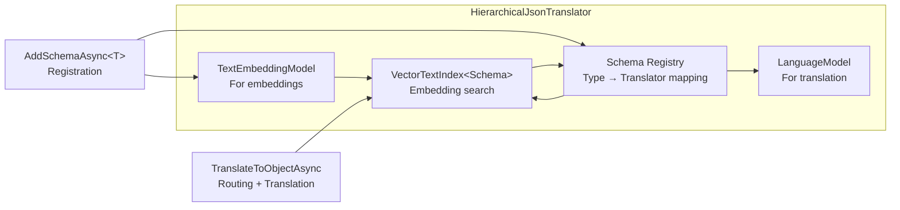
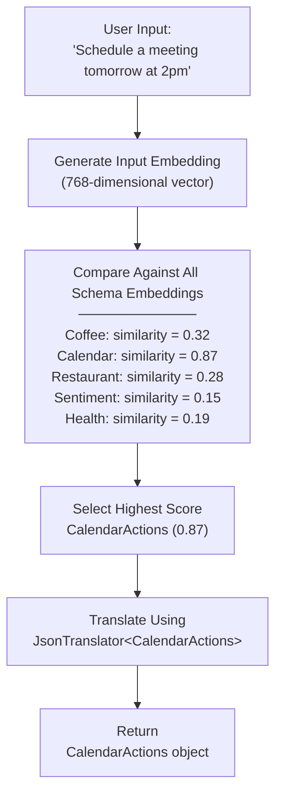

<!-- source: DeepWiki mcp.deepwiki.com · repo microsoft/typechat.net · page 7.2 Multi-Schema Routing · fetched 2026-10-26 -->

# Multi-Schema Routing

<details>
<summary>Relevant source files</summary>

The following files were used as context for generating this wiki page:

- [README.md](README.md)
- [examples/SchemaHierarchy/Program.cs](examples/SchemaHierarchy/Program.cs)
- [examples/Sentiment/Program.cs](examples/Sentiment/Program.cs)
- [examples/appSettings.json](examples/appSettings.json)
- [tests/TypeChat.UnitTests/TestSchema.cs](tests/TypeChat.UnitTests/TestSchema.cs)

</details>


## Purpose and Scope

Multi-schema routing enables TypeChat.NET applications to handle diverse user intents by dynamically selecting the appropriate schema translator for each request. This capability is essential when building applications that need to respond to multiple, distinct types of requests—such as a unified assistant that can handle coffee orders, calendar actions, and restaurant reservations.

This page covers the concepts, architectures, and implementation approaches for multi-schema routing in TypeChat.NET. For information about the underlying embedding and vectorization technology, see [Embeddings and Vectorization](#7.3). For general request routing patterns, see [Request Routing](#7.4).

## Overview

Multi-schema routing addresses scenarios where a single application needs to support multiple `JsonTranslator<T>` instances, each targeting different schema types. Rather than forcing users to explicitly select which translator to use, the system automatically determines the most appropriate schema based on the natural language input.

### When to Use Multi-Schema Routing

Multi-schema routing is appropriate when:
- Your application supports multiple, distinct intent types (e.g., ordering, scheduling, sentiment analysis)
- Different user requests map to completely different schema structures
- You want to build a unified interface that delegates to specialized sub-applications
- Request types can be distinguished by semantic meaning rather than explicit keywords

Sources: [README.md:134-137]()

## Routing Approaches

TypeChat.NET supports two primary approaches for multi-schema routing, each suited to different scenarios:

| Approach | Implementation | Best For | Requires Embeddings |
|----------|---------------|----------|-------------------|
| **Dynamic Routing** | Programmatic logic using patterns, keywords, or custom classification | Deterministic routing rules, keyword-based detection | No |
| **Semantic Routing** | Embedding-based similarity matching | Natural language understanding, ambiguous cases | Yes |

### Dynamic Routing

Dynamic routing uses programmatic logic to select schemas. This can include:
- Pattern matching on input text
- Keyword detection
- Custom classification logic
- Rule-based decision trees

This approach provides deterministic behavior and does not require embedding models, making it suitable for scenarios with clear distinguishing features.

### Semantic Routing

Semantic routing leverages text embeddings to compute similarity between the input request and schema descriptions. The system:
1. Generates embeddings for schema descriptions during initialization
2. Generates an embedding for each incoming request
3. Computes similarity scores (typically cosine similarity)
4. Routes to the schema with the highest similarity score

This approach handles ambiguous or nuanced requests more effectively than keyword-based routing.

Sources: [README.md:134-137](), [examples/SchemaHierarchy/Program.cs:1-66]()

## Multi-Schema Routing Architecture

The following diagram illustrates the high-level architecture for multi-schema routing:



**Multi-Schema Routing Architecture**: The router maintains a registry of available schemas with their descriptions and translator instances. For semantic routing, it uses `TextEmbeddingModel` and `VectorTextIndex` to find the best match. Once selected, the appropriate `JsonTranslator<T>` handles the translation.

Sources: [examples/SchemaHierarchy/Program.cs:17-26]()

## Semantic Routing Workflow

The following sequence diagram shows how semantic routing operates using embeddings:

```mermaid
sequenceDiagram
    participant User
    participant App
    participant HJT as HierarchicalJsonTranslator
    participant VTI as VectorTextIndex&lt;Schema&gt;
    participant EM as TextEmbeddingModel
    participant JT as JsonTranslator&lt;T&gt;
    participant LM as LanguageModel
    
    Note over App,EM: Initialization Phase
    App->>HJT: new HierarchicalJsonTranslator(model, embeddingModel)
    App->>HJT: AddSchemaAsync&lt;Cart&gt;("Order Coffee Drinks...")
    HJT->>EM: GenerateEmbeddingAsync("Order Coffee Drinks...")
    EM-->>HJT: Embedding vector
    HJT->>VTI: AddAsync(schema, embedding)
    App->>HJT: AddSchemaAsync&lt;CalendarActions&gt;("Actions related to calendars...")
    HJT->>EM: GenerateEmbeddingAsync("Actions related to calendars...")
    EM-->>HJT: Embedding vector
    HJT->>VTI: AddAsync(schema, embedding)
    Note over HJT,VTI: Repeat for all schemas
    
    Note over User,LM: Translation Phase
    User->>App: "Schedule a meeting tomorrow at 2pm"
    App->>HJT: TranslateToObjectAsync(input)
    HJT->>EM: GenerateEmbeddingAsync(input)
    EM-->>HJT: Input embedding vector
    HJT->>VTI: FindNearestAsync(input embedding)
    VTI-->>HJT: CalendarActions schema (highest similarity)
    HJT->>JT: GetTranslator&lt;CalendarActions&gt;()
    HJT->>JT: TranslateAsync(input)
    JT->>LM: CompleteAsync(prompt + CalendarActions schema)
    LM-->>JT: JSON response
    JT-->>HJT: CalendarActions object
    HJT-->>App: CalendarActions object
    App-->>User: Display result
```

**Semantic Routing Sequence**: During initialization, each schema description is converted to an embedding and indexed. At runtime, the input is converted to an embedding, compared against indexed schema embeddings, and routed to the nearest match.

Sources: [examples/SchemaHierarchy/Program.cs:17-48]()

## Schema Registration

Schema registration involves associating a schema type with a descriptive string that captures its purpose and scope. These descriptions are critical for semantic routing as they form the basis for similarity matching.

### Registration Example

The `SchemaHierarchy` example demonstrates registering multiple schemas:

```
examples/SchemaHierarchy/Program.cs:38-48
```

Each `AddSchemaAsync<T>()` call provides:
1. **Type parameter** (`<Cart>`, `<CalendarActions>`, etc.): The C# type representing the schema
2. **Description string**: A natural language description of what requests this schema handles

### Writing Effective Descriptions

Schema descriptions should:
- Clearly state the domain or intent type
- Include relevant keywords and synonyms
- Mention specific entities or operations the schema handles
- Be distinct from other schema descriptions

**Examples of effective descriptions:**

| Schema Type | Description | Key Characteristics |
|------------|-------------|-------------------|
| `Cart` | "Order Coffee Drinks (Italian names included) and Baked Goods" | Mentions coffee, drinks, Italian names, baked goods |
| `CalendarActions` | "Actions related to calendars, appointments, meetings, schedules" | Lists calendar-related nouns (appointments, meetings, schedules) |
| `Order` | "Order pizza, beer and salads" | Specific to restaurant menu items |
| `SentimentResponse` | "Statements with sentiments, emotions, feelings, impressions about places, things, the surroundings" | Focuses on emotional/evaluative language |
| `HealthDataResponse` | "Health information: enter your medications, conditions" | Medical domain with specific data types |

Sources: [examples/SchemaHierarchy/Program.cs:43-47]()

## HierarchicalJsonTranslator

The `HierarchicalJsonTranslator` class implements semantic routing using embeddings. While not shown in the provided file excerpts, this class is referenced in the `SchemaHierarchy` example and serves as the primary implementation for embedding-based multi-schema routing.

### Key Components



**HierarchicalJsonTranslator Components**: The translator combines a language model for translation, an embedding model for similarity computation, a schema registry for maintaining type-to-translator mappings, and a vector index for nearest-neighbor search.

### Initialization

The constructor requires both translation and embedding models:

```
examples/SchemaHierarchy/Program.cs:23-25
```

The embedding model is typically configured separately from the translation model, as shown in the configuration:

```
examples/appSettings.json:15-20
```

### Schema Addition

The `AddSchemaAsync<T>()` method:
1. Creates a `JsonTranslator<T>` instance for the schema type
2. Generates an embedding for the provided description
3. Stores the schema-translator-embedding association in the vector index
4. Enables lookup during routing

### Translation Process

The `TranslateToObjectAsync()` method:
1. Accepts natural language input
2. Generates an embedding for the input
3. Searches the vector index for the nearest schema description
4. Retrieves the corresponding `JsonTranslator<T>`
5. Delegates translation to the selected translator
6. Returns the typed object (as `object` since the type varies)

Sources: [examples/SchemaHierarchy/Program.cs:17-36]()

## Vector-Based Routing Implementation

The routing decision relies on `VectorTextIndex<T>`, which provides nearest-neighbor search capabilities. The index stores embeddings and their associated metadata (in this case, schema information).

### Similarity Computation

The system computes similarity between embeddings using standard vector operations, typically:
- **Cosine similarity**: Measures angle between vectors (range: -1 to 1)
- **Dot product**: Measures alignment between vectors

For more details on these operations, see [Embeddings and Vectorization](#7.3).

### Routing Decision

The schema with the highest similarity score is selected. The process:



**Similarity-Based Selection**: The input embedding is compared against all registered schema embeddings. The schema with the highest similarity score is selected for translation.

Sources: [README.md:136-137]()

## MultiSchema Example

The `MultiSchema` example demonstrates dynamic routing without embeddings. While the implementation details are not shown in the provided files, the README indicates this example uses programmatic logic to route requests to different sub-applications (Calendar, Restaurant, CoffeeShop) based on input context.

This approach might use:
- Regular expressions for pattern matching
- Keyword lists for domain detection
- Custom classification logic based on linguistic features
- Rule-based decision trees

The advantage of this approach is simpler setup (no embedding model required) and deterministic behavior. The disadvantage is reduced flexibility for handling ambiguous or novel input patterns.

Sources: [README.md:135]()

## Handling Routing Failures

When no schema matches the input sufficiently well, applications should handle this gracefully:

1. **Threshold-based rejection**: Only route if similarity score exceeds a threshold
2. **Fallback schema**: Designate a default schema for unmatched requests
3. **Error reporting**: Inform the user that the request couldn't be understood
4. **Logging**: Track routing failures to identify gaps in schema coverage

## Integration with Other Components

Multi-schema routing integrates with several TypeChat.NET components:

### VectorTextIndex

`VectorTextIndex<T>` provides the core nearest-neighbor search functionality. It:
- Stores items (schemas) with their embeddings
- Supports adding items asynchronously
- Finds nearest matches based on similarity metrics
- Returns ranked results

For implementation details, see [Embeddings and Vectorization](#7.3).

### TextEmbeddingModel

`TextEmbeddingModel` generates embeddings from text. It:
- Wraps OpenAI embedding endpoints (e.g., `text-embedding-ada-002`)
- Handles batch embedding generation
- Integrates with both Azure OpenAI and OpenAI services

Configuration example:

```
examples/appSettings.json:15-20
```

### TextClassifier

The `TextClassifier` class (referenced in README) provides an alternative classification approach. It may use embeddings or other techniques to classify input into predefined categories, which can then drive routing decisions.

For more information on request routing patterns, see [Request Routing](#7.4).

Sources: [README.md:137](), [examples/appSettings.json:15-20]()

## Example Application Analysis

The `SchemaHierarchy` example provides a complete implementation of semantic multi-schema routing:

### Application Structure

```
examples/SchemaHierarchy/Program.cs:17-66
```

Key aspects:
1. **Constructor** ([lines 22-26]()): Initializes both translation and embedding models
2. **Initialization** ([lines 38-48]()): Registers all schemas with descriptions during startup
3. **Processing** ([lines 28-36]()): Routes and translates each input, handling any schema type
4. **Console Interface**: Uses the `ConsoleApp` base class for interactive or batch mode

### Supported Schemas

The example supports five distinct schemas, demonstrating the breadth of multi-schema routing:

| Schema | Domain | Sample Request |
|--------|--------|---------------|
| `Cart` (CoffeeShop) | Coffee orders | "I'll have a large latte with almond milk" |
| `CalendarActions` | Scheduling | "Schedule a meeting tomorrow at 2pm" |
| `Order` (Restaurant) | Food orders | "I'd like a large pepperoni pizza and two beers" |
| `SentimentResponse` | Sentiment analysis | "This place has a wonderful atmosphere" |
| `HealthDataResponse` | Health data | "I take metformin and have type 2 diabetes" |

### Running the Example

The console prompt `"☕📅🍕💊🤧😀> "` uses emojis representing each supported domain:
- ☕ Coffee
- 📅 Calendar
- 🍕 Restaurant
- 💊💉 Health
- 😀 Sentiment

Sources: [examples/SchemaHierarchy/Program.cs:1-66]()

## Best Practices

### Schema Description Guidelines

1. **Be specific**: Include concrete examples of entities or operations
2. **Use natural language**: Descriptions should read like human explanations
3. **Include synonyms**: Cover alternative ways of expressing the same intent
4. **Avoid overlap**: Ensure descriptions are distinguishable from each other
5. **Test with real inputs**: Validate that typical user requests match correctly

### Model Selection

For semantic routing:
- **Embedding model**: Use `text-embedding-ada-002` or equivalent
- **Translation model**: Can vary per schema (e.g., `gpt-3.5-turbo` vs. `gpt-4`)
- **Consistency**: Ensure embedding model remains consistent across schema additions

### Performance Considerations

1. **Initialization cost**: Generate schema embeddings once during startup
2. **Routing overhead**: Embedding generation and similarity computation add latency per request
3. **Caching**: Consider caching embeddings for frequently used input patterns
4. **Threshold tuning**: Adjust similarity thresholds based on observed routing accuracy

### Error Handling

1. **Validation failures**: Each translator may fail validation independently
2. **Type casting**: `TranslateToObjectAsync()` returns `object`; cast to expected type carefully
3. **Null results**: Handle cases where no suitable schema is found
4. **Logging**: Track which schemas are selected to identify routing issues

Sources: [examples/SchemaHierarchy/Program.cs:1-66](), [README.md:134-137]()

## Summary

Multi-schema routing enables TypeChat.NET applications to handle diverse user intents by automatically selecting the appropriate schema translator. The two primary approaches—dynamic routing (programmatic logic) and semantic routing (embedding-based similarity)—offer flexibility for different scenarios. The `HierarchicalJsonTranslator` class implements semantic routing using `VectorTextIndex` and `TextEmbeddingModel`, providing a robust solution for applications that need to support multiple, distinct intent types within a unified interface.

Sources: [README.md:134-137](), [examples/SchemaHierarchy/Program.cs:1-66]()

---

