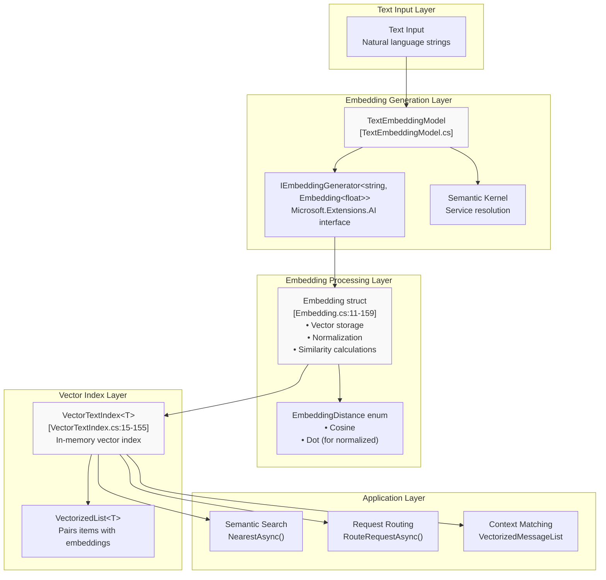
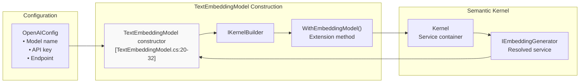
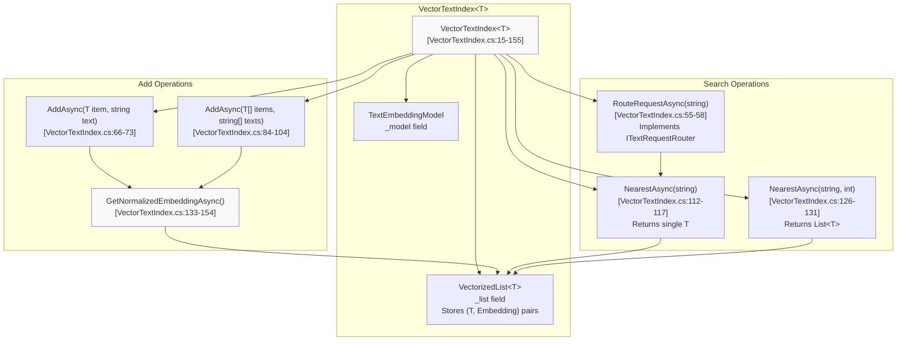
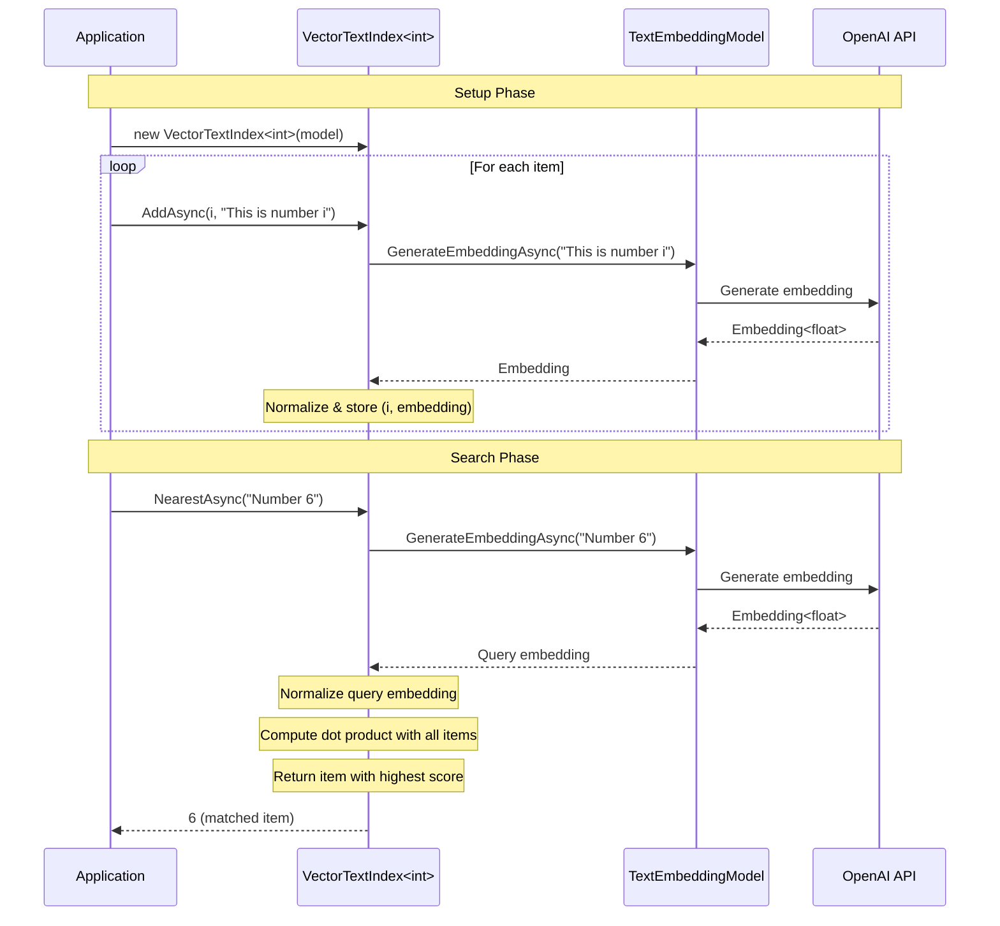

<!-- source: DeepWiki mcp.deepwiki.com · repo microsoft/typechat.net · page 7.3 Embeddings and Vectorization · fetched 2026-10-26 -->

# Embeddings and Vectorization

<details>
<summary>Relevant source files</summary>

The following files were used as context for generating this wiki page:

- [examples/typechat.examplesLib/ConsoleApp.cs](examples/typechat.examplesLib/ConsoleApp.cs)
- [examples/typechat.examplesLib/TypeChat.ExamplesLib.csproj](examples/typechat.examplesLib/TypeChat.ExamplesLib.csproj)
- [examples/typechat.examplesLib/VectorTextIndex.cs](examples/typechat.examplesLib/VectorTextIndex.cs)
- [src/typechat.meai/TypeChat.Extensions.AI.csproj](src/typechat.meai/TypeChat.Extensions.AI.csproj)
- [src/typechat.sk/Embeddings/Embedding.cs](src/typechat.sk/Embeddings/Embedding.cs)
- [src/typechat.sk/Embeddings/EmbeddingsEx.cs](src/typechat.sk/Embeddings/EmbeddingsEx.cs)
- [src/typechat.sk/TextEmbeddingModel.cs](src/typechat.sk/TextEmbeddingModel.cs)
- [tests/TypeChat.IntegrationTests/TestVectorized_EndToEnd.cs](tests/TypeChat.IntegrationTests/TestVectorized_EndToEnd.cs)

</details>


## Purpose and Scope

This document describes TypeChat's embedding and vectorization capabilities, which enable semantic search, similarity calculations, and intelligent request routing. Embeddings convert text into numerical vectors that capture semantic meaning, allowing the system to find conceptually similar items even when they don't share exact keywords.

For information about using embeddings in multi-schema scenarios, see [Multi-Schema Routing](#7.2). For information about request routing strategies, see [Request Routing](#7.4). For information about embedding model integration, see [Semantic Kernel Integration](#6.1) and [Microsoft.Extensions.AI Integration](#6.2).

**Sources:** [examples/typechat.examplesLib/VectorTextIndex.cs](), [src/typechat.sk/TextEmbeddingModel.cs](), [src/typechat.sk/Embeddings/Embedding.cs]()

---

## Core Concepts

### What Are Embeddings?

Embeddings are numerical vector representations of text that capture semantic meaning. Two pieces of text with similar meanings will have similar embedding vectors, even if they use different words. This enables semantic search, where you can find relevant content based on meaning rather than exact keyword matching.

TypeChat uses embeddings from language models (typically OpenAI's `text-embedding-ada-002`) to:
- Perform semantic search across collections of items
- Route requests to the appropriate schema or handler
- Find conceptually similar content
- Build context-aware conversational agents

### Architecture Overview



**Sources:** [examples/typechat.examplesLib/VectorTextIndex.cs:1-155](), [src/typechat.sk/TextEmbeddingModel.cs:1-79](), [src/typechat.sk/Embeddings/Embedding.cs:1-159]()

---

## The Embedding Structure

### Embedding Struct

The `Embedding` struct ([src/typechat.sk/Embeddings/Embedding.cs:11-159]()) is a lightweight wrapper around a `float[]` vector that provides mathematical operations for comparing embeddings.

| Property/Method | Type | Description |
|----------------|------|-------------|
| `Vector` | `float[]` | The raw embedding vector |
| `Size` | `int` | Dimension of the embedding vector |
| `VectorSpan` | `ReadOnlySpan<float>` | Span view of the vector for efficient operations |
| `NormalizeInPlace()` | `void` | Converts vector to unit length (magnitude = 1) |
| `CosineSimilarity(Embedding)` | `double` | Computes cosine similarity [-1, 1] |
| `DotProduct(Embedding)` | `double` | Computes dot product |
| `Similarity(Embedding, EmbeddingDistance)` | `double` | Computes similarity using specified distance measure |

### Normalization

Embeddings can be normalized to unit length (magnitude = 1), which provides performance benefits. When all embeddings are normalized, dot product and cosine similarity are equivalent, but dot product is faster to compute:

```
Normalized embeddings: CosineSimilarity(A, B) = DotProduct(A, B)
```

The `NormalizeInPlace()` method ([src/typechat.sk/Embeddings/Embedding.cs:80-87]()) converts the embedding vector to unit length:

```csharp
public void NormalizeInPlace()
{
    var length = EuclideanLength(_vector);
    for (int i = 0; i < _vector.Length; ++i)
    {
        _vector[i] = (float)((double)_vector[i] / length);
    }
}
```

### Distance Measures

TypeChat supports two similarity measures via the `EmbeddingDistance` enum:

| Measure | Use Case | Range | Optimizations |
|---------|----------|-------|---------------|
| `Cosine` | Standard semantic similarity | [-1, 1] | Works with any embeddings |
| `Dot` | Fast similarity for normalized embeddings | [-1, 1] for normalized | Requires normalized embeddings, faster |

**Sources:** [src/typechat.sk/Embeddings/Embedding.cs:11-159](), [src/typechat.sk/Embeddings/EmbeddingsEx.cs:1-95]()

---

## TextEmbeddingModel

### Overview

The `TextEmbeddingModel` class ([src/typechat.sk/TextEmbeddingModel.cs:8-79]()) wraps the `IEmbeddingGenerator<string, Embedding<float>>` interface from `Microsoft.Extensions.AI` to generate embeddings from text.

### Creating an Embedding Model



From `OpenAIConfig`:
```csharp
TextEmbeddingModel model = new TextEmbeddingModel(config);
```

From an `IEmbeddingGenerator`:
```csharp
TextEmbeddingModel model = new TextEmbeddingModel(service, modelInfo);
```

**Implementation:** [src/typechat.sk/TextEmbeddingModel.cs:20-44]()

### Generating Embeddings

#### Single Embedding

```csharp
Task<Embedding<float>> GenerateEmbeddingAsync(
    string text, 
    CancellationToken cancelToken = default
)
```

**Implementation:** [src/typechat.sk/TextEmbeddingModel.cs:52-60]()

#### Batch Embeddings

For efficiency when processing multiple texts, use the batch method:

```csharp
Task<Embedding<float>[]> GenerateEmbeddingsAsync(
    IList<string> texts, 
    CancellationToken cancelToken = default
)
```

**Implementation:** [src/typechat.sk/TextEmbeddingModel.cs:62-78]()

Batch generation is more efficient than individual calls because the embedding model can process multiple texts in a single API request.

**Sources:** [src/typechat.sk/TextEmbeddingModel.cs:1-79]()

---

## VectorTextIndex\<T\>

### Overview

`VectorTextIndex<T>` ([examples/typechat.examplesLib/VectorTextIndex.cs:15-155]()) is an in-memory vector index that automatically vectorizes items and enables semantic search. Each item of type `T` is associated with a text description, and that description is converted to an embedding for fast similarity comparisons.

### Architecture



### Construction

```csharp
VectorTextIndex<T> index = new VectorTextIndex<T>(embeddingModel);
```

Or with a custom `VectorizedList<T>`:

```csharp
VectorTextIndex<T> index = new VectorTextIndex<T>(embeddingModel, vectorizedList);
```

**Implementation:** [examples/typechat.examplesLib/VectorTextIndex.cs:24-40]()

### Adding Items

#### Single Item

```csharp
await index.AddAsync(item, "text description of item");
```

The text description is automatically converted to a normalized embedding and stored with the item.

**Implementation:** [examples/typechat.examplesLib/VectorTextIndex.cs:66-73]()

#### Batch Addition

For better performance when adding multiple items:

```csharp
T[] items = new T[] { item1, item2, item3 };
string[] descriptions = new string[] { "desc1", "desc2", "desc3" };
await index.AddAsync(items, descriptions);
```

Batch addition uses the embedding model's batch API, which is significantly faster than individual calls.

**Implementation:** [examples/typechat.examplesLib/VectorTextIndex.cs:84-104]()

### Searching

#### Find Nearest Single Item

```csharp
T nearestItem = await index.NearestAsync("search query");
```

Returns the single item whose text description is semantically most similar to the query.

**Implementation:** [examples/typechat.examplesLib/VectorTextIndex.cs:112-117]()

#### Find Top N Nearest Items

```csharp
List<T> topMatches = await index.NearestAsync("search query", maxMatches: 5);
```

Returns the top N items ranked by semantic similarity.

**Implementation:** [examples/typechat.examplesLib/VectorTextIndex.cs:126-131]()

### Request Routing

`VectorTextIndex<T>` implements the `ITextRequestRouter<T>` interface, enabling it to route text requests to the semantically nearest item:

```csharp
T target = await index.RouteRequestAsync("user request");
```

This is useful for routing user inputs to the appropriate handler, schema, or action based on semantic similarity.

**Implementation:** [examples/typechat.examplesLib/VectorTextIndex.cs:55-58]()

**Sources:** [examples/typechat.examplesLib/VectorTextIndex.cs:1-155]()

---

## Normalization and Performance

### Why Normalize?

`VectorTextIndex<T>` automatically normalizes all embeddings before storing them ([examples/typechat.examplesLib/VectorTextIndex.cs:133-154]()):

```csharp
private async Task<Embedding> GetNormalizedEmbeddingAsync(string text, CancellationToken cancelToken)
{
    var embedding_float = await _model.GenerateEmbeddingAsync(text, cancelToken);
    var embedding = new Embedding(embedding_float);
    embedding.NormalizeInPlace();  // Convert to unit vector
    return embedding;
}
```

This provides two benefits:

1. **Performance:** With normalized embeddings, dot product equals cosine similarity but is faster to compute
2. **Consistency:** All similarity scores are on the same scale

### Distance Measure Selection

When searching, `VectorTextIndex<T>` uses dot product (`EmbeddingDistance.Dot`) because all embeddings are normalized:

```csharp
return _list.Nearest(embedding, EmbeddingDistance.Dot);
```

**Source:** [examples/typechat.examplesLib/VectorTextIndex.cs:116]()

---

## Extension Methods

The `EmbeddingsEx` class ([src/typechat.sk/Embeddings/EmbeddingsEx.cs:1-95]()) provides extension methods for working with collections of embeddings.

### Finding Nearest Neighbors

```csharp
// Find index of nearest neighbor
ScoredValue<int> nearest = embeddings.IndexOfNearest(queryEmbedding, EmbeddingDistance.Cosine);

// Find top N nearest neighbors
TopNCollection<int> topN = embeddings.Nearest(queryEmbedding, maxMatches: 5, EmbeddingDistance.Dot);
```

**Implementation:** [src/typechat.sk/Embeddings/EmbeddingsEx.cs:48-94]()

### Generating Single Embeddings

```csharp
// Extension method for IEmbeddingGenerator
Embedding<float> embedding = await model.GenerateEmbeddingAsync(text, kernel, cancelToken);
```

**Implementation:** [src/typechat.sk/Embeddings/EmbeddingsEx.cs:33-38]()

**Sources:** [src/typechat.sk/Embeddings/EmbeddingsEx.cs:1-95]()

---

## Usage Examples

### Basic Semantic Search



Example from tests ([tests/TypeChat.IntegrationTests/TestVectorized_EndToEnd.cs:51-89]()):

```csharp
VectorTextIndex<int> index = new VectorTextIndex<int>(embeddingModel);

// Add items
for (int i = 0; i < 10; i++)
{
    await index.AddAsync(i, $"This is the number {i}");
}

// Search
int match = await index.NearestAsync($"Number 6");
Assert.Equal(6, match);

// Get top 5 matches
var matches = await index.NearestAsync($"Number 6", 5);
Assert.Equal(5, matches.Count);
```

### Request Routing

Example from tests ([tests/TypeChat.IntegrationTests/TestVectorized_EndToEnd.cs:92-103]()):

```csharp
VectorTextIndex<string> index = new VectorTextIndex<string>(embeddingModel);

// Add shop categories
await index.AddAsync("bookstore", "Books, magazines, and reading materials");
await index.AddAsync("coffeeshop", "Coffee, tea, and beverages");
await index.AddAsync("bakery", "Bread, pastries, and baked goods");

// Route request
string match = await index.RouteRequestAsync(
    "Want to buy a book about artificial intelligence"
);

// Returns "bookstore"
```

### Batch Operations

Adding multiple items efficiently:

```csharp
VectorTextIndex<Schema> index = new VectorTextIndex<Schema>(embeddingModel);

Schema[] schemas = LoadSchemas();
string[] descriptions = schemas.Select(s => s.Description).ToArray();

// Single API call for all embeddings
await index.AddAsync(schemas, descriptions);
```

**Sources:** [tests/TypeChat.IntegrationTests/TestVectorized_EndToEnd.cs:16-146](), [examples/typechat.examplesLib/VectorTextIndex.cs:66-104]()

---

## Integration Patterns

### With Multi-Schema Routing

`VectorTextIndex<T>` is used in schema hierarchy scenarios to route requests to the appropriate schema based on semantic similarity. See [Multi-Schema Routing](#7.2) for details.

### With Conversational Agents

Embeddings can be used to find relevant historical context in multi-turn conversations by comparing the current input to previous messages.

### With VectorizedMessageList

The `VectorizedMessageList` class (used in tests [tests/TypeChat.IntegrationTests/TestVectorized_EndToEnd.cs:106-140]()) extends vectorization to message lists, enabling context-aware conversational agents:

```csharp
VectorizedMessageList messages = new VectorizedMessageList(embeddingModel);
messages.MaxContextMatches = 2;

// Add messages
await messages.AppendAsync("Strawberry Shortcake, Tiramisu");
await messages.AppendAsync("Donuts and Eclairs");

// Get relevant context
await foreach (var match in messages.GetContextAsync("Chocolate Cake"))
{
    // Returns dessert-related messages
}
```

**Sources:** [tests/TypeChat.IntegrationTests/TestVectorized_EndToEnd.cs:106-140]()

---

## Performance Considerations

### Normalization Strategy

All embeddings in `VectorTextIndex<T>` are normalized on insertion, not on query. This means:
- Normalization cost is paid once per item (during `AddAsync`)
- Query-time operations are fast (simple dot product)
- Memory overhead is minimal (same vector size)

### Batch Operations

When adding multiple items, always use `AddAsync(T[], string[])` instead of multiple `AddAsync(T, string)` calls. The batch method:
- Makes a single API call to the embedding model
- Reduces network round-trips
- Improves throughput significantly

### In-Memory Index

`VectorTextIndex<T>` stores all embeddings in memory. For large collections:
- Consider implementing persistence
- Consider implementing approximate nearest neighbor search (ANN)
- Current implementation is O(n) for searches (linear scan)

**Sources:** [examples/typechat.examplesLib/VectorTextIndex.cs:84-104](), [examples/typechat.examplesLib/VectorTextIndex.cs:133-154]()

---

## Key Classes Reference

| Class/Type | Location | Purpose |
|------------|----------|---------|
| `Embedding` | [src/typechat.sk/Embeddings/Embedding.cs:11-159]() | Struct representing an embedding vector with similarity operations |
| `TextEmbeddingModel` | [src/typechat.sk/TextEmbeddingModel.cs:8-79]() | Wrapper for generating embeddings via Microsoft.Extensions.AI |
| `VectorTextIndex<T>` | [examples/typechat.examplesLib/VectorTextIndex.cs:15-155]() | In-memory vector index for semantic search |
| `VectorizedList<T>` | Referenced in VectorTextIndex | Storage for (item, embedding) pairs |
| `EmbeddingDistance` | [src/typechat.sk/Embeddings/Embedding.cs]() | Enum for distance measures (Cosine, Dot) |
| `ITextRequestRouter<T>` | [examples/typechat.examplesLib/VectorTextIndex.cs:15]() | Interface for routing text requests to typed targets |
| `EmbeddingsEx` | [src/typechat.sk/Embeddings/EmbeddingsEx.cs:7-95]() | Extension methods for embeddings operations |

**Sources:** [src/typechat.sk/Embeddings/Embedding.cs](), [src/typechat.sk/TextEmbeddingModel.cs](), [examples/typechat.examplesLib/VectorTextIndex.cs](), [src/typechat.sk/Embeddings/EmbeddingsEx.cs]()

---

