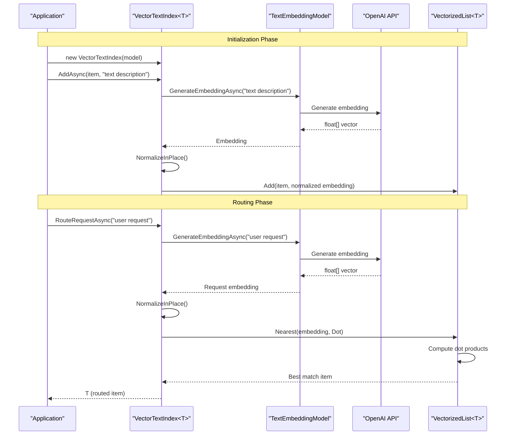
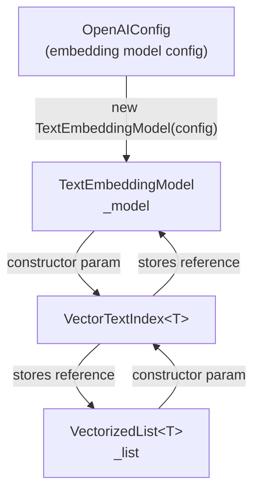
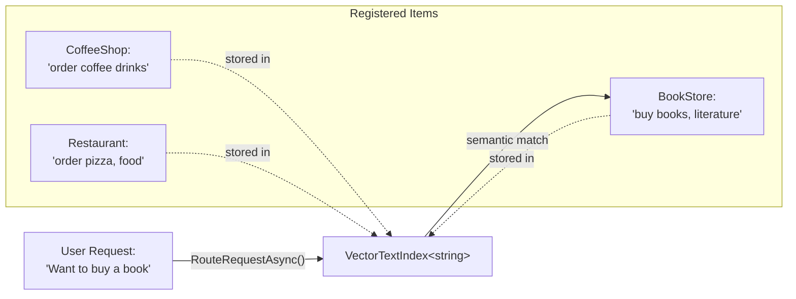

<!-- source: DeepWiki mcp.deepwiki.com · repo microsoft/typechat.net · page 7.4 Request Routing · fetched 2026-10-26 -->

# Request Routing

<details>
<summary>Relevant source files</summary>

The following files were used as context for generating this wiki page:

- [README.md](README.md)
- [examples/Sentiment/Program.cs](examples/Sentiment/Program.cs)
- [examples/appSettings.json](examples/appSettings.json)
- [examples/typechat.examplesLib/ConsoleApp.cs](examples/typechat.examplesLib/ConsoleApp.cs)
- [examples/typechat.examplesLib/VectorTextIndex.cs](examples/typechat.examplesLib/VectorTextIndex.cs)
- [src/typechat.sk/Embeddings/Embedding.cs](src/typechat.sk/Embeddings/Embedding.cs)
- [src/typechat.sk/Embeddings/EmbeddingsEx.cs](src/typechat.sk/Embeddings/EmbeddingsEx.cs)
- [src/typechat.sk/TextEmbeddingModel.cs](src/typechat.sk/TextEmbeddingModel.cs)
- [tests/TypeChat.IntegrationTests/TestVectorized_EndToEnd.cs](tests/TypeChat.IntegrationTests/TestVectorized_EndToEnd.cs)

</details>


Request Routing provides semantic routing capabilities that enable TypeChat applications to dynamically direct user requests to the appropriate handler based on meaning rather than exact pattern matching. This page covers the embedding-based routing infrastructure provided by `VectorTextIndex<T>` and `TextEmbeddingModel`.

For dynamic schema selection using routing, see [Multi-Schema Routing](#7.2). For general embedding and vectorization concepts, see [Embeddings and Vectorization](#7.3).

---

## Purpose and Scope

Request routing solves the problem of directing natural language input to the correct handler when multiple options exist. Instead of keyword matching or rule-based classification, TypeChat uses **semantic similarity** through embeddings to find the best match.

The routing system enables:
- Semantic matching of requests to registered items
- Nearest neighbor search in embedding space
- Top-N matching for ambiguous cases
- Integration with multi-schema translators

---

## Core Components

The request routing infrastructure consists of three main components:

| Component | Purpose | Location |
|-----------|---------|----------|
| `VectorTextIndex<T>` | In-memory vector index with routing capabilities | [examples/typechat.examplesLib/VectorTextIndex.cs]() |
| `TextEmbeddingModel` | Embedding generation service | [src/typechat.sk/TextEmbeddingModel.cs]() |
| `Embedding` | Vector representation and similarity operations | [src/typechat.sk/Embeddings/Embedding.cs]() |

Sources: [examples/typechat.examplesLib/VectorTextIndex.cs:1-156](), [src/typechat.sk/TextEmbeddingModel.cs:1-80]()

---

## Routing Architecture

### Request Routing Workflow



Sources: [examples/typechat.examplesLib/VectorTextIndex.cs:55-58](), [examples/typechat.examplesLib/VectorTextIndex.cs:112-117]()

---

## VectorTextIndex

### Class Structure

`VectorTextIndex<T>` implements `ITextRequestRouter<T>` and provides semantic routing through embeddings.

**Key Properties and Methods:**

| Member | Type | Purpose |
|--------|------|---------|
| `Items` | `VectorizedList<T>` | Underlying vectorized collection |
| `AddAsync(item, text)` | Method | Add item with text representation |
| `AddAsync(items[], texts[])` | Method | Batch add with embeddings |
| `NearestAsync(text)` | Method | Find single nearest match |
| `NearestAsync(text, maxMatches)` | Method | Find top-N matches |
| `RouteRequestAsync(request)` | Method | Route request to nearest item |

Sources: [examples/typechat.examplesLib/VectorTextIndex.cs:15-45]()

### Initialization Pattern



Sources: [examples/typechat.examplesLib/VectorTextIndex.cs:24-40]()

### Adding Items

Items are added with their text representations, which are automatically vectorized:

**Single Item:**
```
await index.AddAsync(item, "text representation")
```
- Calls `GetNormalizedEmbeddingAsync(text)` [examples/typechat.examplesLib/VectorTextIndex.cs:70]()
- Normalizes embedding to unit vector [examples/typechat.examplesLib/VectorTextIndex.cs:137]()
- Adds to `_list` [examples/typechat.examplesLib/VectorTextIndex.cs:72]()

**Batch Add:**
```
await index.AddAsync(items[], texts[])
```
- Uses batch embedding generation for efficiency [examples/typechat.examplesLib/VectorTextIndex.cs:94]()
- Validates lengths match [examples/typechat.examplesLib/VectorTextIndex.cs:89-92]()
- Normalizes all embeddings [examples/typechat.examplesLib/VectorTextIndex.cs:149-151]()

Sources: [examples/typechat.examplesLib/VectorTextIndex.cs:66-104]()

### Routing Requests

The `RouteRequestAsync` method is the primary routing interface:

```
T result = await index.RouteRequestAsync("user request text")
```

Implementation delegates to `NearestAsync`:
- [examples/typechat.examplesLib/VectorTextIndex.cs:55-58]()

**Nearest Neighbor Search:**
1. Generate embedding for request text [examples/typechat.examplesLib/VectorTextIndex.cs:114]()
2. Normalize to unit vector [examples/typechat.examplesLib/VectorTextIndex.cs:137]()
3. Find item with highest dot product [examples/typechat.examplesLib/VectorTextIndex.cs:116]()

Sources: [examples/typechat.examplesLib/VectorTextIndex.cs:112-131]()

---

## TextEmbeddingModel

### Model Initialization

`TextEmbeddingModel` wraps embedding generation services and supports multiple initialization patterns:

**From OpenAI Configuration:**
```csharp
OpenAIConfig config = Config.LoadOpenAI("OpenAI_Embedding");
TextEmbeddingModel model = new TextEmbeddingModel(config);
```
- Uses [src/typechat.sk/TextEmbeddingModel.cs:20-32]()
- Creates Kernel with embedding service [src/typechat.sk/TextEmbeddingModel.cs:25-28]()

**From Existing Service:**
```csharp
IEmbeddingGenerator<string, Embedding<float>> service = ...;
TextEmbeddingModel model = new TextEmbeddingModel(service, modelInfo);
```
- Uses [src/typechat.sk/TextEmbeddingModel.cs:39-44]()

Sources: [src/typechat.sk/TextEmbeddingModel.cs:8-49]()

### Embedding Generation

**Single Embedding:**
```
Embedding<float> embedding = await model.GenerateEmbeddingAsync(text);
```
Implementation: [src/typechat.sk/TextEmbeddingModel.cs:57-60]()

**Batch Embeddings:**
```
Embedding<float>[] embeddings = await model.GenerateEmbeddingsAsync(texts);
```
Implementation: [src/typechat.sk/TextEmbeddingModel.cs:68-78]()

Batch generation is significantly more efficient when multiple texts need embedding simultaneously.

Sources: [src/typechat.sk/TextEmbeddingModel.cs:51-79]()

---

## Embedding Operations

### Similarity Measures

The `Embedding` struct provides two similarity measures:

| Measure | Method | Use Case |
|---------|--------|----------|
| **Cosine Similarity** | `CosineSimilarity(other)` | General similarity, range [-1, 1] |
| **Dot Product** | `DotProduct(other)` | Optimized for normalized vectors |

**Implementation Details:**

Cosine Similarity: [src/typechat.sk/Embeddings/Embedding.cs:94-97]()
```csharp
public double CosineSimilarity(Embedding other)
{
    return TensorPrimitives.CosineSimilarity(VectorSpan, other.VectorSpan);
}
```

Dot Product: [src/typechat.sk/Embeddings/Embedding.cs:104-107]()
```csharp
public double DotProduct(Embedding other)
{
    return TensorPrimitives.Dot(VectorSpan, other.VectorSpan);
}
```

Sources: [src/typechat.sk/Embeddings/Embedding.cs:89-122]()

### Normalization

For performance optimization, embeddings should be normalized to unit vectors:

```csharp
embedding.NormalizeInPlace();
```

**Why Normalize:**
- When all vectors have length 1, dot product equals cosine similarity
- Dot product is faster to compute than cosine similarity
- `VectorTextIndex<T>` automatically normalizes all embeddings [examples/typechat.examplesLib/VectorTextIndex.cs:137]()

Implementation: [src/typechat.sk/Embeddings/Embedding.cs:80-87]()

Sources: [src/typechat.sk/Embeddings/Embedding.cs:76-87]()

---

## Routing Patterns

### Basic Routing Example



**Test Example:**

The routing test demonstrates typical usage: [tests/TypeChat.IntegrationTests/TestVectorized_EndToEnd.cs:92-103]()

```csharp
VectorTextIndex<string> index = CreateIndex<string>();
foreach (var shop in Classes.Shops())
{
    await index.AddAsync(shop.Key, shop.Value);
}
string match = await index.RouteRequestAsync(
    "Want to buy a book about artificial intelligence"
);
Assert.True(index.Items.Contains(match));
```

Sources: [tests/TypeChat.IntegrationTests/TestVectorized_EndToEnd.cs:92-103]()

### Top-N Matching

For ambiguous requests, retrieve multiple matches:

```csharp
List<T> matches = await index.NearestAsync(text, maxMatches: 5);
```

This returns the top 5 semantically closest items, sorted by similarity score.

Implementation: [examples/typechat.examplesLib/VectorTextIndex.cs:126-131]()

Test example: [tests/TypeChat.IntegrationTests/TestVectorized_EndToEnd.cs:86-89]()

Sources: [examples/typechat.examplesLib/VectorTextIndex.cs:119-131](), [tests/TypeChat.IntegrationTests/TestVectorized_EndToEnd.cs:82-89]()

---

## Integration with Schema Routing

### ITextRequestRouter Interface

`VectorTextIndex<T>` implements the `ITextRequestRouter<T>` interface:

```csharp
public interface ITextRequestRouter<T>
{
    Task<T> RouteRequestAsync(string request, CancellationToken cancelToken = default);
}
```

This enables polymorphic use in schema routing scenarios. Reference: [examples/typechat.examplesLib/VectorTextIndex.cs:15]()

### Schema Hierarchy Example

The [SchemaHierarchy example](#8.5) uses `VectorTextIndex<Schema>` to route requests to the semantically nearest schema:

```
VectorTextIndex<Schema> schemaIndex = new VectorTextIndex<Schema>(embeddingModel);

// Add schemas with descriptions
await schemaIndex.AddAsync(calendarSchema, "calendar events and scheduling");
await schemaIndex.AddAsync(restaurantSchema, "food ordering and menus");
await schemaIndex.AddAsync(coffeeSchema, "coffee drinks and customization");

// Route request
Schema targetSchema = await schemaIndex.RouteRequestAsync(userRequest);
```

Reference: [README.md:136-137]()

Sources: [README.md:136-137](), [examples/typechat.examplesLib/VectorTextIndex.cs:15-58]()

---

## Configuration

### Embedding Model Setup

Embedding models are configured separately from chat models. Typical configuration in `appSettings.json`:

```json
{
  "OpenAI_Embedding": {
    "Azure": true,
    "ApiKey": "?", 
    "Endpoint": "?",
    "Model": "ada-002"
  }
}
```

Reference: [examples/appSettings.json:15-20]()

**Loading Configuration:**

```csharp
OpenAIConfig embeddingConfig = Config.LoadOpenAI("OpenAI_Embedding");
TextEmbeddingModel model = new TextEmbeddingModel(embeddingConfig);
```

Sources: [examples/appSettings.json:15-20]()

### Supported Models

TypeChat has been tested with:
- **text-embedding-ada-002** (OpenAI and Azure OpenAI)

Reference: [README.md:84]()

Sources: [README.md:80-85]()

---

## Extension Methods

The `EmbeddingsEx` class provides additional utility methods for working with embedding collections:

### IndexOfNearest

Find the index of the nearest embedding in a list:

```csharp
ScoredValue<int> result = embeddings.IndexOfNearest(queryEmbedding, EmbeddingDistance.Dot);
int index = result.Value;
double score = result.Score;
```

Implementation: [src/typechat.sk/Embeddings/EmbeddingsEx.cs:48-60]()

### Nearest (Top-N)

Find multiple nearest neighbors:

```csharp
TopNCollection<int> matches = embeddings.Nearest(
    queryEmbedding, 
    maxMatches: 10, 
    EmbeddingDistance.Dot
);
```

Implementation: [src/typechat.sk/Embeddings/EmbeddingsEx.cs:88-94]()

Sources: [src/typechat.sk/Embeddings/EmbeddingsEx.cs:41-95]()

---

## Performance Considerations

### Normalization Strategy

`VectorTextIndex<T>` normalizes all embeddings to unit vectors:
- Normalization happens once when items are added [examples/typechat.examplesLib/VectorTextIndex.cs:137]()
- Request embeddings are normalized before comparison [examples/typechat.examplesLib/VectorTextIndex.cs:137]()
- Enables using dot product instead of cosine similarity for speed

### Batch Operations

When adding multiple items, use batch methods:
- Batch embedding generation reduces API calls [examples/typechat.examplesLib/VectorTextIndex.cs:94]()
- More efficient than individual `AddAsync` calls
- Particularly beneficial with high-latency embedding services

Sources: [examples/typechat.examplesLib/VectorTextIndex.cs:84-104](), [examples/typechat.examplesLib/VectorTextIndex.cs:133-154]()

---

## Testing

### Integration Tests

The routing system includes comprehensive integration tests in [tests/TypeChat.IntegrationTests/TestVectorized_EndToEnd.cs]():

| Test | Purpose | Line Reference |
|------|---------|----------------|
| `TestEmbeddings` | Verify embedding generation and similarity | [tests/TypeChat.IntegrationTests/TestVectorized_EndToEnd.cs:16-48]() |
| `TestVectorTextIndex` | Test index operations and nearest neighbor | [tests/TypeChat.IntegrationTests/TestVectorized_EndToEnd.cs:51-89]() |
| `TestRouting` | Verify semantic routing to shops | [tests/TypeChat.IntegrationTests/TestVectorized_EndToEnd.cs:92-103]() |
| `TestMessageIndex` | Test vectorized message context | [tests/TypeChat.IntegrationTests/TestVectorized_EndToEnd.cs:106-140]() |

**Test Requirements:**

Tests require embedding model configuration and use `Skip.If()` to conditionally run:
```csharp
Skip.If(!CanRunEndToEndTest_Embeddings(_config));
```

Reference: [tests/TypeChat.IntegrationTests/TestVectorized_EndToEnd.cs:18]()

Sources: [tests/TypeChat.IntegrationTests/TestVectorized_EndToEnd.cs:1-147]()

---

## Distance Measures

The `EmbeddingDistance` enum defines supported similarity measures:

```csharp
public enum EmbeddingDistance
{
    Dot,      // Dot product (optimized for normalized vectors)
    Cosine    // Cosine similarity
}
```

**When to Use Each:**

| Measure | Best For | Notes |
|---------|----------|-------|
| `Dot` | Normalized embeddings | Faster, equivalent to cosine for unit vectors |
| `Cosine` | Non-normalized embeddings | Handles varying vector magnitudes |

`VectorTextIndex<T>` always uses `Dot` since it normalizes embeddings.

Reference: [examples/typechat.examplesLib/VectorTextIndex.cs:116]()

Sources: [src/typechat.sk/Embeddings/Embedding.cs:115-122](), [examples/typechat.examplesLib/VectorTextIndex.cs:116]()

---

## Summary

Request routing in TypeChat enables semantic matching through:

1. **VectorTextIndex<T>** - In-memory vector index with automatic embedding
2. **TextEmbeddingModel** - Embedding generation service wrapper
3. **Embedding** - Vector operations and similarity measures
4. **ITextRequestRouter<T>** - Interface for routing implementations

The system uses normalized embeddings and dot products for efficient semantic matching, supporting both single-match and top-N routing scenarios. Integration with multi-schema translators enables dynamic schema selection based on request semantics.

Sources: [examples/typechat.examplesLib/VectorTextIndex.cs:1-156](), [src/typechat.sk/TextEmbeddingModel.cs:1-80](), [src/typechat.sk/Embeddings/Embedding.cs:1-160]()

---

