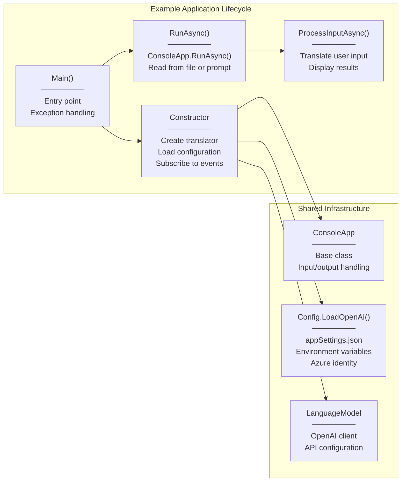
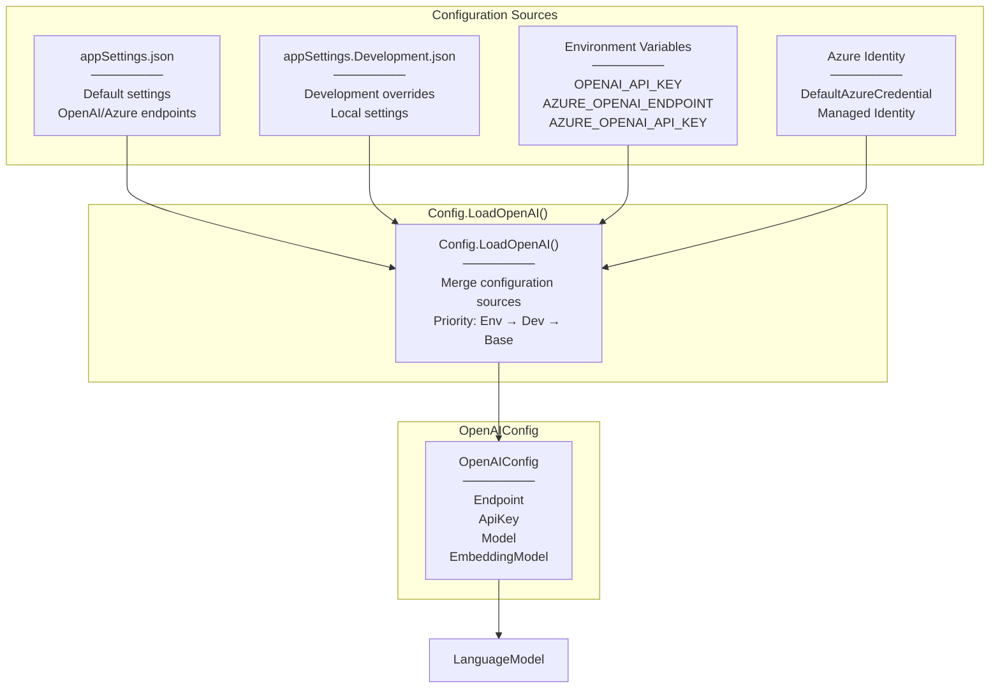
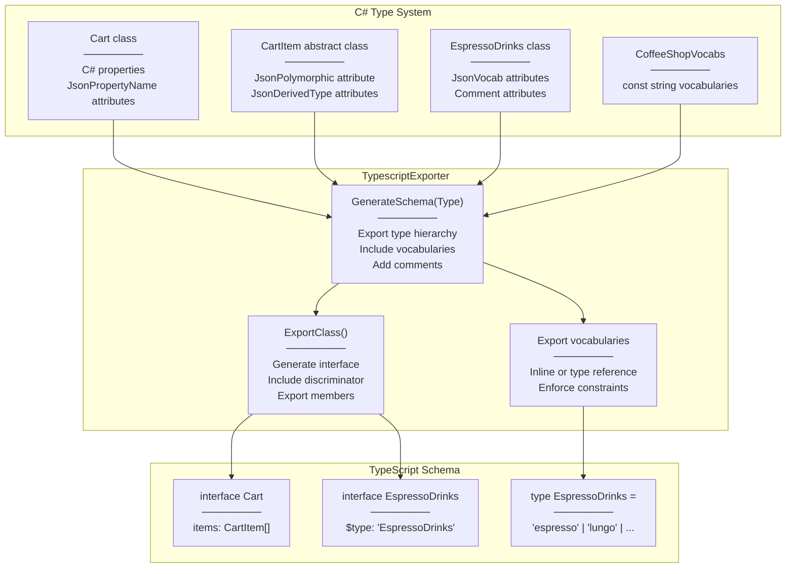

<!-- source: DeepWiki mcp.deepwiki.com · repo microsoft/typechat.net · page 8 Examples · fetched 2026-10-26 -->

# Examples

<details>
<summary>Relevant source files</summary>

The following files were used as context for generating this wiki page:

- [TypeChat.sln](TypeChat.sln)
- [examples/CoffeeShop/CoffeeShop.csproj](examples/CoffeeShop/CoffeeShop.csproj)
- [examples/CoffeeShop/CoffeeShopSchema.cs](examples/CoffeeShop/CoffeeShopSchema.cs)
- [examples/CoffeeShop/Program.cs](examples/CoffeeShop/Program.cs)
- [examples/CoffeeShop/input.txt](examples/CoffeeShop/input.txt)
- [examples/CoffeeShop2/CoffeeShop2.csproj](examples/CoffeeShop2/CoffeeShop2.csproj)
- [examples/Math/Math.csproj](examples/Math/Math.csproj)
- [examples/Sentiment/Sentiment.csproj](examples/Sentiment/Sentiment.csproj)
- [src/typechat.schema/TypescriptExporter.cs](src/typechat.schema/TypescriptExporter.cs)

</details>


This page provides an overview of the example applications included in the TypeChat.NET repository. These examples demonstrate TypeChat capabilities ranging from simple JSON translation to complex program generation, conversational agents, and multi-schema routing. Each example is a self-contained console application that showcases specific TypeChat features and patterns.

For detailed walkthroughs of individual examples, see:
- [CoffeeShop Example](#8.1) - Complex schema with vocabularies and polymorphism
- [Sentiment Analysis Example](#8.2) - Simple translation example
- [Math Calculator Example](#8.3) - Program translation and execution
- [HealthData Agent Example](#8.4) - Conversational agent with history
- [SchemaHierarchy Example](#8.5) - Semantic routing via embeddings

For information about the core translation concepts used in these examples, see [Core Concepts](#3). For program translation concepts, see [Program Translation](#5). For agent concepts, see [Conversational Agents](#7.1).

## Example Application Categories

The repository contains examples organized by TypeChat capability level and use case complexity. All examples share common infrastructure from `TypeChat.ExamplesLib` and use `ConsoleApp` as their base class.

```mermaid
graph TB
    subgraph SimpleTranslation["Simple Translation Examples"]
        Sentiment["Sentiment<br/>────────<br/>JsonTranslator&lt;SentimentResponse&gt;<br/>Basic schema translation"]
        CoffeeShop["CoffeeShop<br/>────────<br/>JsonTranslator&lt;Cart&gt;<br/>Vocabularies, polymorphism<br/>UnknownItem pattern"]
        CoffeeShop2["CoffeeShop2<br/>────────<br/>JsonTranslator&lt;Cart&gt;<br/>External vocabulary loading"]
        Restaurant["Restaurant<br/>────────<br/>JsonTranslator&lt;Order&gt;<br/>Complex nested schemas"]
    end
    
    subgraph ProgramExecution["Program Execution Examples"]
        Math["Math<br/>────────<br/>ProgramTranslator&lt;IMathAPI&gt;<br/>Mathematical operations"]
        Calendar["Calendar<br/>────────<br/>ProgramTranslator&lt;ICalendarAPI&gt;<br/>Calendar actions"]
    end
    
    subgraph ConversationalAgents["Conversational Agent Examples"]
        HealthData["HealthData<br/>────────<br/>AgentWithHistory&lt;HealthDataResponse&gt;<br/>Multi-turn data collection"]
    end
    
    subgraph MultiSchemaRouting["Multi-Schema Routing Examples"]
        MultiSchema["MultiSchema<br/>────────<br/>Dynamic schema selection<br/>Calendar/Restaurant/Coffee"]
        SchemaHierarchy["SchemaHierarchy<br/>────────<br/>VectorTextIndex&lt;SchemaInfo&gt;<br/>Semantic routing via embeddings"]
    end
    
    subgraph AdvancedIntegration["Advanced Integration Examples"]
        Plugins["Plugins<br/>────────<br/>Semantic Kernel integration<br/>Plugin orchestration"]
    end
    
    subgraph SharedInfra["Shared Infrastructure"]
        ExamplesLib["TypeChat.ExamplesLib<br/>────────<br/>ConsoleApp base class<br/>Config.LoadOpenAI()<br/>VectorTextIndex&lt;T&gt;<br/>Authentication helpers"]
    end
    
    Sentiment --> ExamplesLib
    CoffeeShop --> ExamplesLib
    CoffeeShop2 --> ExamplesLib
    Restaurant --> ExamplesLib
    Math --> ExamplesLib
    Calendar --> ExamplesLib
    HealthData --> ExamplesLib
    MultiSchema --> ExamplesLib
    SchemaHierarchy --> ExamplesLib
    Plugins --> ExamplesLib
```



**Sources:** [TypeChat.sln:1-173](), [examples/CoffeeShop/CoffeeShop.csproj:1-37](), [examples/Sentiment/Sentiment.csproj:1-36](), [examples/Math/Math.csproj:1-44]()

## Example Overview Table

| Example | TypeChat Component | Schema Complexity | Key Features | Use Case |
|---------|-------------------|-------------------|--------------|----------|
| Sentiment | `JsonTranslator<SentimentResponse>` | Minimal | Basic translation | Sentiment analysis from text |
| CoffeeShop | `JsonTranslator<Cart>` | High | Vocabularies, polymorphism, `UnknownItem` | Coffee order processing |
| CoffeeShop2 | `JsonTranslator<Cart>` | High | External vocabulary loading from JSON | Dynamic vocabulary management |
| Restaurant | `JsonTranslator<Order>` | Very High | Complex nested types | Restaurant order processing |
| Math | `ProgramTranslator<IMathAPI>` | Medium | Code generation, DLR compilation | Natural language calculator |
| Calendar | `ProgramTranslator<ICalendarAPI>` | Medium | API invocation | Calendar operations |
| HealthData | `AgentWithHistory<HealthDataResponse>` | Medium | Multi-turn conversation | Health data collection |
| MultiSchema | Multiple translators | High | Dynamic routing logic | Multi-domain request handling |
| SchemaHierarchy | `VectorTextIndex<SchemaInfo>` | High | Semantic similarity | Embedding-based routing |
| Plugins | `ProgramTranslator` + SK | Medium | Semantic Kernel plugins | Plugin orchestration |

**Sources:** [TypeChat.sln:14-172]()

## Common Application Structure

All examples follow a consistent structure using `ConsoleApp` as the base class and shared configuration patterns.



**Sources:** [examples/CoffeeShop/Program.cs:10-76]()

### CoffeeShop Application Structure

The CoffeeShop example demonstrates the standard pattern used across examples:

[examples/CoffeeShop/Program.cs:10-23]() - The `CoffeeShopApp` class inherits from `ConsoleApp` and creates a `JsonTranslator<Cart>` in the constructor:

```csharp
public class CoffeeShopApp : ConsoleApp
{
    private readonly JsonTranslator<Cart> _translator;

    public CoffeeShopApp()
    {
        _translator = new JsonTranslator<Cart>(
            new LanguageModel(Config.LoadOpenAI())
        );
        _translator.MaxRepairAttempts = 3;
    }
}
```

[examples/CoffeeShop/Program.cs:26-38]() - The `ProcessInputAsync` method handles translation and result display:

```csharp
public override async Task ProcessInputAsync(string input, CancellationToken cancelToken)
{
    Cart cart = await _translator.TranslateAsync(input, cancelToken);
    
    Console.WriteLine("##YOUR ORDER");
    string json = Microsoft.TypeChat.Json.Stringify(cart);
    Console.WriteLine(json);
    
    if (!PrintAnyUnknown(cart))
    {
        Console.WriteLine("Success!");
    }
}
```

[examples/CoffeeShop/Program.cs:57-76]() - The `Main` method initializes the app and runs it:

```csharp
public static async Task<int> Main(string[] args)
{
    try
    {
        CoffeeShopApp app = new CoffeeShopApp();
        await app.RunAsync("☕> ", args.GetOrNull(0));
    }
    catch (Exception ex)
    {
        WriteError(ex);
        Console.ReadLine();
        return -1;
    }
    return 0;
}
```

**Sources:** [examples/CoffeeShop/Program.cs:1-77]()

## Configuration and Setup

All examples use a consistent configuration pattern:



**Sources:** [examples/CoffeeShop/CoffeeShop.csproj:13-23](), [examples/Sentiment/Sentiment.csproj:12-22]()

[examples/CoffeeShop/CoffeeShop.csproj:13-23]() - Configuration files are copied to the output directory:

```xml
<ItemGroup>
  <Content Include="..\appSettings.json" Link="appSettings.json">
    <CopyToOutputDirectory>Always</CopyToOutputDirectory>
  </Content>
</ItemGroup>

<ItemGroup Condition="Exists('..\appSettings.Development.json')">
  <Content Include="..\appSettings.Development.json" Link="appSettings.Development.json">
    <CopyToOutputDirectory>Always</CopyToOutputDirectory>
  </Content>
</ItemGroup>
```

**Sources:** [examples/CoffeeShop/CoffeeShop.csproj:1-37](), [examples/Sentiment/Sentiment.csproj:1-36]()

## Schema Definition Patterns

Examples demonstrate different schema complexity levels and TypeScript generation patterns.

### Simple Schema Example (Sentiment)

The Sentiment example uses a minimal schema with basic types.

**Key TypeChat features demonstrated:**
- Basic C# to TypeScript mapping
- Simple property translation
- Nullable types

### Complex Schema Example (CoffeeShop)

[examples/CoffeeShop/CoffeeShopSchema.cs:18-32]() - The `Cart` and `CartItem` types demonstrate polymorphism:

```csharp
public partial class Cart
{
    [JsonPropertyName("items")]
    public CartItem[] Items { get; set; }
}

[JsonPolymorphic]
[JsonDerivedType(typeof(UnknownItem), typeDiscriminator: nameof(UnknownItem))]
[JsonDerivedType(typeof(EspressoDrinks), typeDiscriminator: nameof(EspressoDrinks))]
[JsonDerivedType(typeof(CoffeeDrinks), typeDiscriminator: nameof(CoffeeDrinks))]
[JsonDerivedType(typeof(LatteDrinks), typeDiscriminator: nameof(LatteDrinks))]
[JsonDerivedType(typeof(BakeryProducts), typeDiscriminator: nameof(BakeryProducts))]
public abstract partial class CartItem
{
}
```

[examples/CoffeeShop/CoffeeShopSchema.cs:34-40]() - The `UnknownItem` pattern handles partial understanding:

```csharp
[Comment("Use this type for Cart Items that match nothing else")]
public partial class UnknownItem : CartItem
{
    [Comment("The text that wasn't understood")]
    [JsonPropertyName("text")]
    public string Text { get; set; }
}
```

[examples/CoffeeShop/CoffeeShopSchema.cs:48-63]() - Vocabularies constrain string values:

```csharp
public partial class EspressoDrinks : LineItem
{
    [JsonVocab(CoffeeShopVocabs.EspressoDrinks, PropertyName = "productName")]
    [JsonPropertyName("productName")]
    public string Name { get; set; }

    [JsonPropertyName("temperature")]
    public CoffeeTemperature? Temperature { get; set; }

    [JsonPropertyName("size")]
    [Comment("The default is 'Doppio'")]
    public EspressoSize? Size { get; set; } = EspressoSize.Doppio;

    [JsonPropertyName("options")]
    public DrinkOption[]? Options { get; set; }
}
```

[examples/CoffeeShop/CoffeeShopSchema.cs:258-289]() - Vocabularies are defined as constants:

```csharp
public static class CoffeeShopVocabs
{
    public const string EspressoDrinks = "espresso | lungo | ristretto | macchiato";
    public const string CoffeeDrinks = "americano | coffee";
    public const string LatteDrinks = "cappuccino | flat white | latte | latte macchiato| mocha | chai latte";
    // ... additional vocabularies
}
```

**Sources:** [examples/CoffeeShop/CoffeeShopSchema.cs:1-290]()

## TypeScript Schema Generation

TypeChat automatically generates TypeScript schemas from C# types. The `TypescriptExporter` class handles this conversion.



**Sources:** [src/typechat.schema/TypescriptExporter.cs:28-47](), [examples/CoffeeShop/CoffeeShopSchema.cs:1-290]()

[src/typechat.schema/TypescriptExporter.cs:36-47]() - The `GenerateSchema` method creates TypeScript from C# types:

```csharp
public static TypescriptSchema GenerateSchema(Type type, IVocabCollection? knownVocabs = null)
{
    using StringWriter writer = new StringWriter();
    TypescriptExporter exporter = new TypescriptExporter(writer);
    if (knownVocabs is not null)
    {
        exporter.Vocabs = knownVocabs;
    }
    exporter.Export(type);
    string schema = writer.ToString();
    return new TypescriptSchema(type, schema, exporter.UsedVocabs);
}
```

**Sources:** [src/typechat.schema/TypescriptExporter.cs:1-768]()

## Input Processing Patterns

Examples demonstrate different input sources and processing patterns.

### File Input

[examples/CoffeeShop/input.txt:1-72]() - The CoffeeShop example includes a comprehensive input file with test cases:

```
# Ported from Typechat example
i'd like a latte that's it
i'll have a dark roast coffee thank you
get me a coffee please
we need twenty five flat whites and that'll do it
# ... more test cases
```

The input file demonstrates:
- Basic orders
- Complex orders with multiple options
- Edge cases (multiple sizes, unknown items)
- Non-English input
- Invalid requests

### Interactive Prompt

[examples/CoffeeShop/Program.cs:65]() - Examples support interactive mode or file input:

```csharp
await app.RunAsync("☕> ", args.GetOrNull(0));
```

When no file path is provided, the app enters interactive mode with the specified prompt.

**Sources:** [examples/CoffeeShop/input.txt:1-72](), [examples/CoffeeShop/Program.cs:57-76]()

## Example Capabilities Map

```mermaid
graph TB
    subgraph CoreCapabilities["Core TypeChat Capabilities"]
        JsonTranslation["JSON Translation<br/>────────<br/>JsonTranslator&lt;T&gt;"]
        ProgramTranslation["Program Translation<br/>────────<br/>ProgramTranslator&lt;T&gt;"]
        ConversationalAI["Conversational AI<br/>────────<br/>AgentWithHistory&lt;T&gt;"]
        RequestRouting["Request Routing<br/>────────<br/>VectorTextIndex&lt;T&gt;<br/>TextClassifier"]
    end
    
    subgraph Features["TypeChat Features"]
        Vocabularies["Vocabularies<br/>────────<br/>JsonVocab attribute"]
        Polymorphism["Polymorphism<br/>────────<br/>JsonPolymorphic attribute"]
        UnknownPattern["Unknown Pattern<br/>────────<br/>UnknownItem handling"]
        Validation["Validation & Repair<br/>────────<br/>Automatic error correction"]
        Compilation["DLR Compilation<br/>────────<br/>Type-safe delegates"]
        Interpretation["Program Interpretation<br/>────────<br/>Dynamic execution"]
        Embeddings["Embeddings<br/>────────<br/>Semantic similarity"]
    end
    
    subgraph Examples["Example Applications"]
        Sentiment1["Sentiment"]
        CoffeeShop1["CoffeeShop"]
        CoffeeShop21["CoffeeShop2"]
        Restaurant1["Restaurant"]
        Math1["Math"]
        Calendar1["Calendar"]
        HealthData1["HealthData"]
        MultiSchema1["MultiSchema"]
        SchemaHierarchy1["SchemaHierarchy"]
        Plugins1["Plugins"]
    end
    
    JsonTranslation --> Sentiment1
    JsonTranslation --> CoffeeShop1
    JsonTranslation --> CoffeeShop21
    JsonTranslation --> Restaurant1
    
    ProgramTranslation --> Math1
    ProgramTranslation --> Calendar1
    ProgramTranslation --> Plugins1
    
    ConversationalAI --> HealthData1
    
    RequestRouting --> MultiSchema1
    RequestRouting --> SchemaHierarchy1
    
    Vocabularies --> CoffeeShop1
    Vocabularies --> CoffeeShop21
    Polymorphism --> CoffeeShop1
    Polymorphism --> Restaurant1
    UnknownPattern --> CoffeeShop1
    Validation --> CoffeeShop1
    Compilation --> Math1
    Compilation --> Calendar1
    Interpretation --> Math1
    Embeddings --> SchemaHierarchy1
```



**Sources:** [TypeChat.sln:1-173]()

## Project References

All examples reference core TypeChat libraries and the shared examples library.

[examples/CoffeeShop/CoffeeShop.csproj:25-28]() - Standard project references:

```xml
<ItemGroup>
  <ProjectReference Include="..\typechat.examplesLib\TypeChat.ExamplesLib.csproj" />
  <ProjectReference Include="..\..\src\typechat\TypeChat.csproj" />
</ItemGroup>
```

[examples/Math/Math.csproj:25-29]() - Program examples add `TypeChat.Program`:

```xml
<ItemGroup>
  <ProjectReference Include="..\typechat.examplesLib\TypeChat.ExamplesLib.csproj" />
  <ProjectReference Include="..\..\src\typechat.program\TypeChat.Program.csproj" />
  <ProjectReference Include="..\..\src\typechat\TypeChat.csproj" />
</ItemGroup>
```

**Sources:** [examples/CoffeeShop/CoffeeShop.csproj:1-37](), [examples/Math/Math.csproj:1-44](), [examples/Sentiment/Sentiment.csproj:1-36]()

## Running Examples

All examples follow the same execution pattern:

1. **Configuration**: Ensure `appSettings.json` or environment variables contain OpenAI credentials
2. **Build**: Build the solution or individual example project
3. **Run with file**: `dotnet run -- path/to/input.txt` (processes all lines in file)
4. **Run interactively**: `dotnet run` (enters prompt mode)

The `ConsoleApp` base class handles:
- Reading from file or interactive prompt
- Line-by-line processing
- Error display
- Result formatting

**Sources:** [examples/CoffeeShop/Program.cs:57-76]()

## Next Steps

For detailed analysis of specific examples, see the following pages:

- [CoffeeShop Example](#8.1) - Deep dive into complex schemas, vocabularies, and the UnknownItem pattern
- [Sentiment Analysis Example](#8.2) - Simple translation with minimal schema
- [Math Calculator Example](#8.3) - Program translation, compilation, and execution
- [HealthData Agent Example](#8.4) - Multi-turn conversations and history management
- [SchemaHierarchy Example](#8.5) - Semantic routing with embeddings and vector search

For guidance on schema design patterns demonstrated in these examples, see [Schema Definition](#4) and [Best Practices](#11.1).

For testing examples and patterns, see [Integration Testing](#9.2).

---

