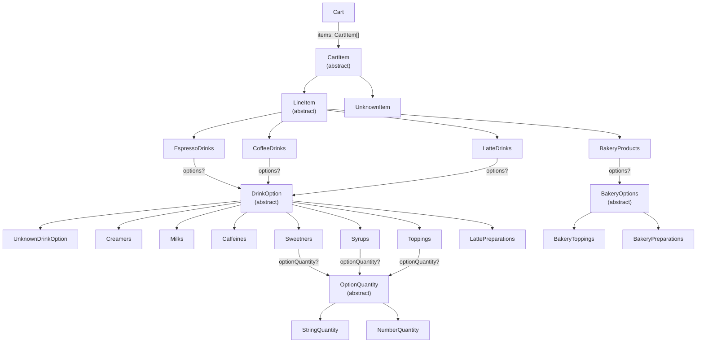
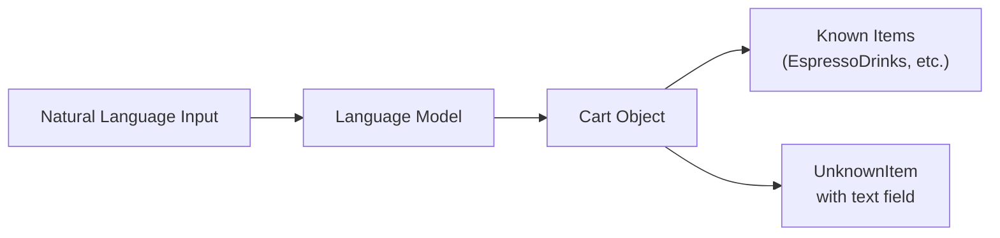
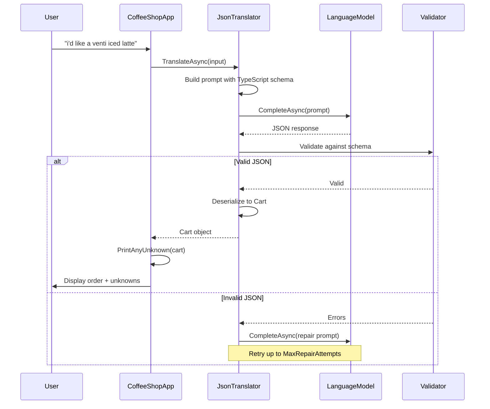

<!-- source: DeepWiki mcp.deepwiki.com · repo microsoft/typechat.net · page 8.1 CoffeeShop Example · fetched 2026-10-26 -->

# CoffeeShop Example

<details>
<summary>Relevant source files</summary>

The following files were used as context for generating this wiki page:

- [TypeChat.sln](TypeChat.sln)
- [examples/CoffeeShop/CoffeeShop.csproj](examples/CoffeeShop/CoffeeShop.csproj)
- [examples/CoffeeShop/CoffeeShopSchema.cs](examples/CoffeeShop/CoffeeShopSchema.cs)
- [examples/CoffeeShop/Program.cs](examples/CoffeeShop/Program.cs)
- [examples/CoffeeShop/input.txt](examples/CoffeeShop/input.txt)
- [examples/CoffeeShop2/CoffeeShop2.csproj](examples/CoffeeShop2/CoffeeShop2.csproj)
- [examples/Math/Math.csproj](examples/Math/Math.csproj)
- [examples/Sentiment/Sentiment.csproj](examples/Sentiment/Sentiment.csproj)
- [src/typechat.schema/TypescriptExporter.cs](src/typechat.schema/TypescriptExporter.cs)

</details>


## Purpose and Scope

The CoffeeShop example demonstrates TypeChat.NET's capabilities for translating complex natural language coffee orders into structured data. This example showcases:

- Complex nested schema design with multiple levels of polymorphism
- Extensive use of vocabularies (`JsonVocab`) to constrain string values
- The `UnknownItem` pattern for handling partial understanding
- Real-world domain modeling for a coffee shop ordering system

This example focuses on schema-based translation using `JsonTranslator<T>`. For program execution examples, see [Math Calculator Example](#8.3). For conversational AI, see [HealthData Agent Example](#8.4).

**Sources:** [examples/CoffeeShop/Program.cs:1-77](), [examples/CoffeeShop/CoffeeShopSchema.cs:1-290]()

---

## Example Location and Structure

The CoffeeShop example exists in two variants:

| Example | Location | Vocabulary Source |
|---------|----------|-------------------|
| CoffeeShop | `examples/CoffeeShop/` | Hardcoded in `CoffeeShopVocabs` class |
| CoffeeShop2 | `examples/CoffeeShop2/` | Loaded from `CoffeeShopVocab.json` file |

Both share the same schema structure but differ in how vocabularies are provided to the system. This document focuses on the CoffeeShop variant with hardcoded vocabularies.

**Sources:** [examples/CoffeeShop/CoffeeShop.csproj:1-37](), [examples/CoffeeShop2/CoffeeShop2.csproj:1-39]()

---

## Schema Architecture

### Type Hierarchy Diagram



**Sources:** [examples/CoffeeShop/CoffeeShopSchema.cs:18-250]()

### Cart and CartItem Classes

The root type `Cart` contains an array of `CartItem` objects:

```
Cart
  - items: CartItem[]
```

`CartItem` is an abstract base class marked with `JsonPolymorphic` that has five derived types: `UnknownItem`, `EspressoDrinks`, `CoffeeDrinks`, `LatteDrinks`, and `BakeryProducts`.

**Sources:** [examples/CoffeeShop/CoffeeShopSchema.cs:18-32]()

### LineItem and Drink Types

`LineItem` extends `CartItem` and adds a `quantity` property with a default value of 1. The three drink types (`EspressoDrinks`, `CoffeeDrinks`, `LatteDrinks`) all inherit from `LineItem`:

| Type | Vocabulary | Default Size | Temperature | Options |
|------|-----------|--------------|-------------|---------|
| `EspressoDrinks` | "espresso \| lungo \| ristretto \| macchiato" | Doppio | Optional | `DrinkOption[]?` |
| `CoffeeDrinks` | "americano \| coffee" | Grande | Optional | `DrinkOption[]?` |
| `LatteDrinks` | "cappuccino \| flat white \| latte \| latte macchiato\| mocha \| chai latte" | Grande | Optional | `DrinkOption[]?` |

**Sources:** [examples/CoffeeShop/CoffeeShopSchema.cs:42-97](), [examples/CoffeeShop/CoffeeShopSchema.cs:258-264]()

### DrinkOption Polymorphism

`DrinkOption` is a polymorphic base class with eight derived types. Each type uses `JsonVocab` to constrain valid values:

| Type | Purpose | Vocabulary Sample | Quantity |
|------|---------|-------------------|----------|
| `UnknownDrinkOption` | Fallback for unrecognized options | N/A | No |
| `Creamers` | Milk creamers | "whole milk creamer \| two percent milk creamer \| ..." | No |
| `Milks` | Milk types | "whole milk \| two percent milk \| nonfat milk \| ..." | No |
| `Caffeines` | Caffeine levels | "regular \| two thirds caf \| half caf \| one third caf \| decaf" | No |
| `Sweetners` | Sweetener types | "equal \| honey \| splenda \| sugar \| ..." | Optional |
| `Syrups` | Syrup flavors | "almond syrup \| buttered rum syrup \| caramel syrup \| ..." | Optional |
| `Toppings` | Drink toppings | "cinnamon \| foam \| ice \| nutmeg \| whipped cream \| water" | Optional |
| `LattePreparations` | Preparation instructions | "for here cup \| lid \| with room \| to go \| dry \| wet" | No |

**Sources:** [examples/CoffeeShop/CoffeeShopSchema.cs:136-211](), [examples/CoffeeShop/CoffeeShopSchema.cs:266-283]()

### BakeryProducts and Options

`BakeryProducts` inherits from `LineItem` and has its own option hierarchy:

```
BakeryProducts
  - productName: JsonVocab("apple bran muffin | blueberry muffin | lemon poppyseed muffin | bagel")
  - options?: BakeryOptions[]
    - BakeryToppings: JsonVocab("butter | strawberry jam | cream cheese")
    - BakeryPreparations: JsonVocab("warmed | cut in half")
```

**Sources:** [examples/CoffeeShop/CoffeeShopSchema.cs:99-229](), [examples/CoffeeShop/CoffeeShopSchema.cs:285-287]()

### OptionQuantity Polymorphism

`OptionQuantity` represents quantity modifiers for options with two implementations:

- `StringQuantity`: Uses vocabulary "no | light | regular | extra"
- `NumberQuantity`: Uses integer amount

This allows natural language like "two pumps of vanilla" (NumberQuantity) or "extra foam" (StringQuantity).

**Sources:** [examples/CoffeeShop/CoffeeShopSchema.cs:231-249](), [examples/CoffeeShop/CoffeeShopSchema.cs:288]()

---

## Vocabulary System

### Vocabulary Definition and Usage

The CoffeeShop example demonstrates extensive use of the `JsonVocab` attribute to constrain string values. All vocabularies are defined as constants in the `CoffeeShopVocabs` static class.

**Example Vocabulary Definition:**

```
public const string LatteDrinks = "cappuccino | flat white | latte | latte macchiato| mocha | chai latte";
```

**Usage in Schema:**

```
[JsonVocab(CoffeeShopVocabs.LatteDrinks, PropertyName = "productName")]
[JsonPropertyName("productName")]
public string Name { get; set; }
```

**Sources:** [examples/CoffeeShop/CoffeeShopSchema.cs:258-289](), [examples/CoffeeShop/CoffeeShopSchema.cs:82-86]()

### Complete Vocabulary Table

| Vocabulary Constant | Purpose | Values |
|---------------------|---------|--------|
| `EspressoDrinks` | Espresso-based drinks | espresso, lungo, ristretto, macchiato |
| `CoffeeDrinks` | Regular coffee drinks | americano, coffee |
| `LatteDrinks` | Latte-based drinks | cappuccino, flat white, latte, latte macchiato, mocha, chai latte |
| `Creamers` | Coffee creamers | whole milk creamer, two percent milk creamer, one percent milk creamer, nonfat milk creamer, coconut milk creamer, soy milk creamer, almond milk creamer, oat milk creamer, half and half, heavy cream |
| `Milks` | Milk types | whole milk, two percent milk, nonfat milk, coconut milk, soy milk, almond milk, oat milk |
| `Caffeines` | Caffeine levels | regular, two thirds caf, half caf, one third caf, decaf |
| `Toppings` | Drink toppings | cinnamon, foam, ice, nutmeg, whipped cream, water |
| `Sweetners` | Sweetener types | equal, honey, splenda, sugar, sugar in the raw, sweet n low |
| `Syrups` | Syrup flavors | almond syrup, buttered rum syrup, caramel syrup, cinnamon syrup, hazelnut syrup, orange syrup, peppermint syrup, raspberry syrup, toffee syrup, vanilla syrup |
| `LattePreparations` | Preparation instructions | for here cup, lid, with room, to go, dry, wet |
| `BakeryProducts` | Bakery items | apple bran muffin, blueberry muffin, lemon poppyseed muffin, bagel |
| `BakeryToppings` | Bakery toppings | butter, strawberry jam, cream cheese |
| `BakeryPreparations` | Bakery preparations | warmed, cut in half |
| `OptionQuantity` | Quantity modifiers | no, light, regular, extra |

**Sources:** [examples/CoffeeShop/CoffeeShopSchema.cs:258-289]()

### How Vocabularies Guide the Language Model

Vocabularies are exported as TypeScript union types in the schema sent to the language model. For example, `LatteDrinks` becomes:

```typescript
type LatteDrinks = "cappuccino" | "flat white" | "latte" | "latte macchiato" | "mocha" | "chai latte";
```

This constrains the model to only generate values from the vocabulary, improving translation accuracy and reducing hallucination.

**Sources:** [src/typechat.schema/TypescriptExporter.cs:544-630]()

---

## UnknownItem Pattern

### Purpose and Implementation

The `UnknownItem` pattern allows TypeChat to gracefully handle requests that don't match any known product types. This enables partial understanding rather than complete failure when the user includes unknown items.



**Sources:** [examples/CoffeeShop/CoffeeShopSchema.cs:34-40]()

### UnknownItem Class Structure

```
[Comment("Use this type for Cart Items that match nothing else")]
public partial class UnknownItem : CartItem
{
    [Comment("The text that wasn't understood")]
    [JsonPropertyName("text")]
    public string Text { get; set; }
}
```

The `Comment` attribute provides explicit instructions to the language model about when to use `UnknownItem`.

**Sources:** [examples/CoffeeShop/CoffeeShopSchema.cs:34-40]()

### UnknownDrinkOption Pattern

The same pattern applies to drink options:

```
[Comment("Use this type for DrinkOptions that match nothing else OR if you are NOT SURE.")]
public class UnknownDrinkOption : DrinkOption
{
    [Comment("The text that wasn't understood")]
    [JsonPropertyName("text")]
    public string Text { get; set; }
}
```

**Sources:** [examples/CoffeeShop/CoffeeShopSchema.cs:147-153]()

### Detection and Reporting

The application includes the `Cart.GetUnknown` extension method to extract all unknown items from a cart. The `CoffeeShopApp.PrintAnyUnknown` method displays these to the user:

```
if (cart.Items is not null)
{
    StringBuilder sb = new StringBuilder();
    cart.GetUnknown(sb);
    if (sb.Length > 0)
    {
        Console.WriteLine("I didn't understand the following:");
        Console.WriteLine(sb.ToString());
    }
}
```

**Sources:** [examples/CoffeeShop/Program.cs:40-55]()

---

## Application Implementation

### CoffeeShopApp Class Structure

```mermaid
graph TB
    CoffeeShopApp["CoffeeShopApp"]
    ConsoleApp["ConsoleApp<br/>(base class)"]
    JsonTranslator["JsonTranslator&lt;Cart&gt;"]
    LanguageModel["LanguageModel"]
    Config["Config.LoadOpenAI()"]
    
    CoffeeShopApp --|inherits| ConsoleApp
    CoffeeShopApp -->|creates| JsonTranslator
    JsonTranslator -->|uses| LanguageModel
    LanguageModel -->|configured by| Config
```

**Sources:** [examples/CoffeeShop/Program.cs:10-22]()

### Initialization

The `CoffeeShopApp` constructor creates a `JsonTranslator<Cart>` with configuration:

```
public CoffeeShopApp()
{
    _translator = new JsonTranslator<Cart>(
        new LanguageModel(Config.LoadOpenAI())
    );
    _translator.MaxRepairAttempts = 3;
}
```

Key configuration:
- `MaxRepairAttempts` set to 3 allows the model multiple attempts to correct invalid JSON
- `Config.LoadOpenAI()` loads credentials from appSettings.json

**Sources:** [examples/CoffeeShop/Program.cs:14-22]()

### Translation Flow



**Sources:** [examples/CoffeeShop/Program.cs:26-38]()

### Processing Input Method

```
public override async Task ProcessInputAsync(string input, CancellationToken cancelToken)
{
    Cart cart = await _translator.TranslateAsync(input, cancelToken);
    
    Console.WriteLine("##YOUR ORDER");
    string json = Microsoft.TypeChat.Json.Stringify(cart);
    Console.WriteLine(json);
    
    if (!PrintAnyUnknown(cart))
    {
        Console.WriteLine("Success!");
    }
}
```

The method:
1. Translates natural language to `Cart` object
2. Serializes the cart back to JSON for display
3. Checks for unknown items and reports them
4. Prints "Success!" only if everything was understood

**Sources:** [examples/CoffeeShop/Program.cs:26-38]()

---

## Example Interactions

### Natural Language to Schema Mapping

The following table shows how various natural language inputs map to the schema:

| Input | Cart Structure |
|-------|----------------|
| "i'd like a latte" | `{ items: [{ $type: "LatteDrinks", productName: "latte", size: "Grande", quantity: 1 }] }` |
| "venti iced latte" | `{ items: [{ $type: "LatteDrinks", productName: "latte", size: "Venti", temperature: "Iced", quantity: 1 }] }` |
| "decaf soy vanilla syrup caramel latte with sugar and foam" | `{ items: [{ $type: "LatteDrinks", productName: "latte", options: [{ $type: "Caffeines", optionName: "decaf" }, { $type: "Milks", optionName: "soy milk" }, { $type: "Syrups", optionName: "vanilla syrup" }, { $type: "Syrups", optionName: "caramel syrup" }, { $type: "Sweetners", optionName: "sugar" }, { $type: "Toppings", optionName: "foam" }] }] }` |
| "bagel with cream cheese, cut in half" | `{ items: [{ $type: "BakeryProducts", productName: "bagel", options: [{ $type: "BakeryToppings", name: "cream cheese" }, { $type: "BakeryPreparations", name: "cut in half" }] }] }` |

**Sources:** [examples/CoffeeShop/input.txt:1-72]()

### Complex Order Example

```
Input: "two tall lattes. the first one with no foam. the second one with whole milk."

Cart Structure:
{
  "items": [
    {
      "$type": "LatteDrinks",
      "productName": "latte",
      "size": "Tall",
      "quantity": 1,
      "options": [
        {
          "$type": "Toppings",
          "optionName": "foam",
          "optionQuantity": {
            "$type": "StringQuantity",
            "amount": "no"
          }
        }
      ]
    },
    {
      "$type": "LatteDrinks",
      "productName": "latte",
      "size": "Tall",
      "quantity": 1,
      "options": [
        {
          "$type": "Milks",
          "optionName": "whole milk"
        }
      ]
    }
  ]
}
```

This demonstrates:
- Multiple items in a single order
- Individual customization per item
- Size specification ("tall")
- Different option types (Toppings vs Milks)
- Quantity modifiers (StringQuantity with "no")

**Sources:** [examples/CoffeeShop/input.txt:38]()

### UnknownItem Examples

```
Input: "i want a banana, a bran muffin and 2 tall coffees"

Result:
{
  "items": [
    { "$type": "UnknownItem", "text": "banana" },
    { "$type": "BakeryProducts", "productName": "apple bran muffin", "quantity": 1 },
    { "$type": "CoffeeDrinks", "productName": "coffee", "size": "Tall", "quantity": 2 }
  ]
}

Console Output:
I didn't understand the following:
UnknownItem: banana
```

The model correctly identifies "banana" as unknown while successfully parsing the bran muffin and coffees.

**Sources:** [examples/CoffeeShop/input.txt:67]()

---

## Schema Design Best Practices

### Property Naming Sensitivity

The schema includes a warning comment about property naming:

```
/*
    Do not rename properties or refactor without testing.
    The model can be VERY sensitive to property names.
    E.g. changing 'productName' to 'name' can lead to the model being less stringent 
    about what it places in that field. 
*/
```

This demonstrates that language models use property names as semantic hints. Using `productName` rather than `name` helps the model understand the expected content.

**Sources:** [examples/CoffeeShop/CoffeeShopSchema.cs:8-16]()

### Comment Attributes for Model Guidance

The schema uses `Comment` attributes extensively:

- `[Comment("Use this type for Cart Items that match nothing else")]` on `UnknownItem`
- `[Comment("The text that wasn't understood")]` on unknown text fields
- `[Comment("The default is 'Grande'")]` on default size properties
- `[Comment("Always emit first")]` on discriminator fields

These comments appear in the generated TypeScript schema and guide the language model's behavior.

**Sources:** [examples/CoffeeShop/CoffeeShopSchema.cs:34-40](), [examples/CoffeeShop/CoffeeShopSchema.cs:58-59](), [examples/CoffeeShop/CoffeeShopSchema.cs:92-93]()

### Default Values

The schema uses C# default values that are preserved in the TypeScript schema:

```
[Comment("The default is 'Doppio'")]
public EspressoSize? Size { get; set; } = EspressoSize.Doppio;
```

This tells the model that if no size is mentioned, it should use "Doppio" for espresso drinks.

**Sources:** [examples/CoffeeShop/CoffeeShopSchema.cs:57-59]()

---

## Testing and Validation

### Test Input File

The example includes an `input.txt` file with comprehensive test cases organized into sections:

1. **Ported from TypeChat example** (lines 1-45): Basic orders and variations
2. **Other test strings** (lines 49-60): Additional test cases
3. **Unknown items** (lines 65-69): Cases that should produce `UnknownItem`

**Sources:** [examples/CoffeeShop/input.txt:1-72]()

### Running the Example

```bash
# Interactive mode
dotnet run --project examples/CoffeeShop

# Batch mode with test file
dotnet run --project examples/CoffeeShop input.txt
```

The batch mode processes each line from `input.txt` as a separate order.

**Sources:** [examples/CoffeeShop/Program.cs:57-76]()

### Debugging Options

The application includes commented-out debugging options:

```
// Uncomment to see ALL raw messages to and from the AI
//base.SubscribeAllEvents(_translator);

// Un-comment to print auto-generated schema at start:
//Console.WriteLine(app.Schema.Schema.Text);
```

- `SubscribeAllEvents`: Shows all prompts and responses
- `Schema.Schema.Text`: Displays the generated TypeScript schema

**Sources:** [examples/CoffeeShop/Program.cs:20-21](), [examples/CoffeeShop/Program.cs:62-63]()

---

## TypeScript Schema Generation

### Generated Schema Structure

The TypeScript schema auto-generated from the C# types follows this structure:

```
interface Cart {
  items: CartItem[];
}

type CartItem = 
  | UnknownItem
  | EspressoDrinks
  | CoffeeDrinks
  | LatteDrinks
  | BakeryProducts;

interface UnknownItem {
  $type: "UnknownItem";
  text: string;
}

interface EspressoDrinks {
  $type: "EspressoDrinks";
  productName: EspressoDrinksVocab;
  temperature?: CoffeeTemperature;
  size?: EspressoSize;
  options?: DrinkOption[];
  quantity: number;
}

type EspressoDrinksVocab = "espresso" | "lungo" | "ristretto" | "macchiato";
```

This schema is automatically generated by `TypescriptExporter.GenerateSchema` and sent to the language model with every translation request.

**Sources:** [src/typechat.schema/TypescriptExporter.cs:28-47](), [examples/CoffeeShop/Program.cs:24]()

### Discriminator Fields

The `$type` field in each polymorphic type serves as a discriminator:

```
interface EspressoDrinks {
  $type: "EspressoDrinks"; // Always emit first
  ...
}
```

This enables JSON deserialization to correctly instantiate the appropriate derived class.

**Sources:** [src/typechat.schema/TypescriptExporter.cs:632-652]()

---

## Comparison: CoffeeShop vs CoffeeShop2

### Key Differences

| Aspect | CoffeeShop | CoffeeShop2 |
|--------|-----------|-------------|
| Vocabulary Source | Hardcoded in `CoffeeShopVocabs` class | Loaded from `CoffeeShopVocab.json` |
| Schema Definition | Identical | Identical |
| Flexibility | Static vocabulary | Dynamic vocabulary |
| Use Case | Fixed menu | Menu can change without recompilation |

### CoffeeShop2 Vocabulary Loading

CoffeeShop2 demonstrates loading vocabularies from an external JSON file at runtime, allowing menu updates without code changes. This is accomplished through the `IVocabCollection` interface.

**Sources:** [examples/CoffeeShop2/CoffeeShopVocab.json:1]()

---

## Related Examples

For related examples demonstrating other TypeChat capabilities:

- **Simple translation**: See [Sentiment Analysis Example](#8.2) for a minimal schema
- **Program execution**: See [Math Calculator Example](#8.3) for natural language to code
- **Conversational AI**: See [HealthData Agent Example](#8.4) for multi-turn dialogs
- **Schema routing**: See [SchemaHierarchy Example](#8.5) for multi-schema scenarios

For schema design concepts:
- **Vocabularies**: See [Vocabularies](#4.2)
- **Polymorphic types**: See [Polymorphic Types](#4.3)
- **Unknown items**: See [Unknown Items Pattern](#4.4)

**Sources:** [examples/CoffeeShop/Program.cs:1-77](), [examples/CoffeeShop/CoffeeShopSchema.cs:1-290]()

---

