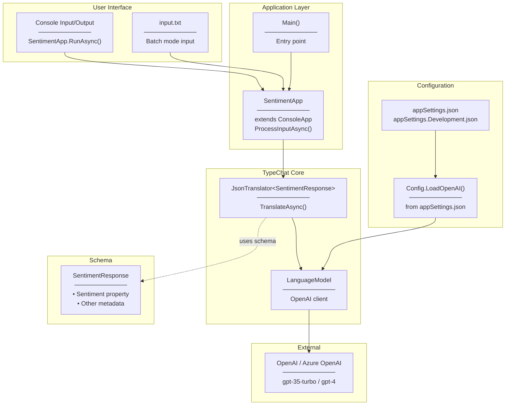
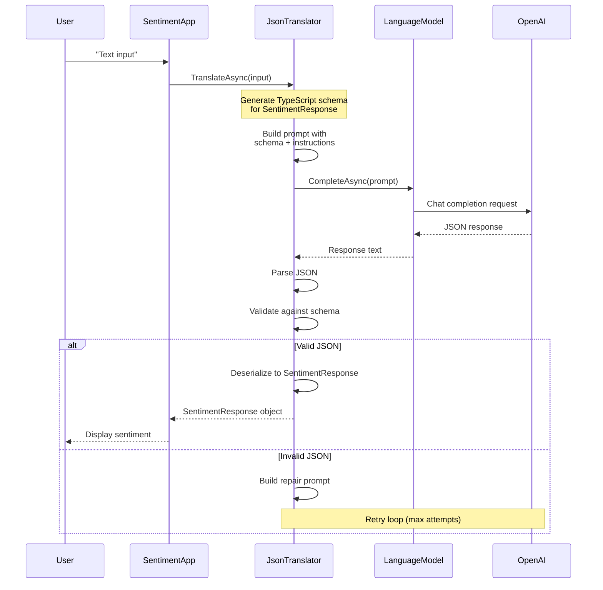

<!-- source: DeepWiki mcp.deepwiki.com · repo microsoft/typechat.net · page 8.2 Sentiment Analysis Example · fetched 2026-10-26 -->

# Sentiment Analysis Example

<details>
<summary>Relevant source files</summary>

The following files were used as context for generating this wiki page:

- [README.md](README.md)
- [TypeChat.sln](TypeChat.sln)
- [examples/CoffeeShop/CoffeeShop.csproj](examples/CoffeeShop/CoffeeShop.csproj)
- [examples/CoffeeShop2/CoffeeShop2.csproj](examples/CoffeeShop2/CoffeeShop2.csproj)
- [examples/Math/Math.csproj](examples/Math/Math.csproj)
- [examples/Sentiment/Program.cs](examples/Sentiment/Program.cs)
- [examples/Sentiment/Sentiment.csproj](examples/Sentiment/Sentiment.csproj)
- [examples/appSettings.json](examples/appSettings.json)

</details>


## Purpose and Scope

This page documents the Sentiment Analysis example, which serves as TypeChat.NET's "Hello World" application and the simplest introduction to the `JsonTranslator<T>` class. The example demonstrates how to translate natural language text into a strongly-typed sentiment response using a language model.

This is the recommended starting point for understanding TypeChat.NET's core translation workflow. For comprehensive coverage of `JsonTranslator<T>`, see [JsonTranslator](#3.1). For step-by-step guidance on creating your first application, see [Your First Translation](#2.3). For information on configuring OpenAI credentials, see [Configuration](#2.2).

**Sources:** [README.md:124](), [examples/Sentiment/Program.cs:1-43]()

## Example Overview

The Sentiment Analysis example translates arbitrary text input into a structured sentiment classification. The application:

1. Accepts text input from the user (console or batch file)
2. Translates the input into a strongly-typed `SentimentResponse` object
3. Displays the detected sentiment

This minimal example demonstrates the essential TypeChat.NET workflow without the complexity of vocabularies, polymorphism, or program execution found in more advanced examples like CoffeeShop or Math.

**Sources:** [README.md:124](), [examples/Sentiment/Program.cs:19-23]()

## Architecture Diagram



**Sources:** [examples/Sentiment/Program.cs:1-43](), [examples/appSettings.json:1-22]()

## Application Structure

### SentimentApp Class

The `SentimentApp` class extends `ConsoleApp` from the TypeChat.ExamplesLib assembly, inheriting standard console application functionality including input handling, batch mode support, and error display.

[examples/Sentiment/Program.cs:6-7]()

| Member | Type | Purpose |
|--------|------|---------|
| `_translator` | `JsonTranslator<SentimentResponse>` | Private field holding the translator instance |
| `ProcessInputAsync()` | Method | Processes each line of user input by translating and displaying results |
| `Main()` | Static method | Application entry point that creates and runs the app |

**Sources:** [examples/Sentiment/Program.cs:6-41]()

### Constructor and Initialization

The constructor creates the translation pipeline in three steps:

1. **Load Configuration:** `Config.LoadOpenAI()` reads OpenAI settings from `appSettings.json` or `appSettings.Development.json`
2. **Create Language Model:** `new LanguageModel(config)` wraps the OpenAI client
3. **Create Translator:** `new JsonTranslator<SentimentResponse>(model)` creates the typed translator

[examples/Sentiment/Program.cs:10-17]()

The constructor demonstrates three alternative configuration loading approaches:
- `Config.LoadOpenAI()` - from application configuration files (used in example)
- `OpenAIConfig.LoadFromJsonFile()` - from explicit JSON file path
- `OpenAIConfig.FromEnvironment()` - from environment variables

**Sources:** [examples/Sentiment/Program.cs:10-17](), [README.md:193-207]()

### Translation Processing

The `ProcessInputAsync` method implements the core translation workflow:

[examples/Sentiment/Program.cs:19-23]()

```
Input: "I love TypeChat!"
  ↓
TranslateAsync()
  ↓
Output: SentimentResponse object
  ↓
Display: "The sentiment is positive"
```

The method:
1. Accepts string input from the user
2. Calls `_translator.TranslateAsync(input, cancelToken)` to perform translation
3. Returns a strongly-typed `SentimentResponse` object
4. Accesses the `Sentiment` property to display results

**Sources:** [examples/Sentiment/Program.cs:19-23]()

### Entry Point

The `Main` method follows the standard console application pattern:

[examples/Sentiment/Program.cs:25-40]()

- Creates a `SentimentApp` instance
- Calls `RunAsync()` with a custom prompt ("😀> ") and optional input file path
- Handles exceptions with `WriteError()` from the `ConsoleApp` base class
- Returns 0 for success, -1 for errors

The application supports two execution modes:
- **Interactive mode:** `dotnet run` - prompts user for input line by line
- **Batch mode:** `dotnet run input.txt` - processes all lines from file

**Sources:** [examples/Sentiment/Program.cs:25-40](), [README.md:119]()

## Translation Workflow



**Sources:** [examples/Sentiment/Program.cs:19-23](), [README.md:29-34]()

## Schema Definition

The example uses a `SentimentResponse` type as its schema. While the type definition is not shown in the provided source files, based on the usage pattern at [examples/Sentiment/Program.cs:22](), the schema includes at minimum a `Sentiment` property.

### Type Export to TypeScript

TypeChat.NET automatically generates a TypeScript schema from the C# `SentimentResponse` type. The schema generation process:

1. Analyzes the C# type structure using reflection
2. Exports the type definition to TypeScript syntax
3. Includes all public properties and their types
4. Adds any vocabulary constraints or comments specified via attributes
5. Includes dependent types and base classes

The generated TypeScript schema is included in the prompt sent to the language model, enabling it to produce JSON that conforms to the expected structure. See [Schema Generation](#3.2) for details on this process.

**Sources:** [README.md:34-37](), [examples/Sentiment/Program.cs:8]()

### Minimal Schema Example

The Sentiment example demonstrates the simplest possible schema pattern:

| Feature | Present in Sentiment |
|---------|---------------------|
| Vocabularies | No |
| Polymorphic types | No |
| Nested objects | No |
| Arrays/collections | No |
| Complex constraints | No |

This minimal approach makes the example ideal for understanding core translation mechanics without schema complexity. For examples with more sophisticated schemas, see [CoffeeShop Example](#8.1).

**Sources:** [README.md:124-133]()

## Project Configuration

### Project File Structure

[examples/Sentiment/Sentiment.csproj:1-36]()

The project file demonstrates standard TypeChat.NET project structure:

| Configuration | Purpose |
|--------------|---------|
| `TargetFramework: net8.0` | Requires .NET 8.0 or later |
| `ImplicitUsings: enable` | Automatic using directives |
| `Nullable: annotations` | Nullable reference type annotations |

### Dependencies

The project references:

1. **TypeChat.ExamplesLib** - Provides `ConsoleApp` base class and utilities
2. **TypeChat** - Core `JsonTranslator<T>` and `LanguageModel` classes

**Sources:** [examples/Sentiment/Sentiment.csproj:24-27]()

### Configuration Files

The project includes configuration files via linked content:

[examples/Sentiment/Sentiment.csproj:12-22]()

- `appSettings.json` - Default configuration (checked into source control)
- `appSettings.Development.json` - Local overrides with API keys (never checked in)

Both files are copied to the output directory, allowing the application to load configuration at runtime. See [Configuration](#2.2) for details on configuring API keys.

**Sources:** [examples/Sentiment/Sentiment.csproj:12-22](), [README.md:149-190]()

## Running the Example

### Prerequisites

Before running the example, you must configure OpenAI credentials:

1. Navigate to the `examples` folder
2. Copy `appSettings.json` to `appSettings.Development.json`
3. Add your OpenAI API key or configure Azure identity
4. Specify your model endpoint and deployment name

See [Configuration](#2.2) for detailed setup instructions.

**Sources:** [README.md:149-190]()

### Execution Modes

**Interactive Mode:**
```bash
cd examples/Sentiment
dotnet run
```

The application displays the "😀> " prompt and waits for user input. Enter text to analyze sentiment:

```
😀> I absolutely love this library!
The sentiment is positive

😀> This is frustrating and difficult
The sentiment is negative
```

**Batch Mode:**
```bash
dotnet run input.txt
```

Processes all lines from the input file sequentially. The repository includes [examples/Sentiment/input.txt:30-33]() with sample inputs for batch processing.

**Sources:** [examples/Sentiment/Program.cs:30](), [README.md:119](), [examples/Sentiment/Sentiment.csproj:30-33]()

## Key Concepts Demonstrated

### Minimal JsonTranslator Usage

The Sentiment example demonstrates the minimal code required to use TypeChat.NET:

1. Create a language model instance
2. Create a `JsonTranslator<T>` with the model
3. Call `TranslateAsync()` with user input
4. Receive a strongly-typed result

This three-line pattern (excluding configuration) represents the essential TypeChat.NET workflow used in all applications.

**Sources:** [examples/Sentiment/Program.cs:10-22]()

### Configuration Loading

The example shows three equivalent configuration loading approaches:

| Method | Source | Use Case |
|--------|--------|----------|
| `Config.LoadOpenAI()` | Application configuration | Recommended for most apps |
| `OpenAIConfig.LoadFromJsonFile()` | Explicit file path | Custom configuration locations |
| `OpenAIConfig.FromEnvironment()` | Environment variables | Container/cloud deployments |

**Sources:** [examples/Sentiment/Program.cs:12-15](), [README.md:193-207]()

### ConsoleApp Infrastructure

By extending `ConsoleApp`, the example gains standard functionality without boilerplate:

- Input loop handling (interactive and batch modes)
- Exception handling and error display
- Cancellation token management
- Standard command-line argument parsing

This pattern is used across all TypeChat.NET examples, providing consistent user experience.

**Sources:** [examples/Sentiment/Program.cs:6]()

## Comparison with Other Examples

The Sentiment example is intentionally minimal. For more advanced features:

| Feature | Example | Page |
|---------|---------|------|
| Complex schemas with vocabularies | CoffeeShop | [8.1](#8.1) |
| Polymorphic type hierarchies | CoffeeShop | [8.1](#8.1) |
| Program generation and execution | Math | [8.3](#8.3) |
| Multi-turn conversations | HealthData | [8.4](#8.4) |
| Multi-schema routing | SchemaHierarchy | [8.5](#8.5) |

The progression from Sentiment → CoffeeShop → Math → HealthData → SchemaHierarchy represents increasing complexity in TypeChat.NET usage patterns.

**Sources:** [README.md:121-146]()

---

