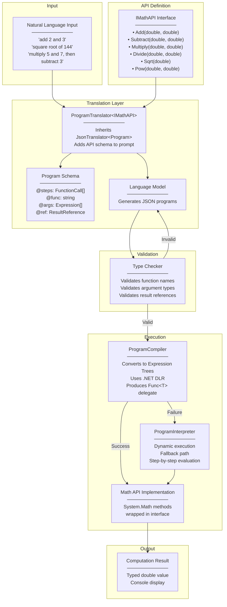
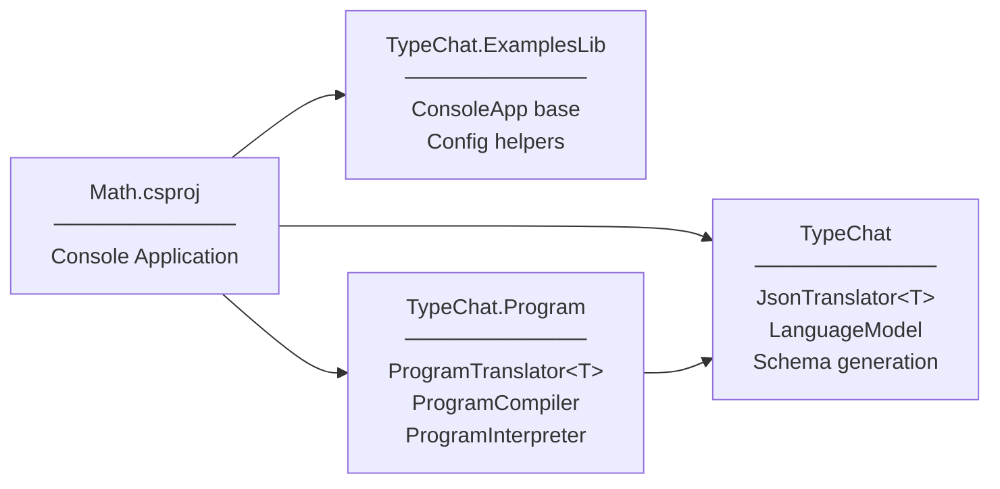

<!-- source: DeepWiki mcp.deepwiki.com · repo microsoft/typechat.net · page 8.3 Math Calculator Example · fetched 2026-10-26 -->

# Math Calculator Example

<details>
<summary>Relevant source files</summary>

The following files were used as context for generating this wiki page:

- [TypeChat.sln](TypeChat.sln)
- [examples/CoffeeShop/CoffeeShop.csproj](examples/CoffeeShop/CoffeeShop.csproj)
- [examples/CoffeeShop2/CoffeeShop2.csproj](examples/CoffeeShop2/CoffeeShop2.csproj)
- [examples/Math/Math.csproj](examples/Math/Math.csproj)
- [examples/Sentiment/Sentiment.csproj](examples/Sentiment/Sentiment.csproj)
- [src/typechat.program/Include.cs](src/typechat.program/Include.cs)

</details>


## Purpose and Scope

This document describes the Math Calculator example application, which demonstrates **program translation** capabilities in TypeChat.NET. The example shows how to translate natural language mathematical expressions into executable programs that call a defined API.

For information about the core program translation system, see [ProgramTranslator](#5.1). For details about program compilation and execution, see [Program Compilation](#5.3) and [Program Interpretation](#5.4).

## Overview

The Math Calculator example ([examples/Math]()) demonstrates TypeChat.NET's ability to translate natural language into structured, executable programs. Unlike simple JSON translation (see [Sentiment Analysis Example](#8.2)), this example generates multi-step programs that invoke methods on a target API interface.

**Key capabilities demonstrated:**
- Translation of natural language math expressions to API calls
- Multi-step program generation (e.g., "add 2 and 3, then multiply by 4")
- Type-safe API invocation through interface definitions
- Both compiled (optimized) and interpreted execution paths
- Automatic validation of function signatures and argument types

Sources: [examples/Math/Math.csproj:1-43]()

## Architecture

The following diagram illustrates the complete workflow of the Math Calculator example:



Sources: [examples/Math/Math.csproj:1-43](), Diagram 3 from repository overview

## IMathAPI Interface

The Math Calculator defines a target API interface that exposes mathematical operations. The `ProgramTranslator<IMathAPI>` uses this interface to:
1. Generate a TypeScript schema of available functions
2. Validate that generated programs only call defined methods
3. Type-check function arguments at translation time
4. Execute the programs against a concrete implementation

**Typical interface structure:**

| Method | Parameters | Return Type | Purpose |
|--------|-----------|-------------|---------|
| `Add` | `(double a, double b)` | `double` | Addition |
| `Subtract` | `(double a, double b)` | `double` | Subtraction |
| `Multiply` | `(double a, double b)` | `double` | Multiplication |
| `Divide` | `(double a, double b)` | `double` | Division |
| `Sqrt` | `(double x)` | `double` | Square root |
| `Pow` | `(double x, double y)` | `double` | Exponentiation |
| `Negate` | `(double x)` | `double` | Negation |

Sources: [examples/Math/Math.csproj:32-34]()

## Translation Workflow

The following sequence diagram shows the complete translation and execution process:

```mermaid
sequenceDiagram
    participant User
    participant App as "Math Calculator App"
    participant PT as "ProgramTranslator&lt;IMathAPI&gt;"
    participant LM as "Language Model"
    participant TC as "Type Checker"
    participant PC as "ProgramCompiler"
    participant API as "IMathAPI Implementation"
    
    User->>App: "add 2 and 3, then multiply by 4"
    
    App->>PT: TranslateAsync(input)
    
    Note over PT: Build prompt with:<br/>- IMathAPI schema<br/>- Program grammar<br/>- User request
    
    PT->>LM: CompleteAsync(prompt)
    LM-->>PT: JSON Program
    
    Note over PT: Parse JSON to Program object
    
    PT->>TC: Validate program
    
    alt Valid Program
        TC-->>PT: Valid
        PT-->>App: Program object
        
        App->>PC: TryCompile(program, api)
        
        alt Compilation Success
            PC->>PC: Build Expression Trees<br/>using DLR
            PC-->>App: Compiled Func&lt;IMathAPI, double&gt;
            App->>API: Execute delegate
            API-->>App: Result (20.0)
        else Compilation Failure
            PC-->>App: null
            App->>API: Execute via ProgramInterpreter
            API-->>App: Result (20.0)
        end
        
        App-->>User: Display result
        
    else Invalid Program
        TC-->>PT: Validation errors
        Note over PT: Attempt repair<br/>(up to MaxRepairAttempts)
    end
```

Sources: [examples/Math/Math.csproj:26-28](), Diagram 2 from repository overview

## Program Structure

The generated `Program` objects consist of a sequence of function calls, where each call can reference results from previous steps.

**Program Schema Components:**

| Component | Type | Description |
|-----------|------|-------------|
| `@steps` | `FunctionCall[]` | Array of function calls to execute in order |
| `@func` | `string` | Name of the function to invoke (must match IMathAPI method) |
| `@args` | `Expression[]` | Arguments to pass to the function |
| `@ref` | `ResultReference` | Reference to a previous step's result (e.g., `@step1`) |

**Example Translation:**

Natural Language:
```
"add 2 and 3, then multiply the result by 4"
```

Generated Program JSON:
```json
{
  "@steps": [
    {
      "@func": "Add",
      "@args": [2, 3]
    },
    {
      "@func": "Multiply",
      "@args": ["@step0", 4]
    }
  ]
}
```

Sources: [src/typechat.program/Include.cs:1-12](), Diagram 3 from repository overview

## Execution Paths

The Math Calculator supports two execution strategies:

### Compiled Execution Path

The `ProgramCompiler` converts validated programs into optimized .NET delegates using Expression Trees and the Dynamic Language Runtime (DLR).

**Advantages:**
- Type-safe at compile time
- Optimized performance (JIT compilation)
- Direct method invocation (no reflection overhead)
- Preferred execution path

**Process:**
1. Build Expression Tree for each step
2. Handle result references via closure variables
3. Compile to `Func<IMathAPI, TResult>` delegate
4. Execute delegate with API implementation

### Interpreted Execution Path

The `ProgramInterpreter` provides dynamic execution as a fallback when compilation fails or for debugging purposes.

**Advantages:**
- Flexible (handles edge cases)
- Easier debugging (step-by-step visibility)
- No compilation overhead for single-use programs

**Process:**
1. Iterate through `@steps` array
2. Resolve function names via reflection
3. Evaluate expressions recursively
4. Store intermediate results
5. Return final result

Sources: [examples/Math/Math.csproj:27-28](), Diagram 3 from repository overview

## Project Structure

The Math example project references the following TypeChat.NET assemblies:



Sources: [examples/Math/Math.csproj:25-28]()

## Key Files

| File | Purpose |
|------|---------|
| `Math.csproj` | Project file defining dependencies and build configuration |
| `Program.cs` | Main entry point; creates `ProgramTranslator<IMathAPI>` and processes input |
| `MathAPI.cs` | Interface definition for mathematical operations |
| `input.txt` | Sample natural language math expressions for testing |
| `appSettings.json` | Configuration for OpenAI/Azure OpenAI credentials |

Sources: [examples/Math/Math.csproj:1-43]()

## Configuration

The Math Calculator uses the standard TypeChat configuration system:

**Required settings:**
- OpenAI API key or Azure OpenAI endpoint
- Model name (e.g., `gpt-3.5-turbo`, `gpt-4`)

**Configuration sources:**
1. `appSettings.json` in the examples directory
2. `appSettings.Development.json` (if present)
3. Environment variables for sensitive credentials

See [Configuration](#2.2) for detailed setup instructions.

Sources: [examples/Math/Math.csproj:13-22]()

## Example Interactions

The following table shows sample inputs and their expected outputs:

| Natural Language Input | Generated Program | Result |
|------------------------|-------------------|--------|
| `"add 2 and 3"` | `Add(2, 3)` | `5.0` |
| `"square root of 144"` | `Sqrt(144)` | `12.0` |
| `"multiply 5 and 7, then subtract 3"` | `Multiply(5, 7)` → `Subtract(@step0, 3)` | `32.0` |
| `"2 plus 3 times 4"` | `Add(2, 3)` → `Multiply(@step0, 4)` | `20.0` |
| `"divide 100 by 5, then square the result"` | `Divide(100, 5)` → `Pow(@step0, 2)` | `400.0` |

Sources: [examples/Math/Math.csproj:38-40]()

## Type Safety and Validation

The Math Calculator demonstrates TypeChat's strong type safety guarantees:

**Translation-time validation:**
- Function names must match `IMathAPI` methods
- Argument counts must match method signatures
- Argument types must be compatible with parameters
- Result references must point to valid previous steps

**Execution-time safety:**
- Compiled delegates are type-safe (no runtime type errors)
- Interpreted execution validates types at each step
- Invalid operations (e.g., division by zero) throw appropriate exceptions

**Error handling:**
- Invalid programs trigger the repair loop (see [Validation and Repair](#3.3))
- Compilation failures fall back to interpretation
- Execution errors are caught and reported to the user

Sources: [examples/Math/Math.csproj:1-43](), Diagram 3 from repository overview

## Usage Pattern

The typical usage pattern for the Math Calculator:

1. **Initialize:** Create `ProgramTranslator<IMathAPI>` with language model
2. **Translate:** Convert natural language to `Program` object
3. **Compile:** Attempt to compile program to optimized delegate
4. **Execute:** Run compiled delegate or fall back to interpreter
5. **Display:** Show the computed result to the user

This pattern is reusable for any API-based program translation scenario. For other examples of program translation, see [Calendar Actions Example](#8.4).

Sources: [examples/Math/Math.csproj:1-43]()

## Related Examples

- [Calendar Actions](#8.4) - Program translation for calendar operations
- [CoffeeShop Example](#8.1) - Simple JSON translation without programs
- [Semantic Kernel Plugins](#6.1) - Program translation for SK plugin orchestration

---

