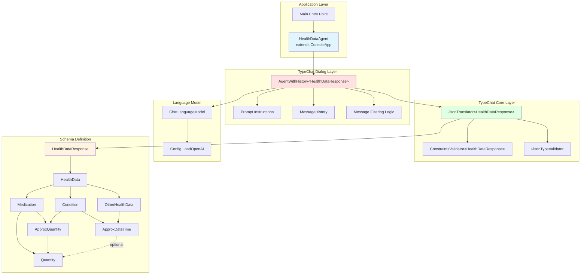
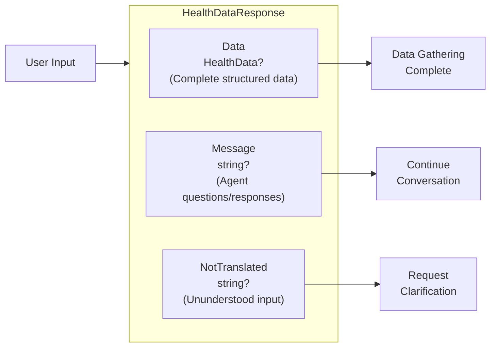
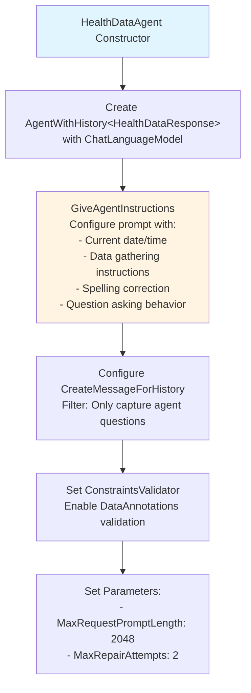
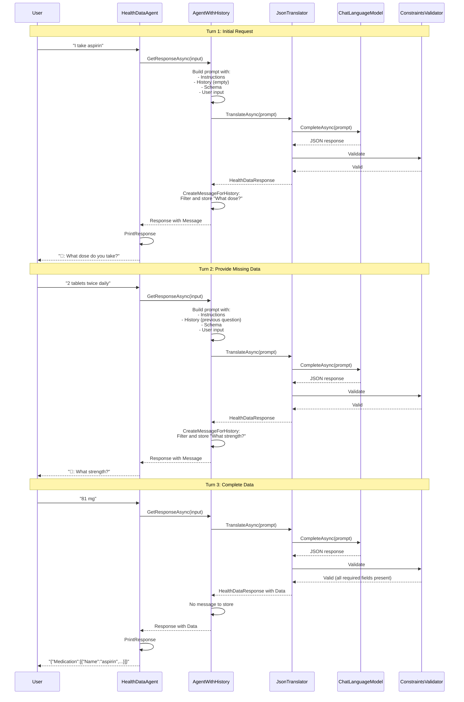
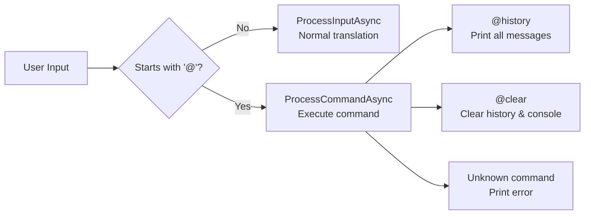

<!-- source: DeepWiki mcp.deepwiki.com · repo microsoft/typechat.net · page 8.4 HealthData Agent Example · fetched 2026-10-26 -->

# HealthData Agent Example

<details>
<summary>Relevant source files</summary>

The following files were used as context for generating this wiki page:

- [TypeChat.sln](TypeChat.sln)
- [examples/CoffeeShop/CoffeeShop.csproj](examples/CoffeeShop/CoffeeShop.csproj)
- [examples/CoffeeShop2/CoffeeShop2.csproj](examples/CoffeeShop2/CoffeeShop2.csproj)
- [examples/HealthData/HealthSchema.cs](examples/HealthData/HealthSchema.cs)
- [examples/HealthData/Program.cs](examples/HealthData/Program.cs)
- [examples/Math/Math.csproj](examples/Math/Math.csproj)
- [examples/Sentiment/Sentiment.csproj](examples/Sentiment/Sentiment.csproj)

</details>


## Purpose and Scope

This document provides a comprehensive analysis of the HealthData example application, which demonstrates TypeChat's conversational agent capabilities for structured data collection. The example implements a multi-turn dialog system that gathers medical information (medications and conditions) through natural conversation while ensuring data completeness and validation.

This example showcases the `AgentWithHistory<T>` class for building conversational AI applications. For information about basic JSON translation without conversation, see [Sentiment Analysis Example](#8.2). For program translation examples, see [Math Calculator Example](#8.3). For general agent concepts, see [Conversational Agents](#7.1).

**Sources:** [examples/HealthData/Program.cs:1-127]()

---

## Architecture Overview

The HealthData Agent is built on TypeChat's dialog system and uses the following components:



**Diagram: HealthData Agent Component Architecture**

The architecture consists of four layers:
- **Application Layer**: `HealthDataAgent` class handles user interaction and response rendering
- **Dialog Layer**: `AgentWithHistory<HealthDataResponse>` manages conversation state and multi-turn interactions
- **Core Layer**: `JsonTranslator<HealthDataResponse>` translates natural language to structured JSON, with `ConstraintsValidator` for additional validation
- **Schema Layer**: Type hierarchy defining health data structures

**Sources:** [examples/HealthData/Program.cs:9-31](), [examples/HealthData/HealthSchema.cs:1-108]()

---

## Schema Definition

### Core Schema Types

The health data schema defines a hierarchical structure for medical information:

| Type | Purpose | Key Properties |
|------|---------|----------------|
| `HealthDataResponse` | Top-level response wrapper | `Data`, `Message`, `NotTranslated` |
| `HealthData` | Container for all health data | `Medication[]`, `Condition[]`, `Other[]` |
| `Medication` | Prescription/medication information | `Name`, `Dose`, `Frequency`, `Strength` |
| `Condition` | Medical condition/diagnosis | `Name`, `StartDate`, `Status`, `EndDate?` |
| `OtherHealthData` | Unstructured health information | `Text`, `When?` |
| `ApproxQuantity` | Quantity with optional precision | `DisplayText`, `Quantity?` |
| `ApproxDateTime` | Date/time with optional precision | `DisplayText`, `Timestamp?` |
| `Quantity` | Precise measurement | `Value`, `Units` |

**Sources:** [examples/HealthData/HealthSchema.cs:9-108]()

### Response Structure Pattern

The `HealthDataResponse` uses a three-field pattern for conversational data collection:



**Diagram: HealthDataResponse Response Pattern**

- **Data**: Populated only when all required fields are collected
- **Message**: Used by agent to ask questions or acknowledge responses
- **NotTranslated**: Captures off-topic or unclear user input

**Sources:** [examples/HealthData/HealthSchema.cs:91-107]()

### Schema Features

#### Comments and Type Annotations

The schema uses `[Comment]` attributes extensively to guide the language model:

[examples/HealthData/HealthSchema.cs:11-14]() - Quantity comments specify units  
[examples/HealthData/HealthSchema.cs:40-41]() - Medication name spelling correction  
[examples/HealthData/HealthSchema.cs:66-67]() - Condition status guidance

#### Vocabulary Constraints

The `Condition.Status` field uses `[JsonVocab]` to constrain possible values:

[examples/HealthData/HealthSchema.cs:67-69]() - Status vocabulary: `"active | recurrence | relapse | inactive | remission | resolved | unknown"`

#### Required Field Validation

Multiple fields use `[Required]` or `[JsonRequired]` attributes:

[examples/HealthData/HealthSchema.cs:44-53]() - Medication dose, frequency, and strength are required  
[examples/HealthData/HealthSchema.cs:63-69]() - Condition start date and status are required

**Sources:** [examples/HealthData/HealthSchema.cs:1-108]()

---

## Agent Configuration

### Initialization

The `HealthDataAgent` constructor configures the agent with specific behaviors:



**Diagram: Agent Initialization Sequence**

**Sources:** [examples/HealthData/Program.cs:13-31]()

### Agent Instructions

The agent receives detailed instructions about its behavior:

[examples/HealthData/Program.cs:44-57]() - Instructions include:
- Current date/time context via `PromptLibrary.Now()`
- Step-by-step data gathering approach
- Asking specific questions for missing required/optional fields
- Stopping when user doesn't know the answer
- Automatic spelling correction
- Recording complex health data completely
- Always providing a response (question or acknowledgment)

### History Management

Custom message filtering ensures only agent questions are stored in history:

[examples/HealthData/Program.cs:20]() - `CreateMessageForHistory` lambda:
```
(r) => (r.HasMessage) ? Message.FromAssistant(r.Message) : null
```

This prevents storing structured data responses, keeping history focused on conversation flow.

### Constraints Validation

The agent uses `ConstraintsValidator<HealthDataResponse>` for additional validation beyond JSON schema:

[examples/HealthData/Program.cs:22]() - Enforces `System.ComponentModel.DataAnnotations` attributes like `[Required]`

### Performance Tuning

[examples/HealthData/Program.cs:26-27]() - Configuration parameters:
- `MaxRequestPromptLength = 2048`: Limits prompt size to avoid token limits
- `MaxRepairAttempts = 2`: Reduces retry attempts for validation failures

**Sources:** [examples/HealthData/Program.cs:13-31](), [examples/HealthData/Program.cs:44-57]()

---

## Conversation Flow

### Multi-Turn Dialog Pattern



**Diagram: Multi-Turn Conversation Sequence for Medication Entry**

**Sources:** [examples/HealthData/Program.cs:35-39]()

### Response Processing

The `ProcessInputAsync` method handles user input and displays responses:

[examples/HealthData/Program.cs:35-39]() - Processing flow:
1. Call `_agent.GetResponseAsync(input, cancelToken)`
2. Pass result to `PrintResponse(response)`

The `PrintResponse` method displays different response components:

[examples/HealthData/Program.cs:83-97]() - Display logic:
- If `response.Data` exists: Print JSON-serialized structured data
- If `response.HasMessage`: Print agent message with 📝 emoji
- If `response.HasNotTranslated`: Print ununderstood text with 🤔 emoji

**Sources:** [examples/HealthData/Program.cs:35-39](), [examples/HealthData/Program.cs:83-97]()

---

## Command Interface

### Available Commands

| Command | Implementation | Purpose |
|---------|---------------|---------|
| `@history` | [examples/HealthData/Program.cs:67-72]() | Display all messages in conversation history |
| `@clear` | [examples/HealthData/Program.cs:74-78]() | Clear history and reset console |

### Command Processing

[examples/HealthData/Program.cs:59-81]() - The `ProcessCommandAsync` method handles commands prefixed with `@`:



**Diagram: Command Processing Flow**

**Sources:** [examples/HealthData/Program.cs:59-81]()

---

## Application Entry Point

### Main Method

[examples/HealthData/Program.cs:99-116]() - The `Main` method:
1. Creates `HealthDataAgent` instance
2. Calls `PrintHelp()` to display usage instructions
3. Calls `RunAsync("💉💊🤧> ", args.GetOrNull(0))` to start console loop
4. Handles exceptions and returns exit code

### Help Display

[examples/HealthData/Program.cs:118-124]() - The `PrintHelp` method displays:
- Purpose: "Enter medications and conditions"
- `@history` command description
- `@clear` command description

The prompt uses health-related emojis: 💉💊🤧>

**Sources:** [examples/HealthData/Program.cs:99-124]()

---

## Key Implementation Details

### Approximate Quantity Pattern

The schema uses an "approximate with optional precision" pattern:

**ApproxQuantity Structure:**
- [examples/HealthData/HealthSchema.cs:17-25]()
- `DisplayText`: Human-readable text (e.g., "twice a day", "unknown")
- `Quantity`: Optional precise measurement with value and units

This allows the agent to accept imprecise user input while capturing precision when available.

### Approximate DateTime Pattern

Similar pattern for temporal information:

**ApproxDateTime Structure:**
- [examples/HealthData/HealthSchema.cs:27-35]()
- `DisplayText`: Human-readable text (e.g., "last year", "unknown")
- `Timestamp`: Optional precise DateTime value

### JsonIgnore Helper Properties

[examples/HealthData/HealthSchema.cs:102-106]() - Helper properties marked with `[JsonIgnore]`:
- `HasMessage`: Checks if `Message` is non-empty
- `HasNotTranslated`: Checks if `NotTranslated` is non-empty

These are not serialized to JSON but provide convenient access in application code.

**Sources:** [examples/HealthData/HealthSchema.cs:17-35](), [examples/HealthData/HealthSchema.cs:102-106]()

---

## Project Configuration

### Dependencies

The HealthData project references:
- `TypeChat.csproj`: Core translation functionality
- `TypeChat.ExamplesLib.csproj`: Console application framework

### Configuration Files

[examples/CoffeeShop/CoffeeShop.csproj:14-23]() - Standard configuration pattern:
- `appSettings.json`: Shared configuration
- `appSettings.Development.json`: Development overrides (conditional include)

Configuration is loaded via `Config.LoadOpenAI()` at [examples/HealthData/Program.cs:16]()

**Sources:** [examples/CoffeeShop/CoffeeShop.csproj:14-23](), [examples/HealthData/Program.cs:16]()

---

## Usage Example

### Sample Conversation

```
💉💊🤧> I'm taking metformin for diabetes
📝: What dose of metformin do you take?

💉💊🤧> 500 mg twice a day
📝: When did you start taking this medication?

💉💊🤧> about 6 months ago
{
  "Medication": [
    {
      "Name": "metformin",
      "Dose": {
        "DisplayText": "twice a day",
        "Quantity": { "Value": 1, "Units": "dose" }
      },
      "Frequency": {
        "DisplayText": "twice a day",
        "Quantity": { "Value": 2, "Units": "per-day" }
      },
      "Strength": {
        "DisplayText": "500 mg",
        "Quantity": { "Value": 500, "Units": "mg" }
      }
    }
  ],
  "Condition": [
    {
      "Name": "diabetes",
      "StartDate": {
        "DisplayText": "about 6 months ago"
      },
      "Status": "active"
    }
  ]
}
```

### Command Usage

```
💉💊🤧> @history
user: I'm taking metformin for diabetes
assistant: What dose of metformin do you take?
user: 500 mg twice a day
assistant: When did you start taking this medication?

💉💊🤧> @clear
[Console cleared and help redisplayed]
```

**Sources:** [examples/HealthData/Program.cs:1-127](), [examples/HealthData/HealthSchema.cs:1-108]()

---

