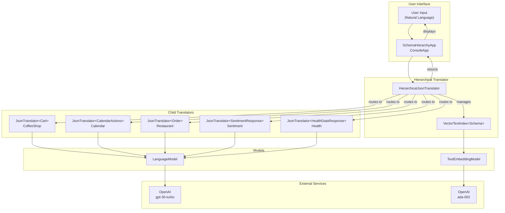
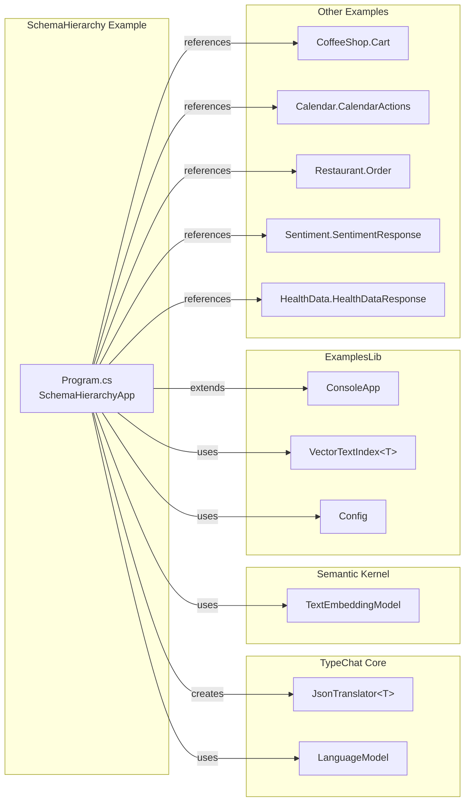

<!-- source: DeepWiki mcp.deepwiki.com · repo microsoft/typechat.net · page 8.5 SchemaHierarchy Example · fetched 2026-10-26 -->

# SchemaHierarchy Example

<details>
<summary>Relevant source files</summary>

The following files were used as context for generating this wiki page:

- [README.md](README.md)
- [examples/SchemaHierarchy/Program.cs](examples/SchemaHierarchy/Program.cs)
- [examples/Sentiment/Program.cs](examples/Sentiment/Program.cs)
- [examples/appSettings.json](examples/appSettings.json)
- [tests/TypeChat.UnitTests/TestSchema.cs](tests/TypeChat.UnitTests/TestSchema.cs)

</details>


This page describes the **SchemaHierarchy** example application, which demonstrates semantic routing across multiple schemas using text embeddings. The example shows how to build a single natural language interface that dynamically routes user requests to the most appropriate schema based on semantic similarity.

For information about multi-schema routing using explicit logic, see [Multi-Schema Routing](#7.2). For details about the underlying embedding and vectorization infrastructure, see [Embeddings and Vectorization](#7.3).

## Purpose and Scope

The SchemaHierarchy example illustrates how to create a hierarchical translator that manages multiple `JsonTranslator<T>` instances, each targeting a different schema. When a user submits a natural language request, the system:

1. Uses embeddings to determine which schema is semantically most relevant
2. Routes the request to the appropriate child translator
3. Returns a strongly-typed result corresponding to the selected schema

This pattern is useful when building applications that need to handle diverse user intents within a single interface, such as multi-domain assistants or unified command interfaces.

**Sources:** [README.md:134-137](), [examples/SchemaHierarchy/Program.cs:1-68]()

## Architecture Overview

The following diagram shows the high-level architecture of the SchemaHierarchy example:



**Sources:** [examples/SchemaHierarchy/Program.cs:17-26](), [README.md:134-137]()

## Key Components

The SchemaHierarchy example consists of the following core components:

| Component | Type | Purpose |
|-----------|------|---------|
| `SchemaHierarchyApp` | ConsoleApp | Main application class that manages user interaction |
| `HierarchicalJsonTranslator` | Custom translator | Manages multiple child translators and routes requests |
| `VectorTextIndex<Schema>` | Generic index | Performs semantic search to find nearest matching schema |
| `TextEmbeddingModel` | Embedding generator | Generates embeddings for schema descriptions and user input |
| `LanguageModel` | LLM client | Used by child translators for JSON translation |

**Sources:** [examples/SchemaHierarchy/Program.cs:17-26]()

## Schema Registration

The following diagram illustrates how schemas are registered during application initialization:

```mermaid
sequenceDiagram
    participant Main as Main()
    participant App as SchemaHierarchyApp
    participant HJT as HierarchicalJsonTranslator
    participant VI as VectorTextIndex&lt;Schema&gt;
    participant EM as TextEmbeddingModel
    
    Main->>App: new SchemaHierarchyApp()
    App->>HJT: Create with LanguageModel + TextEmbeddingModel
    HJT->>VI: Initialize VectorTextIndex
    
    Main->>App: RunAsync()
    App->>App: InitApp()
    
    Note over App,EM: Register Cart Schema
    App->>HJT: AddSchemaAsync&lt;Cart&gt;("Order Coffee...")
    HJT->>EM: Generate embedding for description
    EM-->>HJT: Embedding vector
    HJT->>VI: Add schema with embedding
    
    Note over App,EM: Register CalendarActions Schema
    App->>HJT: AddSchemaAsync&lt;CalendarActions&gt;("Actions related...")
    HJT->>EM: Generate embedding for description
    EM-->>HJT: Embedding vector
    HJT->>VI: Add schema with embedding
    
    Note over App,EM: Register Other Schemas
    App->>HJT: AddSchemaAsync&lt;Order&gt;(...)
    App->>HJT: AddSchemaAsync&lt;SentimentResponse&gt;(...)
    App->>HJT: AddSchemaAsync&lt;HealthDataResponse&gt;(...)
    
    Note over App: Application ready for requests
```

The initialization occurs in the `InitApp()` method, which registers five schemas with descriptive text:

```
Cart: "Order Coffee Drinks (Italian names included) and Baked Goods"
CalendarActions: "Actions related to calendars, appointments, meetings, schedules"
Order: "Order pizza, beer and salads"
SentimentResponse: "Statements with sentiments, emotions, feelings, impressions about places, things, the surroundings"
HealthDataResponse: "Health information: enter your medications, conditions"
```

Each schema is associated with its description embedding, enabling semantic similarity comparison during request routing.

**Sources:** [examples/SchemaHierarchy/Program.cs:38-48]()

## Request Routing Workflow

The following diagram shows how user requests are routed to the appropriate schema:

```mermaid
sequenceDiagram
    participant User
    participant App as SchemaHierarchyApp
    participant HJT as HierarchicalJsonTranslator
    participant VI as VectorTextIndex&lt;Schema&gt;
    participant EM as TextEmbeddingModel
    participant JT as JsonTranslator&lt;T&gt;
    participant LM as LanguageModel
    
    User->>App: "I need a latte with extra foam"
    App->>HJT: TranslateToObjectAsync(input)
    
    Note over HJT,EM: Phase 1: Find Nearest Schema
    HJT->>EM: Generate embedding for input
    EM-->>HJT: Input embedding vector
    
    HJT->>VI: GetNearestAsync(input embedding)
    VI->>VI: Calculate cosine similarity<br/>with all schema embeddings
    VI-->>HJT: Nearest schema = Cart
    
    Note over HJT,LM: Phase 2: Translate Using Selected Schema
    HJT->>JT: Retrieve JsonTranslator&lt;Cart&gt;
    HJT->>JT: TranslateAsync(input)
    JT->>LM: Complete with Cart schema
    LM-->>JT: JSON response
    JT->>JT: Validate and deserialize
    JT-->>HJT: Cart object
    
    HJT-->>App: object (Cart)
    App->>App: Display result type + JSON
    App-->>User: Cart<br/>{"items": [...]}
```

This two-phase approach separates schema selection from translation, enabling efficient routing without requiring the LLM to understand all schemas simultaneously.

**Sources:** [examples/SchemaHierarchy/Program.cs:28-36](), [README.md:134-137]()

## Implementation Details

### Main Application Class

The `SchemaHierarchyApp` class extends `ConsoleApp` and manages the lifecycle of the hierarchical translator:

| Method | Purpose | Line Reference |
|--------|---------|----------------|
| Constructor | Initializes models and translator | [examples/SchemaHierarchy/Program.cs:21-26]() |
| `InitApp()` | Registers all schemas with descriptions | [examples/SchemaHierarchy/Program.cs:38-48]() |
| `ProcessInputAsync()` | Routes input and displays result | [examples/SchemaHierarchy/Program.cs:28-36]() |
| `Main()` | Entry point with console prompt | [examples/SchemaHierarchy/Program.cs:50-66]() |

### Configuration Requirements

The application requires two OpenAI configurations:

1. **Chat Model** (`OpenAI`): For JSON translation via child translators
   - Default: `gpt-35-turbo`
   - Loaded via `Config.LoadOpenAI()`

2. **Embedding Model** (`OpenAI_Embedding`): For semantic similarity
   - Default: `ada-002`
   - Loaded via `Config.LoadOpenAI("OpenAI_Embedding")`

**Sources:** [examples/SchemaHierarchy/Program.cs:23-25](), [examples/appSettings.json:1-21]()

### Schema Registration

Each schema is registered with a descriptive string that captures its domain:

```
await _translator.AddSchemaAsync<Cart>("Order Coffee Drinks (Italian names included) and Baked Goods");
```

The description quality directly impacts routing accuracy. Descriptions should:
- Clearly identify the domain
- Include relevant keywords and synonyms
- Distinguish the schema from others in the hierarchy
- Be concise but comprehensive

**Sources:** [examples/SchemaHierarchy/Program.cs:43-47]()

### Result Processing

The `ProcessInputAsync()` method receives an untyped `object` result because the actual type depends on which schema was selected:

```csharp
object result = await _translator.TranslateToObjectAsync(input, cancelToken);
if (result is not null)
{
    Console.WriteLine($"{result.GetType()}");
    Console.WriteLine(Microsoft.TypeChat.Json.Stringify(result));
}
```

This demonstrates a trade-off: dynamic schema routing provides flexibility but requires runtime type inspection. Applications can use pattern matching or type checks to handle different result types appropriately.

**Sources:** [examples/SchemaHierarchy/Program.cs:30-35]()

## Usage Examples

The following table shows example inputs and their expected routing:

| User Input | Routed Schema | Reason |
|------------|---------------|--------|
| "I need a cappuccino with almond milk" | `Cart` | Coffee order keywords |
| "Schedule a meeting tomorrow at 2pm" | `CalendarActions` | Calendar-related action |
| "Order a large pepperoni pizza" | `Order` | Pizza restaurant order |
| "I'm feeling very happy about the weather" | `SentimentResponse` | Sentiment/emotion expression |
| "I take aspirin daily" | `HealthDataResponse` | Medication information |

### Running the Example

The application supports both interactive and batch modes:

**Interactive Mode:**
```bash
dotnet run
```

Displays the prompt: `☕📅🍕💊🤧😀> `

The emoji prompt reflects the five supported domains (coffee, calendar, restaurant, health, sentiment).

**Batch Mode:**
```bash
dotnet run input.txt
```

Processes all inputs from the specified file.

**Sources:** [examples/SchemaHierarchy/Program.cs:55](), [README.md:119-120]()

## Component Dependencies

The following diagram shows the dependency relationships:



This demonstrates how SchemaHierarchy combines components from across the TypeChat ecosystem to create a unified multi-domain interface.

**Sources:** [examples/SchemaHierarchy/Program.cs:3-13](), [examples/SchemaHierarchy/Program.cs:43-47]()

## Key Takeaways

The SchemaHierarchy example demonstrates several important patterns:

1. **Semantic Routing**: Uses embeddings to automatically route requests without hardcoded rules
2. **Composition**: Combines multiple existing schemas into a unified interface
3. **Scalability**: Adding new schemas requires only registration—no routing logic changes
4. **Type Safety**: Each child translator maintains strong typing for its domain
5. **Flexibility**: The untyped result pattern allows dynamic handling of diverse outputs

This approach is particularly effective when:
- Domains have distinct vocabularies and concepts
- The number of schemas is manageable (typically < 20)
- Schema descriptions can be clearly differentiated
- Request distribution is relatively balanced across schemas

For scenarios requiring more complex routing logic or tighter integration between schemas, consider the MultiSchema approach described in [Multi-Schema Routing](#7.2).

**Sources:** [README.md:134-137](), [examples/SchemaHierarchy/Program.cs:1-68]()

---

