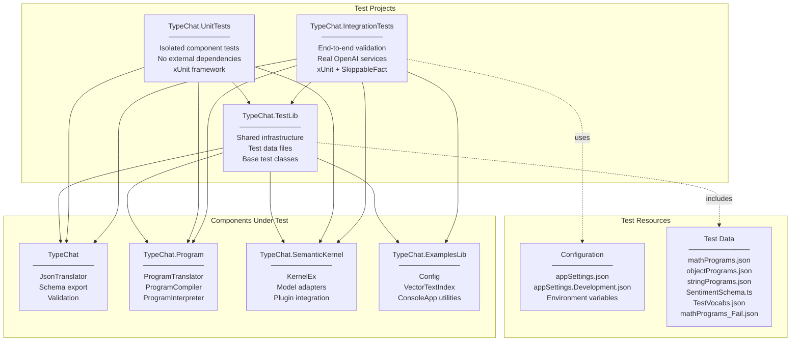
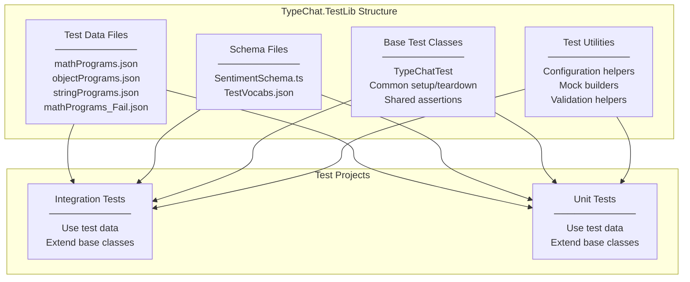
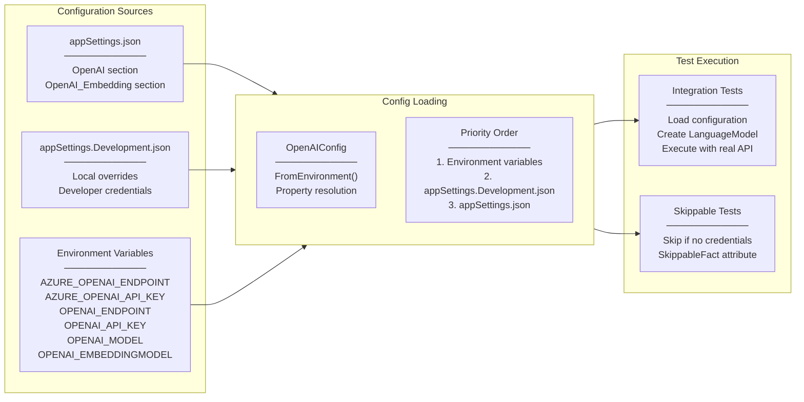
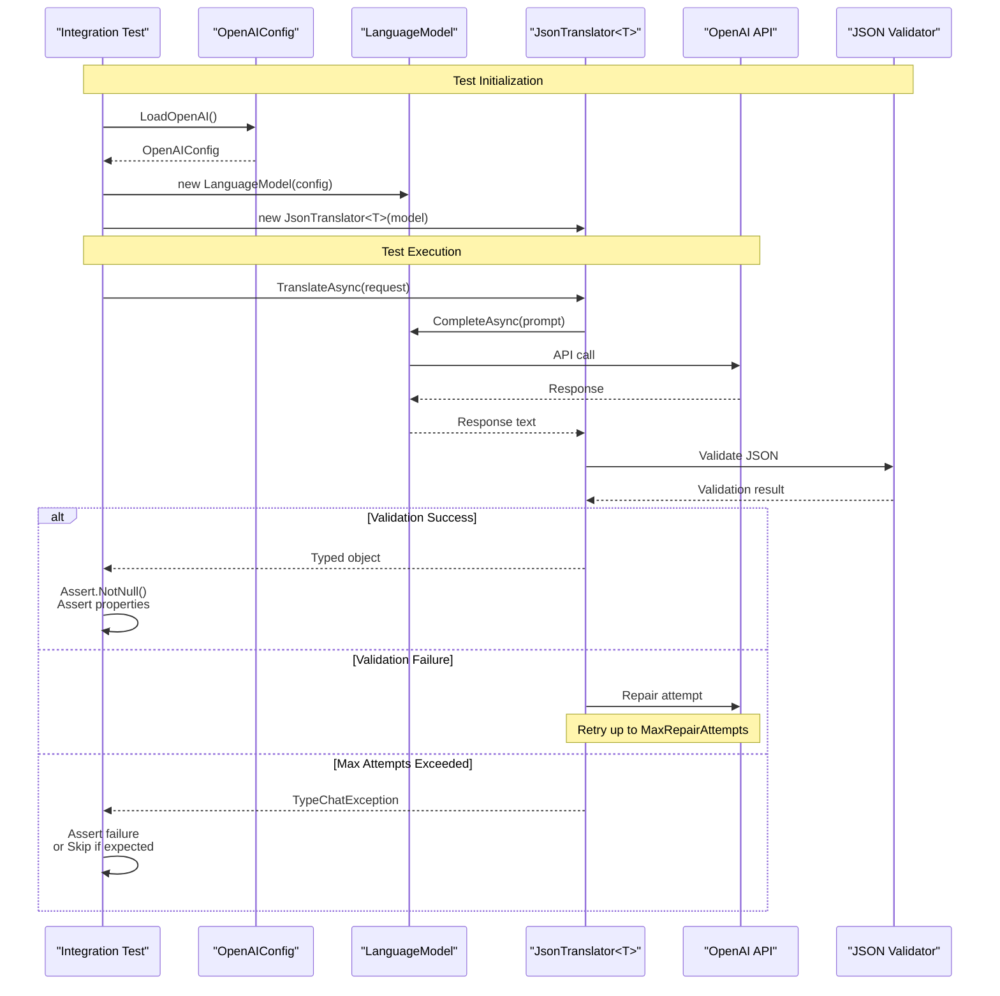
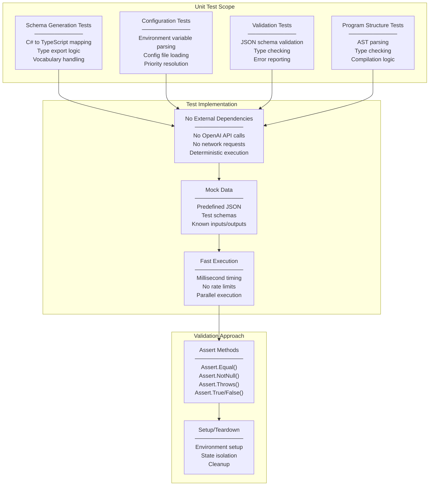

<!-- source: DeepWiki mcp.deepwiki.com · repo microsoft/typechat.net · page 9 Testing · fetched 2026-10-26 -->

# Testing

<details>
<summary>Relevant source files</summary>

The following files were used as context for generating this wiki page:

- [src/typechat.program/Extensions.cs](src/typechat.program/Extensions.cs)
- [tests/TypeChat.IntegrationTests/TypeChat.IntegrationTests.csproj](tests/TypeChat.IntegrationTests/TypeChat.IntegrationTests.csproj)
- [tests/TypeChat.IntegrationTests/appSettings.json](tests/TypeChat.IntegrationTests/appSettings.json)
- [tests/TypeChat.TestLib/TypeChat.TestLib.csproj](tests/TypeChat.TestLib/TypeChat.TestLib.csproj)
- [tests/TypeChat.UnitTests/TestConfig.cs](tests/TypeChat.UnitTests/TestConfig.cs)
- [tests/TypeChat.UnitTests/TypeChat.UnitTests.csproj](tests/TypeChat.UnitTests/TypeChat.UnitTests.csproj)

</details>


TypeChat.NET includes comprehensive testing infrastructure covering unit tests, integration tests, and shared test utilities. The testing approach validates core translation functionality, program execution, schema generation, embedding capabilities, and integration points with Semantic Kernel and Microsoft.Extensions.AI. Tests are organized into three projects: `TypeChat.UnitTests` for isolated component validation, `TypeChat.IntegrationTests` for end-to-end scenarios with real language models, and `TypeChat.TestLib` for shared test infrastructure and test data.

For examples of testing specific features, see [Schema Generation](#3.2) for schema validation tests, [Program Translation](#5) for program execution tests, and [Embeddings and Vectorization](#7.3) for embedding tests.

---

## Test Project Architecture

The testing infrastructure is organized into three distinct assemblies, each serving a specific purpose in the validation strategy.



**Test Project Dependencies**

| Project | Framework | Purpose | External Services |
|---------|-----------|---------|-------------------|
| **TypeChat.UnitTests** | xUnit | Isolated component validation | None |
| **TypeChat.IntegrationTests** | xUnit + SkippableFact | End-to-end scenarios | OpenAI/Azure OpenAI |
| **TypeChat.TestLib** | xUnit | Shared utilities and test data | None |

Sources: [tests/TypeChat.IntegrationTests/TypeChat.IntegrationTests.csproj](), [tests/TypeChat.UnitTests/TypeChat.UnitTests.csproj](), [tests/TypeChat.TestLib/TypeChat.TestLib.csproj]()

---

## Test Infrastructure (TypeChat.TestLib)

The `TypeChat.TestLib` project provides shared testing infrastructure including base test classes, test data files, and utility methods. This centralized approach eliminates code duplication across test projects and ensures consistent test patterns.



**Test Data Files**

| File | Purpose | Usage |
|------|---------|-------|
| `mathPrograms.json` | Valid mathematical program examples | Program translation validation |
| `mathPrograms_Fail.json` | Invalid program examples | Error handling validation |
| `objectPrograms.json` | Object manipulation programs | Complex type handling tests |
| `stringPrograms.json` | String operation programs | String API validation |
| `SentimentSchema.ts` | TypeScript schema example | Schema export validation |
| `TestVocabs.json` | Vocabulary definitions | Vocabulary constraint tests |

The test data files are configured to copy to the output directory during build, ensuring they are available at runtime for test execution.

Sources: [tests/TypeChat.TestLib/TypeChat.TestLib.csproj:28-46](), [tests/TypeChat.UnitTests/TestConfig.cs]()

---

## Test Configuration

TypeChat tests require OpenAI or Azure OpenAI credentials for integration testing. Configuration supports both file-based and environment variable approaches, enabling flexible test execution in local development and CI/CD environments.



**Configuration File Structure**

The `appSettings.json` file defines separate configurations for chat and embedding models:

```json
{
  "OpenAI": {
    "Azure": true,
    "Endpoint": "https://your-endpoint.openai.azure.com",
    "ApiKey": "your-api-key",
    "Model": "gpt-4"
  },
  "OpenAI_Embedding": {
    "Azure": true,
    "Endpoint": "https://your-endpoint.openai.azure.com",
    "ApiKey": "your-api-key",
    "Model": "text-embedding-ada-002"
  }
}
```

**Environment Variable Configuration**

The `TestConfig` class validates environment variable configuration loading:

| Environment Variable | Purpose | Azure | Non-Azure |
|---------------------|---------|-------|-----------|
| `AZURE_OPENAI_ENDPOINT` | Azure OpenAI endpoint URL | ✓ | |
| `AZURE_OPENAI_API_KEY` | Azure OpenAI API key | ✓ | |
| `OPENAI_ENDPOINT` | OpenAI endpoint URL | | ✓ |
| `OPENAI_API_KEY` | OpenAI API key | | ✓ |
| `OPENAI_ORGANIZATION` | OpenAI organization ID | | ✓ |
| `OPENAI_MODEL` | Chat completion model name | ✓ | ✓ |
| `OPENAI_EMBEDDINGMODEL` | Embedding model name | ✓ | ✓ |

**Configuration Fallback Strategy**

The integration tests project implements a cascading configuration file resolution:

1. Check for `appSettings.Development.json` in test project directory
2. If not found, check for `appSettings.Development.json` in examples directory
3. Fall back to `appSettings.json` in test project directory

This approach allows developers to maintain a single development configuration file at the repository root while enabling project-specific overrides when needed.

Sources: [tests/TypeChat.IntegrationTests/TypeChat.IntegrationTests.csproj:33-47](), [tests/TypeChat.IntegrationTests/appSettings.json](), [tests/TypeChat.UnitTests/TestConfig.cs:8-99]()

---

## Integration Testing

Integration tests validate end-to-end scenarios with real OpenAI or Azure OpenAI services. These tests ensure that TypeChat's translation workflow, program execution, embedding generation, and Semantic Kernel integration function correctly with actual language models.



**Integration Test Categories**

Integration tests are organized by the components they validate:

| Test Category | Components Tested | External Dependencies |
|---------------|-------------------|----------------------|
| **Core Translation Tests** | `JsonTranslator<T>`, schema export, validation, repair | OpenAI chat completion |
| **Program Execution Tests** | `ProgramTranslator<T>`, `ProgramCompiler`, `ProgramInterpreter` | OpenAI chat completion |
| **Semantic Kernel Tests** | `KernelEx`, model adapters, plugin integration | OpenAI via Semantic Kernel |
| **Embedding Tests** | `TextEmbeddingModel`, `VectorTextIndex`, similarity calculations | OpenAI embeddings API |
| **Agent Tests** | `AgentWithHistory<T>`, conversation management | OpenAI chat completion |
| **Routing Tests** | Multi-schema routing, semantic classification | OpenAI embeddings + chat |

**Skippable Tests**

Integration tests use the `Xunit.SkippableFact` attribute to gracefully skip tests when OpenAI credentials are not configured. This allows the test suite to run in environments without API access without generating false negatives:

```
[SkippableFact]
public async Task TestTranslation()
{
    Skip.IfNot(HasValidConfig(), "OpenAI configuration not available");
    // Test implementation
}
```

This pattern is particularly useful for:
- Running tests in CI/CD environments without exposing credentials
- Executing partial test suites during development
- Validating tests on developer machines without API access

Sources: [tests/TypeChat.IntegrationTests/TypeChat.IntegrationTests.csproj:22]()

---

## Unit Testing

Unit tests validate individual components in isolation without external dependencies. These tests focus on schema generation logic, type validation, configuration loading, and other deterministic functionality that does not require language model interaction.



**Unit Test Examples**

The `TestConfig` class demonstrates typical unit test patterns for validating configuration loading:

**Environment Variable Configuration Test**
- Tests `OpenAIConfig.FromEnvironment()` method
- Sets environment variables using test helper methods
- Validates correct parsing of Azure vs non-Azure configuration
- Ensures proper cleanup in `finally` blocks

**Configuration Priority Test**
- Validates that Azure configuration takes precedence when both Azure and OpenAI variables are set
- Tests that embedding model configuration uses separate environment variables
- Ensures `OpenAIConfig.FromEnvironment(isEmbedding: true)` loads correct model names

**Test Isolation Pattern**

Unit tests follow a consistent pattern for environment variable manipulation:

```
string? prevValue = null;
try
{
    prevValue = SetEnv(VARIABLE_NAME, "TEST_VALUE");
    var config = OpenAIConfig.FromEnvironment();
    Assert.Equal("TEST_VALUE", config.Property);
}
finally
{
    SetEnv(VARIABLE_NAME, prevValue); // Restore original value
}
```

This pattern ensures:
- Tests do not interfere with each other
- Original environment state is preserved
- Tests can run in parallel without conflicts

**Unit Test Organization**

| Test Class | Focus Area | External Dependencies |
|------------|------------|----------------------|
| `TestConfig` | Configuration loading and environment variables | None |
| `TestSchemaExport` | TypeScript schema generation from C# types | None |
| `TestTypeMapping` | C# to TypeScript type mapping logic | None |
| `TestProgramParsing` | Program JSON parsing and AST construction | None |
| `TestProgramValidation` | Program type checking without compilation | None |

Unit tests are designed to execute quickly (typically under 100ms per test) and can be run continuously during development without requiring API credentials or network access.

Sources: [tests/TypeChat.UnitTests/TypeChat.UnitTests.csproj](), [tests/TypeChat.UnitTests/TestConfig.cs:8-99]()

---

## Running Tests

Tests can be executed using standard .NET testing tools. The test suite supports both command-line and IDE-based execution with appropriate handling of configuration requirements.

**Command-Line Execution**

```bash
# Run all tests
dotnet test

# Run only unit tests (fast, no external dependencies)
dotnet test tests/TypeChat.UnitTests

# Run only integration tests (requires OpenAI configuration)
dotnet test tests/TypeChat.IntegrationTests

# Run with verbose output
dotnet test --logger "console;verbosity=detailed"

# Run specific test by name
dotnet test --filter "FullyQualifiedName~TestConfig.TestEnvOpenAI"
```

**IDE Execution**

- **Visual Studio**: Use Test Explorer to discover and run tests
- **Visual Studio Code**: Install C# Dev Kit extension for integrated test runner
- **JetBrains Rider**: Use built-in test runner with coverage support

**Test Execution Requirements**

| Test Project | OpenAI Config Required | Network Access Required | Execution Time |
|--------------|------------------------|------------------------|----------------|
| TypeChat.UnitTests | No | No | < 5 seconds |
| TypeChat.IntegrationTests | Yes | Yes | 30-120 seconds |
| TypeChat.TestLib | N/A (library only) | No | N/A |

**CI/CD Considerations**

For continuous integration pipelines:

1. **Unit Tests**: Run on every commit without special configuration
2. **Integration Tests**: Require OpenAI credentials via environment variables or Azure Key Vault
3. **Skippable Tests**: Use `SkippableFact` to gracefully skip when credentials unavailable
4. **Rate Limiting**: Consider test parallelization limits to avoid OpenAI rate limits
5. **Test Data**: Ensure test data files are included in build artifacts

Sources: [tests/TypeChat.IntegrationTests/TypeChat.IntegrationTests.csproj](), [tests/TypeChat.UnitTests/TypeChat.UnitTests.csproj]()

---

## Testing Patterns and Best Practices

TypeChat tests follow consistent patterns to ensure reliability, maintainability, and clear failure diagnostics.

```mermaid
graph TB
    subgraph TestPatterns["Common Testing Patterns"]
        AAA["Arrange-Act-Assert<br/>────────────<br/>1. Setup test data<br/>2. Execute operation<br/>3. Verify results"]
        
        Isolation["Test Isolation<br/>────────────<br/>Independent tests<br/>No shared state<br/>Cleanup in finally blocks"]
        
        Descriptive["Descriptive Names<br/>────────────<br/>TestMethodName_Scenario_ExpectedResult<br/>Clear intent<br/>Self-documenting"]
    end
    
    subgraph ConfigPatterns["Configuration Patterns"]
        EnvRestore["Environment Restoration<br/>────────────<br/>Save original values<br/>Modify for test<br/>Restore in finally"]
        
        ConfigFallback["Configuration Fallback<br/>────────────<br/>Try environment variables<br/>Try appSettings.Development.json<br/>Try appSettings.json"]
        
        SkipOnMissing["Skip When Missing<br/>────────────<br/>SkippableFact attribute<br/>Skip.IfNot() checks<br/>Graceful degradation"]
    end
    
    subgraph DataPatterns["Test Data Patterns"]
        ValidData["Valid Test Cases<br/>────────────<br/>mathPrograms.json<br/>Expected success scenarios<br/>Positive validation"]
        
        InvalidData["Invalid Test Cases<br/>────────────<br/>mathPrograms_Fail.json<br/>Expected failure scenarios<br/>Error handling validation"]
        
        EdgeCases["Edge Cases<br/>────────────<br/>Empty inputs<br/>Boundary values<br/>Special characters"]
    end
    
    AAA --> Isolation
    Isolation --> Descriptive
    
    EnvRestore --> ConfigFallback
    ConfigFallback --> SkipOnMissing
    
    ValidData --> InvalidData
    InvalidData --> EdgeCases
```



**Recommended Test Structure**

**1. Arrange-Act-Assert Pattern**
```
[Fact]
public void TestOperation()
{
    // Arrange: Set up test data and dependencies
    var input = CreateTestInput();
    var expected = CreateExpectedOutput();
    
    // Act: Execute the operation under test
    var actual = PerformOperation(input);
    
    // Assert: Verify results
    Assert.Equal(expected, actual);
}
```

**2. Environment Variable Test Pattern**
```
[Fact]
public void TestEnvironmentConfig()
{
    string? previousValue = null;
    try
    {
        // Arrange: Set test environment
        previousValue = SetEnv("VARIABLE_NAME", "TEST_VALUE");
        
        // Act: Execute operation
        var result = LoadConfiguration();
        
        // Assert: Verify behavior
        Assert.Equal("TEST_VALUE", result.Property);
    }
    finally
    {
        // Cleanup: Restore original state
        SetEnv("VARIABLE_NAME", previousValue);
    }
}
```

**3. Integration Test with Skipping**
```
[SkippableFact]
public async Task TestTranslation()
{
    // Skip if configuration not available
    var config = Config.LoadOpenAI();
    Skip.IfNot(config.IsValid(), "OpenAI configuration required");
    
    // Arrange: Create translator
    var model = new LanguageModel(config);
    var translator = new JsonTranslator<ResponseType>(model);
    
    // Act: Perform translation
    var result = await translator.TranslateAsync("test input");
    
    // Assert: Verify translation
    Assert.NotNull(result.Value);
    Assert.Null(result.Exception);
}
```

**Best Practices Summary**

| Practice | Rationale | Implementation |
|----------|-----------|----------------|
| **Independent Tests** | Tests should not depend on execution order | Use setup/teardown for state management |
| **Fast Unit Tests** | Enable rapid feedback during development | Avoid external dependencies in unit tests |
| **Descriptive Names** | Clearly communicate test intent | Use `Test[Component]_[Scenario]_[Expected]` pattern |
| **Test Data Files** | Reuse test data across test projects | Store in TypeChat.TestLib, copy to output |
| **Configuration Fallback** | Support multiple configuration methods | Check env vars, then dev file, then default file |
| **Graceful Skipping** | Allow tests to run without all prerequisites | Use `SkippableFact` for optional dependencies |
| **Cleanup in Finally** | Ensure state restoration even on failure | Always restore environment variables |
| **Both Success and Failure** | Validate correct behavior and error handling | Include `_Fail.json` test data files |

Sources: [tests/TypeChat.UnitTests/TestConfig.cs:8-99](), [tests/TypeChat.TestLib/TypeChat.TestLib.csproj:29-46]()

---

