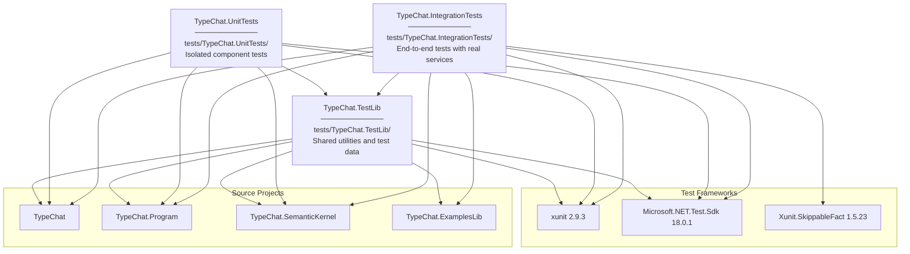
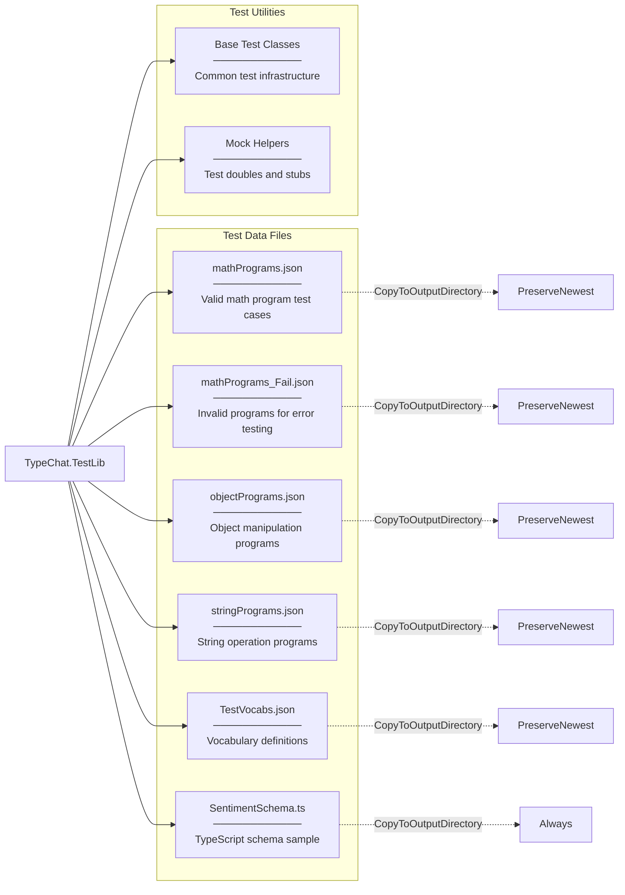
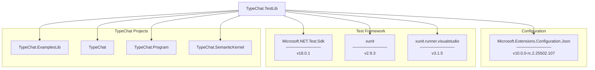
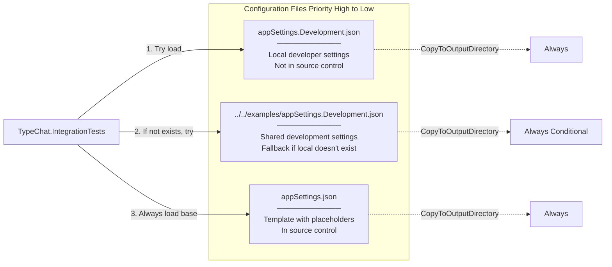
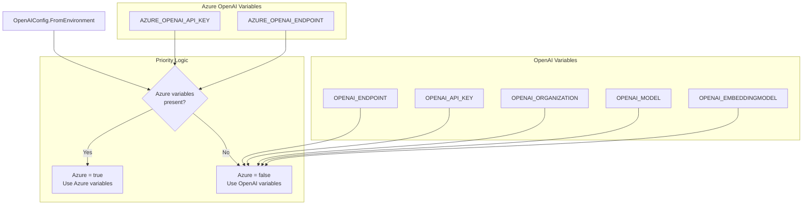

<!-- source: DeepWiki mcp.deepwiki.com · repo microsoft/typechat.net · page 9.1 Test Infrastructure · fetched 2026-10-26 -->

# Test Infrastructure

<details>
<summary>Relevant source files</summary>

The following files were used as context for generating this wiki page:

- [src/typechat.program/Extensions.cs](src/typechat.program/Extensions.cs)
- [tests/TypeChat.IntegrationTests/TypeChat.IntegrationTests.csproj](tests/TypeChat.IntegrationTests/TypeChat.IntegrationTests.csproj)
- [tests/TypeChat.IntegrationTests/appSettings.json](tests/TypeChat.IntegrationTests/appSettings.json)
- [tests/TypeChat.TestLib/TypeChat.TestLib.csproj](tests/TypeChat.TestLib/TypeChat.TestLib.csproj)
- [tests/TypeChat.UnitTests/TestConfig.cs](tests/TypeChat.UnitTests/TestConfig.cs)
- [tests/TypeChat.UnitTests/TypeChat.UnitTests.csproj](tests/TypeChat.UnitTests/TypeChat.UnitTests.csproj)

</details>


## Purpose and Scope

This document describes the test infrastructure that supports TypeChat.NET testing. It covers the test project structure, shared test utilities in `TypeChat.TestLib`, test data files, and configuration management for connecting to OpenAI services during testing.

For information about writing integration tests with real language models, see [Integration Testing](#9.2). For information about writing isolated unit tests, see [Unit Testing](#9.3).

## Test Project Architecture

TypeChat.NET's test infrastructure consists of three projects organized in a layered architecture:

**Test Project Structure and Dependencies**



Sources: [tests/TypeChat.IntegrationTests/TypeChat.IntegrationTests.csproj:1-49](), [tests/TypeChat.UnitTests/TypeChat.UnitTests.csproj:1-35](), [tests/TypeChat.TestLib/TypeChat.TestLib.csproj:1-49]()

### Project Characteristics

| Project | Target Framework | Purpose | Key Dependencies |
|---------|------------------|---------|------------------|
| `TypeChat.IntegrationTests` | net8.0 | End-to-end scenarios with real OpenAI services | TestLib, ExamplesLib, Xunit.SkippableFact |
| `TypeChat.UnitTests` | net8.0 | Isolated component tests without external services | TestLib |
| `TypeChat.TestLib` | net8.0 | Shared test utilities, data, and base classes | Configuration.Json |

All three projects:
- Use xUnit 2.9.3 as the test framework
- Target .NET 8.0 with latest C# language version
- Enable implicit usings and nullable annotations
- Set `IsTestProject` to `true` and `IsPackable` to `false`

Sources: [tests/TypeChat.IntegrationTests/TypeChat.IntegrationTests.csproj:3-13](), [tests/TypeChat.UnitTests/TypeChat.UnitTests.csproj:3-13](), [tests/TypeChat.TestLib/TypeChat.TestLib.csproj:3-8]()

## TypeChat.TestLib: Shared Test Infrastructure

The `TypeChat.TestLib` project provides shared utilities and test data used by both integration and unit test projects.

### Test Library Contents

**TypeChat.TestLib Structure**



Sources: [tests/TypeChat.TestLib/TypeChat.TestLib.csproj:28-46]()

### Test Data Files

The test library includes several JSON and TypeScript files used for validating TypeChat functionality:

| File | Purpose | Copy Behavior |
|------|---------|---------------|
| `mathPrograms.json` | Valid mathematical programs for program translation tests | PreserveNewest |
| `mathPrograms_Fail.json` | Invalid programs to test error handling | PreserveNewest |
| `objectPrograms.json` | Programs that manipulate objects | PreserveNewest |
| `stringPrograms.json` | Programs that perform string operations | PreserveNewest |
| `TestVocabs.json` | Vocabulary definitions for vocabulary constraint testing | PreserveNewest |
| `SentimentSchema.ts` | Sample TypeScript schema for schema validation tests | Always |

These files are copied to the output directory to make them available at test runtime. The `PreserveNewest` behavior only copies when the source file is newer than the destination, while `Always` copies on every build.

Sources: [tests/TypeChat.TestLib/TypeChat.TestLib.csproj:28-46]()

### Test Library Dependencies



The test library references `Microsoft.Extensions.Configuration.Json` to support loading test configuration from JSON files, and references all core TypeChat projects to provide test utilities that work with the full framework.

Sources: [tests/TypeChat.TestLib/TypeChat.TestLib.csproj:10-26]()

## Configuration Management

TypeChat tests support two configuration methods: JSON configuration files and environment variables.

### JSON Configuration Files

The integration tests use a layered configuration approach:

**Integration Test Configuration Loading**



The configuration loading logic in the project file:

```
Lines 34-36: Always include appSettings.json
Lines 38-42: Conditionally include appSettings.Development.json if it exists
Lines 43-47: Fallback to shared examples/appSettings.Development.json if local doesn't exist
```

Sources: [tests/TypeChat.IntegrationTests/TypeChat.IntegrationTests.csproj:33-47]()

### appSettings.json Structure

The base `appSettings.json` file provides a template for OpenAI configuration:

```json
{
  "OpenAI": {
    "Azure": true,
    "Endpoint": "?",
    "ApiKey": "?",
    "Model": "?"
  },
  "OpenAI_Embedding": {
    "Azure": true,
    "Endpoint": "?",
    "ApiKey": "?",
    "Model": "?"
  }
}
```

This file supports two separate OpenAI configurations:
- `OpenAI`: For language model (chat/completion) operations
- `OpenAI_Embedding`: For text embedding generation

Each configuration specifies:
- `Azure`: Whether to use Azure OpenAI Service (true) or OpenAI API (false)
- `Endpoint`: API endpoint URL
- `ApiKey`: Authentication key
- `Model`: Model name/deployment name

Sources: [tests/TypeChat.IntegrationTests/appSettings.json:1-14]()

### Environment Variable Configuration

TypeChat also supports configuration through environment variables, tested in `TestConfig.cs`:

**OpenAI Environment Variables**



The `OpenAIConfig.FromEnvironment()` method checks environment variables with this priority:
1. If `AZURE_OPENAI_API_KEY` or `AZURE_OPENAI_ENDPOINT` are set, use Azure OpenAI configuration
2. Otherwise, use standard OpenAI configuration with `OPENAI_*` variables

For embedding models, pass `true` to `FromEnvironment(true)` to use `OPENAI_EMBEDDINGMODEL` instead of `OPENAI_MODEL`.

Sources: [tests/TypeChat.UnitTests/TestConfig.cs:1-100]()

### Configuration Variable Names

| Variable | Purpose | Source Class |
|----------|---------|--------------|
| `AZURE_OPENAI_API_KEY` | Azure OpenAI authentication key | `OpenAIConfig.VariableNames` |
| `AZURE_OPENAI_ENDPOINT` | Azure OpenAI endpoint URL | `OpenAIConfig.VariableNames` |
| `OPENAI_ENDPOINT` | OpenAI API endpoint URL | `OpenAIConfig.VariableNames` |
| `OPENAI_API_KEY` | OpenAI API authentication key | `OpenAIConfig.VariableNames` |
| `OPENAI_ORGANIZATION` | OpenAI organization ID | `OpenAIConfig.VariableNames` |
| `OPENAI_MODEL` | Model name for chat/completion | `OpenAIConfig.VariableNames` |
| `OPENAI_EMBEDDINGMODEL` | Model name for embeddings | `OpenAIConfig.VariableNames` |

Sources: [tests/TypeChat.UnitTests/TestConfig.cs:18-75]()

## Test Framework Dependencies

All test projects use xUnit as the testing framework with supporting packages:

### Core Testing Packages

| Package | Version | Purpose |
|---------|---------|---------|
| `Microsoft.NET.Test.Sdk` | 18.0.1 | .NET test platform SDK for running tests |
| `xunit` | 2.9.3 | xUnit test framework for writing tests |
| `xunit.runner.visualstudio` | 3.1.5 | Visual Studio and VS Code test runner integration |
| `Xunit.SkippableFact` | 1.5.23 | Conditional test execution (IntegrationTests only) |

Sources: [tests/TypeChat.IntegrationTests/TypeChat.IntegrationTests.csproj:15-23](), [tests/TypeChat.UnitTests/TypeChat.UnitTests.csproj:19-26](), [tests/TypeChat.TestLib/TypeChat.TestLib.csproj:13-18]()

### Xunit.SkippableFact Usage

The `Xunit.SkippableFact` package (used only in IntegrationTests) allows tests to be skipped at runtime based on conditions:

```csharp
[SkippableFact]
public async Task TestWithOpenAI()
{
    Skip.IfNot(HasValidConfiguration(), "OpenAI configuration not available");
    // Test continues only if configuration is valid
}
```

This is particularly useful for integration tests that require external services, allowing tests to skip gracefully when OpenAI credentials are not configured rather than failing.

Sources: [tests/TypeChat.IntegrationTests/TypeChat.IntegrationTests.csproj:22-22]()

## Assembly Configuration

All test projects share common assembly-level configuration:

### Build Settings

| Setting | Value | Purpose |
|---------|-------|---------|
| `TargetFramework` | net8.0 | Target .NET 8.0 runtime |
| `LangVersion` | latest | Use latest C# language features |
| `RollForward` | LatestMajor | Allow running on newer .NET versions |
| `ImplicitUsings` | enable | Enable global usings for common namespaces |
| `Nullable` | annotations | Enable nullable reference type annotations |
| `IsPackable` | false | Prevent creating NuGet packages |
| `IsTestProject` | true | Mark as test project for tooling |

Sources: [tests/TypeChat.IntegrationTests/TypeChat.IntegrationTests.csproj:3-13](), [tests/TypeChat.UnitTests/TypeChat.UnitTests.csproj:3-13](), [tests/TypeChat.TestLib/TypeChat.TestLib.csproj:3-8]()

### Assembly Names and Namespaces

Each test project uses lowercase assembly names for consistency:

| Project | Assembly Name | Root Namespace |
|---------|--------------|----------------|
| TypeChat.IntegrationTests | typechat.integrationtests | Microsoft.TypeChat.IntegrationTests |
| TypeChat.UnitTests | typechat.unittests | Microsoft.TypeChat.UnitTests |
| TypeChat.TestLib | (default) | Microsoft.TypeChat.Tests |

The lowercase assembly names follow the convention used in the main TypeChat projects, while maintaining standard PascalCase namespace conventions.

Sources: [tests/TypeChat.IntegrationTests/TypeChat.IntegrationTests.csproj:11-12](), [tests/TypeChat.UnitTests/TypeChat.UnitTests.csproj:11-12](), [tests/TypeChat.TestLib/TypeChat.TestLib.csproj:7-7]()

---

