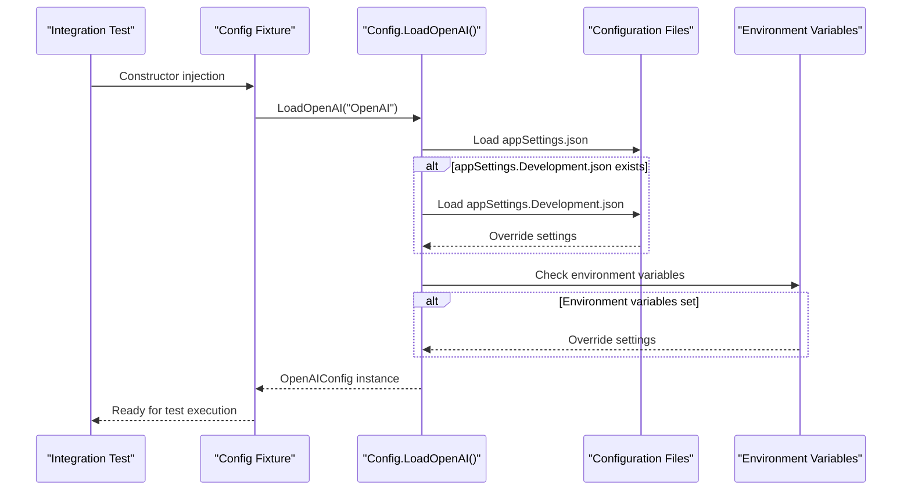
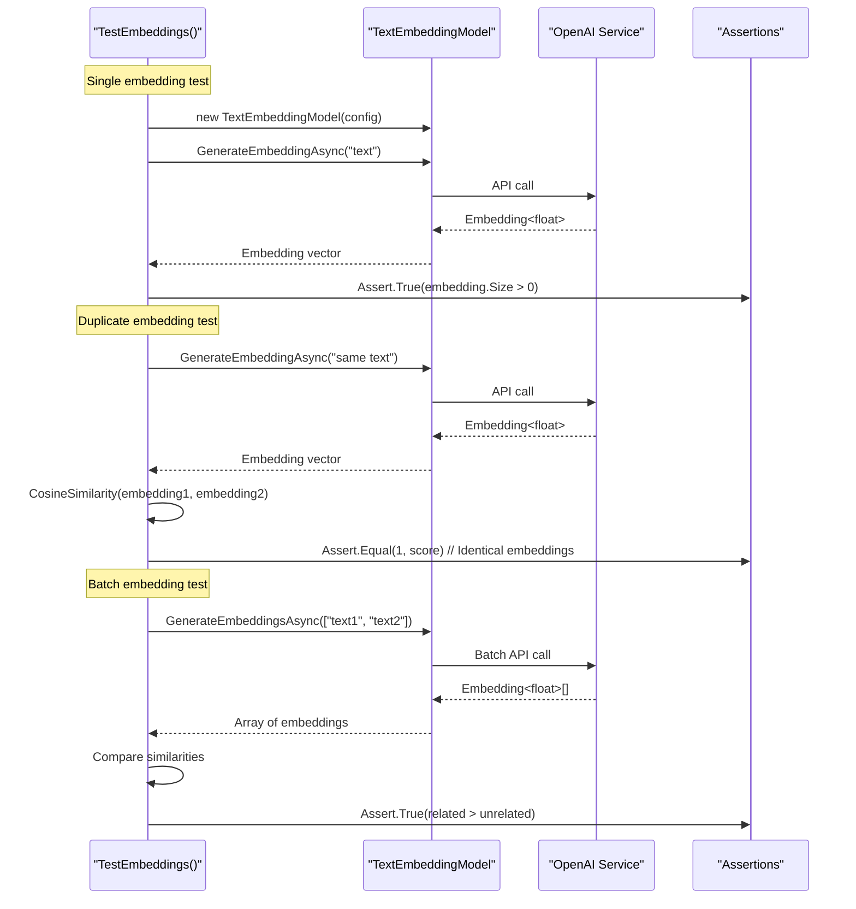
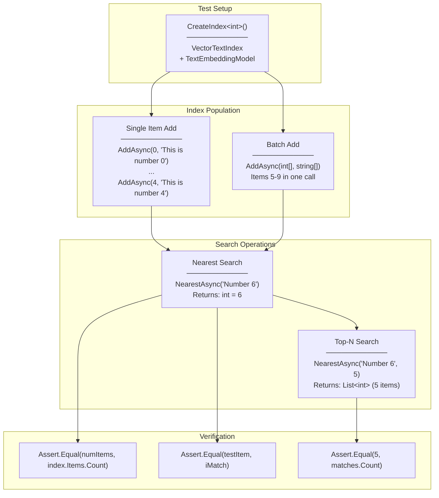
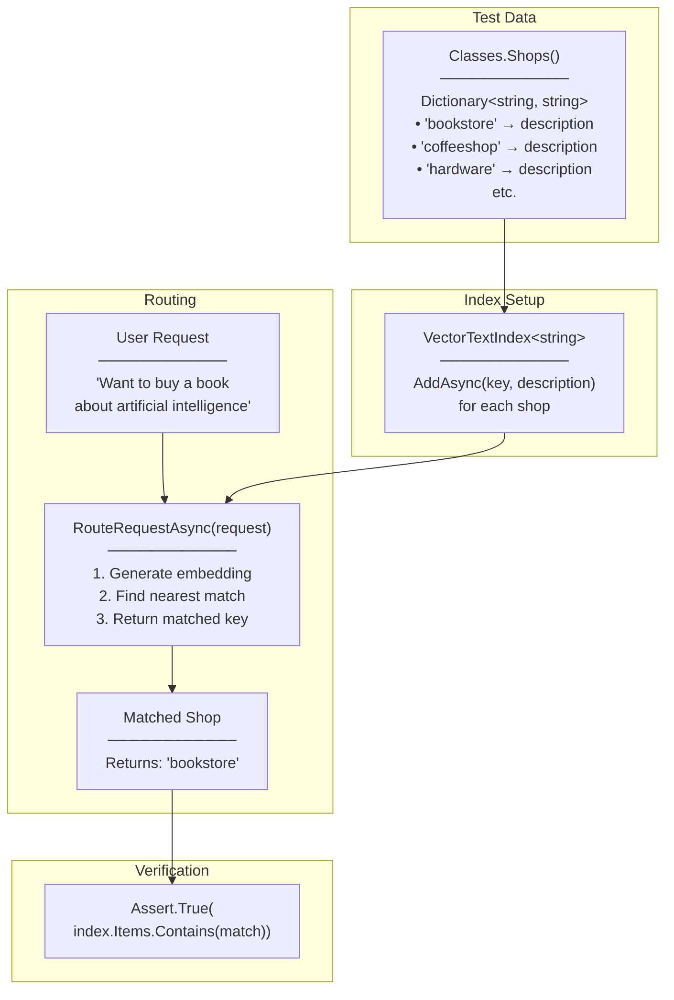
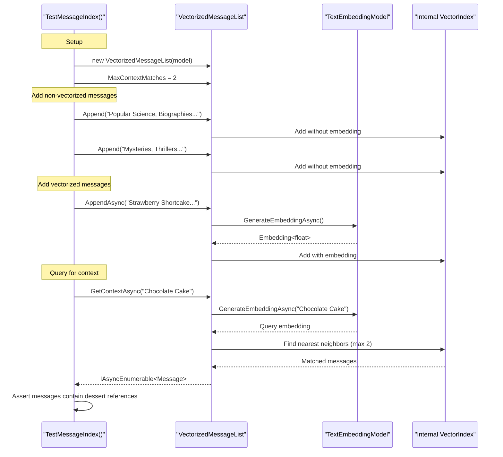
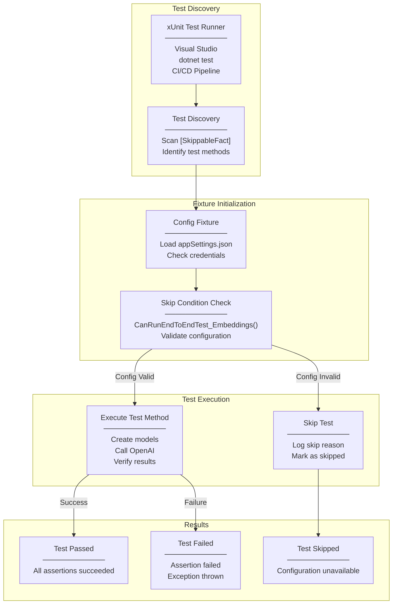

<!-- source: DeepWiki mcp.deepwiki.com · repo microsoft/typechat.net · page 9.2 Integration Testing · fetched 2026-10-26 -->

# Integration Testing

<details>
<summary>Relevant source files</summary>

The following files were used as context for generating this wiki page:

- [examples/typechat.examplesLib/ConsoleApp.cs](examples/typechat.examplesLib/ConsoleApp.cs)
- [examples/typechat.examplesLib/VectorTextIndex.cs](examples/typechat.examplesLib/VectorTextIndex.cs)
- [src/typechat.sk/Embeddings/Embedding.cs](src/typechat.sk/Embeddings/Embedding.cs)
- [src/typechat.sk/Embeddings/EmbeddingsEx.cs](src/typechat.sk/Embeddings/EmbeddingsEx.cs)
- [src/typechat.sk/TextEmbeddingModel.cs](src/typechat.sk/TextEmbeddingModel.cs)
- [tests/TypeChat.IntegrationTests/TestVectorized_EndToEnd.cs](tests/TypeChat.IntegrationTests/TestVectorized_EndToEnd.cs)
- [tests/TypeChat.IntegrationTests/TypeChat.IntegrationTests.csproj](tests/TypeChat.IntegrationTests/TypeChat.IntegrationTests.csproj)
- [tests/TypeChat.IntegrationTests/appSettings.json](tests/TypeChat.IntegrationTests/appSettings.json)
- [tests/TypeChat.TestLib/TypeChat.TestLib.csproj](tests/TypeChat.TestLib/TypeChat.TestLib.csproj)
- [tests/TypeChat.UnitTests/TestConfig.cs](tests/TypeChat.UnitTests/TestConfig.cs)
- [tests/TypeChat.UnitTests/TypeChat.UnitTests.csproj](tests/TypeChat.UnitTests/TypeChat.UnitTests.csproj)

</details>


## Purpose and Scope

This document covers the integration testing infrastructure in TypeChat.NET, focusing on end-to-end tests that validate complete workflows with real language models and external services. Integration tests verify that TypeChat components work correctly with OpenAI/Azure OpenAI services, including JSON translation, program execution, embeddings generation, and semantic search capabilities.

For information about unit testing isolated components without external dependencies, see [Unit Testing](#9.3). For general test infrastructure and shared utilities, see [Test Infrastructure](#9.1).

## Overview

Integration tests in TypeChat.NET validate end-to-end scenarios by making actual calls to OpenAI or Azure OpenAI services. These tests ensure that the complete translation pipeline—from prompt generation through validation and repair—works correctly in real-world conditions. Unlike unit tests, integration tests exercise the full stack including network communication, model responses, and state management.

The integration test suite is located in the `TypeChat.IntegrationTests` project and uses xUnit as the testing framework with support for conditional test execution via `Xunit.SkippableFact`.

**Sources:** [tests/TypeChat.IntegrationTests/TypeChat.IntegrationTests.csproj:1-49]()

## Test Project Structure

```mermaid
graph TB
    subgraph "Integration Test Project"
        IntTests["TypeChat.IntegrationTests<br/>────────────<br/>tests/TypeChat.IntegrationTests/"]
        
        TestVectorized["TestVectorized_EndToEnd.cs<br/>────────────<br/>• Embedding tests<br/>• VectorTextIndex tests<br/>• Routing tests<br/>• Message index tests"]
        
        Config["appSettings.json<br/>────────────<br/>OpenAI configuration<br/>Azure OpenAI settings"]
        
        DevConfig["appSettings.Development.json<br/>────────────<br/>Local development overrides"]
    end
    
    subgraph "Dependencies"
        TestLib["TypeChat.TestLib<br/>────────────<br/>Shared test utilities<br/>Base classes<br/>Test data"]
        
        ExamplesLib["TypeChat.ExamplesLib<br/>────────────<br/>Config helpers<br/>VectorTextIndex<br/>ConsoleApp base"]
        
        Core["TypeChat Core<br/>────────────<br/>JsonTranslator<br/>LanguageModel"]
        
        Program["TypeChat.Program<br/>────────────<br/>ProgramTranslator<br/>ProgramCompiler"]
        
        SK["TypeChat.SemanticKernel<br/>────────────<br/>TextEmbeddingModel<br/>KernelEx"]
    end
    
    subgraph "Test Framework"
        XUnit["xUnit<br/>────────────<br/>Test runner<br/>Assertions"]
        
        Skippable["Xunit.SkippableFact<br/>────────────<br/>Conditional execution"]
    end
    
    IntTests --> TestVectorized
    IntTests --> Config
    IntTests --> DevConfig
    
    IntTests --> TestLib
    IntTests --> ExamplesLib
    IntTests --> Core
    IntTests --> Program
    IntTests --> SK
    
    IntTests --> XUnit
    IntTests --> Skippable
```



**Sources:** [tests/TypeChat.IntegrationTests/TypeChat.IntegrationTests.csproj:1-49]()

### Key Components

| Component | Purpose |
|-----------|---------|
| `TypeChat.IntegrationTests.csproj` | Main test project with references to all TypeChat libraries |
| `TestVectorized_EndToEnd.cs` | End-to-end tests for embeddings and vectorization features |
| `appSettings.json` | Configuration for OpenAI/Azure OpenAI endpoints and credentials |
| `appSettings.Development.json` | Optional local configuration overrides |
| `TypeChatTest` base class | Shared test infrastructure from TypeChat.TestLib |
| `Config` fixture | Manages OpenAI configuration for test execution |

**Sources:** [tests/TypeChat.IntegrationTests/TypeChat.IntegrationTests.csproj:15-31](), [tests/TypeChat.IntegrationTests/TypeChat.IntegrationTests.csproj:34-47]()

## Configuration Management

Integration tests require valid OpenAI or Azure OpenAI credentials to execute. The configuration system supports multiple sources and graceful fallback behavior.

### Configuration File Structure

The `appSettings.json` file defines two separate OpenAI configurations:

```json
{
  "OpenAI": {
    "Azure": true,
    "Endpoint": "?",
    "ApiKey": "?",
    "Model": "?"
  },
  "OpenAI_Embedding": {
    "Azure": true,
    "Endpoint": "?",
    "ApiKey": "?",
    "Model": "?"
  }
}
```

**Configuration Properties:**

| Property | Description |
|----------|-------------|
| `Azure` | Boolean indicating whether to use Azure OpenAI (true) or OpenAI (false) |
| `Endpoint` | Service endpoint URL |
| `ApiKey` | Authentication key |
| `Model` | Model name/deployment name |

**Sources:** [tests/TypeChat.IntegrationTests/appSettings.json:1-14]()

### Configuration Loading Flow



The configuration loading follows a priority order:
1. Base configuration from `appSettings.json`
2. Overrides from `appSettings.Development.json` (if present)
3. Overrides from environment variables (highest priority)

**Sources:** [tests/TypeChat.IntegrationTests/TypeChat.IntegrationTests.csproj:38-47](), [tests/TypeChat.UnitTests/TestConfig.cs:8-99]()

### Configuration Fixture Pattern

Integration tests use xUnit's `IClassFixture<Config>` to share configuration across test methods:

```csharp
public class TestVectorized_EndToEnd : TypeChatTest, IClassFixture<Config>
{
    private readonly Config _config;

    public TestVectorized_EndToEnd(Config config, ITestOutputHelper output)
        : base(output)
    {
        _config = config;
    }
    // Tests use _config.OpenAIEmbeddings, etc.
}
```

The `Config` fixture is instantiated once per test class and injected into each test instance, ensuring efficient configuration loading and consistent settings across related tests.

**Sources:** [tests/TypeChat.IntegrationTests/TestVectorized_EndToEnd.cs:5-13]()

## Conditional Test Execution

Integration tests use `[SkippableFact]` attribute to skip tests when required configuration is unavailable:

```csharp
[SkippableFact]
public async Task TestEmbeddings()
{
    Skip.If(!CanRunEndToEndTest_Embeddings(_config));
    // Test implementation
}
```

### Skip Condition Pattern

The `CanRunEndToEndTest_Embeddings()` method (from `TypeChatTest` base class) checks:
- Valid OpenAI embedding configuration exists
- Endpoint is configured (not "?")
- API key is configured (not "?")
- Model name is specified

This pattern allows the test suite to run in environments without full OpenAI access, automatically skipping tests that require external services.

**Sources:** [tests/TypeChat.IntegrationTests/TestVectorized_EndToEnd.cs:15-18](), [tests/TypeChat.IntegrationTests/TestVectorized_EndToEnd.cs:50-53]()

## Embeddings and Vectorization Tests

The `TestVectorized_EndToEnd` class demonstrates comprehensive testing of TypeChat's embedding and vectorization capabilities.

### Embedding Generation Test Flow



**Sources:** [tests/TypeChat.IntegrationTests/TestVectorized_EndToEnd.cs:16-48]()

### Embedding Test Implementation

The test validates three key scenarios:

**1. Reproducibility:** Same input produces identical embeddings
```csharp
string request = "The area of a circle is Pi R Squared";
TextEmbeddingModel model = new TextEmbeddingModel(_config.OpenAIEmbeddings);
Embedding embeddingX = new Embedding(await model.GenerateEmbeddingAsync(request));
Embedding embeddingY = new Embedding(await model.GenerateEmbeddingAsync(request));
double score = embeddingX.CosineSimilarity(embeddingY);
Assert.Equal(1, score.RoundToInt()); // Cosine should be 1
```

**2. Batch Processing:** Multiple texts can be embedded efficiently
```csharp
string[] requests = new string[]
{
    "The circumference of a circle is 2 Pi R",
    "All we are, is dust in the wind, dude"
};
Embedding<float>[] embeddings = await model.GenerateEmbeddingsAsync(requests);
```

**3. Semantic Similarity:** Related content has higher similarity than unrelated content
```csharp
double score1 = embeddingX.CosineSimilarity(embeddings[0]); // Math-related
double score2 = embeddingX.CosineSimilarity(embeddings[1]); // Unrelated
Assert.True(score1 > score2);
```

**Sources:** [tests/TypeChat.IntegrationTests/TestVectorized_EndToEnd.cs:23-48]()

## VectorTextIndex Testing

The `VectorTextIndex<T>` class provides in-memory semantic search capabilities. Integration tests verify indexing, retrieval, and routing operations.

### VectorTextIndex Test Operations



**Sources:** [tests/TypeChat.IntegrationTests/TestVectorized_EndToEnd.cs:51-89]()

### Index Population Pattern

The test demonstrates both single-item and batch indexing:

**Single Item Addition:**
```csharp
for (int i = 0; i < numSingle; ++i)
{
    await index.AddAsync(i, $"This is the number {i}");
}
```

**Batch Addition:**
```csharp
int[] intValues = new int[numArray];
string[] stringValues = new string[numArray];
for (; i < numItems; ++i)
{
    intValues[i - numSingle] = i;
    stringValues[i - numSingle] = $"This is the number {i}";
}
await index.AddAsync(intValues, stringValues);
```

The batch method is more efficient when adding multiple items, as it can leverage the model's batch embedding generation capabilities.

**Sources:** [tests/TypeChat.IntegrationTests/TestVectorized_EndToEnd.cs:62-77](), [examples/typechat.examplesLib/VectorTextIndex.cs:84-104]()

### Nearest Neighbor Search

The test verifies semantic search functionality:

```csharp
// Search for closest match
int iMatch = await index.NearestAsync($"Number {testItem}");
Assert.Equal(testItem, iMatch);

// Get top 5 matches
var matches = await index.NearestAsync($"Number {testItem}", 5);
Assert.Equal(5, matches.Count);
Assert.Equal(iMatch, matches[0]); // First match should be the nearest
```

The `NearestAsync()` method uses cosine similarity (via dot product on normalized embeddings) to find the semantically closest items in the index.

**Sources:** [tests/TypeChat.IntegrationTests/TestVectorized_EndToEnd.cs:82-88](), [examples/typechat.examplesLib/VectorTextIndex.cs:112-131]()

## Request Routing Tests

Integration tests validate semantic routing capabilities for directing requests to appropriate handlers based on content similarity.

### Routing Test Architecture



**Sources:** [tests/TypeChat.IntegrationTests/TestVectorized_EndToEnd.cs:92-103]()

### Routing Implementation

The routing test demonstrates how `VectorTextIndex<T>` can act as a `ITextRequestRouter<T>`:

```csharp
[SkippableFact]
public async Task TestRouting()
{
    Skip.If(!CanRunEndToEndTest_Embeddings(_config));

    VectorTextIndex<string> index = CreateIndex<string>();
    foreach (var shop in Classes.Shops())
    {
        await index.AddAsync(shop.Key, shop.Value);
    }
    string match = await index.RouteRequestAsync("Want to buy a book about artificial intelligence");
    Assert.True(index.Items.Contains(match));
}
```

The `RouteRequestAsync()` method internally calls `NearestAsync()` to find the semantically closest match, making it suitable for multi-schema routing scenarios.

**Sources:** [tests/TypeChat.IntegrationTests/TestVectorized_EndToEnd.cs:92-103](), [examples/typechat.examplesLib/VectorTextIndex.cs:55-58]()

## Vectorized Message List Testing

The `VectorizedMessageList` class maintains a conversational history with semantic search capabilities. Integration tests verify context retrieval based on semantic similarity.

### Message Index Test Flow



**Sources:** [tests/TypeChat.IntegrationTests/TestVectorized_EndToEnd.cs:106-140]()

### Message List Implementation Details

The test validates two key scenarios:

**1. Selective Vectorization:**
```csharp
// Non-vectorized additions (synchronous)
for (int i = 0; i < books.Length; ++i)
{
    messages.Append(books[i]);
}

// Vectorized additions (asynchronous)
for (int i = 0; i < desserts.Length; ++i)
{
    await messages.AppendAsync(desserts[i]);
}
```

**2. Context Retrieval by Semantic Similarity:**
```csharp
await foreach (var match in messages.GetContextAsync("Chocolate Cake"))
{
    Assert.True(desserts.Contains(match.GetText()));
}

await foreach (var match in messages.GetContextAsync("Literary fiction"))
{
    Assert.True(books.Contains(match.GetText()));
}
```

The `MaxContextMatches` property limits the number of results returned, enabling efficient context window management for conversational agents.

**Sources:** [tests/TypeChat.IntegrationTests/TestVectorized_EndToEnd.cs:110-140]()

## Test Execution Model



**Sources:** [tests/TypeChat.IntegrationTests/TypeChat.IntegrationTests.csproj:16-22]()

## Running Integration Tests

### Command Line Execution

Run all integration tests:
```bash
dotnet test tests/TypeChat.IntegrationTests/TypeChat.IntegrationTests.csproj
```

Run specific test class:
```bash
dotnet test --filter "FullyQualifiedName~TestVectorized_EndToEnd"
```

Run specific test method:
```bash
dotnet test --filter "FullyQualifiedName~TestVectorized_EndToEnd.TestEmbeddings"
```

### Visual Studio Execution

1. Open Test Explorer (Test → Test Explorer)
2. Tests appear under TypeChat.IntegrationTests
3. Right-click test or test class to run
4. View results in Test Explorer output

### Configuration Requirements

Before running integration tests:

| Requirement | Description |
|-------------|-------------|
| **OpenAI Credentials** | Valid API key and endpoint |
| **Embedding Model** | Configured embedding deployment |
| **Network Access** | Connectivity to OpenAI services |
| **Configuration File** | `appSettings.Development.json` with valid settings |

Tests automatically skip when configuration is unavailable, preventing false failures.

**Sources:** [tests/TypeChat.IntegrationTests/TypeChat.IntegrationTests.csproj:1-49]()

## Writing New Integration Tests

### Test Class Template

```csharp
public class TestMyFeature_EndToEnd : TypeChatTest, IClassFixture<Config>
{
    private readonly Config _config;

    public TestMyFeature_EndToEnd(Config config, ITestOutputHelper output)
        : base(output)
    {
        _config = config;
    }

    [SkippableFact]
    public async Task TestMyFeature()
    {
        Skip.If(!CanRunEndToEndTest(_config));
        
        // Setup
        var model = new LanguageModel(_config.OpenAI);
        var translator = new JsonTranslator<MyType>(model);
        
        // Execute
        var result = await translator.TranslateAsync("user input");
        
        // Verify
        Assert.NotNull(result.Value);
        Assert.Equal(expectedValue, result.Value.Property);
    }
}
```

### Key Patterns

**1. Inherit from TypeChatTest:**
- Provides base test infrastructure
- Access to configuration helpers
- Standard skip condition methods

**2. Use IClassFixture<Config>:**
- Shares configuration across test methods
- Efficient initialization
- Consistent test environment

**3. Apply [SkippableFact]:**
- Graceful handling of missing configuration
- Prevents false failures in CI/CD
- Clear skip reasons in test output

**4. Check Configuration:**
- Call `Skip.If()` at method start
- Use appropriate check method
- Document required configuration

**Sources:** [tests/TypeChat.IntegrationTests/TestVectorized_EndToEnd.cs:5-18]()

## Test Data Management

Integration tests use real data but should be designed for determinism:

### Best Practices

| Practice | Rationale |
|----------|-----------|
| **Deterministic Queries** | Use specific queries that should produce predictable responses |
| **Validate Structure** | Assert on response structure rather than exact content |
| **Use Semantic Checks** | Verify semantic similarity rather than exact string matches |
| **Test Multiple Scenarios** | Cover success, failure, and edge cases |
| **Timeout Protection** | Set reasonable timeouts for API calls |

### Example: Semantic Validation

Instead of exact string matching:
```csharp
// Good: Semantic validation
double similarity = embeddingX.CosineSimilarity(embeddingY);
Assert.True(similarity > 0.8); // Related content
```

Rather than:
```csharp
// Avoid: Exact string matching (fragile)
Assert.Equal("expected exact response", response.ToString());
```

**Sources:** [tests/TypeChat.IntegrationTests/TestVectorized_EndToEnd.cs:29-47]()

## Common Integration Test Patterns

### Pattern 1: Embedding Reproducibility

Verify that identical inputs produce identical embeddings:

```csharp
var embedding1 = await model.GenerateEmbeddingAsync(text);
var embedding2 = await model.GenerateEmbeddingAsync(text);
Assert.Equal(1.0, embedding1.CosineSimilarity(embedding2), precision: 5);
```

**Sources:** [tests/TypeChat.IntegrationTests/TestVectorized_EndToEnd.cs:23-30]()

### Pattern 2: Semantic Similarity Comparison

Verify that related content has higher similarity:

```csharp
var baseEmbedding = await model.GenerateEmbeddingAsync("circle area");
var relatedEmbedding = await model.GenerateEmbeddingAsync("circle circumference");
var unrelatedEmbedding = await model.GenerateEmbeddingAsync("dust in wind");

double relatedScore = baseEmbedding.CosineSimilarity(relatedEmbedding);
double unrelatedScore = baseEmbedding.CosineSimilarity(unrelatedEmbedding);
Assert.True(relatedScore > unrelatedScore);
```

**Sources:** [tests/TypeChat.IntegrationTests/TestVectorized_EndToEnd.cs:32-47]()

### Pattern 3: Index Population and Search

Build index, search, and verify results:

```csharp
var index = new VectorTextIndex<T>(model);

// Populate
for (int i = 0; i < items.Length; i++)
{
    await index.AddAsync(items[i], descriptions[i]);
}

// Search
T result = await index.NearestAsync(query);

// Verify
Assert.NotNull(result);
Assert.Contains(result, items);
```

**Sources:** [tests/TypeChat.IntegrationTests/TestVectorized_EndToEnd.cs:55-84]()

### Pattern 4: Routing Validation

Test request routing to correct handlers:

```csharp
var router = new VectorTextIndex<string>(model);
await router.AddAsync("handler1", "description of handler1 capabilities");
await router.AddAsync("handler2", "description of handler2 capabilities");

string match = await router.RouteRequestAsync("user request matching handler1");
Assert.Equal("handler1", match);
```

**Sources:** [tests/TypeChat.IntegrationTests/TestVectorized_EndToEnd.cs:92-103]()

## CI/CD Integration

Integration tests are designed for continuous integration pipelines:

### Required Secrets

Configure these secrets in your CI/CD environment:

| Secret Name | Purpose |
|-------------|---------|
| `AZURE_OPENAI_ENDPOINT` | Azure OpenAI service endpoint |
| `AZURE_OPENAI_API_KEY` | Azure OpenAI API key |
| `OPENAI_API_KEY` | OpenAI API key (if not using Azure) |
| `OPENAI_EMBEDDINGMODEL` | Embedding model deployment name |

### Pipeline Configuration

Tests automatically skip when secrets are unavailable, allowing the pipeline to succeed without access to OpenAI services. This enables:

- Running tests in development environments with local configuration
- Running tests in CI with production credentials
- Graceful degradation when credentials are temporarily unavailable
- Clear reporting of which tests executed vs. skipped

**Sources:** [tests/TypeChat.IntegrationTests/appSettings.json:1-14](), [tests/TypeChat.UnitTests/TestConfig.cs:8-99]()

## Troubleshooting

### Test Skipped: Configuration Not Found

**Problem:** All tests show as skipped

**Solutions:**
1. Create `appSettings.Development.json` with valid credentials
2. Set environment variables for OpenAI configuration
3. Verify configuration file is copied to output directory

**Sources:** [tests/TypeChat.IntegrationTests/TypeChat.IntegrationTests.csproj:34-47]()

### Test Failed: Authentication Error

**Problem:** 401 Unauthorized errors

**Solutions:**
1. Verify API key is correct and active
2. Check endpoint URL format
3. Ensure model/deployment name matches actual deployment
4. Verify Azure OpenAI vs. OpenAI setting is correct

### Test Failed: Model Not Found

**Problem:** 404 Not Found errors

**Solutions:**
1. Verify model deployment exists in Azure OpenAI
2. Check model name matches deployment name exactly
3. Ensure endpoint points to correct resource

### Test Timeout

**Problem:** Tests hang or timeout

**Solutions:**
1. Check network connectivity to OpenAI services
2. Verify firewall/proxy settings allow HTTPS to OpenAI domains
3. Increase timeout values if network is slow
4. Consider using Azure OpenAI for better latency

**Sources:** [tests/TypeChat.IntegrationTests/TestVectorized_EndToEnd.cs:15-18]()

---

