<!-- source: DeepWiki mcp.deepwiki.com · repo microsoft/typechat.net · page 9.3 Unit Testing · fetched 2026-10-26 -->

# Unit Testing

<details>
<summary>Relevant source files</summary>

The following files were used as context for generating this wiki page:

- [examples/SchemaHierarchy/Program.cs](examples/SchemaHierarchy/Program.cs)
- [src/typechat.program/Extensions.cs](src/typechat.program/Extensions.cs)
- [tests/TypeChat.UnitTests/TestSchema.cs](tests/TypeChat.UnitTests/TestSchema.cs)

</details>


Unit testing in TypeChat.NET validates individual components in isolation without requiring external dependencies such as OpenAI services. Unit tests focus on deterministic, fast-running validation of schema generation, type mapping, configuration loading, and internal logic.

For end-to-end testing with actual language models, see [Integration Testing](#9.2). For information about the overall test infrastructure and shared utilities, see [Test Infrastructure](#9.1).

## Purpose and Scope

The **TypeChat.UnitTests** project provides isolated component tests that:

- Validate TypeScript schema generation from C# types
- Test type mapping logic (primitives, nullables, arrays, generics)
- Verify vocabulary and polymorphic type handling
- Test API schema generation for program translation
- Validate configuration loading and parsing
- Execute without network calls or external service dependencies

Unit tests run quickly and deterministically, making them suitable for continuous integration pipelines and rapid development feedback loops.

**Sources:** Diagram 6 from context

## Test Project Structure

The unit test project follows a standard xUnit organization:

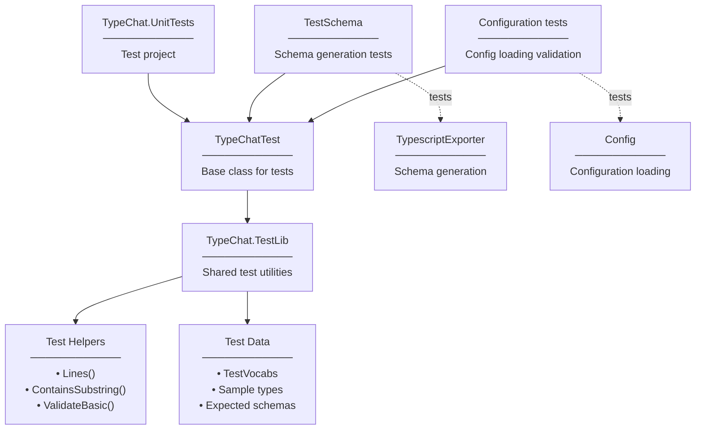

**Sources:** Diagram 6 from context, [tests/TypeChat.UnitTests/TestSchema.cs]()

## Schema Generation Testing

Schema generation tests validate that `TypescriptExporter` correctly converts C# types into TypeScript schemas that language models can understand.

### Basic Schema Export Tests

Tests verify fundamental type mapping:

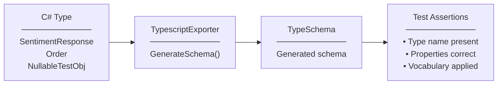

The `ExportBasic()` test [tests/TypeChat.UnitTests/TestSchema.cs:8-21]() demonstrates this pattern:

| Test Method | Purpose | Key Validations |
|------------|---------|----------------|
| `ExportBasic()` | Validate basic type export | Schema contains expected type name, properties present |
| `ExportNullable()` | Test optional property handling | Optional properties marked with `?`, correct nullability |
| `ExportMathAPI()` | Verify API interface export | Method signatures, parameter types, return types |
| `ExportStringAPI()` | Test string manipulation API | Array parameters (`any[]`), string return types |
| `ExportObjectAPI()` | Validate complex object APIs | Nested types exported, object return types correct |
| `ExportAsyncApi()` | Test async method handling | `Task<T>` unwrapped to `T`, no Task in output |
| `ExportGenerics()` | Verify generic type handling | Generic parameters instantiated in type name |

**Sources:** [tests/TypeChat.UnitTests/TestSchema.cs:8-98]()

### Nullable Type Testing

The `ExportNullable()` test [tests/TypeChat.UnitTests/TestSchema.cs:24-38]() validates optional property handling:

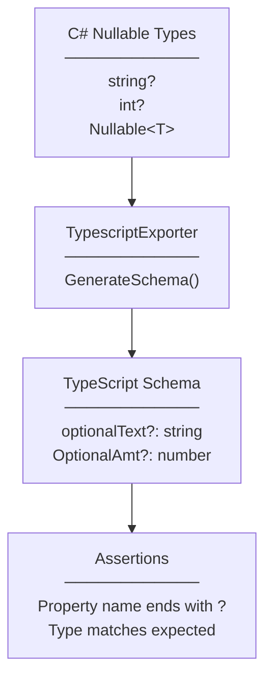

The test verifies that C# nullable properties are correctly mapped to TypeScript optional properties using the `?` suffix.

**Sources:** [tests/TypeChat.UnitTests/TestSchema.cs:24-38]()

### API Schema Testing

API schema tests validate interface export for program translation scenarios:

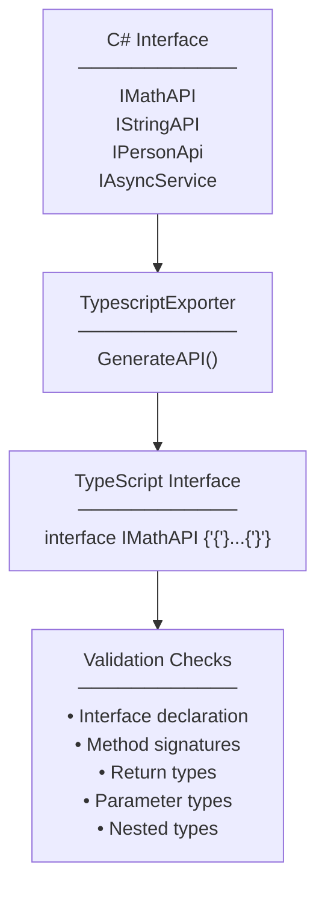

The `ExportMathAPI()` test [tests/TypeChat.UnitTests/TestSchema.cs:41-48]() validates that:
- Interface declaration is present
- Method names are correct
- Parameter names and types match
- Return types are properly mapped

**Sources:** [tests/TypeChat.UnitTests/TestSchema.cs:41-72]()

### Generic Type Testing

The `ExportGenerics()` test [tests/TypeChat.UnitTests/TestSchema.cs:88-97]() demonstrates how generic types are handled:

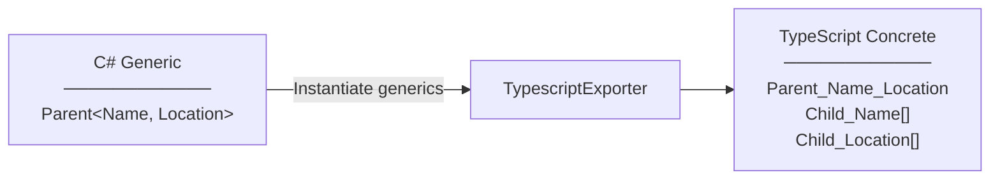

Generic types are instantiated with concrete type parameters, resulting in type names like `Parent_Name_Location` rather than `Parent<TName, TLocation>`.

**Sources:** [tests/TypeChat.UnitTests/TestSchema.cs:88-97]()

## Test Utilities and Helpers

The `TypeChatTest` base class and helper extensions provide reusable test infrastructure:

### String Analysis Helpers

Tests use extension methods to analyze generated schemas:

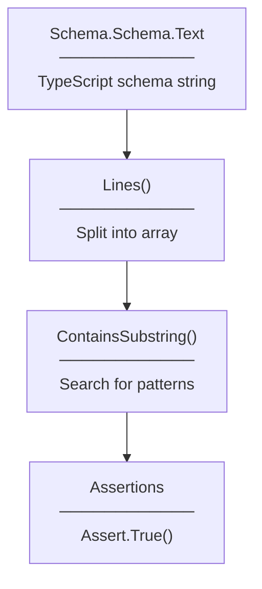

The `ContainsSubstring()` method allows searching for multiple keywords in sequence, validating that generated schemas contain expected constructs.

Example usage from [tests/TypeChat.UnitTests/TestSchema.cs:17-20]():
```
var lines = schema.Schema.Text.Lines();
Assert.True(lines.ContainsSubstring("coffee", "CoffeeOrder[]"));
Assert.True(lines.ContainsSubstring("desserts", "DessertOrder[]"));
```

**Sources:** [tests/TypeChat.UnitTests/TestSchema.cs:17-20]()

### Validation Methods

The `ValidateBasic()` method provides standard schema validation:

| Validation | Purpose |
|-----------|---------|
| Type name match | Verifies target type name appears in schema |
| Schema structure | Ensures valid TypeScript syntax |
| Export completeness | Confirms all properties exported |

**Sources:** [tests/TypeChat.UnitTests/TestSchema.cs:11]()

## Writing Unit Tests

To write unit tests for TypeChat components:

### 1. Test Class Structure

Create test classes that inherit from `TypeChatTest`:

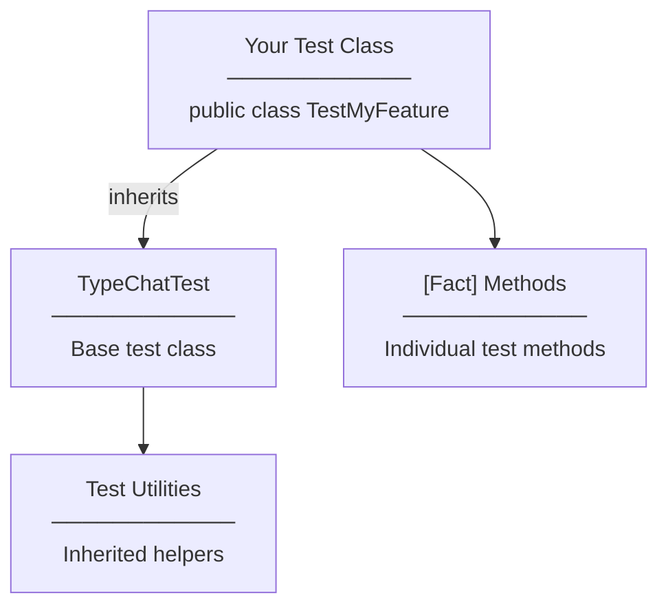

### 2. Test Method Pattern

Follow the Arrange-Act-Assert pattern:

| Phase | Action | Example |
|-------|--------|---------|
| **Arrange** | Set up test data | Create type, configure options, load vocabularies |
| **Act** | Execute component | Call `TypescriptExporter.GenerateSchema()` |
| **Assert** | Verify results | Use `Assert.True()`, `ContainsSubstring()` |

### 3. Schema Validation Pattern

For schema generation tests:

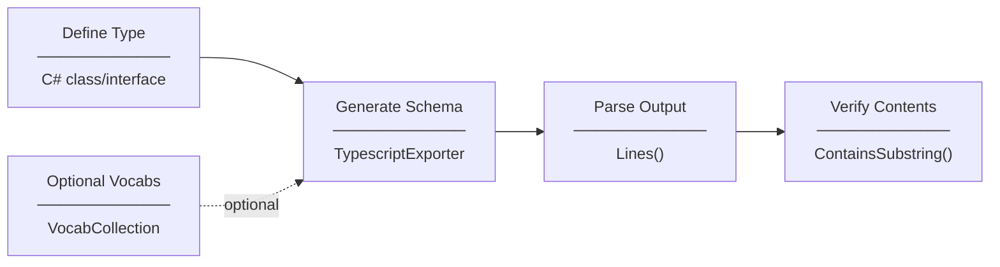

**Sources:** [tests/TypeChat.UnitTests/TestSchema.cs:8-98]()

## Test Data Management

Unit tests use structured test data from **TypeChat.TestLib**:

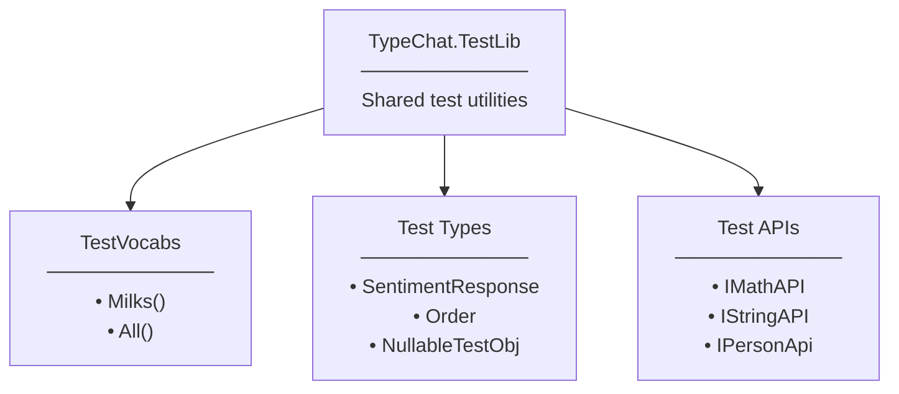

### Vocabulary Test Data

Tests use `TestVocabs.All()` [tests/TypeChat.UnitTests/TestSchema.cs:14]() to provide vocabulary collections for schema generation, ensuring that vocabulary constraints are properly exported.

**Sources:** [tests/TypeChat.UnitTests/TestSchema.cs:14,32]()

## Isolated Testing Strategy

Unit tests maintain isolation by avoiding external dependencies:

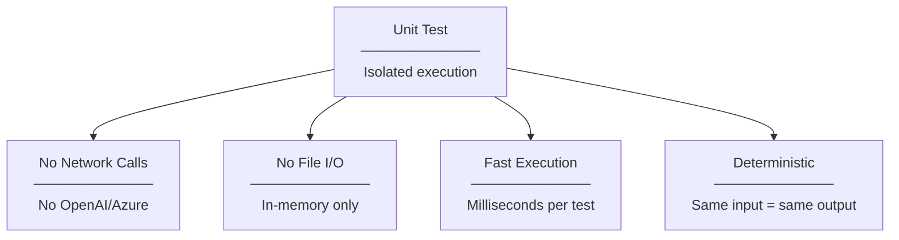

| Isolation Principle | Implementation |
|-------------------|----------------|
| No language model calls | Test schema generation logic directly |
| No configuration files | Test types defined in code |
| No external services | Pure in-memory validation |
| Deterministic results | No randomness or time-based logic |

**Sources:** Diagram 6 from context

## Testing Type Mapping Logic

Tests verify correct C# to TypeScript type mapping:

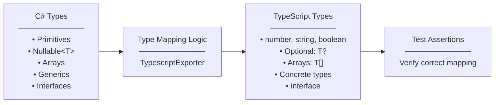

### Async Method Handling

The `ExportAsyncApi()` test [tests/TypeChat.UnitTests/TestSchema.cs:75-85]() verifies that:
- `Task<T>` return types are unwrapped to `T`
- `Task` (void) methods map to `void`
- No `Task` keyword appears in generated schema

**Sources:** [tests/TypeChat.UnitTests/TestSchema.cs:75-85]()

## Best Practices

### Test Organization

| Practice | Rationale |
|---------|-----------|
| One test per scenario | Clear failure messages, easy debugging |
| Descriptive test names | Test name describes what is validated |
| Arrange-Act-Assert | Standard test structure |
| Minimal setup | Tests should be self-contained |

### Assertion Strategies

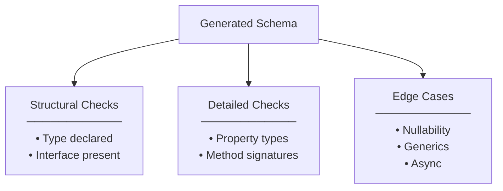

### Test Maintenance

- Keep test data in **TypeChat.TestLib** for reuse
- Update tests when schema generation logic changes
- Add tests for new type mapping scenarios
- Verify both positive and negative cases

**Sources:** [tests/TypeChat.UnitTests/TestSchema.cs](), Diagram 6 from context

## Common Unit Test Scenarios

| Scenario | Test Method Example | Validates |
|----------|-------------------|-----------|
| Basic type export | `ExportBasic()` | Type names, properties present |
| Optional properties | `ExportNullable()` | Nullable types marked with `?` |
| API interfaces | `ExportMathAPI()` | Method signatures correct |
| Generic types | `ExportGenerics()` | Generic parameters instantiated |
| Async methods | `ExportAsyncApi()` | `Task<T>` unwrapped |
| Vocabularies | `ExportBasic()` with vocabs | Vocabulary constraints applied |

**Sources:** [tests/TypeChat.UnitTests/TestSchema.cs:8-98]()

---

