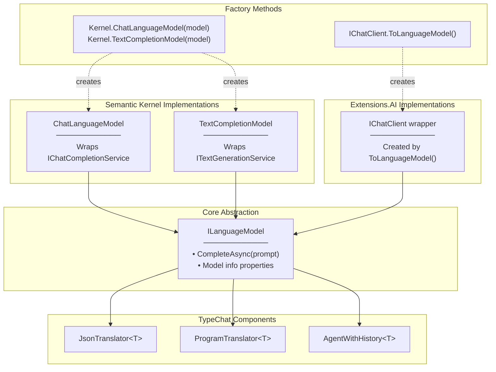
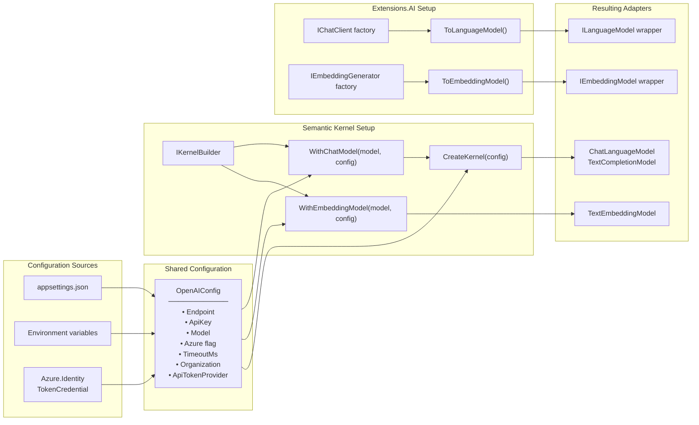
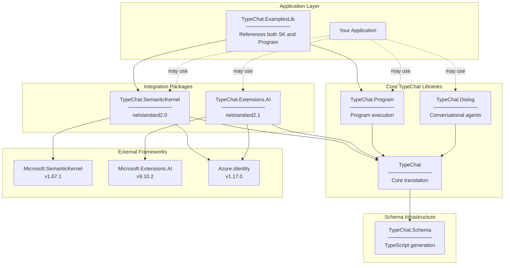
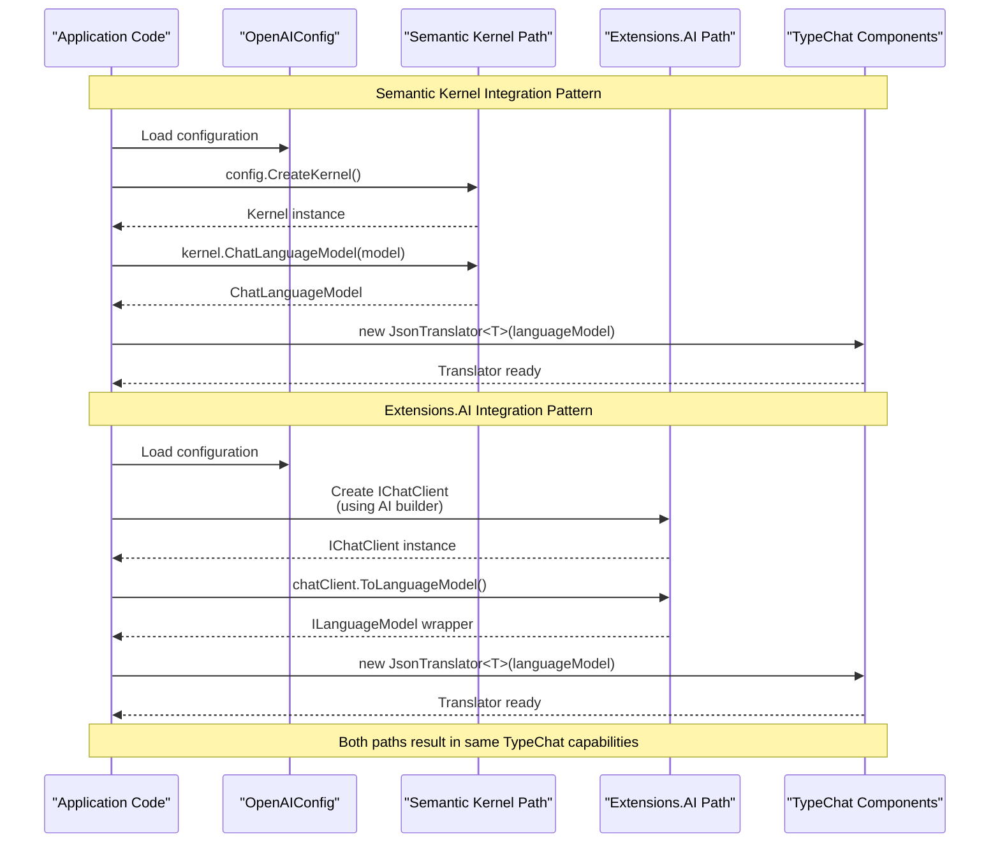

<!-- source: DeepWiki mcp.deepwiki.com · repo microsoft/typechat.net · unicode-title page 页**：10.4 Integration Types · patched 2026-10-26 -->

# Integration
# Integration

Relevant source files

The following files were used as context for generating this wiki page:

- [examples/typechat.examplesLib/TypeChat.ExamplesLib.csproj](examples/typechat.examplesLib/TypeChat.ExamplesLib.csproj)
- [src/typechat.meai/TypeChat.Extensions.AI.csproj](src/typechat.meai/TypeChat.Extensions.AI.csproj)
- [src/typechat.program/TypeChat.Program.csproj](src/typechat.program/TypeChat.Program.csproj)
- [src/typechat.schema/TypeChat.Schema.csproj](src/typechat.schema/TypeChat.Schema.csproj)
- [src/typechat.sk/KernelEx.cs](src/typechat.sk/KernelEx.cs)
- [src/typechat.sk/TypeChat.SemanticKernel.csproj](src/typechat.sk/TypeChat.SemanticKernel.csproj)
- [src/typechat/TypeChat.csproj](src/typechat/TypeChat.csproj)

## Purpose and Scope

TypeChat.NET provides two integration packages that enable seamless integration with different AI frameworks and abstractions. These packages allow TypeChat to leverage language models and embeddings from multiple sources while maintaining a consistent programming model.

This page provides an overview of both integration paths. For detailed information about specific integrations, see:
- Semantic Kernel integration: [Semantic Kernel Integration](#6.1)
- Microsoft.Extensions.AI integration: [Microsoft.Extensions.AI Integration](#6.2)

For information about the core `ILanguageModel` interface that both integrations implement, see [Language Models](#3.4).

Sources: [src/typechat.sk/TypeChat.SemanticKernel.csproj:1-41](), [src/typechat.meai/TypeChat.Extensions.AI.csproj:1-40]()

## Integration Architecture

TypeChat's integration architecture provides two parallel paths for connecting to AI services, each targeting different ecosystems and use cases.

```mermaid
graph TB
    subgraph TypeChatCore["TypeChat Core Library"]
        ILM["ILanguageModel<br/>interface"]
        JT["JsonTranslator&lt;T&gt;"]
        PT["ProgramTranslator&lt;T&gt;"]
        Agent["AgentWithHistory&lt;T&gt;"]
    end
    
    subgraph SKIntegration["TypeChat.SemanticKernel"]
        SKPackage["Microsoft.TypeChat.SemanticKernel<br/>netstandard2.0"]
        KernelEx["KernelEx<br/>extension methods"]
        ChatLM["ChatLanguageModel"]
        TextLM["TextCompletionModel"]
        EmbedLM["TextEmbeddingModel"]
    end
    
    subgraph AIIntegration["TypeChat.Extensions.AI"]
        AIPackage["Microsoft.TypeChat.Extensions.AI<br/>netstandard2.1"]
        AIEx["Extension methods<br/>ToLanguageModel()"]
        ChatWrapper["IChatClient wrapper"]
        EmbedWrapper["IEmbeddingGenerator wrapper"]
    end
    
    subgraph SKFramework["Semantic Kernel Framework"]
        SKLib["Microsoft.SemanticKernel<br/>v1.67.1"]
        IChatCompletion["IChatCompletionService"]
        ITextGen["ITextGenerationService"]
        IEmbedGen["IEmbeddingGenerationService"]
    end
    
    subgraph AIFramework["Microsoft.Extensions.AI"]
        AILib["Microsoft.Extensions.AI<br/>v9.10.2"]
        IChatClient["IChatClient"]
        IEmbedGen2["IEmbeddingGenerator"]
    end
    
    subgraph Services["AI Services"]
        OpenAI["OpenAI<br/>gpt-3.5-turbo<br/>gpt-4"]
        AzureOAI["Azure OpenAI"]
        Others["Other providers<br/>via Extensions.AI"]
    end
    
    JT --> ILM
    PT --> ILM
    Agent --> ILM
    
    ChatLM --> ILM
    TextLM --> ILM
    
    ChatWrapper --> ILM
    
    KernelEx --> IChatCompletion
    KernelEx --> ITextGen
    ChatLM --> IChatCompletion
    TextLM --> ITextGen
    EmbedLM --> IEmbedGen
    
    AIEx --> IChatClient
    AIEx --> IEmbedGen2
    ChatWrapper --> IChatClient
    EmbedWrapper --> IEmbedGen2
    
    IChatCompletion --> OpenAI
    IChatCompletion --> AzureOAI
    ITextGen --> OpenAI
    ITextGen --> AzureOAI
    IEmbedGen --> OpenAI
    IEmbedGen --> AzureOAI
    
    IChatClient --> OpenAI
    IChatClient --> AzureOAI
    IChatClient --> Others
    IEmbedGen2 --> OpenAI
    IEmbedGen2 --> AzureOAI
    IEmbedGen2 --> Others
    
    SKPackage -.depends on.-> SKLib
    SKPackage -.depends on.-> TypeChatCore
    AIPackage -.depends on.-> AILib
    AIPackage -.depends on.-> TypeChatCore
```

**Dual Integration Architecture**: TypeChat supports two integration paths that both implement the `ILanguageModel` interface. The Semantic Kernel path provides integration with the SK ecosystem and its rich plugin model. The Extensions.AI path provides integration with the standardized `Microsoft.Extensions.AI` abstractions, offering maximum portability across AI providers.

Sources: [src/typechat.sk/TypeChat.SemanticKernel.csproj:1-41](), [src/typechat.meai/TypeChat.Extensions.AI.csproj:1-40](), [src/typechat/TypeChat.csproj:1-24]()

## Integration Packages

TypeChat.NET provides two separate NuGet packages for integration with different AI frameworks:

| Package | Assembly Name | Target Framework | Key Dependencies | Description |
|---------|--------------|------------------|------------------|-------------|
| `Microsoft.TypeChat.SemanticKernel` | `Microsoft.TypeChat.SemanticKernel` | netstandard2.0 | `Microsoft.SemanticKernel` v1.67.1 `Azure.Identity` v1.17.0 | Provides `KernelEx` extension methods, model adapters (`ChatLanguageModel`, `TextCompletionModel`, `TextEmbeddingModel`), and plugin integration capabilities |
| `Microsoft.TypeChat.Extensions.AI` | `Microsoft.TypeChat.Extensions.AI` | netstandard2.1 | `Microsoft.Extensions.AI` v9.10.2 `Azure.Identity` v1.17.0 | Provides extension methods (`ToLanguageModel()`, `ToEmbeddingModel()`) for wrapping `IChatClient` and `IEmbeddingGenerator` implementations |

Both packages:
- Reference the core `Microsoft.TypeChat` library
- Support both OpenAI and Azure OpenAI services
- Include `Azure.Identity` for Azure authentication
- Suppress experimental API warnings (`SKEXP0001`, `SKEXP0011`)

Sources: [src/typechat.sk/TypeChat.SemanticKernel.csproj:1-41](), [src/typechat.meai/TypeChat.Extensions.AI.csproj:1-40]()

## Language Model Abstraction

Both integration packages implement the core `ILanguageModel` interface, which TypeChat uses to communicate with AI services. This abstraction enables TypeChat components (`JsonTranslator<T>`, `ProgramTranslator<T>`, `AgentWithHistory<T>`) to work with any language model implementation.

**Consistent Interface**: The `ILanguageModel` abstraction allows TypeChat components to remain decoupled from specific AI frameworks. Both integration packages provide implementations that wrap their respective framework's services (`IChatCompletionService`, `ITextGenerationService`, `IChatClient`) and expose them through the common interface.

Sources: [src/typechat.sk/KernelEx.cs:110-133]()

## Configuration and Setup

Both integration packages use the `OpenAIConfig` class for configuration, providing a unified configuration model regardless of the integration path chosen.

**Unified Configuration**: Both integration paths consume the same `OpenAIConfig` class, which supports Azure OpenAI (with API key or token-based authentication), standard OpenAI, timeouts, and organization settings. The Semantic Kernel path uses `KernelEx` extension methods to configure the kernel builder, while the Extensions.AI path uses factory methods to create clients that are then wrapped using extension methods.

Sources: [src/typechat.sk/KernelEx.cs:16-107](), [src/typechat.sk/TypeChat.SemanticKernel.csproj:18-22](), [src/typechat.meai/TypeChat.Extensions.AI.csproj:18-22]()

## Key Extension Methods

Both integration packages provide extension methods that simplify the creation of TypeChat-compatible language models from their respective frameworks.

### Semantic Kernel Extensions

The `KernelEx` class in [src/typechat.sk/KernelEx.cs:8-140]() provides:

| Method | Parameters | Returns | Purpose |
|--------|-----------|---------|---------|
| `CreateKernel` | `OpenAIConfig` | `Kernel` | Creates a configured Semantic Kernel with chat model and retry settings |
| `WithChatModel` | `IKernelBuilder`, `string modelName`, `OpenAIConfig` | `IKernelBuilder` | Adds a chat completion service (Azure or OpenAI) to the kernel builder |
| `WithChatModels` | `IKernelBuilder`, `OpenAIConfig`, `params string[] modelNames` | `IKernelBuilder` | Adds multiple chat models at once |
| `WithEmbeddingModel` | `IKernelBuilder`, `string modelName`, `OpenAIConfig` | `IKernelBuilder` | Adds an embedding generation service to the kernel builder |
| `ChatLanguageModel` | `Kernel`, `ModelInfo` | `ChatLanguageModel` | Creates a TypeChat language model from the kernel's chat completion service |
| `TextCompletionModel` | `Kernel`, `ModelInfo` | `TextCompletionModel` | Creates a TypeChat language model from the kernel's text generation service |

### Microsoft.Extensions.AI Extensions

The Extensions.AI integration package provides:

| Method | Parameters | Returns | Purpose |
|--------|-----------|---------|---------|
| `ToLanguageModel` | `IChatClient` | `ILanguageModel` | Wraps an `IChatClient` as a TypeChat language model |
| `ToEmbeddingModel` | `IEmbeddingGenerator` | `IEmbeddingModel` | Wraps an embedding generator for TypeChat use |

Sources: [src/typechat.sk/KernelEx.cs:8-140]()

## Choosing an Integration Path

The choice between Semantic Kernel and Microsoft.Extensions.AI integration depends on your application's requirements and existing dependencies.

### Use Semantic Kernel Integration When:

- **Semantic Kernel Ecosystem**: Your application already uses or plans to use Semantic Kernel for AI orchestration, plugins, or planners
- **SK Plugin Integration**: You want to translate natural language into Semantic Kernel plugin invocations using TypeChat's program translation capabilities
- **Kernel Services**: You need access to Semantic Kernel's kernel services, memory, and execution context
- **Mature SK Features**: You want to leverage SK's memory connectors, planning capabilities, or other SK-specific features
- **netstandard2.0**: You need compatibility with .NET Framework or older .NET Core versions

### Use Microsoft.Extensions.AI Integration When:

- **Provider Portability**: You want maximum flexibility to switch between different AI providers without changing your TypeChat integration code
- **Standard Abstractions**: You prefer working with the standardized `IChatClient` and `IEmbeddingGenerator` interfaces that are becoming the .NET standard for AI services
- **Simpler Dependencies**: You want a lighter dependency footprint without the full Semantic Kernel framework
- **Multi-Provider**: Your application needs to work with AI providers beyond OpenAI/Azure OpenAI that have Extensions.AI adapters
- **netstandard2.1+**: Your application targets modern .NET versions (requires netstandard2.1)

### Both Integration Paths Support:

- OpenAI and Azure OpenAI services
- Azure Identity authentication (API key or token-based)
- Text embeddings and vectorization via `VectorTextIndex<T>`
- Configuration timeouts and retry logic
- All TypeChat core features (`JsonTranslator`, `ProgramTranslator`, `AgentWithHistory`)

Sources: [src/typechat.sk/TypeChat.SemanticKernel.csproj:1-41](), [src/typechat.meai/TypeChat.Extensions.AI.csproj:1-40]()

## Integration Package Dependencies

Understanding the dependency relationships helps clarify how the integration packages fit into the TypeChat ecosystem.

**Layered Dependencies**: Integration packages sit between application code and the core TypeChat library. They add framework-specific adapters without modifying core TypeChat behavior. The `TypeChat.ExamplesLib` demonstrates using both integration packages together, showing that they can coexist in the same application when needed.

Sources: [src/typechat.sk/TypeChat.SemanticKernel.csproj:25-27](), [src/typechat.meai/TypeChat.Extensions.AI.csproj:24-26](), [examples/typechat.examplesLib/TypeChat.ExamplesLib.csproj:18-21]()

## Usage Pattern Comparison

The following diagram illustrates the typical usage patterns for both integration approaches when creating a TypeChat translator.

**Convergence at TypeChat**: Both integration patterns converge at the `ILanguageModel` interface, meaning the rest of your TypeChat code (schema definitions, translation logic, validation, repair) remains identical regardless of which integration path you choose. This design allows you to switch integration paths without rewriting your TypeChat application logic.

Sources: [src/typechat.sk/KernelEx.cs:16-24](), [src/typechat.sk/KernelEx.cs:115-120]()

---

