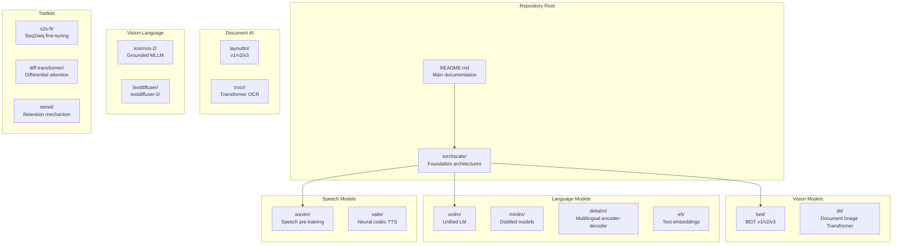
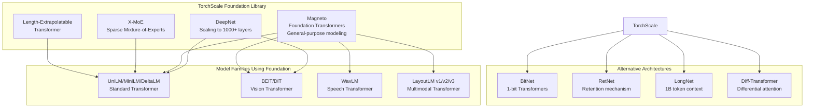
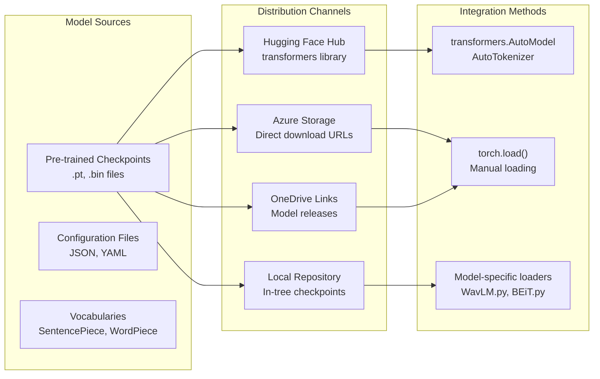
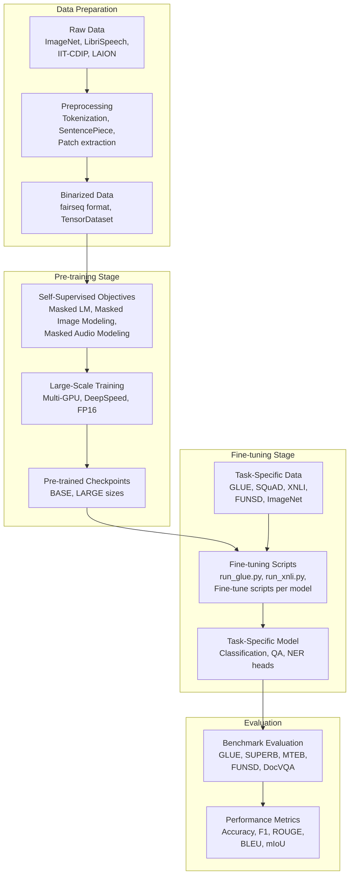
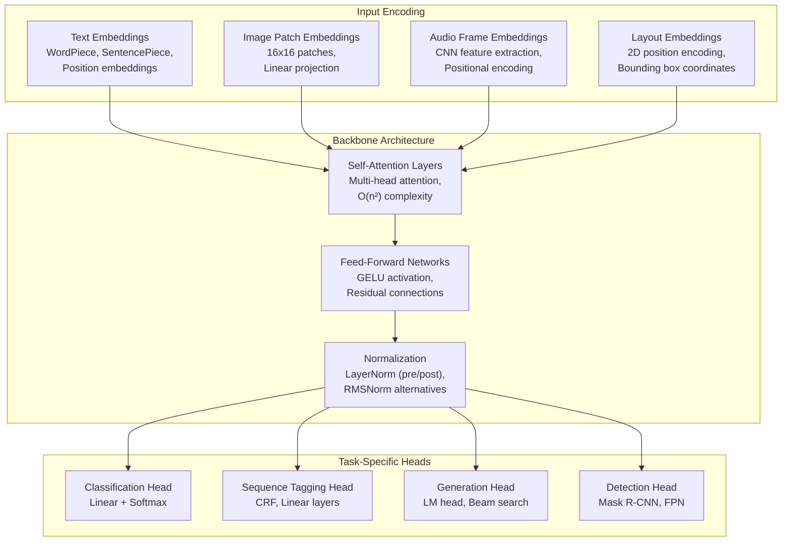

<!-- source: DeepWiki mcp.deepwiki.com · repo microsoft/unilm · page 1 Overview · fetched 2026-10-26 -->

# Overview

<details>
<summary>Relevant source files</summary>

The following files were used as context for generating this wiki page:

- [README.md](README.md)
- [deltalm/README.md](deltalm/README.md)
- [minilm/README.md](minilm/README.md)
- [minilm/examples/run_xnli.py](minilm/examples/run_xnli.py)
- [valle/README.md](valle/README.md)
- [wavlm/ASR.PNG](wavlm/ASR.PNG)
- [wavlm/README.md](wavlm/README.md)
- [wavlm/SUPERB_Results.png](wavlm/SUPERB_Results.png)
- [wavlm/screenshot.png](wavlm/screenshot.png)

</details>


The Microsoft UniLM repository is a collection of foundation models for large-scale self-supervised pre-training across natural language understanding (NLU), natural language generation (NLG), computer vision, speech processing, and multimodal AI tasks. The repository provides pre-trained models, training code, fine-tuning scripts, and evaluation benchmarks spanning 100+ languages and multiple modalities (text, images, audio, document layout).

This page provides a high-level overview of the repository's structure, model families, and architectural components. For specific model architectures and training details, see the individual model pages listed in sections 2-6. For the foundational scaling infrastructure (TorchScale, DeepNet, Magneto), see [Foundation Architectures](#1.1).

## Repository Scope and Model Categories

The repository contains six primary categories of models, each organized in dedicated subdirectories:

**Vision Models** ([BEiT](#2.1), [DiT](#2.2)): Self-supervised pre-training for image transformers using masked image modeling. BEiT targets general vision tasks (classification, segmentation), while DiT specializes in document image understanding.

**Language Models** ([UniLM](#3.1), [MiniLM](#3.2), [DeltaLM](#3.3), [E5](#3.4)): Unified pre-training for NLU and NLG tasks, including knowledge distillation approaches (MiniLM), multilingual translation (DeltaLM), and text embeddings (E5).

**Speech Models** ([WavLM](#4.1), [VALL-E](#4.2)): Pre-training for full-stack speech processing including ASR, speaker verification, and speech synthesis using neural codec language models.

**Document AI Models** ([LayoutLM series](#5.1-5.3), [TrOCR](#5.4)): Multimodal models combining text, layout, and visual information for document understanding tasks (forms, receipts, PDFs) and optical character recognition.

**Vision-Language Models** ([Kosmos-2](#6.1), [TextDiffuser](#6.2-6.3)): Models that ground language in visual contexts for tasks like phrase grounding, image captioning, and text-to-image generation with accurate text rendering.

**Toolkits and Infrastructure** ([s2s-ft](#7.1), [Diff-Transformer](#7.2), [RetNet](#7.3), TorchScale): Supporting frameworks for sequence-to-sequence fine-tuning, alternative attention mechanisms, and foundation architecture components.

Sources: [README.md:1-258]()

## Repository Structure and Code Organization

The repository follows a flat directory structure where each model family has its own top-level directory containing model code, configuration files, pre-trained checkpoints, and fine-tuning scripts.



**Directory-to-Model Mapping**:
- `beit/`, `beit2/`, `beit3/`: Vision pre-training models
- `dit/`: Document image transformer
- `unilm/`, `unilm-v1/`: Unified language model versions
- `minilm/`: Knowledge distillation models with reduced parameters
- `deltalm/`: Encoder-decoder for 100+ languages
- `e5/`: Text embedding models evaluated on MTEB/BEIR
- `wavlm/`: Speech representation learning
- `valle/`: Text-to-speech synthesis
- `layoutlm/`, `layoutlmv2/`, `layoutlmv3/`, `layoutxlm/`: Multimodal document understanding
- `trocr/`: OCR with vision transformers and text decoders
- `kosmos-2/`, `kosmos-2.5/`: Multimodal large language models
- `textdiffuser/`, `textdiffuser-2/`: Diffusion models for text rendering
- `s2s-ft/`: Fine-tuning toolkit for sequence-to-sequence tasks
- `diff-transformer/`: Alternative attention mechanism implementations
- `retnet/`: Retention-based architecture as Transformer alternative

Sources: [README.md:1-258]()

## Foundation Architecture and Shared Components

The repository's models build upon shared architectural innovations provided by the TorchScale library, which implements core components for scaling transformers to thousands of layers while maintaining training stability and efficiency.



**Core Components**:
- **DeepNet**: Post-normalization architecture enabling stable training of 1,000+ layer transformers
- **Magneto (Foundation Transformers)**: Sub-layer normalization with weight initialization for true general-purpose modeling across tasks/modalities
- **X-MoE**: Scalable and fine-tunable sparse mixture-of-experts with efficient routing
- **Length Extrapolation**: Position encoding and attention mechanisms supporting context lengths beyond training data

**Alternative Architectures**:
- **BitNet**: 1-bit quantized transformers for extreme efficiency
- **RetNet**: Retention mechanism as alternative to attention with improved stability
- **LongNet**: Dilated attention patterns supporting 1 billion token contexts
- **Diff-Transformer**: Differential attention mechanism with noise cancellation properties

These components are implemented as reusable modules that can be composed to build new models. The TorchScale library is maintained separately at `https://github.com/microsoft/torchscale`.

Sources: [README.md:6-25]()

## Model Hosting and Distribution

Pre-trained models are distributed through multiple channels depending on the model family:



**Hugging Face Integration**: Most models (BEiT, LayoutLM series, TrOCR, MiniLM) are available via the `transformers` library:
```python
from transformers import AutoModel, AutoTokenizer
tokenizer = AutoTokenizer.from_pretrained("microsoft/MiniLM-L12-H384-uncased")
model = AutoModel.from_pretrained("microsoft/MiniLM-L12-H384-uncased")
```

**Direct Download**: Models like WavLM and DeltaLM provide direct download links via Azure Storage or Google Drive for checkpoint files, vocabularies, and SentencePiece models.

**Model-Specific Loaders**: Some models (WavLM, VALL-E) provide custom loading code:
```python
from WavLM import WavLM, WavLMConfig
checkpoint = torch.load('/path/to/wavlm.pt')
cfg = WavLMConfig(checkpoint['cfg'])
model = WavLM(cfg)
```

Sources: [README.md:149-157](), [wavlm/README.md:17-49](), [minilm/README.md:42-54]()

## Pre-training and Fine-tuning Pipeline

The typical workflow for using models in this repository follows a multi-stage pipeline from pre-training to downstream task evaluation:



**Pre-training Objectives by Modality**:
- **Language**: Masked Language Modeling (UniLM, MiniLM), Pseudo-Masked LM (UniLM v2), Encoder-decoder objectives (DeltaLM)
- **Vision**: Masked Image Modeling with DALL-E tokenizer (BEiT), Visual token prediction (DiT)
- **Speech**: Masked Audio Modeling with utterance mixing (WavLM), Denoising objectives
- **Multimodal**: Joint text-image masking (LayoutLMv3), Word-patch alignment (LayoutLMv3), Cross-modal objectives

**Fine-tuning Tools**:
- Language models use standard `transformers` fine-tuning scripts with task-specific heads
- Vision models integrate with detectron2/MMDetection for object detection tasks
- The `s2s-ft` toolkit provides specialized support for sequence-to-sequence generation tasks
- Models support parameter-efficient fine-tuning via LoRA adapters where applicable

**Training Infrastructure**:
- Multi-GPU training with PyTorch DistributedDataParallel
- Mixed precision (FP16/BF16) via NVIDIA Apex or PyTorch AMP
- DeepSpeed integration for large models
- Gradient checkpointing for memory efficiency

Sources: [README.md:96-109](), [minilm/examples/run_xnli.py:1-463](), [deltalm/README.md:34-153]()

## Cross-Model Architectural Patterns

Despite diversity in modalities, models in the repository share common architectural patterns and components:



**Shared Components Across Models**:
1. **Transformer Backbone**: 12-layer (BASE) or 24-layer (LARGE) transformer encoder/decoder
2. **Position Encoding**: Learned absolute positions (UniLM, MiniLM), relative position bias (BEiT, WavLM), 2D position for documents (LayoutLM)
3. **Attention Mechanisms**: Standard multi-head self-attention with optional modifications (gated relative position in WavLM, window attention in BEiT)
4. **Normalization**: Pre-normalization (newer models) or post-normalization (older models), with LayerNorm as default
5. **Activation Functions**: GELU activation in feed-forward networks
6. **Residual Connections**: Standard residual connections around attention and FFN layers

**Model Size Conventions**:
- BASE: 12 layers, 768 hidden size, 12 attention heads (~110M parameters)
- LARGE: 24 layers, 1024 hidden size, 16 attention heads (~340M parameters)
- Efficient variants: 6/12 layers, 384 hidden size (MiniLM: 22M-33M parameters)

**Vocabulary and Tokenization**:
- English models: WordPiece vocabulary (BERT-style, 30K tokens)
- Multilingual models: SentencePiece unigram model (XLM-R style, 250K tokens)
- Vision models: Image patches as "visual tokens" (16×16 pixels)
- Speech models: Audio frames as input (25ms windows, 10ms stride)

Sources: [README.md:44-95](), [wavlm/README.md:1-135](), [minilm/README.md:1-287]()

## Evaluation Benchmarks and Performance

Models in the repository are evaluated on standardized benchmarks across modalities:

| Modality | Model | Primary Benchmarks | Metrics |
|----------|-------|-------------------|---------|
| **Language** | UniLM, MiniLM, DeltaLM, E5 | GLUE, SuperGLUE, XNLI, WMT, MTEB | Accuracy, F1, BLEU, NDCG |
| **Vision** | BEiT, DiT | ImageNet, COCO, ADE20K, RVL-CDIP | Top-1 Acc, mIoU, mAP |
| **Speech** | WavLM | SUPERB, LibriSpeech, VoxCeleb | WER, EER, Acc |
| **Document AI** | LayoutLM, TrOCR | FUNSD, XFUND, DocVQA, SROIE | F1, EM, CER, WER |
| **Vision-Language** | Kosmos-2, TextDiffuser | VQA, COCO Captions, Referring Expr | Acc, CIDEr, Recall@K |

**Key Benchmark Datasets**:
- **GLUE/SuperGLUE**: General language understanding (8-10 NLU tasks)
- **XNLI**: Cross-lingual natural language inference (15 languages)
- **SUPERB**: Speech processing benchmark (10 tasks including ASR, speaker ID, emotion)
- **MTEB**: Massive text embedding benchmark (56 datasets, 8 task types)
- **FUNSD/XFUND**: Form understanding in 7-8 languages
- **DocVQA**: Document visual question answering
- **SROIE**: Scanned receipt OCR and information extraction

Model cards and detailed results are available in individual model directories and on the Hugging Face Hub.

Sources: [README.md:115-168](), [wavlm/README.md:53-106](), [minilm/README.md:59-238]()

---

