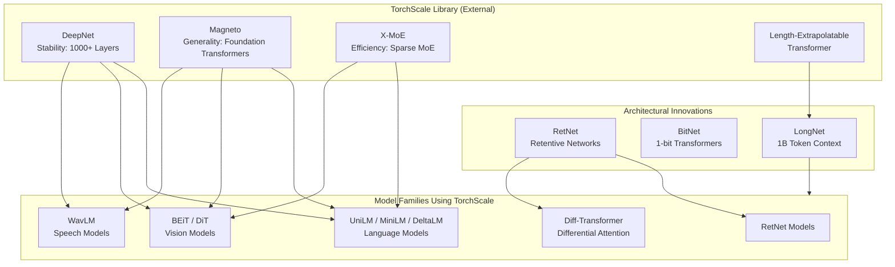
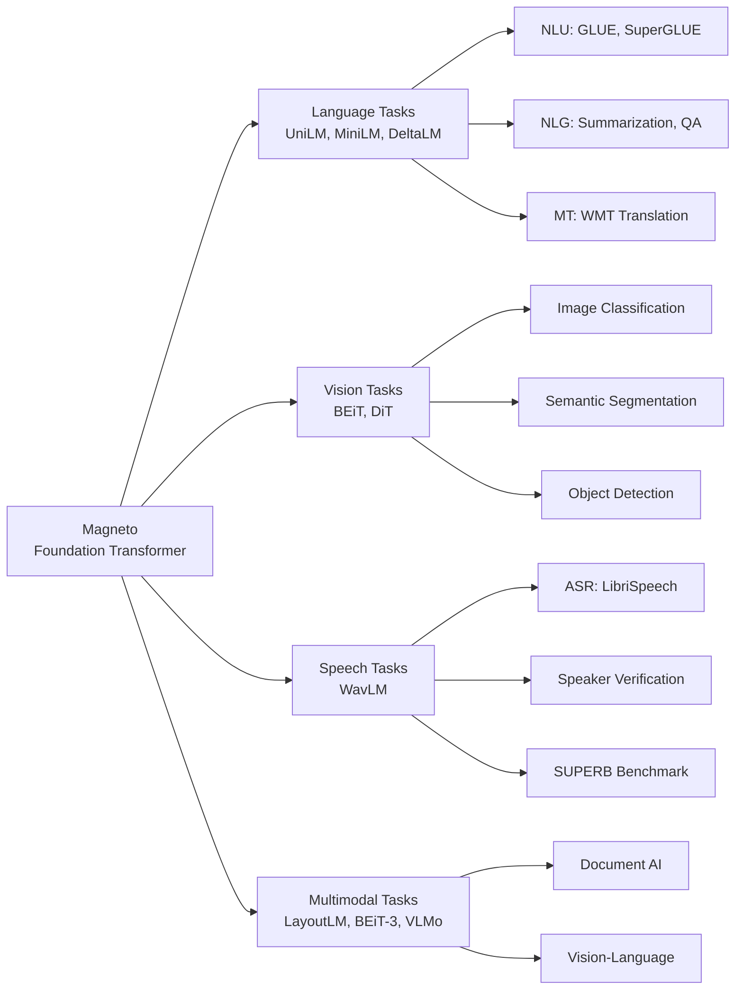
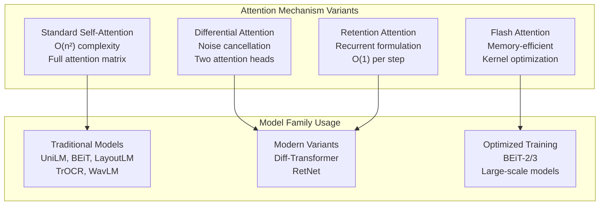
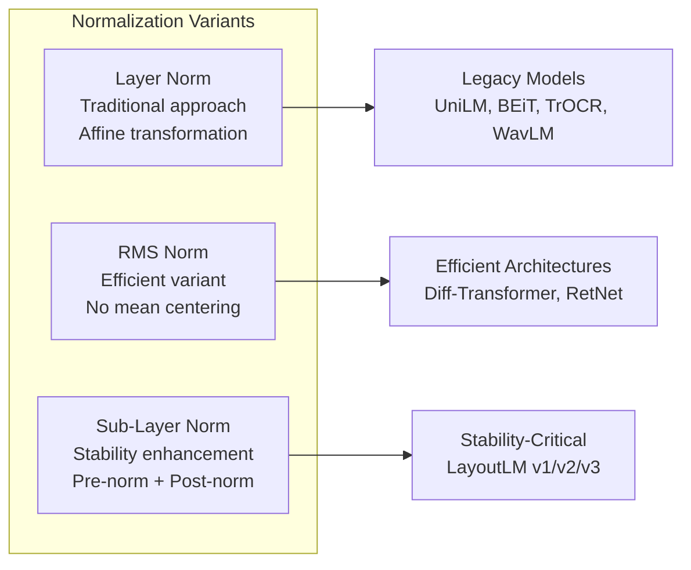
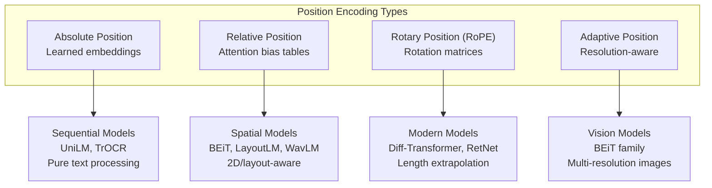
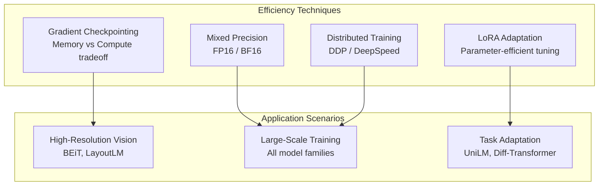
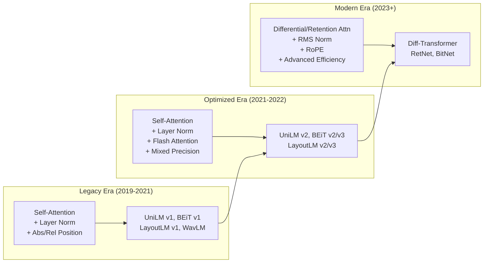

<!-- source: DeepWiki mcp.deepwiki.com · repo microsoft/unilm · page 1.1 Foundation Architectures · fetched 2026-10-26 -->

# Foundation Architectures

Relevant source files

The following files were used as context for generating this wiki page:

- [README.md](README.md)
- [deltalm/README.md](deltalm/README.md)
- [minilm/README.md](minilm/README.md)
- [minilm/examples/run_xnli.py](minilm/examples/run_xnli.py)
- [valle/README.md](valle/README.md)
- [wavlm/ASR.PNG](wavlm/ASR.PNG)
- [wavlm/README.md](wavlm/README.md)
- [wavlm/SUPERB_Results.png](wavlm/SUPERB_Results.png)
- [wavlm/screenshot.png](wavlm/screenshot.png)

## Purpose and Scope

This document describes the **TorchScale** library and foundational architectural components that enable scaling across all model families in the UniLM repository. TorchScale provides the underlying building blocks for stability (DeepNet), generality (Magneto), efficiency (X-MoE), and architectural innovations (RetNet, BitNet, LongNet) that support language, vision, speech, and multimodal models.

For specific model implementations that use these foundations, see language models ([3](#3)), vision models ([2](#2)), speech models ([4](#4)), and multimodal models ([5](#5), [6](#6)).

---

## TorchScale: Foundation Architecture Library

**TorchScale** is an external library (https://github.com/microsoft/torchscale) that provides fundamental research on architectures for foundation models and AI. It focuses on:

- **Modeling Generality and Capability**: Architectures that work across tasks, languages, and modalities
- **Training Stability**: Techniques to scale Transformers to unprecedented depths
- **Training Efficiency**: Methods to reduce computational cost and improve transferability

TorchScale serves as the foundation layer that flows into multiple model families including UniLM, BEiT, WavLM, Diff-Transformer, and RetNet.

**Sources:** [README.md:6-26]()

---

## Stability: DeepNet

**DeepNet** provides architectural modifications to scale Transformers to **1,000+ layers** and beyond. Traditional Transformers suffer from training instability and gradient issues when scaled to extreme depths. DeepNet introduces stability techniques that enable:

- Deep pre-training for improved representation learning
- Stable gradient flow through hundreds of layers
- Foundation for models requiring high capacity

### Impact on Model Families

DeepNet's stability improvements are critical for:
- **UniLM**: Enables deeper encoder-decoder architectures for language understanding/generation
- **BEiT**: Supports deep vision transformers for self-supervised image pre-training
- **WavLM**: Allows deep speech processing models trained on 94k hours of audio

**Sources:** [README.md:11]()

---

## Generality: Magneto (Foundation Transformers)

**Magneto** (Foundation Transformers) provides architectural designs for **true general-purpose modeling** across:
- **Tasks**: Classification, generation, translation, retrieval
- **Modalities**: Language, vision, speech, multimodal fusion
- **Languages**: 100+ languages supported

### Key Architectural Principles

Magneto unifies model architectures to enable parameter sharing and transfer learning across diverse tasks without requiring modality-specific modifications. This allows models like BEiT-3 to achieve "The Big Convergence" - a single architecture for all tasks and modalities.

**Sources:** [README.md:13]()

---

## Efficiency and Transferability: X-MoE

**X-MoE** (Scalable Mixture-of-Experts) provides **sparse computation** through gated expert routing:

- **Scalability**: Increases model capacity without proportional compute cost
- **Fine-tunable**: Unlike some MoE approaches, X-MoE models can be efficiently fine-tuned
- **Transferability**: Supports transfer learning across tasks and domains

### Technical Approach

X-MoE replaces dense feed-forward networks with sparse expert layers:
- Each input token is routed to a subset of expert networks
- Only active experts perform computation
- Enables 10x+ model capacity increase with manageable compute costs

This approach is particularly valuable for:
- **UniLM variants**: Scaling language models while controlling training costs
- **BEiT variants**: Increasing vision model capacity for diverse visual tasks

**Sources:** [README.md:17]()

---

## Architectural Innovations

### RetNet: Retentive Networks

**RetNet** provides an alternative to standard Transformers using **retention mechanisms** instead of attention:

- **Training Efficiency**: O(1) complexity per step during training (vs O(n) for attention)
- **Inference Efficiency**: Constant-time decoding with linear complexity
- **Performance**: Competitive with Transformers while being more efficient

RetNet is positioned as a "Successor to Transformer for Large Language Models" and is explored in section [7.3](#7.3).

### BitNet: 1-bit Transformers

**BitNet** quantizes model weights to **1-bit representations**:

- Extreme compression for Large Language Models
- Reduces memory footprint by ~32x (vs FP32)
- Enables deployment on resource-constrained devices
- Maintains competitive performance through training techniques

### LongNet: Extreme Context Length

**LongNet** scales Transformers to **1,000,000,000 tokens** of context:

- Dilated attention mechanisms for long-range dependencies
- Enables processing of entire codebases, books, or long videos
- Foundation for long-context applications

**Sources:** [README.md:19-26]()

---

## Core Architectural Components

All models in the repository are built from shared architectural components that can be composed in different ways. This section catalogs the building blocks and their usage patterns.

### Attention Mechanisms

| Attention Type | Complexity | Models | Key Benefit |
|---|---|---|---|
| Standard Self-Attention | O(n²) | UniLM, BEiT, LayoutLM, TrOCR, WavLM | Proven architecture, wide compatibility |
| Differential Attention | O(n²) | Diff-Transformer | Improved signal-to-noise ratio |
| Retention Attention | O(1) per step | RetNet | Training efficiency, constant inference |
| Flash Attention | O(n²) optimized | BEiT-2/3, Diff-Transformer | Memory efficiency for large-scale training |

### Normalization Strategies

Different model families use different normalization approaches based on their architectural vintage and requirements:

| Normalization | Computation | Models | Design Rationale |
|---|---|---|---|
| Layer Norm | Mean + Variance | UniLM, BEiT, TrOCR, WavLM | Standard choice for most Transformers |
| RMS Norm | RMS only (no mean) | Diff-Transformer, RetNet | ~10% faster, modern efficient architectures |
| Sub-Layer Norm | Dual normalization | LayoutLM family | Extra stability for multimodal fusion |

### Position Encoding

Position encoding strategies vary based on the nature of input data (sequential text, 2D images, 1D audio):

| Position Type | Models | Input Type | Implementation |
|---|---|---|---|
| Absolute Position | UniLM, TrOCR | Sequential text | Learned embeddings added to input |
| Relative Position | BEiT, LayoutLM, WavLM | 2D images, spatial data | Bias added to attention scores |
| RoPE (Rotary) | Diff-Transformer, RetNet | Modern architectures | Rotation-based, extrapolatable |
| Adaptive Position | BEiT | Multi-resolution images | Resolution-aware interpolation |

**Sources:** [README.md:1-260](), Diagram 5 from system architecture analysis

---

## Efficiency Techniques

All modern models in the repository employ combinations of efficiency techniques during training and deployment:

### Gradient Checkpointing

- **Purpose**: Trade computation for memory
- **Mechanism**: Recompute intermediate activations during backward pass instead of storing them
- **Used by**: BEiT, LayoutLM (necessary for high-resolution images and long documents)

### Mixed Precision Training (FP16/BF16)

- **Purpose**: Accelerate training on Tensor Core GPUs
- **Mechanism**: Use 16-bit floats for forward/backward, 32-bit for updates
- **Used by**: BEiT, LayoutLM, Diff-Transformer, most large-scale models

### Distributed Training

**Data Parallel (DDP)**:
- Replicate model across GPUs
- Each GPU processes different batch
- Used by: UniLM, BEiT for standard training

**DeepSpeed**:
- ZeRO optimizer for model parallelism
- Pipeline parallelism for very large models
- Used by: Large variants of all model families

### LoRA Fine-tuning

- **Purpose**: Parameter-efficient adaptation
- **Mechanism**: Low-rank adaptation matrices added to frozen base model
- **Used by**: UniLM, Diff-Transformer for efficient task-specific tuning

**Sources:** [README.md:137](), [wavlm/README.md:1-135](), [minilm/README.md:1-287]()

---

## Component Reuse Patterns Across Model Families

The following table shows how different model families compose the core architectural components:

| Model Family | Attention | Normalization | Position Encoding | Key Features |
|---|---|---|---|---|
| **UniLM / MiniLM / DeltaLM** | Self-Attention | Layer Norm | Absolute | Standard BERT-style, text-focused |
| **BEiT / DiT** | Self-Attention | Layer Norm | Relative + Adaptive | Vision Transformers, resolution-aware |
| **Diff-Transformer** | Differential Attn | RMS Norm | RoPE | Modern efficient architecture |
| **RetNet** | Retention Attn | RMS Norm | RoPE | Recurrent alternative, training efficiency |
| **LayoutLM v1/v2/v3** | Self-Attention | Sub-Layer Norm | Relative | Multimodal stability, spatial awareness |
| **TrOCR** | Self-Attention | Layer Norm | Absolute | Encoder-decoder for OCR |
| **WavLM** | Self-Attention | Layer Norm | Relative | Speech-specific, temporal modeling |

### Architecture Evolution Pattern

### Design Philosophy

The component reuse pattern follows a clear philosophy:

1. **Proven Components First**: New models start with battle-tested components (standard self-attention, layer norm)
2. **Incremental Innovation**: Models add targeted innovations (Flash Attention for memory, differential attention for signal quality)
3. **Efficiency Focus**: Modern models prioritize efficiency (RMS Norm over Layer Norm, retention over attention)
4. **Task-Specific Adaptations**: Components chosen based on input characteristics (relative position for spatial data, absolute for pure text)

**Sources:** [README.md:1-260](), Diagram 5 from system architecture analysis

---

## Integration with Model Families

### Language Models

Language models (UniLM, MiniLM, DeltaLM) leverage:
- **DeepNet**: Stability for deep encoder-decoder architectures
- **Magneto**: General-purpose design supporting both NLU and NLG
- **X-MoE**: Efficient scaling for large vocabularies (100+ languages)
- **Standard Components**: Self-attention, Layer Norm, Absolute Position (proven for text)

See [3](#3) for detailed language model documentation.

### Vision Models

Vision models (BEiT, DiT) leverage:
- **DeepNet**: Deep architectures for hierarchical visual representations
- **Magneto**: Unified design for classification, detection, segmentation
- **Adaptive Position Encoding**: Handle variable image resolutions
- **Flash Attention**: Memory-efficient processing of high-resolution images

See [2](#2) for detailed vision model documentation.

### Speech Models

Speech models (WavLM) leverage:
- **DeepNet**: Deep processing of temporal audio features
- **Relative Position**: Capture temporal relationships in speech
- **Magneto**: General design for ASR, speaker verification, speech separation

See [4](#4) for detailed speech model documentation.

### Multimodal Models

Multimodal models (LayoutLM, TrOCR, Kosmos) leverage:
- **Magneto**: Core design supporting fusion of text, layout, image modalities
- **Sub-Layer Norm**: Extra stability for multimodal fusion (LayoutLM)
- **Mixed Components**: Combine vision encoders (relative position) with text decoders (absolute position)

See [5](#5) and [6](#6) for detailed multimodal model documentation.

**Sources:** [README.md:6-96](), [wavlm/README.md:1-15](), [minilm/README.md:1-50](), [deltalm/README.md:1-20]()

---

